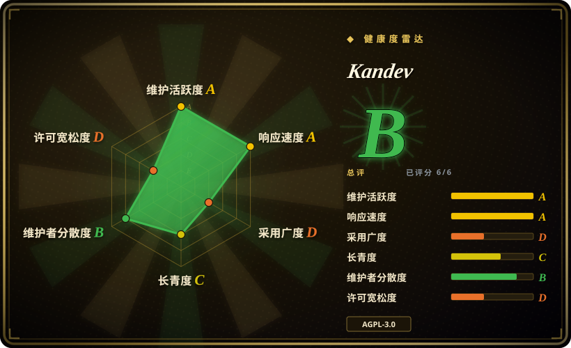
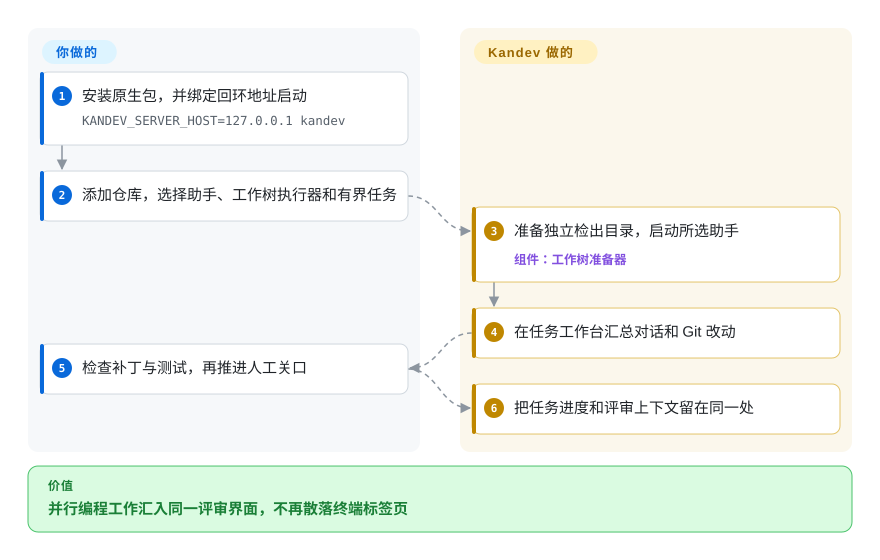
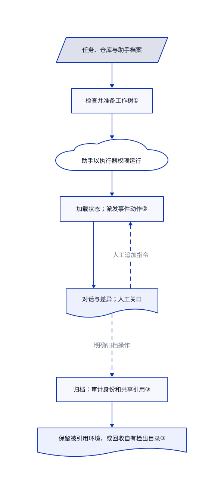

# Kandev

三个编程助手分别改完分支，你还得切换终端找待审补丁。Kandev 把每项任务的对话、工作区、差异和评审步骤放进同一个浏览器工作台。

## 何时使用

你维护多个仓库，同时让 Claude Code、Codex 等编程助手干活。一项任务要先批准方案，另一项任务要围绕代码差异补改。你想把交接记成明确的任务步骤，不再靠记住终端标签页。需要可自托管的评审工作台、可配置的阶段动作，以及本机工作树、容器或远程执行器时，选 Kandev；只想镜像已有命令行会话或只要桌面监管器时，不必引入整套任务生命周期。

你提供仓库、助手凭据和验收标准。Kandev 准备执行环境，并汇总对话、编辑器、终端和 Git 改动。保留由人控制的评审步骤：助手结束一轮，不代表测试通过，更不代表允许合并。本页核读主线提交 `b6263ea4c3165c86ec60e29e798475ad552ad6ce`，它晚于最新稳定版。

## 何时不用

- **你只想用手机访问一个已有命令行会话。** 优先选 [CloudCLI](claudecodeui.zh.md)。任务工作流、执行器配置和环境回收会增加不必要的管理成本。
- **你要宽松许可证的桌面并行监管器。** 优先选 [Agent Orchestrator](agent-orchestrator.zh.md)。Kandev 的 npm 清单明确采用 AGPL-3.0-only；[真实许可](https://github.com/kdlbs/kandev/blob/b6263ea4c3165c86ec60e29e798475ad552ad6ce/LICENSE#L540-L559)要求修改后的网络交互版本向远程用户提供对应源码。
- **你要常驻业务团队、周期任务与预算，而非代码分支评审。** 对比 [Paperclip](paperclip.zh.md)。Kandev 的 Office 自治层仍属实验功能，生产默认关闭，不应当作成熟的组织管理合同。
- **你要防范恶意代码的执行隔离。** 从 [OpenSandbox](../../../sandboxing/opensandbox.zh.md) 等执行平台开始，并核验配置后的隔离。Kandev 工作树只隔开代码状态，不隔离宿主凭据、进程和网络。[安全指南](https://github.com/kdlbs/kandev/blob/b6263ea4c3165c86ec60e29e798475ad552ad6ce/docs/public/security.md#L19-L56)明确默认监听 `0.0.0.0`，身份验证须主动开启；不要直接发布默认实例。

## 横向对比

| 替代品 | 是否收录 | 我们的评价 | 取舍 |
|---|---|---|---|
| [Agent Orchestrator](agent-orchestrator.zh.md) | 已收录 | 要桌面工作树监管与 CI／评审反馈路由，选它；要自托管浏览器工作台和可配置远程执行器，选 Kandev。 | 桌面包装与 Apache-2.0，对比需要自己运营网络和执行边界的服务端 AGPL 应用。 |
| [CloudCLI](claudecodeui.zh.md) | 已收录 | 要远程访问已有编程会话，选它；要任务自带流程步骤、评审关口和执行环境，选 Kandev。 | 减少任务生命周期管理，换取集成任务看板、环境准备与分支评审。 |
| [Paperclip](paperclip.zh.md) | 已收录 | 要按心跳运行、带预算的常驻助手组织，选它；要在编程工作台检查补丁，选 Kandev。 | 组织级控制，对比对话、差异与逐任务执行器；Kandev Office 仍是实验功能。 |

## 快速上手

README 给出 `brew install kdlbs/kandev/kandev`；安装后按安全指南用 `KANDEV_SERVER_HOST=127.0.0.1 kandev` 启动，主动收窄监听范围。在浏览器添加工作区仓库，配置兼容的助手档案，并自行提供模型访问凭据。创建范围明确的任务，选择 Worktree 执行器，再启动助手；工作树是独立检出目录，不是安全沙箱。Kandev 准备工作区并展示执行和差异，你负责测试及是否推进任务。把评审步骤设为等待用户，归档前提交并推送重要成果，因为归档清理也会删除忽略文件和未跟踪文件。本轮只读文档与源码，没有安装或运行这条流程。

<!-- flow-steps:begin (generated from flows/kandev.json by tools/flow_card.py — do not edit) -->

流程文字版

1. **你**：安装原生包，并绑定回环地址启动 — `KANDEV_SERVER_HOST=127.0.0.1 kandev`
2. **你**：添加仓库，选择助手、工作树执行器和有界任务
3. **Kandev**：准备独立检出目录，启动所选助手 — 组件：`工作树准备器`
4. **Kandev**：在任务工作台汇总对话和 Git 改动
5. **你**：检查补丁与测试，再推进人工关口
6. **Kandev**：把任务进度和评审上下文留在同一处

**价值**：并行编程工作汇入同一评审界面，不再散落终端标签页

<!-- flow-steps:end -->

## 技术要点

<!-- mechanism:begin (generated from mechanisms/kandev.json by tools/mechanism_card.py; do not edit) -->

机制文字版

- 任务、仓库与助手档案
- 检查并准备工作树①
- 助手以执行器权限运行
- 加载状态；派发事件动作②
- 对话与差异；人工关口
- 归档：审计身份和共享引用③
- 保留被引用环境，或回收自有检出目录③

- 任务、仓库与助手档案 → 检查并准备工作树①
- 检查并准备工作树① → 助手以执行器权限运行
- 助手以执行器权限运行 → 加载状态；派发事件动作②
- 加载状态；派发事件动作② → 对话与差异；人工关口
- 对话与差异；人工关口 → 加载状态；派发事件动作②（人工追加指令）〔可选／兜底〕
- 对话与差异；人工关口 → 归档：审计身份和共享引用③（明确归档操作）〔可选／兜底〕
- 归档：审计身份和共享引用③ → 保留被引用环境，或回收自有检出目录③

<!-- mechanism:end -->

### 1. 先准备任务环境，再启动助手

- **解决：** 多个助手共用检出目录，会互相干扰分支和文件。
- **做法：** 工作树准备器检查仓库，交给管理器创建检出目录，再向运行时返回路径、分支和身份。多仓库任务为每个附件记录工作树，部分失败时尝试回滚。
- **边界：** 这只隔离代码状态。仓库准备脚本在宿主运行；准备失败可仅提示警告，助手仍会启动；多仓库准备路径跳过执行器档案中的任务级准备脚本。
- **源码：** [准备与返回身份](https://github.com/kdlbs/kandev/blob/b6263ea4c3165c86ec60e29e798475ad552ad6ce/apps/backend/internal/agent/runtime/lifecycle/env_preparer_worktree.go#L58-L177)、[多仓库准备](https://github.com/kdlbs/kandev/blob/b6263ea4c3165c86ec60e29e798475ad552ad6ce/apps/backend/internal/agent/runtime/lifecycle/env_preparer_worktree.go#L431-L565)、[不阻断启动的仓库准备失败](https://github.com/kdlbs/kandev/blob/b6263ea4c3165c86ec60e29e798475ad552ad6ce/apps/backend/internal/worktree/manager_cleanup.go#L418-L465)。

### 2. 用持久任务状态和事件驱动流程

- **解决：** 助手结束一轮，与人批准下一步是不同事件，纯终端记录容易混淆。
- **做法：** 引擎加载任务、会话和步骤，按触发事件选择动作，执行回调并保存数据和迁移。传入操作标识时会跳过已记录完成的操作；仅评估的迁移把完成标记交给真正负责提交的调用方。
- **边界：** 操作标记不等于命令恰好执行一次，也不证明代码质量。推进由流程配置决定；人工关口要明确等待用户，不能在助手完成一轮后自动前进。
- **源码：** [触发处理与延后标记](https://github.com/kdlbs/kandev/blob/b6263ea4c3165c86ec60e29e798475ad552ad6ce/apps/backend/internal/workflow/engine/engine.go#L267-L424)、[动作求值](https://github.com/kdlbs/kandev/blob/b6263ea4c3165c86ec60e29e798475ad552ad6ce/apps/backend/internal/workflow/engine/engine.go#L452-L515)、[人工关口配置](https://github.com/kdlbs/kandev/blob/b6263ea4c3165c86ec60e29e798475ad552ad6ce/docs/public/security.md#L157-L171)。

### 3. 回收前检查所有权和共享引用

- **解决：** 任务可能共用环境或留有未发布成果，只按界面显示路径删除可能误伤别的任务。
- **做法：** 清理先复制工作树记录，再取得路径锁和仓库锁，检查清单身份、活跃引用和保留规则，通过审计后才执行仓库清理脚本和删除。仍被引用的工作树会保留，完成后记录分支清理回执。
- **边界：** 所有权保护不等于保留全部本地改动。归档明确丢弃自有工作树中的已暂存、未暂存、未跟踪和忽略文件。清理脚本失败不阻止删除；归档成功与后台资源清理完成是两回事。
- **源码：** [清理审计与引用保留](https://github.com/kdlbs/kandev/blob/b6263ea4c3165c86ec60e29e798475ad552ad6ce/apps/backend/internal/worktree/manager_cleanup.go#L244-L381)、[清理脚本](https://github.com/kdlbs/kandev/blob/b6263ea4c3165c86ec60e29e798475ad552ad6ce/apps/backend/internal/worktree/manager_cleanup.go#L468-L503)、[归档数据丢失合同](https://github.com/kdlbs/kandev/blob/b6263ea4c3165c86ec60e29e798475ad552ad6ce/docs/public/tasks-and-workflows.md#L1078-L1111)。

## 技术栈

- Go 1.26 后端，清单包含 Gin、WebSocket、ACP 集成、SQLite 和可选 PostgreSQL 支持。
- React 19、TypeScript、Vite、Zustand、Monaco／CodeMirror 与 xterm 前端；编译资源嵌入原生 Go 发行包。另有 Tauri 桌面壳及 npm 原生运行时选择器。
- 来源：[Go 清单](https://github.com/kdlbs/kandev/blob/b6263ea4c3165c86ec60e29e798475ad552ad6ce/apps/backend/go.mod)、[前端清单](https://github.com/kdlbs/kandev/blob/b6263ea4c3165c86ec60e29e798475ad552ad6ce/apps/web/package.json)、[发行形态](https://github.com/kdlbs/kandev/blob/b6263ea4c3165c86ec60e29e798475ad552ad6ce/README.md#L24-L34)。

## 依赖

- 原生应用包、Git、可写状态目录，以及已认证的受支持助手运行时。模型订阅和 API 费用由你承担。原生服务器不需要 Node，通过 npm／npx 启动才需要。
- 只在相应执行模式下需要 Docker、Kubernetes、SSH 或 Sprites 基础设施。其凭据与 Kandev 应用登录是不同边界。
- 默认状态目录为 `~/.kandev`，含工作树和 SQLite。备份数据库及配套密钥时，要单独控制访问。
- 源码构建需要 Go 1.26.0、Node 24 和 pnpm 9.15.9。开发初始化脚本可安装系统包，下载并运行 mise 安装器，修改 shell 启动文件并配置 Git 钩子。仓库的 Claude 配置也会在编辑后运行格式化器；不要把源码初始化当作无副作用预览。见[初始化脚本](https://github.com/kdlbs/kandev/blob/b6263ea4c3165c86ec60e29e798475ad552ad6ce/scripts/bootstrap-dev-env)与[项目钩子](https://github.com/kdlbs/kandev/blob/b6263ea4c3165c86ec60e29e798475ad552ad6ce/.claude/settings.json)。

## 运维难度

**可信单机为中等，共享或远程执行更高。** 原生包减少服务器打包工作，但助手版本、模型费用、仓库脚本、凭据范围和遗留环境仍由你运营。明确绑定回环地址；开启身份验证只增加应用账号，不会变成操作系统沙箱。关闭验证时，[中间件](https://github.com/kdlbs/kandev/blob/b6263ea4c3165c86ec60e29e798475ad552ad6ce/apps/backend/internal/auth/httpmw/middleware.go#L33-L56)为所有可达请求赋予合成管理员身份。

停止、归档和删除的效果不同。工作树归档会回收自有本地改动；Local 保留文件夹；SSH 保留远程任务目录；云沙箱销毁可能丢掉未推送成果。清理失败不回滚归档，要检查遗留资源和费用。凭据应在供应商处撤销，而非只删配置。README 的无遥测声明也不等于离线：助手访问模型，集成访问代码平台，可选分享会把脱敏对话发布为秘密 GitHub Gist。秘密 Gist 仍是对外发布，不是私有存储。

## 健康度与可持续性

- **维护，截至 2026-10-26：** 未归档；最新稳定版 [v0.98.0](https://github.com/kdlbs/kandev/releases/tag/v0.98.0) 于 10 月 23 日发布，此前有 10 月 4 日的 v0.97.0 和 9 月 25 日的 v0.96.0。主线在 10 月 26 日仍有提交。开发活跃，但这不等于升级行为稳定。
- **治理与支持：** 规范仓库归 `kdlbs` Organization 所有，不是 fork。贡献者接口样本显示多人持续提交，carlosflorencio 和 jcfs 居前。[贡献政策](https://github.com/kdlbs/kandev/blob/b6263ea4c3165c86ec60e29e798475ad552ad6ce/CONTRIBUTING.md)要求人工维护者评审，大架构改动先讨论；固定版本完整树没有 GOVERNANCE、CODEOWNERS 或 SECURITY.md 文件。
- **年龄与持续性：** 2026 年 1 月 9 日建仓，核验时约九个半月。[推断：依据建仓时间和发布节奏] 活跃但尚未到 1.0，不能给予强 Lindy 持续性信用；先用于可恢复任务，再决定是否深度依赖。
- **采用证据，截至 2026-10-26：** 评分器测得 `kandev` 的 npm 月下载量为 3,805，采用轴为 D。多名贡献者与 [OpenCode 启动失败报告 #4793](https://github.com/kdlbs/kandev/issues/4793)证明存在社区互动，不证明生产部署成熟。集成和发行资产构成生态表面；下载量和健康汇总分都不能证明规模可靠性。
- **许可与风险：** [LICENSE](https://github.com/kdlbs/kandev/blob/b6263ea4c3165c86ec60e29e798475ad552ad6ce/LICENSE)为 AGPLv3，[CLI 清单](https://github.com/kdlbs/kandev/blob/b6263ea4c3165c86ec60e29e798475ad552ad6ce/apps/cli/package.json#L1-L10)明确 AGPL-3.0-only。默认全网卡监听、主动开启的身份验证、可执行仓库准备脚本及破坏性归档生命周期是采用前要核对的风险，不是拒绝收录理由。

## 存疑（未验证）

- [未验证：本轮未安装或运行上游] 没有复现助手兼容性、界面效果、吞吐、费用、清理恢复及跨平台运行。流程图表达文档路径，不是本机实测结果。
- [未验证：未抓包或执行完整安全审计] README 声称无遥测，但本轮没有证明零外发、完整凭据隔离或不存在漏洞。所读身份验证路径不代表全部 HTTP、WebSocket、MCP 和插件路由都已审计。
- [未验证：公开元数据不能证明融资或生产使用] 维护者资金、贡献指南之外的决策权和具名生产部署仍不清楚。组织账号与贡献人数不证明机构支持。
- [推断：依据建仓时间与活跃的早期版本发布] 保守的持续性判断是选型先验，不是在预测项目会停止维护。
- [未验证：本轮未搭建 OpenCode 复现环境] 10 月 26 日的 #4793 报告启动失败，不能直接断言所有运行时与档案都受影响。
