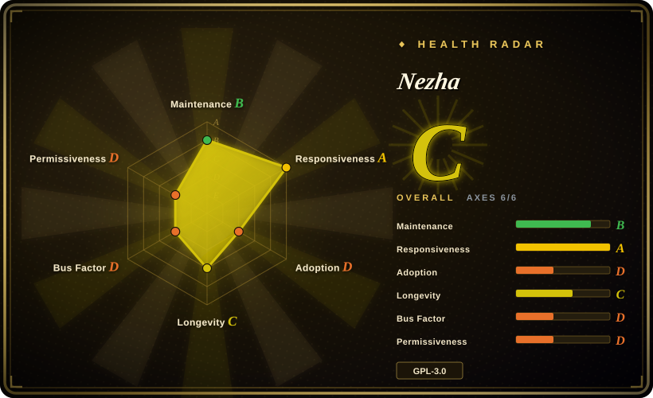
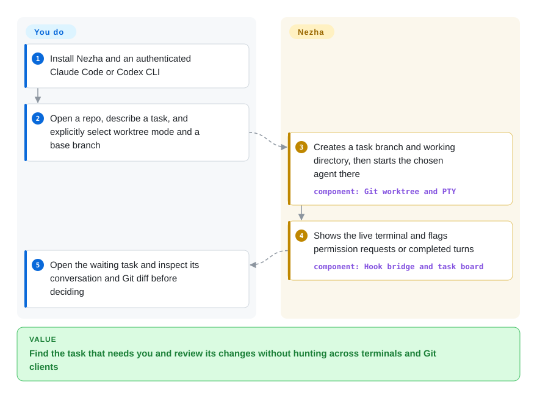
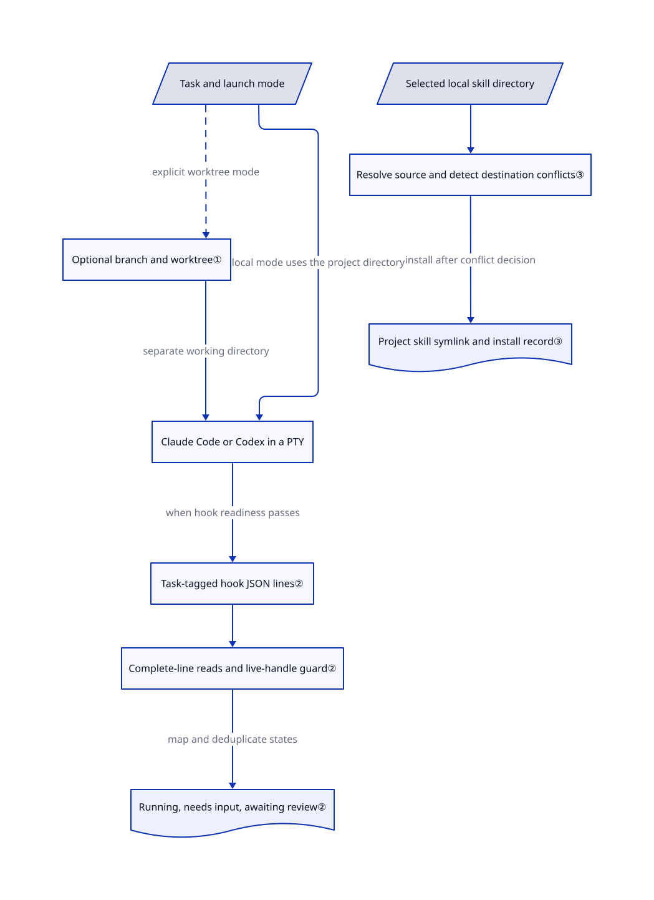

# Nezha

You keep switching between projects to find which coding agent needs permission, then open another tool to inspect its changes. Nezha puts Claude Code and Codex tasks, attention states, session history and Git diffs in one desktop window, with optional separate working directories for parallel tasks.

## When to use

You maintain several local repositories with Claude Code or Codex. One terminal waits for approval while another has finished its turn, but both look idle; you click through terminals, session logs and Git clients to decide where to intervene. Choose Nezha when you want a project-and-task desktop interface that keeps the agents' native terminal interaction, shows their saved conversations, and lets you inspect changes beside the task. Its release offers macOS, Windows and Linux packages rather than a Mac-only terminal replacement.

The deciding tradeoff is a narrower, local workspace instead of a broader orchestration platform. Compared with [Agent Orchestrator](agent-orchestrator.md), choose Nezha for the Claude Code/Codex task, editor and Git loop rather than automated PR/CI feedback routing across many agents. Compared with [CloudCLI](claudecodeui.md), choose it for a desktop on the machine doing the work, not a phone/browser frontend. You still supply the agents, model access, task decomposition and acceptance checks.

## When NOT to use

- **Every parallel task must have a separate checkout without operator setup.** New tasks default to `local`, not worktree mode. Select the worktree option explicitly; otherwise use [Agent Orchestrator](agent-orchestrator.md) for its per-worker workspace model. A Git worktree separates files, not operating-system permissions.
- **You need OpenCode, Kilo or other agents in the structured task lifecycle.** The reviewed launch and hook paths distinguish Claude Code and Codex; [Agent Orchestrator](agent-orchestrator.md) has the broader adapter surface. Merely running a command in a shell is not equivalent to integrated status and session parsing.
- **You need phone access or agents to survive losing the desktop.** Use [CloudCLI](claudecodeui.md) for browser access on a trusted host, or server-side [tmux](../../../terminal-ui/tmux.md) for process persistence. Nezha owns its task processes; its [Windows tray Quit path explicitly kills children](https://github.com/hanshuaikang/nezha/blob/49a1c642e05b1f65448d78d53e21b283e73dc444/src-tauri/src/lib.rs#L200-L207). Closing a window can merely hide it, but restoring a saved conversation after an actual exit is not process persistence.
- **Global agent settings must remain untouched.** Startup installs a bridge and appends a managed hooks block to `~/.codex/config.toml`; it also runs migration cleanup on Claude settings. Claude's current hooks use a separate settings file passed at launch. Keep your existing CLI plus [tmux](../../../terminal-ui/tmux.md) if your configuration-change policy forbids this. See [startup](https://github.com/hanshuaikang/nezha/blob/49a1c642e05b1f65448d78d53e21b283e73dc444/src-tauri/src/lib.rs#L272-L282) and [installation](https://github.com/hanshuaikang/nezha/blob/49a1c642e05b1f65448d78d53e21b283e73dc444/src-tauri/src/hooks.rs#L515-L561).
- **You need a security boundary around untrusted tasks.** Keep the agent's own restrictions or run an independently isolated environment; [tmux](../../../terminal-ui/tmux.md) can host your chosen restricted CLI without imposing Nezha's launch flags. Nezha's `full_access` passes permission/sandbox bypass flags. Separately, its usable Codex hook path adds `--dangerously-bypass-hook-trust` even outside full-access mode. Neither the desktop nor its worktree is a sandbox. See [command construction](https://github.com/hanshuaikang/nezha/blob/49a1c642e05b1f65448d78d53e21b283e73dc444/src-tauri/src/pty.rs#L476-L549) and [hook trust](https://github.com/hanshuaikang/nezha/blob/49a1c642e05b1f65448d78d53e21b283e73dc444/src-tauri/src/pty.rs#L877-L888).

## Comparison

| Alternative | In index | Our verdict | Tradeoff |
|---|---|---|---|
| [Agent Orchestrator](agent-orchestrator.md) | ✅ | Choose AO when CI failures and review comments must return to heterogeneous workers automatically; choose Nezha when the operator drives a local Claude Code/Codex task and Git loop. | AO adds a daemon, broader adapters and feedback routing; Nezha uses a Tauri desktop and a narrower two-agent integration. |
| [CloudCLI](claudecodeui.md) | ✅ | Choose CloudCLI when you must reach workstation sessions from a phone; choose Nezha when you want the task board and editor on that workstation itself. | A web server and remote-access security responsibilities versus an installed desktop; AGPL network terms versus GPL desktop distribution terms. |
| [cmux](../../../agent-frameworks/coding-agents/agent-multiplexers/cmux.md) | ✅ | Choose cmux on a Mac when scriptable terminal panes and an embedded browser matter most; choose Nezha for task records, code editing and Git worktree controls across the packaged desktop platforms. | A native Mac terminal with CLI/socket primitives versus a Tauri task workspace; neither replaces your acceptance process. |
| [tmux](../../../terminal-ui/tmux.md) | ✅ | Choose tmux on a remote server when shells must survive disconnects; choose Nezha for local agent-aware attention states and integrated diffs without scripting those views yourself. | tmux gives process persistence and a mature scriptable substrate; you build the agent-state, worktree and review interface. |

## Quick start

Install the appropriate package from [v0.5.0 releases](https://github.com/hanshuaikang/nezha/releases/tag/v0.5.0), after separately installing and authenticating Claude Code or Codex. The README says the macOS package is unsigned: verify provenance before deciding whether your policy permits opening it, rather than treating a quarantine bypass as routine setup. Open a repository, create a task, choose the agent and permission mode, and explicitly select worktree mode plus a base branch for parallel edits; a worktree is another directory on its own Git branch. Nezha starts the CLI, displays its terminal and attention state, and makes session history and diffs available; you approve actions, test the result and decide what to commit or merge. Model charges and CLI credentials remain your responsibility; startup's global-hook edits are part of the integration, not an optional consequence of running a task. Usage is traced through [the README](https://github.com/hanshuaikang/nezha/blob/49a1c642e05b1f65448d78d53e21b283e73dc444/README_EN.md#L52-L103), [task selector](https://github.com/hanshuaikang/nezha/blob/49a1c642e05b1f65448d78d53e21b283e73dc444/src/components/NewTaskView.tsx#L110-L115) and [submit path](https://github.com/hanshuaikang/nezha/blob/49a1c642e05b1f65448d78d53e21b283e73dc444/src/App.tsx#L789-L850).

<!-- flow-steps:begin (generated from flows/nezha.json by tools/flow_card.py — do not edit) -->

Text version of the flow

1. **You**: Install Nezha and an authenticated Claude Code or Codex CLI
2. **You**: Open a repo, describe a task, and explicitly select worktree mode and a base branch
3. **Nezha**: Creates a task branch and working directory, then starts the chosen agent there — component: `Git worktree and PTY`
4. **Nezha**: Shows the live terminal and flags permission requests or completed turns — component: `Hook bridge and task board`
5. **You**: Open the waiting task and inspect its conversation and Git diff before deciding

**Value**: Find the task that needs you and review its changes without hunting across terminals and Git clients

<!-- flow-steps:end -->

## Key techniques

<!-- mechanism:begin (generated from mechanisms/nezha.json by tools/mechanism_card.py; do not edit) -->

Text version of the mechanism

- Task and launch mode
- Optional branch and worktree①
- Claude Code or Codex in a PTY
- Task-tagged hook JSON lines②
- Complete-line reads and live-handle guard②
- Running, needs input, awaiting review②
- Selected local skill directory
- Resolve source and detect destination conflicts③
- Project skill symlink and install record③

- Task and launch mode → Optional branch and worktree① (explicit worktree mode) [optional/fallback]
- Task and launch mode → Claude Code or Codex in a PTY (local mode uses the project directory)
- Optional branch and worktree① → Claude Code or Codex in a PTY (separate working directory)
- Claude Code or Codex in a PTY → Task-tagged hook JSON lines② (when hook readiness passes)
- Task-tagged hook JSON lines② → Complete-line reads and live-handle guard②
- Complete-line reads and live-handle guard② → Running, needs input, awaiting review② (map and deduplicate states)
- Selected local skill directory → Resolve source and detect destination conflicts③
- Resolve source and detect destination conflicts③ → Project skill symlink and install record③ (install after conflict decision)

<!-- mechanism:end -->

### 1. Optional task branches with explicit merge constraints

- **Problem:** Concurrent agents editing the same checkout can overwrite each other's changes.
- **How:** Worktree mode creates `.nezha/worktrees/<task_id>` and a `nezha/task-<suffix>` branch from the selected base, then launches the agent in that directory. Merge refuses uncommitted worktree changes; it uses a merge commit when the main checkout is on the base, otherwise a local fast-forward ref update.
- **Limits:** Local mode remains the default. Divergence can require manual merging, and discard uses forced worktree removal and branch deletion, so it can destroy uncommitted or unmerged work. This is filesystem separation, not containment.
- **Source:** [Creation and merge](https://github.com/hanshuaikang/nezha/blob/49a1c642e05b1f65448d78d53e21b283e73dc444/src-tauri/src/git.rs#L1451-L1629), [launch directory](https://github.com/hanshuaikang/nezha/blob/49a1c642e05b1f65448d78d53e21b283e73dc444/src/App.tsx#L789-L850), [local default](https://github.com/hanshuaikang/nezha/blob/49a1c642e05b1f65448d78d53e21b283e73dc444/src/components/NewTaskView.tsx#L110-L115).

### 2. Separate permission requests from completed turns

- **Problem:** A quiet terminal does not reveal whether the agent needs approval, finished a turn, or exited.
- **How:** A Node bridge normalizes Claude/Codex hook fields and appends task-tagged JSON lines. The watcher reads complete incremental lines, maps permission events to `input_required`, Stop to `awaiting_review`, and prompt/tool activity to `running`. It emits state changes only for live task handles and deduplicates repeated states.
- **Limits:** Hook readiness requires Node and minimum CLI versions: Claude 2.1.87 or Codex 0.131.0. The launch path falls back to status/session polling when readiness fails; the bridge deliberately exits successfully even when writing fails, so a badge is not an execution audit or proof of correctness.
- **Source:** [Bridge](https://github.com/hanshuaikang/nezha/blob/49a1c642e05b1f65448d78d53e21b283e73dc444/src-tauri/src/nezha-hook.mjs#L9-L72), [incremental reader and state mapping](https://github.com/hanshuaikang/nezha/blob/49a1c642e05b1f65448d78d53e21b283e73dc444/src-tauri/src/event_watcher.rs#L127-L285), [version gates](https://github.com/hanshuaikang/nezha/blob/49a1c642e05b1f65448d78d53e21b283e73dc444/src-tauri/src/hooks.rs#L24-L28), [fallback](https://github.com/hanshuaikang/nezha/blob/49a1c642e05b1f65448d78d53e21b283e73dc444/src-tauri/src/pty.rs#L945-L959).

### 3. Share a local skill source through tracked symlinks

- **Problem:** Copying a skill into each project's agent directory leaves multiple versions to maintain.
- **How:** Skill Hub uses a user-selected local source directory. Installation checks that the resolved source stays inside that directory, looks up the destination project, and creates a symbolic link in its agent skills directory. Existing matching links are idempotent; detect mode returns conflicts instead of overwriting, and installation records track source and destination.
- **Limits:** This distributes local files, not trust decisions or compatibility guarantees. Overwrite mode can remove an existing real directory; uninstall normally removes links, not the source. Review third-party skills before making them available to agents.
- **Source:** [Path checks, conflicts and links](https://github.com/hanshuaikang/nezha/blob/49a1c642e05b1f65448d78d53e21b283e73dc444/src-tauri/src/skills.rs#L679-L784), [overwrite removal](https://github.com/hanshuaikang/nezha/blob/49a1c642e05b1f65448d78d53e21b283e73dc444/src-tauri/src/skills.rs#L445-L457), [uninstall](https://github.com/hanshuaikang/nezha/blob/49a1c642e05b1f65448d78d53e21b283e73dc444/src-tauri/src/skills.rs#L799-L833).

## Tech stack

- TypeScript, React 19 and Vite; CodeMirror 6 for editing, xterm.js 6 for terminal rendering, DOMPurify and marked for Markdown. See [package manifest](https://github.com/hanshuaikang/nezha/blob/49a1c642e05b1f65448d78d53e21b283e73dc444/package.json).
- Rust with Tauri 2, portable-pty, Tokio, notify and reqwest. Windows bundles ConPTY components with their Microsoft MIT license and third-party notices. See [Cargo manifest](https://github.com/hanshuaikang/nezha/blob/49a1c642e05b1f65448d78d53e21b283e73dc444/src-tauri/Cargo.toml) and [ConPTY license](https://github.com/hanshuaikang/nezha/blob/49a1c642e05b1f65448d78d53e21b283e73dc444/src-tauri/resources/conpty/LICENSE).
- Local JSON project/task records under `~/.nezha`; writes use a temporary file, file sync and rename. Session views parse the agents' own saved logs. See [storage](https://github.com/hanshuaikang/nezha/blob/49a1c642e05b1f65448d78d53e21b283e73dc444/src-tauri/src/storage.rs#L99-L212) and [session parser](https://github.com/hanshuaikang/nezha/blob/49a1c642e05b1f65448d78d53e21b283e73dc444/src-tauri/src/session.rs).

## Dependencies

- A desktop with the platform webview used by Tauri, Git for repository/worktree operations, and installed, authenticated Claude Code or Codex. The app is a wrapper, not bundled model inference.
- Node on PATH enables the hook bridge; older CLI versions or missing hook readiness take the polling path. Building additionally needs the Node/pnpm and Rust/Tauri platform toolchains.
- Network access for the chosen agent/provider. Nezha also fetches announcements from `nezha.hanshutx.com/notifications.json`; its Claude usage feature reads the macOS Keychain credential and calls Anthropic's usage API. Local task storage does not imply an air-gapped application. See [announcements](https://github.com/hanshuaikang/nezha/blob/49a1c642e05b1f65448d78d53e21b283e73dc444/src-tauri/src/notification.rs#L225-L277) and [usage request](https://github.com/hanshuaikang/nezha/blob/49a1c642e05b1f65448d78d53e21b283e73dc444/src-tauri/src/usage.rs#L365-L449).

## Ops difficulty

**Low-to-medium for one developer.** There is no external database to operate, but you own CLI authentication, model spend, global-hook compatibility, local JSON backups and worktree cleanup. Opening a project creates project-level Nezha configuration; discard can force-remove a task's worktree and branch. Pin both app and CLI versions before relying on hook-derived states. An [open Linux input-method report](https://github.com/hanshuaikang/nezha/issues/385) means packaged platform availability should not be read as tested parity.

## Health & viability

- **Maintenance, 2026-10-22:** [v0.5.0](https://github.com/hanshuaikang/nezha/releases/tag/v0.5.0) shipped September 17 after v0.4.7 on August 1; the reviewed main commit dates to September 16. It is not archived, but it is not a daily-moving release train.
- **Governance:** a personal-account project; the [contributors API](https://api.github.com/repos/hanshuaikang/nezha/contributors) listed 241 contributions for the owner and 33 across the other nine contributors. No governance or CODEOWNERS file appeared in the reviewed tree. The roadmap has substantial owner concentration.
- **Age and durability:** created March 22, 2026, about seven months before verification. [推断：based on repository age and pre-1.0 releases] Treat it as a reversible personal-workspace trial, not a durable team-platform standard; there is little Lindy evidence yet.
- **Adoption and safeguards:** 1,908 stars are interest, not an installed-user count. The tree contains 25 frontend test files and 82 Rust test annotations; [CI](https://github.com/hanshuaikang/nezha/blob/49a1c642e05b1f65448d78d53e21b283e73dc444/.github/workflows/checks.yml) runs frontend lint/tests/build and cargo-audit. Presence is not a claim that tests were run here. The [audit configuration](https://github.com/hanshuaikang/nezha/blob/49a1c642e05b1f65448d78d53e21b283e73dc444/src-tauri/.cargo/audit.toml) exempts two build-path quick-xml advisories with an explanation.
- **Risk and license:** [GPLv3](https://github.com/hanshuaikang/nezha/blob/49a1c642e05b1f65448d78d53e21b283e73dc444/LICENSE), unsigned macOS installation, CLI-format coupling, automatic global hook edits and the explicit bypass flags are the practical checks. The root license is a standard GPLv3 text, not evidence that unrelated third-party assets become GPL. The scorer's raw class `strong_network_copyleft` groups GPL with AGPL for scoring and must not be read as an AGPL-style network-source requirement on this GPLv3 app.

## Caveats (unverified)

- [未验证：read-only intake; upstream execution was prohibited] Installation, rendering, hook delivery, session resume, worktree merging and Linux/Windows/macOS behavior were inspected in sources but not exercised. The Linux input-method issue is a user report, not a reproduced defect here.
- [推断：based on the March 2026 creation date, pre-1.0 release history and contributor concentration] The reversible-trial recommendation is a selection judgment, not a prediction that the project will be abandoned.
- [未验证：no controlled benchmark or active-user dataset was available in the reviewed sources] README claims of a 7 MB installer and fivefold throughput are not accepted as measured benefits; v0.5.0 assets vary by platform, and download/star counts do not establish productivity or production adoption.
