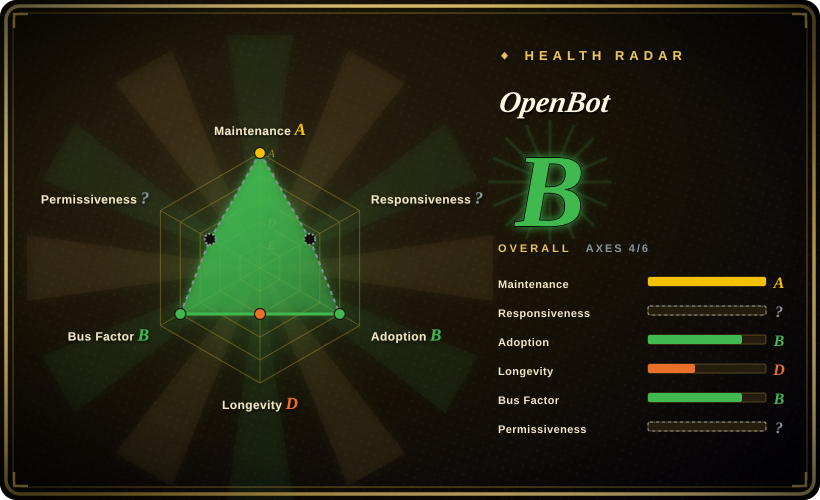
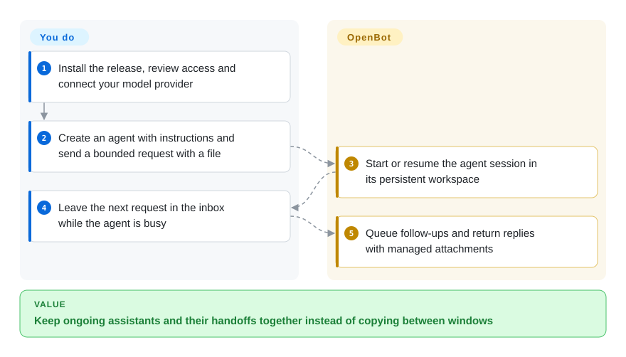
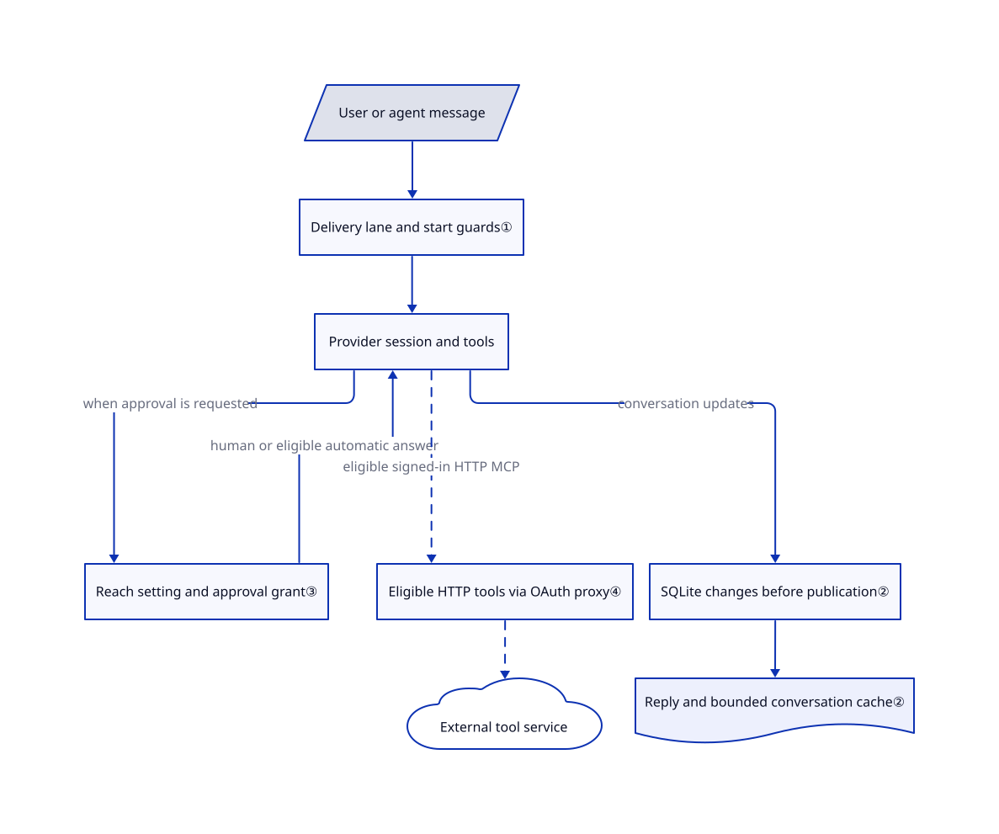

# OpenBot

Your research agent needs a file from your coding agent, but you keep copying replies between separate windows. OpenBot gives these agents persistent desks, a shared file area and queued messages inside one desktop workspace.

This is the **source-available Nightly Labs application**, not the unrelated [CopilotKit OpenBot](../../../agent-frameworks/agent-runtimes/agent-services/openbot.md). Its current license is noncommercial, not MIT or an OSI open-source license.

## When to use

You are experimenting with a personal team of assistants: one collects source material, another writes a draft, and a third checks code. While one is busy, you want to leave the next request in its inbox, share an attachment and let it ask another agent for help without making yourself the message bus. Choose OpenBot when the durable agent, its conversation and browser are the main working objects, rather than a Git branch awaiting review or a company ticket with a monthly budget.

You supply model access, instructions, trusted files and acceptance criteria. OpenBot manages provider sessions, local message delivery, transfers and a consolidated interface. The description below is a static review of commit `9dd3bfa2a599620ed8b7dd691f3a4c0d5f7582d5`, not an installation or execution result. Commercial adoption needs a separate license assessment and, where required, permission from the copyright owner.

## When NOT to use

- **You need commercially reusable source without negotiating a separate license.** Compare [Agent Orchestrator](agent-orchestrator.md) under Apache-2.0. OpenBot's [current license](https://github.com/nightly-labs/openbot/blob/9dd3bfa2a599620ed8b7dd691f3a4c0d5f7582d5/LICENSE#L9-L49) limits permitted purposes; distribution also carries notice obligations. Earlier Apache-2.0 releases do not relicense today's tree.
- **Your unit of work is a patch, branch and human review gate.** Prefer [Kandev](kandev.md) for a task workbench with executor profiles and review steps, or Agent Orchestrator for worktree/CI feedback routing. OpenBot's agent folder is not a Git worktree or a host-security boundary.
- **You need organizational budgets and ticket ownership first.** Compare [Paperclip](paperclip.md). OpenBot's queues and usage-limit handling are not equivalent to a company-wide accounting and budget-control system.
- **You intend to run hostile prompts or unknown repositories on a valuable host.** Use an execution-isolation layer such as [OpenSandbox](../../../sandboxing/opensandbox.md) and validate its configuration. OpenBot defaults to full filesystem access, enables Computer Use on new agents and defaults to automatically answering eligible approval requests; do not treat a separate workspace or sandboxed browser renderer as containment of the agent's shell.
- **You need offline-only operation or zero default analytics.** A minimal local-model setup such as [Pi Web](pi-web.md) may be a narrower starting point, subject to its own configuration. OpenBot's cloud providers and plugins use the network; production analytics is enabled by default with separate desktop, web and mobile controls.

## Comparison

| Alternative | In index | Our verdict | Tradeoff |
|---|---|---|---|
| [Kandev](kandev.md) | Indexed | Pick Kandev when the deliverable is a reviewed repository patch; pick OpenBot when persistent assistants exchange messages, files and browser context across ongoing work. | Configurable task steps and execution environments versus a teammate-oriented desktop; AGPL obligations versus OpenBot's noncommercial restriction. |
| [Agent Orchestrator](agent-orchestrator.md) | Indexed | Pick Agent Orchestrator for parallel coding branches and CI/review routing; pick OpenBot for a persistent multi-provider inbox rather than a branch lifecycle. | Worktree-per-task supervision under Apache-2.0 versus shared file transfers, agent conversations and a noncommercial desktop application. |
| [Paperclip](paperclip.md) | Indexed | Pick Paperclip when standing teams need ticket checkout and budgets; pick OpenBot when you want to converse with assistants and manage their local queues directly. | Organization/server management versus a desktop session-and-browser workspace; neither substitutes for provider-side spending limits. |

## Quick start

The [README installation and setup path](https://github.com/nightly-labs/openbot/blob/9dd3bfa2a599620ed8b7dd691f3a4c0d5f7582d5/README.md#L38-L211) starts with the packaged DMG, Windows installer or Linux AppImage, not a source build. After checking the license and release integrity, you install the app, explicitly review first-launch access and connect a supported provider using your own account or API access. Create an agent with instructions, select its model and access setting, then send a bounded request with a file if needed. OpenBot starts or resumes its provider session, queues follow-up messages and displays responses and managed attachments. You still pay provider costs, inspect results and decide whether any file or external action is acceptable. These steps were read from sources, not run; avoid interpreting the README's old blanket `approvalPolicy: never` warning as the exact current implementation described below.

<!-- flow-steps:begin (generated from flows/nightly-openbot.json by tools/flow_card.py — do not edit) -->

Text version of the flow

1. **You**: Install the release, review access and connect your model provider
2. **You**: Create an agent with instructions and send a bounded request with a file
3. **OpenBot**: Start or resume the agent session in its persistent workspace
4. **You**: Leave the next request in the inbox while the agent is busy
5. **OpenBot**: Queue follow-ups and return replies with managed attachments

**Value**: Keep ongoing assistants and their handoffs together instead of copying between windows

<!-- flow-steps:end -->

## Key techniques

<!-- mechanism:begin (generated from mechanisms/nightly-openbot.json by tools/mechanism_card.py; do not edit) -->

Text version of the mechanism

- User or agent message
- Delivery lane and start guards①
- Provider session and tools
- Reach setting and approval grant③
- Eligible HTTP tools via OAuth proxy④
- External tool service
- SQLite changes before publication②
- Reply and bounded conversation cache②

- User or agent message → Delivery lane and start guards①
- Delivery lane and start guards① → Provider session and tools
- Provider session and tools → Reach setting and approval grant③ (when approval is requested)
- Reach setting and approval grant③ → Provider session and tools (human or eligible automatic answer)
- Provider session and tools → Eligible HTTP tools via OAuth proxy④ (eligible signed-in HTTP MCP) [optional/fallback]
- Eligible HTTP tools via OAuth proxy④ → External tool service [optional/fallback]
- Provider session and tools → SQLite changes before publication② (conversation updates)
- SQLite changes before publication② → Reply and bounded conversation cache②

<!-- mechanism:end -->

### 1. Schedule a delivery lane, not a terminal paste

- **Problem:** A second message can arrive while a provider is still starting the first turn, creating duplicate work or a stuck inbox.
- **How:** The drain checks lane activity and provider/machine holds, reads the next queued delivery and marks its batch starting before preparing the session. It starts a provider turn and associates accepted deliveries with its turn identifier; separate task lanes can run beside the agent's main chat.
- **Limits:** A start timeout is treated as uncertain, not blindly retried: lifecycle events and a grace period settle it. This reduces replay risk but is not exactly-once execution of shell commands or remote effects; some replies and later user messages are combined into one turn rather than one model turn per message.
- **Source:** [Lane guards and batching](https://github.com/nightly-labs/openbot/blob/9dd3bfa2a599620ed8b7dd691f3a4c0d5f7582d5/src/backend/agent/drain-scheduler.ts#L490-L626), [turn submission and uncertainty](https://github.com/nightly-labs/openbot/blob/9dd3bfa2a599620ed8b7dd691f3a4c0d5f7582d5/src/backend/agent/drain-scheduler.ts#L749-L905), [queue steering validation](https://github.com/nightly-labs/openbot/blob/9dd3bfa2a599620ed8b7dd691f3a4c0d5f7582d5/src/backend/agent/queue-controls.ts#L220-L299).

### 2. Keep durable conversations separate from bounded UI caches

- **Problem:** Persistent chats grow, while streaming UI updates must not erase older messages or publish state that a transaction later rolls back.
- **How:** SQLite remains the conversation source of truth. The runtime tracks changed messages and active turns, writes changes before publication, and bounds completed-history caches; nested transactions queue publication until their owning transaction commits.
- **Limits:** The 8 MiB per-chat and 64 MiB total budgets cover completed cache history, not all process memory or active streamed output. Local transaction rollback does not undo a provider call, filesystem edit or external charge.
- **Source:** [Commit/rollback ownership](https://github.com/nightly-labs/openbot/blob/9dd3bfa2a599620ed8b7dd691f3a4c0d5f7582d5/src/backend/agent/conversation-runtime.ts#L30-L128), [persist before publish](https://github.com/nightly-labs/openbot/blob/9dd3bfa2a599620ed8b7dd691f3a4c0d5f7582d5/src/backend/agent/conversation-runtime.ts#L644-L730), [bounded cache](https://github.com/nightly-labs/openbot/blob/9dd3bfa2a599620ed8b7dd691f3a4c0d5f7582d5/src/backend/agent/conversation-runtime.ts#L992-L1035).

### 3. Separate filesystem reach from approval automation

- **Problem:** Full filesystem access, an approval request and a standing permission to answer it are three different decisions.
- **How:** New agents default to `full`; Codex receives `dangerFullAccess` unless Workspace only is selected. Turn submission uses `on-request`, and Claude uses `permissionMode: default`. Automatic answers are enabled by default (`defaultAutoApprove: true`); agents without an explicit override inherit that standing grant. When no workspace restriction applies, the attention registry automatically accepts eligible requests without displaying a human approval card.
- **Limits:** `on-request` therefore does not mean every request waits for a human. Workspace only leaves reads and network access open and permits shared/temp writes, but prevents this general automatic-answer path. Always-ask and owner-only tools still surface requests; browser takeover is separate. The README's blanket `never` claim is stale relative to this code, and a setting is not a proven cross-platform containment guarantee.
- **Source:** [Default reach and provider enforcement](https://github.com/nightly-labs/openbot/blob/9dd3bfa2a599620ed8b7dd691f3a4c0d5f7582d5/packages/contracts/src/ipc-agents.ts#L31-L89), [default approval grant and inheritance](https://github.com/nightly-labs/openbot/blob/9dd3bfa2a599620ed8b7dd691f3a4c0d5f7582d5/packages/contracts/src/ipc-approvals.ts#L81-L97), [missing-file defaults](https://github.com/nightly-labs/openbot/blob/9dd3bfa2a599620ed8b7dd691f3a4c0d5f7582d5/src/main/approval-automation-store.ts#L41-L44), [sandbox policy](https://github.com/nightly-labs/openbot/blob/9dd3bfa2a599620ed8b7dd691f3a4c0d5f7582d5/src/backend/agent/workspace-sandbox.ts#L6-L68), [approval gating](https://github.com/nightly-labs/openbot/blob/9dd3bfa2a599620ed8b7dd691f3a4c0d5f7582d5/src/backend/agent/attention-registry.ts#L692-L800), [Claude configuration](https://github.com/nightly-labs/openbot/blob/9dd3bfa2a599620ed8b7dd691f3a4c0d5f7582d5/src/backend/claude-client.ts#L887-L911).

### 4. Proxy eligible signed-in tools with route-scoped credentials

- **Problem:** Giving each provider a reusable service OAuth token expands the credential surface and makes revocation harder to apply to resumed sessions.
- **How:** Eligible HTTP MCP connections, which expose services as model-callable tools, pass through a loopback proxy. It checks the exact Host and route bearer, injects the current OAuth token upstream, follows only bounded same-origin 307/308 redirects and refreshes once after a 401.
- **Limits:** This applies to eligible signed-in HTTP rows, not every stdio tool, test probe or manually supplied Authorization header. A route bearer still authorizes tool use; hiding the OAuth token does not stop an authorized agent from causing external writes. The body stream has no general size limit after upstream headers arrive.
- **Source:** [Eligibility and fail-closed handoff](https://github.com/nightly-labs/openbot/blob/9dd3bfa2a599620ed8b7dd691f3a4c0d5f7582d5/docs/architecture/integrations.md#L68-L95), [proxy authentication and refresh](https://github.com/nightly-labs/openbot/blob/9dd3bfa2a599620ed8b7dd691f3a4c0d5f7582d5/src/backend/mcp-oauth-proxy.ts#L165-L279), [redirects and header substitution](https://github.com/nightly-labs/openbot/blob/9dd3bfa2a599620ed8b7dd691f3a4c0d5f7582d5/src/backend/mcp-oauth-proxy.ts#L305-L367).

## Tech stack

- TypeScript, Electron, SolidJS 2 release-candidate UI, Effect and typed IPC; Node SQLite persistence. The [manifest](https://github.com/nightly-labs/openbot/blob/9dd3bfa2a599620ed8b7dd691f3a4c0d5f7582d5/package.json) and [architecture](https://github.com/nightly-labs/openbot/blob/9dd3bfa2a599620ed8b7dd691f3a4c0d5f7582d5/docs/ARCHITECTURE.md) describe the desktop/backend boundary.
- Provider adapters include Codex App Server, Claude Agent SDK and ACP clients. These are external runtimes, not model weights implemented by OpenBot; [driver implementations](https://github.com/nightly-labs/openbot/blob/9dd3bfa2a599620ed8b7dd691f3a4c0d5f7582d5/src/backend/provider-drivers.ts) choose and configure them.
- Optional remote access adds Cloudflare account services and WebRTC signaling/TURN; local-first does not mean every feature is self-contained or offline.

## Dependencies

- Packaged desktop: macOS 13+, Windows 10+ x64, or Linux x64/arm64 AppImage, supported provider CLI and appropriate model account. Bun/Node are not needed for the installed release; source development requires Bun 1.4.2 and Node 24.
- Own writable workspace and profile storage. Canonical app state lives in Electron `userData/openbot.db`; files live under `~/OpenBot`, while provider login/history remain in their own directories. Managed runtimes can be shared between profiles.
- Optional browser, Computer Use and external integrations extend access to visited sites, the desktop and external accounts. The packaged driver needs macOS Screen Recording and Accessibility permissions when used. Source install runs Electron setup/cache scripts; do not treat dependency installation as passive reading.

## Ops difficulty

**Medium for a trusted personal desktop; higher for remote/shared hosting.** You manage provider updates, paid quota, persistent browser state, backups and access grants. Production [analytics](https://github.com/nightly-labs/openbot/blob/9dd3bfa2a599620ed8b7dd691f3a4c0d5f7582d5/PRIVACY.md#L135-L224) is enabled by default; switching off desktop collection does not switch off website, phone or account-service collection. Updates can change provider compatibility, so pin a tested release before relying on unattended work.

Pause queued work and stop active turns before quitting. Back up app state and `~/OpenBot` separately; deleting an agent removes its workspace and owned attachments. Uninstalling the app does not remove agent CLIs or their login/history. The [reset/uninstall guide](https://github.com/nightly-labs/openbot/blob/9dd3bfa2a599620ed8b7dd691f3a4c0d5f7582d5/docs/TROUBLESHOOTING.md#L243-L267) documents keeping data aside before reset; neither reset nor queue cancellation reverses external writes, publications or provider charges.

## Health & viability

- **Maintenance, 2026-10-28:** public and not archived; release API lists v0.52.1 and the manifest agrees. The reviewed main commit is dated October 28. This is an actively changing development preview, not evidence of stable cross-provider behavior.
- **Governance:** Nightly Labs owns the repository; [LICENSE and NOTICE](https://github.com/nightly-labs/openbot/blob/9dd3bfa2a599620ed8b7dd691f3a4c0d5f7582d5/NOTICE#L1-L10) identify Synthetify Labs as copyright holder. The sampled contributors are led by NorbertBodziony, Sniezka1927 and nrb-dev. External contributors sign a copyright-assignment agreement, not a neutral-foundation governance contract.
- **Age and adoption:** created August 12, 2026, about eleven weeks before review; metadata recorded 2,895 stars. [推断：creation date, active commit and preview status] It is active but far too young for a strong Lindy durability prior; attention and integration breadth do not establish production reliability.
- **License:** the current [PolyForm text](https://github.com/nightly-labs/openbot/blob/9dd3bfa2a599620ed8b7dd691f3a4c0d5f7582d5/LICENSE#L9-L77) is a real noncommercial grant with redistribution notices and a commercial-contact route. The [README](https://github.com/nightly-labs/openbot/blob/9dd3bfa2a599620ed8b7dd691f3a4c0d5f7582d5/README.md#L607-L620) says versions through 0.1.11 remain Apache-2.0. Third-party MIT notices cover Blobatar, solid-recharts/Recharts and a Cua cursor-motion port, not the whole application; icons, font and seccomp profile have separate notices.

## Caveats (unverified)

- [未验证：scorer has no qualifying response sample and does not parse this license] The automatic radar has 4/6 axes scored. Responsiveness and license risk remain unknown in that score; the license question is not legally unknown here, and the overall grade does not imply commercial permission or an OSI license. Adoption uses aggregated release-asset downloads, not a count of unique users.
- [未验证：no upstream install or execution was authorized] The flow, crash recovery, provider compatibility, resource consumption, costs and cross-platform permission enforcement were inspected statically, not reproduced.
- [未验证：no complete ownership or dependency audit] Declared third-party notices were read and core source blobs authenticated, but that does not establish title to every asset or license compliance of every transitive dependency and optional downloaded runtime.
- [未验证：public APIs cannot establish financing or real deployments] Long-term funding, decision rights beyond published documents and reliable production adoption remain unknown.
- [推断：based on repository age, active commits and development-preview status] The conservative durability verdict is a selection prior, not a prediction of abandonment.
