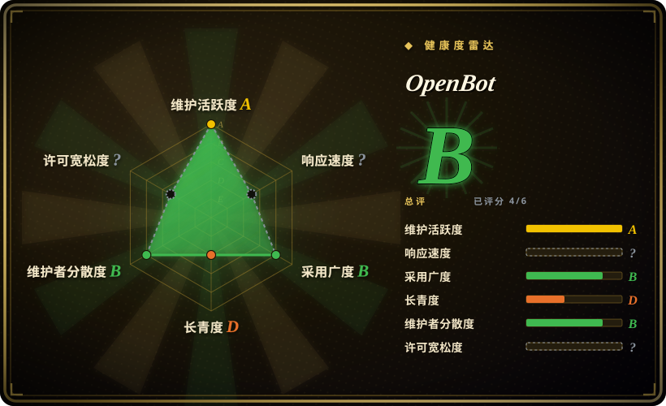
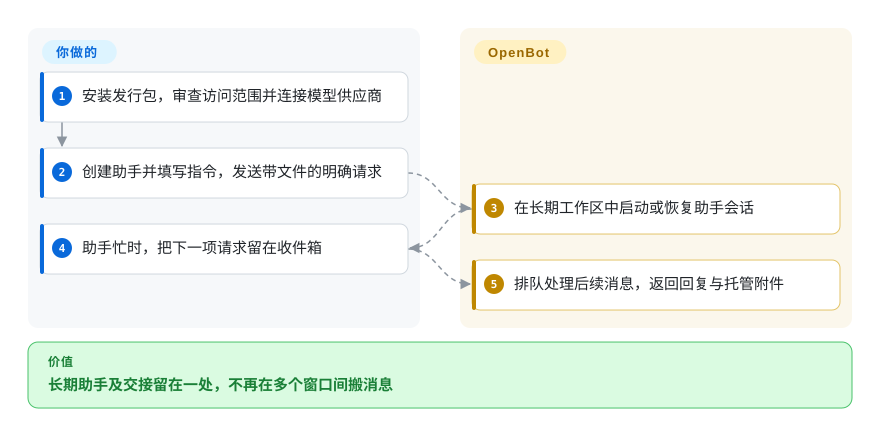
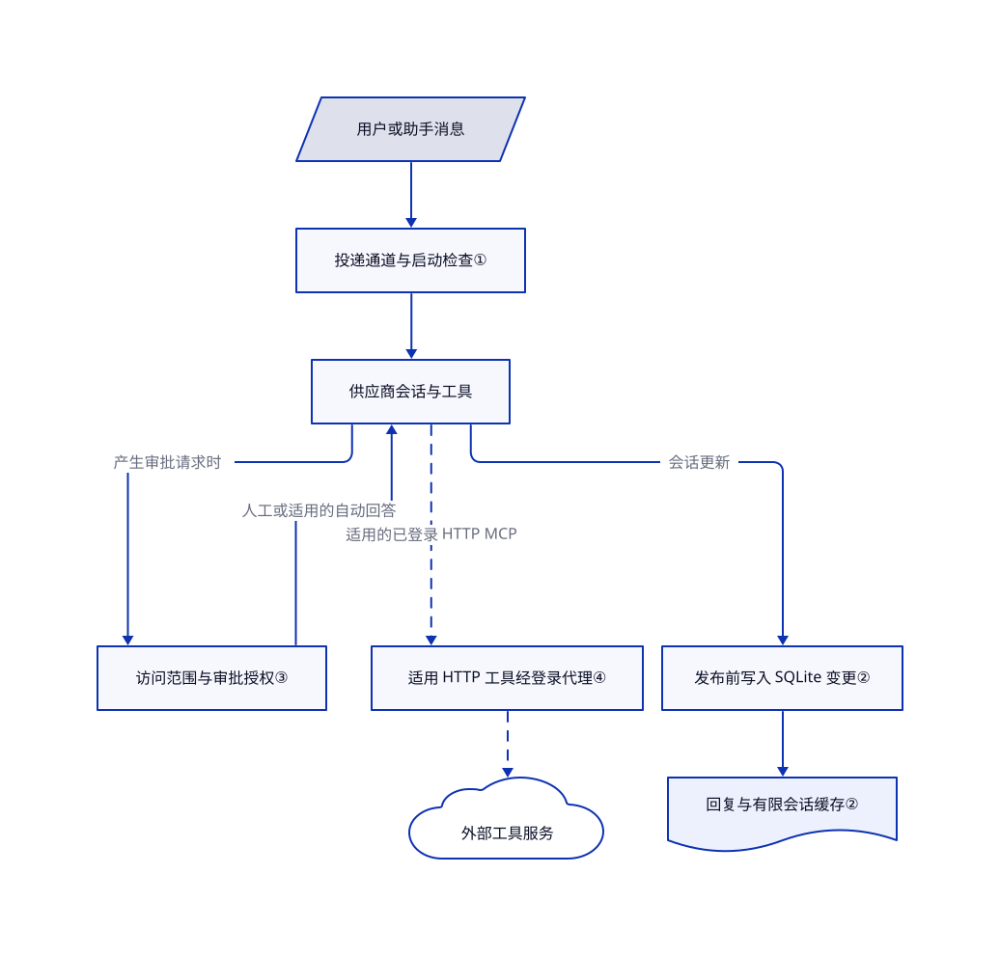

# OpenBot

研究助手要用编程助手刚做好的文件，你却一直在窗口间搬运消息。OpenBot 给这些助手各留一张长期办公桌，再用共享文件区和消息队列把它们接起来。

这是 **Nightly Labs 的源码可用应用**，不是另一个 [CopilotKit OpenBot](../../../agent-frameworks/agent-runtimes/agent-services/openbot.zh.md)。当前许可证限制非商业用途，不是 MIT，也不是 OSI 开放源码许可。

## 何时使用

你在试验一支个人助手小队：一个找资料，一个写初稿，一个检查代码。某个助手忙时，你想把下一项请求留在它的收件箱，附上文件，再让它直接向另一个助手求助，不想自己一直转发。你管理的核心是长期存在的助手、会话和浏览器，而不是待评审的 Git 分支，也不是带月度预算的公司工单时，可以考虑 OpenBot。

你提供模型访问、指令、可信文件和验收标准。OpenBot 负责供应商会话、本地投递、文件转交和统一界面。下文静态审读固定提交 `9dd3bfa2a599620ed8b7dd691f3a4c0d5f7582d5`，不是安装或运行结果。商用接入须另行评估许可，并在需要时取得权利人的授权。

## 何时不用

- **你需要无需另谈许可的商用源码。** 可比较 Apache-2.0 的 [Agent Orchestrator](agent-orchestrator.zh.md)。OpenBot 的[当前许可](https://github.com/nightly-labs/openbot/blob/9dd3bfa2a599620ed8b7dd691f3a4c0d5f7582d5/LICENSE#L9-L49)限制允许用途，再分发也有保留通知的义务。早期版本的 Apache-2.0 不覆盖今天的整棵源码树。
- **你管理的是补丁、分支和人工评审关口。** 优先比较有执行器配置与评审步骤的 [Kandev](kandev.zh.md)，或负责工作树和持续集成反馈的 Agent Orchestrator。OpenBot 的助手文件夹既不是 Git 工作树，也不是宿主安全边界。
- **你首先需要组织预算和工单归属。** 比较 [Paperclip](paperclip.zh.md)。OpenBot 的队列和用量限制处理，不等于公司级记账与预算控制。
- **你准备在重要机器上执行恶意提示词或陌生仓库。** 应先选 [OpenSandbox](../../../sandboxing/opensandbox.zh.md) 这类执行隔离层并验证配置。OpenBot 默认允许全盘访问，新助手也默认启用电脑操作，并默认自动回答适用的审批请求；独立工作目录和浏览器渲染进程的沙箱都不能代替助手命令行的隔离。
- **你要求纯离线或默认零分析上报。** 可把精简的本地模型配置与 [Pi Web](pi-web.zh.md) 作为较窄的起点，但仍须检查其配置。OpenBot 的云端模型与插件会联网；正式版默认开启产品分析，桌面、网页与手机分别控制。

## 横向对比

| 替代品 | 是否收录 | 我们的评价 | 取舍 |
|---|---|---|---|
| [Kandev](kandev.zh.md) | 已收录 | 交付物是待审仓库补丁时选 Kandev；长期助手要交换消息、文件和浏览器上下文时选 OpenBot。 | 可配置任务步骤与执行环境，对比以助手为中心的桌面；AGPL 义务对比 OpenBot 的非商业限制。 |
| [Agent Orchestrator](agent-orchestrator.zh.md) | 已收录 | 并行编程分支与持续集成反馈路由选 Agent Orchestrator；需要长期多供应商收件箱，而非分支生命周期时选 OpenBot。 | Apache-2.0 的逐任务工作树监管，对比非商业桌面里的共享文件转交与助手会话。 |
| [Paperclip](paperclip.zh.md) | 已收录 | 常驻团队要工单领取和预算时选 Paperclip；想直接和助手对话、管理本地队列时选 OpenBot。 | 组织与服务器管理，对比桌面会话和浏览器工作区；两者都不能代替模型供应商的硬消费限额。 |

## 快速上手

[安装与接入说明](https://github.com/nightly-labs/openbot/blob/9dd3bfa2a599620ed8b7dd691f3a4c0d5f7582d5/README.md#L38-L211)从打包好的 DMG、Windows 安装器或 Linux AppImage 开始，不要求源码构建。核对许可和发行包完整性后，你安装应用，明确审查首次启动权限，再用自己的账号或接口凭据连接支持的供应商。创建助手，填写指令，选定模型与访问范围，再发送带明确边界的请求，按需附上文件。OpenBot 启动或恢复供应商会话，把后续消息排队，并展示回复和托管附件。模型费用、结果检查和文件或外部操作是否可接受，仍由你负责。本轮只读过这些步骤，未实际运行；README 的旧版 `approvalPolicy: never` 警告，不代表下文所述当前实现的精确配置。

<!-- flow-steps:begin (generated from flows/nightly-openbot.json by tools/flow_card.py — do not edit) -->

流程文字版

1. **你**：安装发行包，审查访问范围并连接模型供应商
2. **你**：创建助手并填写指令，发送带文件的明确请求
3. **OpenBot**：在长期工作区中启动或恢复助手会话
4. **你**：助手忙时，把下一项请求留在收件箱
5. **OpenBot**：排队处理后续消息，返回回复与托管附件

**价值**：长期助手及交接留在一处，不再在多个窗口间搬消息

<!-- flow-steps:end -->

## 技术要点

<!-- mechanism:begin (generated from mechanisms/nightly-openbot.json by tools/mechanism_card.py; do not edit) -->

机制文字版

- 用户或助手消息
- 投递通道与启动检查①
- 供应商会话与工具
- 访问范围与审批授权③
- 适用 HTTP 工具经登录代理④
- 外部工具服务
- 发布前写入 SQLite 变更②
- 回复与有限会话缓存②

- 用户或助手消息 → 投递通道与启动检查①
- 投递通道与启动检查① → 供应商会话与工具
- 供应商会话与工具 → 访问范围与审批授权③（产生审批请求时）
- 访问范围与审批授权③ → 供应商会话与工具（人工或适用的自动回答）
- 供应商会话与工具 → 适用 HTTP 工具经登录代理④（适用的已登录 HTTP MCP）〔可选／兜底〕
- 适用 HTTP 工具经登录代理④ → 外部工具服务〔可选／兜底〕
- 供应商会话与工具 → 发布前写入 SQLite 变更②（会话更新）
- 发布前写入 SQLite 变更② → 回复与有限会话缓存②

<!-- mechanism:end -->

### 1. 按投递通道调度，不向终端盲贴消息

- **解决：** 第一轮还在启动时第二条消息就到了，容易重复执行或卡住收件箱。
- **做法：** 调度器先检查通道占用、供应商和机器暂停条件，取下一条排队投递，再把整批标为启动中后准备会话。供应商接受执行轮次后，投递绑定其轮次标识；独立任务通道可以和助手主会话并行。
- **边界：** 启动超时视为状态未确认，不直接重试，而由生命周期事件和宽限期收尾。这减少重放风险，不保证命令或外部副作用恰好执行一次；部分回复与后续用户消息会合并成一轮，不是一条消息必占一轮模型调用。
- **源码：** [通道检查与批次](https://github.com/nightly-labs/openbot/blob/9dd3bfa2a599620ed8b7dd691f3a4c0d5f7582d5/src/backend/agent/drain-scheduler.ts#L490-L626)、[启动与不确定性处理](https://github.com/nightly-labs/openbot/blob/9dd3bfa2a599620ed8b7dd691f3a4c0d5f7582d5/src/backend/agent/drain-scheduler.ts#L749-L905)、[队列转向检查](https://github.com/nightly-labs/openbot/blob/9dd3bfa2a599620ed8b7dd691f3a4c0d5f7582d5/src/backend/agent/queue-controls.ts#L220-L299)。

### 2. 持久会话与有限界面缓存分开

- **解决：** 长期聊天不断增长，流式界面更新却不能删掉旧消息，也不能发布后来被事务回滚的状态。
- **做法：** SQLite 是会话事实源。运行时跟踪变更消息与活动轮次，先写变更再发布，并限制已完成历史的缓存；嵌套事务把发布推迟到所属外层事务提交之后。
- **边界：** 单会话 8 MiB、总计 64 MiB 的预算只覆盖已完成历史缓存，不限制整个进程或活动流式输出。数据库回滚不能撤销模型调用、文件修改或外部费用。
- **源码：** [提交与回滚归属](https://github.com/nightly-labs/openbot/blob/9dd3bfa2a599620ed8b7dd691f3a4c0d5f7582d5/src/backend/agent/conversation-runtime.ts#L30-L128)、[先持久化再发布](https://github.com/nightly-labs/openbot/blob/9dd3bfa2a599620ed8b7dd691f3a4c0d5f7582d5/src/backend/agent/conversation-runtime.ts#L644-L730)、[有限缓存](https://github.com/nightly-labs/openbot/blob/9dd3bfa2a599620ed8b7dd691f3a4c0d5f7582d5/src/backend/agent/conversation-runtime.ts#L992-L1035)。

### 3. 文件访问范围与自动审批分开

- **解决：** 全盘访问、发起审批请求和长期允许代答审批，是三个不同的决定。
- **做法：** 新助手默认 `full`；未选择仅工作区时，Codex 得到 `dangerFullAccess`。启动轮次使用 `on-request`，Claude 使用 `permissionMode: default`。自动代答默认开启（`defaultAutoApprove: true`），没有逐助手覆盖设置时继承该长期授权。没有工作区限制时，注意事项登记器自动接受适用请求，不显示人工审批卡。
- **边界：** 因此，`on-request` 不代表每次都等人确认。仅工作区仍放开读取和网络，也允许共享区与临时目录写入，但会阻止这条通用自动代答路径。始终询问和仅所有者可批的工具仍出审批卡，浏览器接管走另一流程。README 的统一 `never` 说法已落后于这份代码；设置存在也不等于跨平台隔离已经实测。
- **源码：** [默认范围与供应商执行方式](https://github.com/nightly-labs/openbot/blob/9dd3bfa2a599620ed8b7dd691f3a4c0d5f7582d5/packages/contracts/src/ipc-agents.ts#L31-L89)、[自动审批默认值与继承](https://github.com/nightly-labs/openbot/blob/9dd3bfa2a599620ed8b7dd691f3a4c0d5f7582d5/packages/contracts/src/ipc-approvals.ts#L81-L97)、[缺失偏好文件时的默认值](https://github.com/nightly-labs/openbot/blob/9dd3bfa2a599620ed8b7dd691f3a4c0d5f7582d5/src/main/approval-automation-store.ts#L41-L44)、[沙箱策略](https://github.com/nightly-labs/openbot/blob/9dd3bfa2a599620ed8b7dd691f3a4c0d5f7582d5/src/backend/agent/workspace-sandbox.ts#L6-L68)、[审批关口](https://github.com/nightly-labs/openbot/blob/9dd3bfa2a599620ed8b7dd691f3a4c0d5f7582d5/src/backend/agent/attention-registry.ts#L692-L800)、[Claude 配置](https://github.com/nightly-labs/openbot/blob/9dd3bfa2a599620ed8b7dd691f3a4c0d5f7582d5/src/backend/claude-client.ts#L887-L911)。

### 4. 用逐路由凭据代理已登录工具

- **解决：** 把长期服务登录令牌交给每种模型运行时，会扩大凭据暴露面，也不便立即撤销恢复中的会话。
- **做法：** 满足条件的 HTTP MCP 连接，即供模型调用外部服务的工具连接，会经过本机回环代理。代理检查精确 Host 和逐路由凭据，向上游加入当前 OAuth 令牌，只跟随有上限的同源 307／308 跳转，收到 401 后刷新并重试一次。
- **边界：** 这只适用于满足条件的已登录 HTTP 连接，不覆盖所有标准输入输出工具、测试探针或手填授权头。路由凭据仍允许调用工具；隐藏 OAuth 令牌不能阻止已获授权的助手向外部写入。上游响应头返回后，响应体流没有通用大小上限。
- **源码：** [适用条件与失败关闭](https://github.com/nightly-labs/openbot/blob/9dd3bfa2a599620ed8b7dd691f3a4c0d5f7582d5/docs/architecture/integrations.md#L68-L95)、[代理鉴权与刷新](https://github.com/nightly-labs/openbot/blob/9dd3bfa2a599620ed8b7dd691f3a4c0d5f7582d5/src/backend/mcp-oauth-proxy.ts#L165-L279)、[跳转与请求头替换](https://github.com/nightly-labs/openbot/blob/9dd3bfa2a599620ed8b7dd691f3a4c0d5f7582d5/src/backend/mcp-oauth-proxy.ts#L305-L367)。

## 技术栈

- TypeScript、Electron、SolidJS 2 候选版界面、Effect 和有类型的进程通信；Node SQLite 持久化。[依赖清单](https://github.com/nightly-labs/openbot/blob/9dd3bfa2a599620ed8b7dd691f3a4c0d5f7582d5/package.json)与[架构说明](https://github.com/nightly-labs/openbot/blob/9dd3bfa2a599620ed8b7dd691f3a4c0d5f7582d5/docs/ARCHITECTURE.md)明确桌面与后端边界。
- 供应商适配器包括 Codex App Server、Claude Agent SDK 和 ACP 客户端。[驱动实现](https://github.com/nightly-labs/openbot/blob/9dd3bfa2a599620ed8b7dd691f3a4c0d5f7582d5/src/backend/provider-drivers.ts)负责选择与配置外部运行时，OpenBot 本身不实现模型权重。
- 可选远程接入增加 Cloudflare 账号服务，以及 WebRTC 信令和中继；本地优先不代表每项能力都自包含或离线。

## 依赖

- 桌面发行包支持 macOS 13 及以上、Windows 10 及以上 x64，以及 Linux x64／arm64 AppImage；还需要支持的供应商命令行与模型账号。安装版无需 Bun／Node；源码开发需要 Bun 1.4.2 与 Node 24。
- 可写工作区与用户配置存储。应用事实源位于 Electron `userData/openbot.db`，文件在 `~/OpenBot`，供应商登录与历史仍在各自目录。托管运行时可能由多个配置共享。
- 可选浏览器、电脑操作和外部集成，把访问延伸到网站、桌面与外部账号。使用打包驱动时，macOS 需要屏幕录制与辅助功能授权。源码依赖安装会执行 Electron 配置和缓存脚本，不是被动阅读。

## 运维难度

**可信个人桌面为中等，远程或共享托管更高。** 你需要管理供应商更新、付费用量、长期浏览器状态、备份与授权。[隐私说明](https://github.com/nightly-labs/openbot/blob/9dd3bfa2a599620ed8b7dd691f3a4c0d5f7582d5/PRIVACY.md#L135-L224)明确正式版默认开启产品分析；关闭桌面采集，不会同步关闭网站、手机或账号服务的采集。更新可能改变供应商兼容性，依赖无人值守执行前应固定已验收的版本。

退出前暂停排队工作并停止活动轮次。应用状态和 `~/OpenBot` 应分别备份；删除助手会删除其工作区和自有附件。卸载应用不会移除助手命令行及其登录或历史。[重置与卸载说明](https://github.com/nightly-labs/openbot/blob/9dd3bfa2a599620ed8b7dd691f3a4c0d5f7582d5/docs/TROUBLESHOOTING.md#L243-L267)要求先把数据另存；重置或取消队列都不能撤销外部写入、发布和模型费用。

## 健康度与可持续性

- **维护，2026-10-28：** 仓库公开且未归档，发行接口列出 v0.52.1，依赖清单一致。审读的主线提交日期为 10 月 28 日。这说明开发活跃，不说明开发预览版已经稳定支持各供应商。
- **治理：** 仓库属于 Nightly Labs；[许可与通知](https://github.com/nightly-labs/openbot/blob/9dd3bfa2a599620ed8b7dd691f3a4c0d5f7582d5/NOTICE#L1-L10)写明版权主体为 Synthetify Labs。贡献者抽样由 NorbertBodziony、Sniezka1927 和 nrb-dev 领先。外部贡献者签署版权转让协议，并非中立基金会治理合同。
- **年龄与采用：** 建仓于 2026 年 8 月 12 日，距本轮约十一周；元数据记录 2,895 星。[推断：依据建仓日期、活跃提交和开发预览状态] 项目活跃，但不足以形成强 Lindy 持久性先验；关注度和集成广度不能证明生产可靠性。
- **许可：** 当前 [PolyForm 正文](https://github.com/nightly-labs/openbot/blob/9dd3bfa2a599620ed8b7dd691f3a4c0d5f7582d5/LICENSE#L9-L77)确实授予非商业用途权限，含分发通知和商用联系入口。[README](https://github.com/nightly-labs/openbot/blob/9dd3bfa2a599620ed8b7dd691f3a4c0d5f7582d5/README.md#L607-L620)说明截至 0.1.11 的旧版本仍为 Apache-2.0。第三方 MIT 通知覆盖 Blobatar、solid-recharts／Recharts 与 Cua 光标运动移植，不覆盖整个应用；图标、字体和系统调用配置另有通知。

## 存疑（未验证）

- [未验证：评分器缺有效响应样本且不识别此许可] 自动雷达仅评出六轴中的四轴。响应与许可风险在评分中未知，不代表本条未读到许可；总评不授予商用权限，也不意味着 OSI 开放许可。采用轴使用发行附件累计下载数，不是独立用户数。
- [未验证：本轮未授权安装或执行上游] 使用流程、崩溃恢复、供应商兼容性、资源消耗、费用和跨平台权限执行均为静态审读，未复现。
- [未验证：未做完整权属与依赖审计] 已读明示的第三方通知并认证核心源码 blob，但不能证明每项素材的权属、所有间接依赖或可选下载运行时的许可合规。
- [未验证：公开接口无法确认资金与真实部署] 长期资金、公开文件以外的决策权和可靠生产采用仍未知。
- [推断：依据仓库年龄、活跃提交与开发预览状态] 保守的持久性判断是选型先验，不是预测项目会停止维护。
