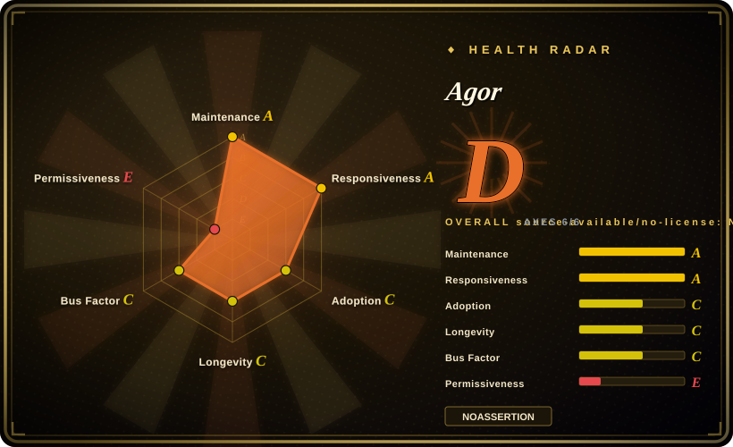
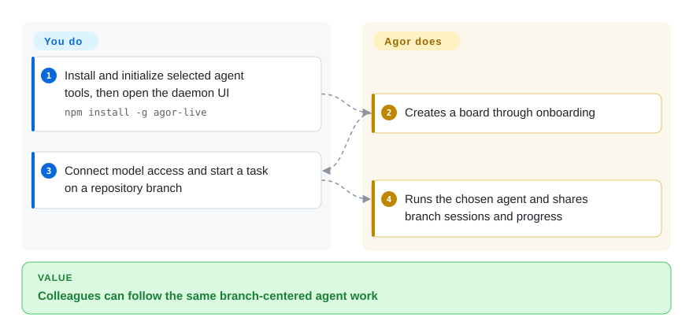
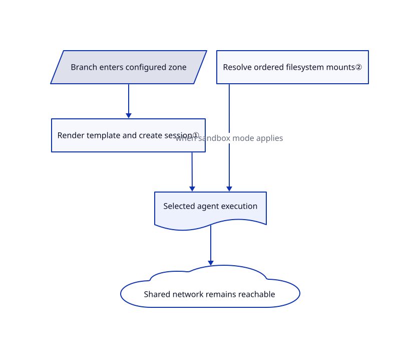

# Agor

Several colleagues run coding agents, but each task disappears into a private terminal and someone else's branch. Agor puts branches and agent sessions on a shared live board with their own working directories and conversation history.

## When to use

You lead a small team using different coding-agent CLIs and want colleagues to follow a session, inspect its branch preview and reuse the same workflow prompts. Instead of exchanging screenshots or giving everyone the same checkout, you run Agor and organize branches and conversations on boards. Choose it over OpenChamber when mixed runtimes and team visibility outweigh a deep single-OpenCode interface; choose Scion when containers and explicitly designed agent teams matter more than a spatial collaboration UI. You still supply agent credentials, review changes and operate the control plane.

## When NOT to use

- **You require unrestricted open-source licensing:** Agor is BSL, not OSI open source before its change date. Consider MIT [OpenHands](../../agent-frameworks/coding-agents/orchestration-and-review/openhands.md) for a browser control center; do not resell Agor's orchestration service without checking the additional grant.
- **One local OpenCode operator:** choose [OpenChamber](../../agent-frameworks/coding-agents/orchestration-and-review/openchamber.md) for its focused review surface, or the CLI itself; shared boards, roles and a daemon are extra administration.
- **Container collaboration is the central requirement:** evaluate [Scion](../../agent-frameworks/coding-agents/orchestration-and-review/scion.md), whose Hub/broker model makes runtime placement and workspace sharing explicit.
- **You equate separate branches with hostile-tenant security:** use a reviewed execution substrate, not worktrees alone. The inspected Linux sandbox shares network access and has deliberate writable home areas; [gh-aw](../../agent-frameworks/coding-agents/orchestration-and-review/gh-aw.md) is a different option for bounded GitHub-only chores with restricted writes.

## Comparison

| Alternative | In index | Our verdict | Tradeoff |
|---|---|---|---|
| [OpenHands](../../agent-frameworks/coding-agents/orchestration-and-review/openhands.md) | ✅ | Choose OpenHands for a browser console across local/remote agent backends and automation; choose Agor when colleagues must share branch-centered spatial workflows. | Agor adds boards, zones, teammates and shared knowledge, but you operate a wider collaboration system under BSL. |
| [OpenChamber](../../agent-frameworks/coding-agents/orchestration-and-review/openchamber.md) | ✅ | Choose OpenChamber for one operator committed to OpenCode and detailed diff review; choose Agor for team participation across different agent runtimes. | A focused OpenCode surface is smaller; Agor adds identity, shared state and runtime integration overhead. |
| [Scion](../../agent-frameworks/coding-agents/orchestration-and-review/scion.md) | ✅ | Choose Scion to design collaborating mixed-harness teams on container hosts; choose Agor when live boards and human participation organize the work. | Scion foregrounds runtime brokers and workspace policies; Agor foregrounds branches, sessions and reusable zone triggers. |

## Quick start

The README installs `agor-live` globally with npm, then runs `agor init`, `agor daemon start` and `agor open`. Node.js 22.12 or later and Git are required; the published package explicitly excludes native Windows. Initialization installs the agent tools you deliberately select, and the browser onboarding connects model credentials and creates a board. Add repository branches and start sessions; Agor maintains branch working directories, streams progress and exposes shared previews, while the underlying agents perform the edits. You pay model costs, grant repository access, configure execution security and review the resulting changes; a board is not an automatic merge approval.

<!-- flow-steps:begin (generated from flows/agor.json by tools/flow_card.py — do not edit) -->

Text version of the flow

1. **You**: Install and initialize selected agent tools, then open the daemon UI — `npm install -g agor-live`
2. **Agor**: Creates a board through onboarding
3. **You**: Connect model access and start a task on a repository branch
4. **Agor**: Runs the chosen agent and shares branch sessions and progress

**Value**: Colleagues can follow the same branch-centered agent work

<!-- flow-steps:end -->

## Key techniques

<!-- mechanism:begin (generated from mechanisms/agor.json by tools/mechanism_card.py; do not edit) -->

Text version of the mechanism

- Branch enters configured zone
- Render template and create session①
- Resolve ordered filesystem mounts②
- Selected agent execution
- Shared network remains reachable

- Branch enters configured zone → Render template and create session①
- Render template and create session① → Selected agent execution
- Resolve ordered filesystem mounts② → Selected agent execution (when sandbox mode applies)
- Selected agent execution → Shared network remains reachable

<!-- mechanism:end -->

### 1. Turn a board zone into a real session trigger

- **Problem:** Moving a card to “review” is only decoration if the review prompt must still be copied by hand.
- **How:** The shared zone helper renders a template using branch, board and zone context, rejects empty prompts and creates a session on that branch before submitting the prompt. UI and MCP paths share this helper.
- **Limits:** This helper requires `always_new` behavior and an active runtime. Starting a review session is not evidence its review passed; downstream failures still matter.
- **Source:** [Zone trigger](https://github.com/preset-io/agor/blob/68cc270c5a77f34ce551a9848f9fa6b61b983750/apps/agor-daemon/src/services/zone-trigger.ts#L1-L126).

### 2. Translate filesystem policy into ordered Linux mounts

- **Problem:** A working directory alone does not stop an agent from reading sibling branches or credential files.
- **How:** The policy resolver builds bubblewrap arguments: a read-only root, explicitly writable branch paths and later secret masks. Per-user mode overlays a private home and requires an owner store instead of silently falling back to the shared home.
- **Limits:** Network remains shared; PID isolation can degrade where the host forbids nested PID namespaces. The resolver's defaults are not proof that a deployment has enabled the intended execution mode, and writable tool-state directories remain authority-bearing.
- **Source:** [Sandbox policy and mount order](https://github.com/preset-io/agor/blob/68cc270c5a77f34ce551a9848f9fa6b61b983750/packages/core/src/config/sandbox-policy.ts#L1-L223), [private home overlay](https://github.com/preset-io/agor/blob/68cc270c5a77f34ce551a9848f9fa6b61b983750/packages/core/src/config/sandbox-policy.ts#L234-L365).

## Tech stack

TypeScript monorepo, FeathersJS daemon, React/React Flow UI, oclif CLI, Drizzle with LibSQL or PostgreSQL, process-isolated executor packages and agent SDK adapters. Node.js 22.12+; pnpm is needed for source development, not necessarily the published install.

## Dependencies

Git and authenticated repository access; selected coding-agent tools and their provider accounts; persistent database and working directories. Linux filesystem sandboxing needs bubblewrap and compatible host namespaces. Team/hosted setups may add PostgreSQL, reverse proxy, identity and delegated execution infrastructure.

## Ops difficulty

**Medium solo, high for teams.** A local database and daemon are approachable. Shared service operation adds permissions, credentials, agent SDK version compatibility, branch lifecycle, port allocation, execution isolation and backup recovery. Do not expose the documented development login as a production service.

## Health & viability

- **2026-10-18:** default-branch work is current; both the source package and [npm registry](https://registry.npmjs.org/agor-live/latest) report 0.27.0 while GitHub Releases lists v0.15.0 from March. Release pages alone understate development.
- Created October 2025, approximately one year old; active but short Lindy history. Preset is the licensor and roadmap owner; `mistercrunch` dominates visible contributions.
- The BSL grant permits internal commercial use and excludes offering Agor's own orchestration functionality as a commercial product to others. The license specifies Apache-2.0 conversion on January 15, 2029, or the version's fourth anniversary, whichever comes first.
- Numerous source tests and boundary checks exist, but their presence is not a certification of multi-user isolation.

## Caveats (unverified)

- [未验证：本次仅静态阅读，未启动上游服务] Multiplayer behavior, runtime parity and sandbox resistance were not exercised.
