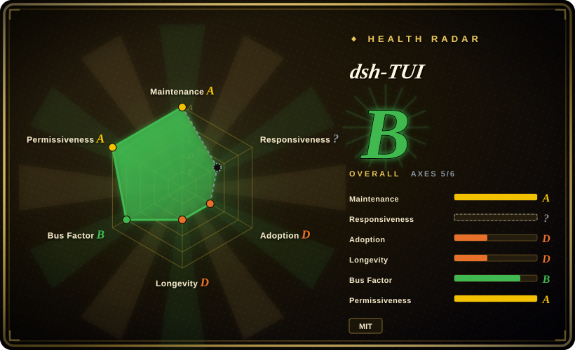
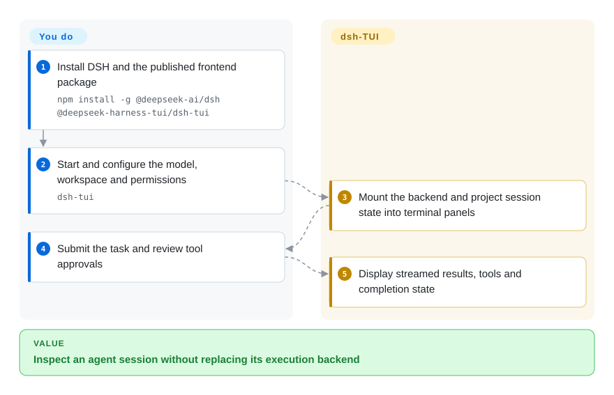
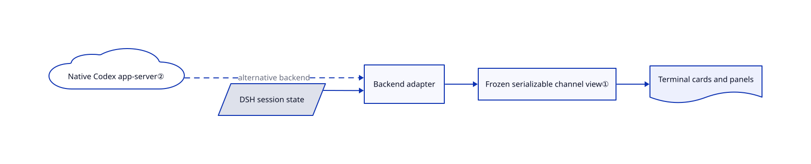

# dsh-TUI

Your DeepSeek Harness session has tools, approvals and background work scattered across text; dsh-TUI projects that state into terminal cards, panels and a session browser.

## When to use

You already use DeepSeek Harness and want visible tool status, session switching and approvals without replacing its execution core. Choose this frontend when DSH compatibility matters more than a standalone agent. Experimental Claude and native Codex backends reuse the same interface, but switching kernels restarts into another session; this is not simultaneous multi-agent orchestration.

## When NOT to use

- Want one independent multi-provider agent rather than a DSH profile? Choose [OpenCode](../../agent-frameworks/coding-agents/terminal-agents/independent-runtimes/opencode.md).
- Want a desktop surface for installed agents? Choose [T3 Code](../../agent-frameworks/coding-agents/terminal-agents/independent-runtimes/t3code.md) rather than a terminal renderer.
- Need the vendor's exact sandbox behavior with less adapter drift? Use [Codex](../../agent-frameworks/coding-agents/terminal-agents/vendor-agents/codex.md) directly. dsh-TUI adds no sandbox; its Windows DSH profile defaults to full access with no approval.
- Need work to continue after closing the UI? Use a supervised runner instead; DSH background sessions stop with this process.

## Comparison

| Alternative | In index | Our verdict | Tradeoff |
| --- | --- | --- | --- |
| [OpenCode](../../agent-frameworks/coding-agents/terminal-agents/independent-runtimes/opencode.md) | ✅ | Choose OpenCode for an independent agent and provider ecosystem; choose dsh-TUI for a DSH-native visual workflow. | New agent loop versus an adapter whose compatibility tracks DSH releases. |
| [T3 Code](../../agent-frameworks/coding-agents/terminal-agents/independent-runtimes/t3code.md) | ✅ | Choose T3 Code for a local GUI over installed agents; choose dsh-TUI when terminal sessions are the workspace. | Desktop interaction versus terminal rendering and terminal-protocol constraints. |
| [Codex](../../agent-frameworks/coding-agents/terminal-agents/vendor-agents/codex.md) | ✅ | Choose native Codex for its direct protocol and controls; choose dsh-TUI only when its shared terminal presentation earns the extra adapter. | Native feature timing versus an experimental backend with pinned app-server compatibility. |

## Quick start

Install `npm install -g @deepseek-ai/dsh @deepseek-harness-tui/dsh-tui`, then run `dsh-tui`. First launch initializes a profile using pnpm and asks for model credentials, workspace and display preferences. The frontend displays backend events and sends your actions back; the backend executes tools and persists sessions. You must inspect permissions and reporting settings before opening sensitive projects: DSH request reporting can include incremental session logs in requests to the configured provider URL. See the [reviewed guide](https://github.com/ccch1mneyyy/dsh-TUI/blob/73ff99fbed56563bf154d719effd09f9f9725349/README.md).

<!-- flow-steps:begin (generated from flows/dsh-tui.json by tools/flow_card.py — do not edit) -->

Text version of the flow

1. **You**: Install DSH and the published frontend package — `npm install -g @deepseek-ai/dsh @deepseek-harness-tui/dsh-tui`
2. **You**: Start and configure the model, workspace and permissions — `dsh-tui`
3. **dsh-TUI**: Mount the backend and project session state into terminal panels
4. **You**: Submit the task and review tool approvals
5. **dsh-TUI**: Display streamed results, tools and completion state

**Value**: Inspect an agent session without replacing its execution backend

<!-- flow-steps:end -->

## Key techniques

<!-- mechanism:begin (generated from mechanisms/dsh-tui.json by tools/mechanism_card.py; do not edit) -->

Text version of the mechanism

- DSH session state
- Native Codex app-server②
- Backend adapter
- Frozen serializable channel view①
- Terminal cards and panels

- DSH session state → Backend adapter
- Native Codex app-server② → Backend adapter (alternative backend) [optional/fallback]
- Backend adapter → Frozen serializable channel view①
- Frozen serializable channel view① → Terminal cards and panels

<!-- mechanism:end -->

### 1. Project a serializable view of backend state

- **Problem:** Rendering directly from mutable service handles couples UI and execution.
- **How:** Channel projection copies transcript rows, tool previews and activity into frozen, JSON-safe snapshots, omitting service functions and secrets.
- **Limits:** A display snapshot is not the authoritative persistence or execution boundary; backend policies still apply.
- **Source:** [Live projection](https://github.com/ccch1mneyyy/dsh-TUI/blob/73ff99fbed56563bf154d719effd09f9f9725349/src/adapter/channel/projection.ts#L1-L71).

### 2. Use the native Codex app-server as a backend

- **Problem:** Reimplementing Codex execution would separate the UI from native threads and settings.
- **How:** The adapter locates and version-checks the user's Codex binary, launches app-server and reads configuration for the recorded thread directory on resume.
- **Limits:** This backend is experimental and version-sensitive; native config is not a guarantee that every UI feature has parity.
- **Source:** [Codex runtime acquisition](https://github.com/ccch1mneyyy/dsh-TUI/blob/73ff99fbed56563bf154d719effd09f9f9725349/src/backends/codex/backend.ts#L1-L105).

## Tech stack

TypeScript, React and Ink/Yoga terminal rendering, Cordis profiles, optional sharp image processing and backend adapters. The vendored dsh-std submodule and whale artwork retain their own attribution.

## Dependencies

Node `^22.19 || >=24`, pnpm and compatible DSH packages; current primary target is DSH 0.2.1-rc.2. Claude uses an optional Agent SDK; native Codex uses an installed CLI. Model accounts and supported terminal graphics are separate requirements.

## Ops difficulty

**Medium.** Align launcher, profile and backend versions. Treat plugins and imported histories as executable configuration and sensitive data. Windows full-access defaults require explicit review; this UI does not supply isolation.

## Health & viability

- On 2026-10-18, v0.16.1 had shipped the prior day; several active contributors and extensive verification scripts are visible.
- Created August 2026, this is a public beta maintained outside DeepSeek's core repo. [推断：依据是创建日期与版本契约] DSH churn is a stronger planning signal than its short age or star count.
- MIT covers its own code; third-party notices explicitly retain BSD whale artwork and MIT adapted components.

## Caveats (unverified)

- [未验证：本批禁止运行上游] Live rendering, authentication and sandbox behavior were not exercised.
- [推断：依据是创建日期与版本契约] Long-term maintenance and protocol stability remain uncertain.
