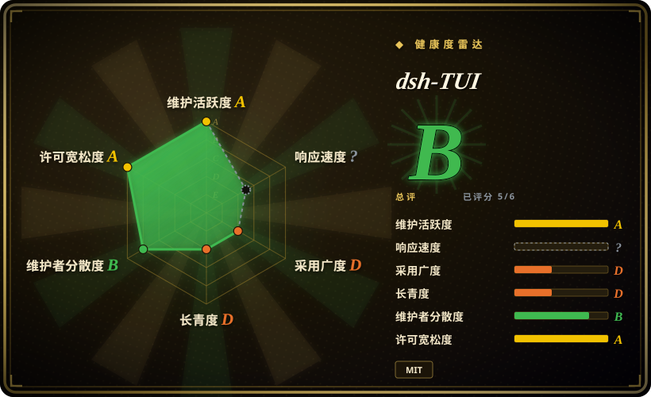
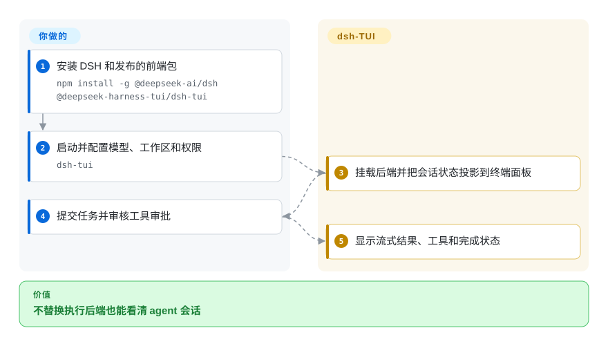
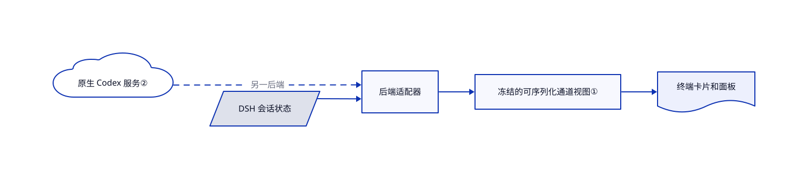

# dsh-TUI

DeepSeek Harness 的工具、审批和后台任务散在文字里。dsh-TUI 把这些状态投影成终端卡片、面板和会话浏览器。

## 何时使用

你已经使用 DeepSeek Harness，想看清工具状态、切换会话和处理审批，又不想替换执行内核。优先 DSH 兼容时可以选这个前端，而非独立 agent。实验性的 Claude 和原生 Codex 后端复用界面，但切换内核需要重启到另一会话，不是同时编排多个 agent。

## 何时不用

- 要独立的多供应商 agent，而非 DSH 配置，选 [OpenCode](../../agent-frameworks/coding-agents/terminal-agents/independent-runtimes/opencode.zh.md)。
- 要桌面界面管理已装 agent，选 [T3 Code](../../agent-frameworks/coding-agents/terminal-agents/independent-runtimes/t3code.zh.md)，不必使用终端渲染。
- 要减少适配漂移，直接用 [Codex](../../agent-frameworks/coding-agents/terminal-agents/vendor-agents/codex.zh.md)。dsh-TUI 没有独立沙箱；Windows 的 DSH 配置默认全访问且不审批。
- 关界面后仍要继续跑，应使用受监督运行器。DSH 后台会话会随本进程退出。

## 横向对比

| 替代品 | 是否收录 | 我们的评价 | 取舍 |
| --- | --- | --- | --- |
| [OpenCode](../../agent-frameworks/coding-agents/terminal-agents/independent-runtimes/opencode.zh.md) | ✅ | 要独立 agent 和供应商生态选 OpenCode；要 DSH 原生可视化流程选 dsh-TUI。 | 独立执行循环，对比随 DSH 版本变化的适配层。 |
| [T3 Code](../../agent-frameworks/coding-agents/terminal-agents/independent-runtimes/t3code.zh.md) | ✅ | 要管理已装 agent 的本地图形界面选 T3 Code；工作区在终端时选 dsh-TUI。 | 桌面交互，对比终端协议与渲染约束。 |
| [Codex](../../agent-frameworks/coding-agents/terminal-agents/vendor-agents/codex.zh.md) | ✅ | 要直接使用原生协议与控制选 Codex；确需统一终端呈现才加 dsh-TUI。 | 原生功能及时性，对比固定协议版本的实验适配。 |

## 快速上手

运行 `npm install -g @deepseek-ai/dsh @deepseek-harness-tui/dsh-tui`，再启动 `dsh-tui`。首次启动通过 pnpm 初始化配置，并询问模型凭据、工作区和显示偏好。前端展示事件并回传操作，工具执行与会话存储归后端负责。打开敏感项目之前，你必须检查权限与上报设置：DSH 可能把增量会话日志放入发往已配置模型地址的请求。来源为[已读指南](https://github.com/ccch1mneyyy/dsh-TUI/blob/73ff99fbed56563bf154d719effd09f9f9725349/README.md)。

<!-- flow-steps:begin (generated from flows/dsh-tui.json by tools/flow_card.py — do not edit) -->

流程文字版

1. **你**：安装 DSH 和发布的前端包 — `npm install -g @deepseek-ai/dsh @deepseek-harness-tui/dsh-tui`
2. **你**：启动并配置模型、工作区和权限 — `dsh-tui`
3. **dsh-TUI**：挂载后端并把会话状态投影到终端面板
4. **你**：提交任务并审核工具审批
5. **dsh-TUI**：显示流式结果、工具和完成状态

**价值**：不替换执行后端也能看清 agent 会话

<!-- flow-steps:end -->

## 技术要点

<!-- mechanism:begin (generated from mechanisms/dsh-tui.json by tools/mechanism_card.py; do not edit) -->

机制文字版

- DSH 会话状态
- 原生 Codex 服务②
- 后端适配器
- 冻结的可序列化通道视图①
- 终端卡片和面板

- DSH 会话状态 → 后端适配器
- 原生 Codex 服务② → 后端适配器（另一后端）〔可选／兜底〕
- 后端适配器 → 冻结的可序列化通道视图①
- 冻结的可序列化通道视图① → 终端卡片和面板

<!-- mechanism:end -->

### 1. 从后端状态生成可序列化视图

- **解决：** 界面直接引用可变服务对象，会耦合显示和执行。
- **做法：** 通道投影复制消息、工具预览和活动状态，生成冻结的 JSON 安全快照，不携带服务函数和密钥。
- **边界：** 显示快照不是持久化事实源，也不是执行隔离；仍以后台策略为准。
- **源码：** [实时投影](https://github.com/ccch1mneyyy/dsh-TUI/blob/73ff99fbed56563bf154d719effd09f9f9725349/src/adapter/channel/projection.ts#L1-L71)。

### 2. 把原生 Codex 服务接作后端

- **解决：** 重写 Codex 执行，会让界面脱离原生线程和配置。
- **做法：** 适配器查找并检查用户 Codex 的版本，启动 app-server；恢复时按线程原工作目录读取配置。
- **边界：** 此后端仍实验性且依赖版本；使用原生配置不等于全部界面功能完全对等。
- **源码：** [运行时获取](https://github.com/ccch1mneyyy/dsh-TUI/blob/73ff99fbed56563bf154d719effd09f9f9725349/src/backends/codex/backend.ts#L1-L105)。

## 技术栈

TypeScript、React、Ink 和 Yoga 终端渲染、Cordis 配置、可选 sharp 图片处理及后端适配器。dsh-std 子模块和鲸鱼素材保留各自声明。

## 依赖

Node `^22.19 || >=24`、pnpm 和兼容 DSH 包，当前主目标为 DSH 0.2.1-rc.2。Claude 依赖可选 Agent SDK，原生 Codex 依赖已安装 CLI。模型账号和终端图形能力另行提供。

## 运维难度

**中等。** 启动器、配置与后端版本要对齐。插件是可执行配置，导入历史是敏感数据。Windows 全访问默认值必须先审查，不能指望界面补上隔离。

## 健康度与可持续性

- 截至 2026-10-18，v0.16.1 前一天发布，多名贡献者和大量验证脚本可见。
- 仓库创建于 2026 年 8 月，是 DeepSeek 核心仓库之外维护的公开测试版。[推断：依据是创建日期与版本契约] DSH 兼容变化比短暂历史和星数更值得规划。
- 自有代码采用 MIT，第三方声明保留 BSD 鲸鱼素材与 MIT 改编组件许可。

## 存疑（未验证）

- [未验证：本批禁止运行上游] 未实测渲染、登录和沙箱行为。
- [推断：依据是创建日期与版本契约] 长期维护与协议稳定性仍不确定。
