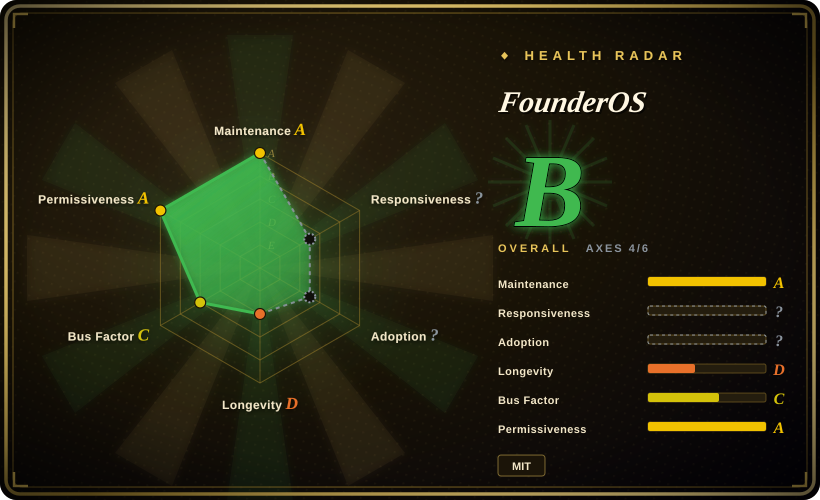
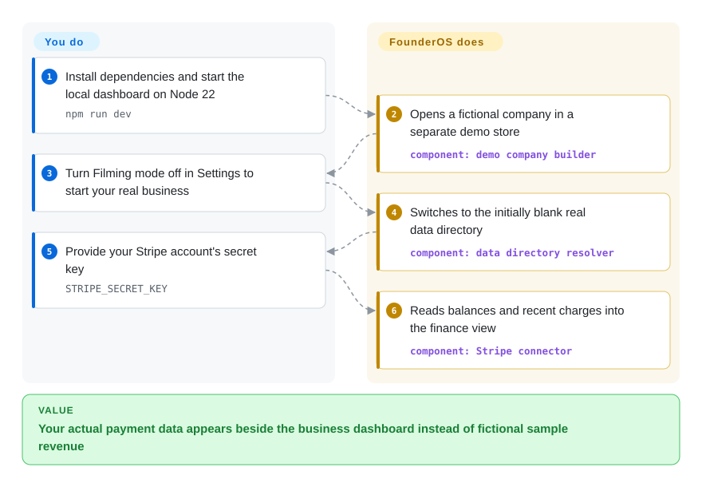
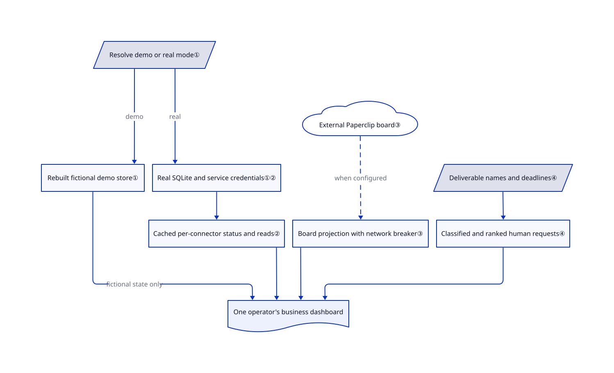

# FounderOS

You check a payment balance, an unanswered client message and an agent's stalled task in three different places. FounderOS puts those views in one local business dashboard, but its first-run company is fictional and real agents still need their own backend.

## When to use

You run a solo consultancy or creator business. Before replying to a client, you switch from the inbox to Stripe, then ask which agent prepared the draft. You want one private screen for communications, revenue, content and agent work without replacing every service you already use. FounderOS supplies that screen over local SQLite records and service connectors; you supply accounts, credentials and the work-running services.

Choose it over Paperclip alone when business context around the agent board matters as much as dispatching agents. Choose it over Macro when one operator and a local Node process fit better than adopting a team-wide workspace. The decisive tradeoff is a broad, editable operator interface rather than a complete autonomous company: several named agents only inspect existing services or report missing configuration.

## When NOT to use

- **You expect the twenty-two demo agents to start doing real work after installation.** Use [Paperclip](paperclip.md) with agents you have installed and configured. FounderOS's real `/agents` view reads a separate Paperclip board; its built-in runtime also contains status probes and explicit unimplemented jobs, not twenty-two turnkey employees.
- **Your job is a repeatable cross-service action, not watching a business.** Use [n8n](../../workflow-orchestration/n8n.md) for a trigger, connector chain and execution history. FounderOS aggregates domain views; a connector badge does not establish that a workflow or every payment-provider client exists.
- **Several people need distinct accounts and shared workspace permissions.** Evaluate [Macro](../../team-chat/macro.md), accepting its much heavier self-host stack. FounderOS documents one operator password, not per-person accounts or role separation.
- **You need a quiet, stable deployment or must preserve the v2 stack.** Prefer your existing n8n workflows or Paperclip board while evaluating this revision. The repository changed from Next.js to Go/SvelteKit on October 10 and back to Next.js on October 20; v2 survives as a tag, not the current architecture.
- **You require an inert, read-only dashboard around your host's credentials.** Use a narrow n8n integration with explicitly provisioned credentials instead. FounderOS resolves some keys from home-directory files, and the communication reply route can send to Slack or WhatsApp without consulting `GLADOS_WRITES`; the separate write switch is not a global read-only guarantee.

## Comparison

| Alternative | In index | Our verdict | Tradeoff |
|---|---|---|---|
| [Paperclip](paperclip.md) | ✅ | Choose Paperclip when agent scheduling, ticket ownership and budgets are the actual bottleneck; choose FounderOS when that board must sit beside income, inbox and content views. | Paperclip operates existing agents; FounderOS can consume that same board, so the two can be complementary rather than replacements. The broader dashboard adds connector and credential operations. |
| [n8n](../../workflow-orchestration/n8n.md) | ✅ | Choose n8n when a business event must reliably call several APIs; choose FounderOS when one operator primarily needs to see and steer several business areas. | n8n gives an explicit automation canvas and per-node execution records under a fair-code license; FounderOS's root license is MIT and its UI is business-shaped, but integrations differ in completeness. |
| [Macro](../../team-chat/macro.md) | ✅ | Choose Macro when coworkers must share linked mail, tasks and documents; choose FounderOS when a single operator wants a smaller local dashboard over existing tools. | Macro brings collaborative data and a substantially larger, AGPL service stack; FounderOS uses a local SQLite app and one password, not a team identity model. |

## Quick start

From a checked-out copy, use Node 22, run `npm install`, then `npm run dev` and open `http://localhost:4100`; Node 22 is also the CI version. The first screen uses a fictional company in `demo-data/`, not your business. In Settings, turn Filming mode off to use the initially blank `data/` store, then supply the credentials for the services you need; for example, `STRIPE_SECRET_KEY` lets the finance connector read balances and charges. FounderOS assembles the views; you own API access, provider charges, backups and any Paperclip board behind real agent work. Before remote access, set the operator password in Settings → Security and restart with an intentional bind address; use `npm run preview` for a built application rather than development compilation.

<!-- flow-steps:begin (generated from flows/founderos.json by tools/flow_card.py — do not edit) -->

Text version of the flow

1. **You**: Install dependencies and start the local dashboard on Node 22 — `npm run dev`
2. **FounderOS**: Opens a fictional company in a separate demo store — component: `demo company builder`
3. **You**: Turn Filming mode off in Settings to start your real business
4. **FounderOS**: Switches to the initially blank real data directory — component: `data directory resolver`
5. **You**: Provide your Stripe account's secret key — `STRIPE_SECRET_KEY`
6. **FounderOS**: Reads balances and recent charges into the finance view — component: `Stripe connector`

**Value**: Your actual payment data appears beside the business dashboard instead of fictional sample revenue

<!-- flow-steps:end -->

## Key techniques

<!-- mechanism:begin (generated from mechanisms/founderos.json by tools/mechanism_card.py; do not edit) -->

Text version of the mechanism

- Resolve demo or real mode①
- Rebuilt fictional demo store①
- Real SQLite and service credentials①②
- Cached per-connector status and reads②
- External Paperclip board③
- Board projection with network breaker③
- Deliverable names and deadlines④
- Classified and ranked human requests④
- One operator's business dashboard

- Resolve demo or real mode① → Rebuilt fictional demo store① (demo)
- Resolve demo or real mode① → Real SQLite and service credentials①② (real)
- Real SQLite and service credentials①② → Cached per-connector status and reads②
- Cached per-connector status and reads② → One operator's business dashboard
- Rebuilt fictional demo store① → One operator's business dashboard (fictional state only)
- External Paperclip board③ → Board projection with network breaker③ (when configured) [optional/fallback]
- Board projection with network breaker③ → One operator's business dashboard
- Deliverable names and deadlines④ → Classified and ranked human requests④
- Classified and ranked human requests④ → One operator's business dashboard

<!-- mechanism:end -->

### 1. Switch datasets instead of seeding over real records

- **Problem:** A convincing demonstration can pollute real financial and customer history if both share a store.
- **How:** A mode resolver chooses `demo-data/` or `data/`; the demo builder shifts sample dates forward and rebuilds its own directory after a week. A seed guard refuses the normal real-data path.
- **Limits:** Demo edits are disposable. Explicit path and seed overrides exist, so this is a storage convention with guards, not a sandbox against malicious code or operator overrides.
- **Source:** [Mode and seed guard](https://github.com/Bennettxai/FounderOS/blob/fb974bfcdf529cb6c8faeb1473d561d26e3d103a/lib/paths.ts#L12-L90), [demo rebuild](https://github.com/Bennettxai/FounderOS/blob/fb974bfcdf529cb6c8faeb1473d561d26e3d103a/lib/demo/store.ts#L62-L101).

### 2. Separate missing credentials from failed reads, but inspect each badge's meaning

- **Problem:** An attractive dashboard can make an unimplemented integration look operational.
- **How:** A connector registry collects per-service status and converts thrown checks to errors. It shares cached checks across pages, while saving a key invalidates the cache. Stripe status actually reads the balance; missing keys produce `not_configured`.
- **Limits:** Verification is not uniform: LLM status reports `connected` when a key exists, and non-Stripe payment status can mean configured-only. Demo mode supplies synthetic connector states. A green badge is not end-to-end proof.
- **Source:** [Registry and cache](https://github.com/Bennettxai/FounderOS/blob/fb974bfcdf529cb6c8faeb1473d561d26e3d103a/lib/connectors/index.ts#L89-L126), [credential precedence and invalidation](https://github.com/Bennettxai/FounderOS/blob/fb974bfcdf529cb6c8faeb1473d561d26e3d103a/lib/creds.ts#L76-L158), [payment checks](https://github.com/Bennettxai/FounderOS/blob/fb974bfcdf529cb6c8faeb1473d561d26e3d103a/lib/connectors/payments.ts#L202-L248), [LLM status](https://github.com/Bennettxai/FounderOS/blob/fb974bfcdf529cb6c8faeb1473d561d26e3d103a/lib/connectors/llm.ts#L130-L143).

### 3. Project a separate agent board into the business screen

- **Problem:** Business context and actual agent execution history live in different applications.
- **How:** The real agents page reads agents, issues and heartbeat runs from Paperclip using a board key and company identifier. Network failures open a thirty-second circuit breaker, which suppresses repeated calls while the board is unreachable.
- **Limits:** FounderOS does not acquire Paperclip's execution engine by rendering it. List helpers return empty lists on failure, so an empty view alone cannot distinguish no work from a broken board; the status check is separate.
- **Source:** [Page composition](https://github.com/Bennettxai/FounderOS/blob/fb974bfcdf529cb6c8faeb1473d561d26e3d103a/app/agents/page.tsx#L27-L46), [board credentials, breaker and reads](https://github.com/Bennettxai/FounderOS/blob/fb974bfcdf529cb6c8faeb1473d561d26e3d103a/founderos/lib/connectors/paperclip.ts#L189-L295), [status verification](https://github.com/Bennettxai/FounderOS/blob/fb974bfcdf529cb6c8faeb1473d561d26e3d103a/founderos/lib/connectors/paperclip.ts#L495-L529).

### 4. Turn named deliverables into a human decision queue

- **Problem:** A finished report and a reply waiting for approval look alike in a flat file list.
- **How:** A classifier reads filename markers such as `STAGED`, `decision` and `draft`, with completed markers taking precedence. It promotes deadline-bearing files into requests and ranks overdue items, waiting people and upcoming deadlines before ordinary blocked work.
- **Limits:** The classifier trusts naming conventions and file dates. It is a deterministic display queue, not model reasoning, permission enforcement or proof that approving a document safely performs its promised action.
- **Source:** [Classification and ranking](https://github.com/Bennettxai/FounderOS/blob/fb974bfcdf529cb6c8faeb1473d561d26e3d103a/founderos/lib/board-approvals.ts#L97-L211).

## Tech stack

- TypeScript, Next.js 14 App Router, React 18 and Tailwind CSS 3; the current checkout is not the Go/SvelteKit v2 stack.
- Local SQLite via `better-sqlite3` and Zod record validation; D3 force layout supports graph views.
- IMAP/SMTP libraries and service SDKs for connectors; Vercel AI SDK for gateway-backed agent chat. Vitest tests and a Node 22 CI workflow are present.
- Sources: [manifest](https://github.com/Bennettxai/FounderOS/blob/fb974bfcdf529cb6c8faeb1473d561d26e3d103a/package.json), [CI](https://github.com/Bennettxai/FounderOS/blob/fb974bfcdf529cb6c8faeb1473d561d26e3d103a/.github/workflows/ci.yml).

## Dependencies

- Node 22 and npm are the safest documented baseline here. The README says Node 22 or newer, but the current manifest again declares `better-sqlite3` 11; [PR #10](https://github.com/Bennettxai/FounderOS/pull/10) describes Node 24 prebuild failures for that major. Do not assume the older merged bump survives the v3 replacement.
- Writable local storage for SQLite and files; no separate database server for the base dashboard. Protect `.env.local` and back up the real data directory.
- Each live service requires its own account and credentials. Gateway chat needs `AI_GATEWAY_API_KEY`; the real agents board needs an independently running Paperclip plus `PAPERCLIP_API_URL`, `PAPERCLIP_BOARD_KEY` and `PAPERCLIP_COMPANY_ID`.
- Optional knowledge search uses the gbrain CLI and a Markdown store, with plain-text fallback. Other feature paths may require local daemons, sender binaries or paid content APIs; they are not all bundled. See the [environment inventory](https://github.com/Bennettxai/FounderOS/blob/fb974bfcdf529cb6c8faeb1473d561d26e3d103a/.env.example).

## Ops difficulty

**Low to inspect the demo; medium-to-high for real business use.** The base process and SQLite are small. The work is provisioning service access, checking which connectors really read data, maintaining optional host daemons and protecting credentials that may be resolved outside this project. Scheduled jobs require an always-on single host; `GLADOS_CRON` defaults off. `GLADOS_WRITES` gates selected launch paths, not every send route: review actual routes before granting sensitive keys. Keep initial evaluation on loopback and use an isolated OS account if existing home-directory credentials must stay out of reach.

Sources: [switches](https://github.com/Bennettxai/FounderOS/blob/fb974bfcdf529cb6c8faeb1473d561d26e3d103a/lib/gates.ts#L1-L40), [credential fallback](https://github.com/Bennettxai/FounderOS/blob/fb974bfcdf529cb6c8faeb1473d561d26e3d103a/lib/creds.ts#L42-L51), [reply route](https://github.com/Bennettxai/FounderOS/blob/fb974bfcdf529cb6c8faeb1473d561d26e3d103a/app/api/comms/reply/route.ts#L29-L51), [bind guard](https://github.com/Bennettxai/FounderOS/blob/fb974bfcdf529cb6c8faeb1473d561d26e3d103a/scripts/serve.mjs#L68-L80).

## Health & viability

- **Maintenance, 2026-10-21:** last push October 20; no published GitHub releases. The October 10 and October 20 commits replace the underlying stack, so pin a commit and treat old issues and instructions as version-specific, not current guarantees.
- **Ownership:** a personal account owns the repository; the contributors API lists Bennettxai with 11 contributions, brodyautomates with 2 and XJJelley with 1. Brody also authored the merged [GladOS port PR](https://github.com/Bennettxai/FounderOS/pull/15). The README links a commercial teaching cohort, not a foundation governance process.
- **Age and adoption:** created July 7, 2026, about three and a half months before this verification; 1,218 stars and 336 forks measure attention, not deployed businesses. [推断: based on repository age and two stack-replacement commits] Active but too young and architecturally unsettled for a strong durability prior; evaluate it as an adaptable operator UI rather than a stable business platform.
- **License and origin:** the root [LICENSE](https://github.com/Bennettxai/FounderOS/blob/fb974bfcdf529cb6c8faeb1473d561d26e3d103a/LICENSE) is MIT, copyright 2026 FounderOS. The [v3 import commit](https://github.com/Bennettxai/FounderOS/commit/042c3fe4341eecf5488f5720cdc1deb69df23aad) identifies `brodyautomates/glados d8daf67` as its base. [未验证: source repository and pinned tree returned GitHub API 404] Its original license and blob-level relationship could not be independently checked; verify inherited rights before commercial redistribution.
- **Measured health:** the automated radar covers four of six axes. Responsiveness has no qualifying sampled window (`no_window_signal`), and adoption has no package signal (`no_package_structural`); neither unknown measures poor quality. The license axis measures the detected MIT declaration, not the unavailable base's rights.

## Caveats (unverified)

- [未验证: upstream execution was excluded by this batch's read-only scope] Live connectors, the full test suite, remote-access controls and rendering were inspected in source but not exercised. No runtime or production-readiness claim is made.
- [未验证: `gh api repos/brodyautomates/glados` and its pinned tree returned 404] The declared GladOS base could not be compared by blob SHA or original license. Public collaboration is visible in PR #15, but that is not an independent licensing audit.
- [推断: based on repository age, commits and integration boundaries, without long-term deployments] The recommendation to treat it as an editable personal dashboard rather than a durable autonomous company is a selection judgment, not a measured failure rate.
