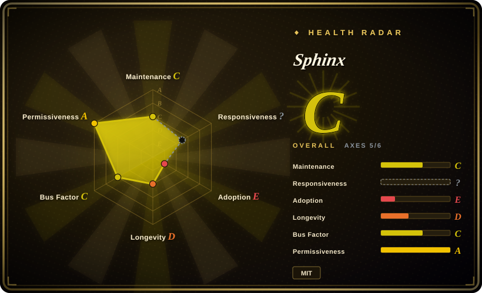
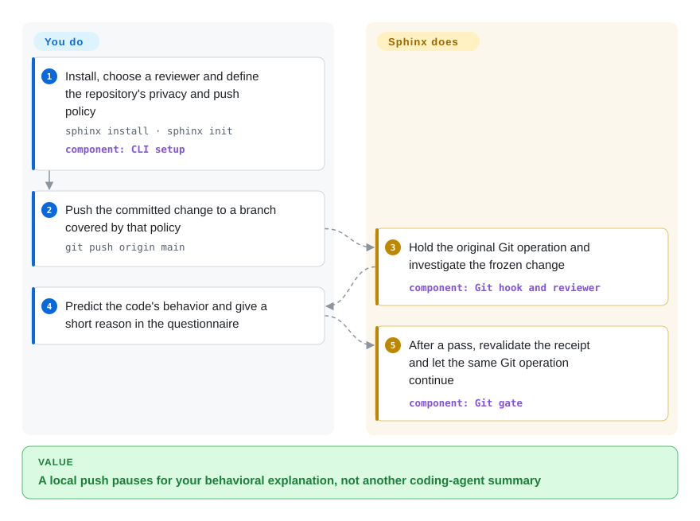
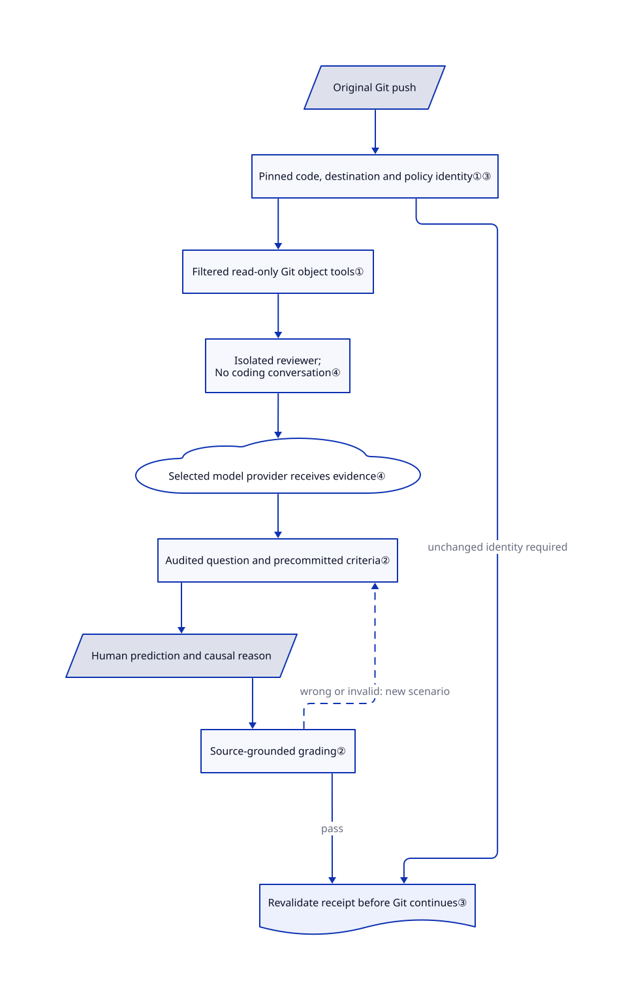

# Sphinx

Your agent finishes a change, but you cannot explain what happens if its worker crashes after writing data. Sphinx holds the Git push while a separate model asks you to predict the committed code's behavior.

## When to use

You ship agent-written changes and can read the diff, yet cannot answer “will this operation run twice after a retry?”. You want a short, open-book check before your local push continues, not another bot's review comment. Sphinx investigates the frozen change and related code, asks for a prediction with a reason, and gives a different scenario after a wrong answer.

Choose it over an annotation surface when the missing step is demonstrating your understanding, rather than telling the agent which lines to fix. The tradeoff is deliberate interruption, model usage and possible grading errors; you still own code review and release approval.

## When NOT to use

- **You need bug findings or patch suggestions.** Choose [PR-Agent](../../../ai-code-review/pr-agent.md); Sphinx tests your explanation of actual behavior, which can include understanding a bug without fixing it.
- **You need to annotate a plan or diff.** Choose [Plannotator](plannotator.md). It returns your comments to the coding agent instead of marking your answers.
- **You need a map before reading a large change.** Choose [PR Lens](../../../diagramming/pr-lens.md) for generated diagrams; Sphinx's questionnaire is not an architecture-document generator.
- **You need enforceable release authorization.** Use server-side branch protection and required reviews on your Git host. Local hooks, Skip and `sphinx yolo` are bypassable; web merges, CI-required checks and deployments are outside v0.1's coverage.
- **You cannot authorize code egress or global hook changes.** Keep a human review in your existing Git client instead. Cloud reviewer routes receive source and answers; installation changes global `core.hooksPath` unless repository scope is explicitly chosen.
- **An incorrect examiner would block urgent work.** Prefer direct human review with [Plannotator](plannotator.md). The upstream evaluation retains unresolved sufficient-answer false negatives; passing is not a reliable competency certificate.

## Comparison

| Alternative | In index | Our verdict | Tradeoff |
|---|---|---|---|
| [Plannotator](plannotator.md) | ✅ | Choose Plannotator when you must correct specific plan or diff lines; choose Sphinx when you want to test your own behavioral prediction before pushing. | Human-authored annotations preserve your judgment; Sphinx adds an examiner, model cost and grading uncertainty. |
| [PR Lens](../../../diagramming/pr-lens.md) | ✅ | Choose PR Lens when a sprawling diff needs an orientation diagram; choose Sphinx when the reader must explain a failure or boundary scenario. | A generated map helps you read without stopping Git; the questionnaire adds a personal checkpoint but not a durable architecture map. |
| [PR-Agent](../../../ai-code-review/pr-agent.md) | ✅ | Choose PR-Agent for automated findings on hosted pull requests; choose Sphinx for a local, human-answer checkpoint independent of the coding conversation. | PR-Agent posts descriptions and suggestions across Git hosts; Sphinx waits inside local Git and does not replace code review. |

## Quick start

Install with `npm install -g sphinx-understand`, then run `sphinx install` and select a reviewer account plus any client integrations. This changes machine-wide Git hooks by default, so inspect your existing hook ownership first; a repository hook override needs `sphinx install --repo`. In your project run `sphinx init`, edit `.sphinxignore` before sharing any source, and use `sphinx doctor` to check the wiring. Start a fresh coding-client session and complete any client trust prompts yourself. A matching `git push origin main` waits while you answer in the local questionnaire or terminal; after a pass, the original Git operation continues without being replayed. You pay the reviewer provider or use your signed-in coding plan, and should set `sphinx config --max-model-calls 30` because the default call count is unlimited; these source-documented steps were not executed for this entry.

<!-- flow-steps:begin (generated from flows/sphinx.json by tools/flow_card.py — do not edit) -->

Text version of the flow

1. **You**: Install, choose a reviewer and define the repository's privacy and push policy — `sphinx install · sphinx init` — component: `CLI setup`
2. **You**: Push the committed change to a branch covered by that policy — `git push origin main`
3. **Sphinx**: Hold the original Git operation and investigate the frozen change — component: `Git hook and reviewer`
4. **You**: Predict the code's behavior and give a short reason in the questionnaire
5. **Sphinx**: After a pass, revalidate the receipt and let the same Git operation continue — component: `Git gate`

**Value**: A local push pauses for your behavioral explanation, not another coding-agent summary

<!-- flow-steps:end -->

## Key techniques

<!-- mechanism:begin (generated from mechanisms/sphinx.json by tools/mechanism_card.py; do not edit) -->

Text version of the mechanism

- Original Git push
- Pinned code, destination and policy identity①③
- Filtered read-only Git object tools①
- Isolated reviewer; No coding conversation④
- Selected model provider receives evidence④
- Audited question and precommitted criteria②
- Human prediction and causal reason
- Source-grounded grading②
- Revalidate receipt before Git continues③

- Original Git push → Pinned code, destination and policy identity①③
- Pinned code, destination and policy identity①③ → Filtered read-only Git object tools①
- Filtered read-only Git object tools① → Isolated reviewer; No coding conversation④
- Isolated reviewer; No coding conversation④ → Selected model provider receives evidence④
- Selected model provider receives evidence④ → Audited question and precommitted criteria②
- Audited question and precommitted criteria② → Human prediction and causal reason
- Human prediction and causal reason → Source-grounded grading②
- Source-grounded grading② → Audited question and precommitted criteria② (wrong or invalid: new scenario) [optional/fallback]
- Source-grounded grading② → Revalidate receipt before Git continues③ (pass)
- Pinned code, destination and policy identity①③ → Revalidate receipt before Git continues③ (unchanged identity required)

<!-- mechanism:end -->

### 1. Read immutable Git objects through a small tool surface

- **Problem:** A reviewer reading the dirty checkout could ask about code that is not actually being pushed, or retrieve unrelated credentials.
- **How:** Sphinx pins the base and head or index inventory. Its reviewer can list files, read files and diffs, and search literal text through bounded tools; ignore rules apply before content retrieval, and symlinks and submodules are not followed.
- **Limits:** Paths are the privacy boundary, not secret-content detection. Allowed unchanged dependencies can also be read, binary contents cannot, and byte limits constrain evidence coverage.
- **Source:** [Snapshot identity](https://github.com/parthh01/sphinx/blob/7485020c1e8784c060d9a616adcb5ddeea6da2fb/src/git.js#L103-L168), [workspace tools](https://github.com/parthh01/sphinx/blob/7485020c1e8784c060d9a616adcb5ddeea6da2fb/src/review-workspace.js#L197-L274), [non-overridable ignores](https://github.com/parthh01/sphinx/blob/7485020c1e8784c060d9a616adcb5ddeea6da2fb/src/ignore.js#L7-L13).

### 2. Commit a small rubric before hearing the human answer

- **Problem:** A model can demand details it never asked for, or accept an explanation merely because it sounds plausible.
- **How:** Each new question commits a predicted outcome and causal reason as minimum acceptance criteria. A fresh request audits the question against retained source observations; grading checks validity before the answer, and an incorrect answer requires a new scenario about the same concept.
- **Limits:** The audit is another model request, not a separate human or guaranteed different model. Structural validation cannot eliminate semantic grading errors; disputes and ambiguity do not pass.
- **Source:** [Question criteria](https://github.com/parthh01/sphinx/blob/7485020c1e8784c060d9a616adcb5ddeea6da2fb/src/evaluator.js#L24-L80), [fresh audit](https://github.com/parthh01/sphinx/blob/7485020c1e8784c060d9a616adcb5ddeea6da2fb/src/evaluator.js#L445-L473), [grading and transfer](https://github.com/parthh01/sphinx/blob/7485020c1e8784c060d9a616adcb5ddeea6da2fb/src/evaluator.js#L508-L568).

### 3. Wake the waiting Git process, then revalidate its receipt

- **Problem:** Replaying a push from a client callback can duplicate an operation, while an old pass may no longer describe the code.
- **How:** The original hook waits for the interview and independently checks the completion receipt. Snapshot identity includes destination, code, policy, ignores and context; the default receipt lasts 24 hours, and revalidation rejects changed source or policy before continuing.
- **Limits:** A pause or timeout stops Git and requires a later retry. Skip and yolo explicitly bypass the check; documentation-only changes can pass without questions, so a success status does not imply a quiz occurred.
- **Source:** [Waiting gate and final check](https://github.com/parthh01/sphinx/blob/7485020c1e8784c060d9a616adcb5ddeea6da2fb/src/git-gate.js#L29-L129), [source revalidation](https://github.com/parthh01/sphinx/blob/7485020c1e8784c060d9a616adcb5ddeea6da2fb/src/git.js#L171-L194), [receipt and documentation path](https://github.com/parthh01/sphinx/blob/7485020c1e8784c060d9a616adcb5ddeea6da2fb/src/sessions.js#L48-L114).

### 4. Separate the examiner from the coding conversation

- **Problem:** The agent that wrote the code already has a persuasive story about it, and could answer its own questions.
- **How:** The embedded Pi session disables ambient skills, agent files, built-in tools and telemetry, using Sphinx's tools and transport instead. CLI requests run in a fresh temporary directory with conversation identifiers removed and isolation flags; the browser binds loopback and checks a random token, Host and Origin.
- **Limits:** These isolate the intended interface, not a hostile local user or agent. Cloud providers still receive evidence and answers, and local session files are not an authorization boundary against the same OS user.
- **Source:** [Pi resource isolation](https://github.com/parthh01/sphinx/blob/7485020c1e8784c060d9a616adcb5ddeea6da2fb/src/pi-runtime.js#L23-L108), [CLI isolation](https://github.com/parthh01/sphinx/blob/7485020c1e8784c060d9a616adcb5ddeea6da2fb/src/evaluator.js#L219-L232), [CLI arguments](https://github.com/parthh01/sphinx/blob/7485020c1e8784c060d9a616adcb5ddeea6da2fb/src/evaluator.js#L374-L408), [browser checks](https://github.com/parthh01/sphinx/blob/7485020c1e8784c060d9a616adcb5ddeea6da2fb/src/browser-interview.js#L54-L199).

## Tech stack

- JavaScript ES modules on Node.js 22.19+, with Git subprocesses, a built-in HTTP questionnaire and local JSON state.
- Runtime packages pin `@earendil-works/pi-ai` and `@earendil-works/pi-coding-agent` to 1.2.0. The separate Next.js landing site is not required to run checks.
- Node's test runner and synthetic Git fixtures cover the harness. The tree contains 54 source JavaScript files and 56 test-tree files at the reviewed SHA; counts do not prove coverage.

## Dependencies

- Git, Node.js and macOS, Linux or WSL; native Windows is unsupported. No database or Sphinx-hosted account is required.
- A signed-in Claude Code or Codex CLI, or OpenRouter credentials, or a configured OpenAI-compatible endpoint. Client choice and reviewer authentication are separate.
- Global installation owns a hook directory and changes Git configuration; agent integrations edit their user settings. Existing hooks chain first, and per-repository hook overrides need explicit integration.
- Source, related allowed files, project context and answers reach the reviewer provider. Built-in credential-path exclusions cannot catch secrets embedded in normal code.
- Pi install telemetry and analytics are disabled in its embedded settings; the separate [landing site](https://github.com/parthh01/sphinx/blob/7485020c1e8784c060d9a616adcb5ddeea6da2fb/site/app/layout.jsx) does load Vercel Analytics. Separately, questionnaire startup checks npm for updates; `SPHINX_UPDATE_CHECK=0` disables that call. With authenticated `gh`, GitHub commit statuses are on by default; PR comments and answer inclusion are opt-in. See [update code](https://github.com/parthh01/sphinx/blob/7485020c1e8784c060d9a616adcb5ddeea6da2fb/src/update.js#L25-L36) and [GitHub publication](https://github.com/parthh01/sphinx/blob/7485020c1e8784c060d9a616adcb5ddeea6da2fb/src/github.js#L90-L161).

## Ops difficulty

**Medium for a personal workstation.** There is no persistent server to operate, but hook ownership, client trust, credentials, spending and provider compatibility become your responsibility. Git may wait up to 25 minutes while the coding host times out sooner. Assessments and credentials remain under `~/.config/sphinx` after uninstall; installation also supports symlinked settings targets, which can modify a dotfiles checkout. Review the install scope rather than treating this as a passive CLI.

## Health & viability

- **Maintenance, 2026-10-19:** the reviewed head is `7485020`; its package says 0.1.9, but GitHub returned no releases or tags. Recent changes and a substantial test tree support evaluation, not a stable release guarantee.
- **Governance, 2026-10-19:** a User-owned repository; the contributor endpoint shows the owner at 81 contributions and the other two accounts at one each. No foundation governance is established by that signal.
- **Age and adoption, 2026-10-19:** created five UTC calendar days earlier, with 120 stars and four forks. That is attention over a very short window, not a Lindy durability record or production adoption evidence.
- **License and correctness risk:** the actual LICENSE uses MIT terms and names Sphinx contributors as copyright holders. The [evaluation docs](https://github.com/parthh01/sphinx/blob/7485020c1e8784c060d9a616adcb5ddeea6da2fb/eval/README.md#L36-L38) explicitly preserve unresolved V18 styling and V20 authorization false negatives, so do not treat a completed questionnaire as dependable certification. [推断：selection judgment based on repository age and documented grading failures] Trial it as an optional learning aid, not a mandatory organizational control.

## Caveats (unverified)

- [未验证：read-only intake, no installation or paid model execution] Hook compatibility, UI behavior, CLI isolation flags and questionnaire accuracy were inspected in source and fixtures, not exercised end to end.
- [推断：based on the five-day repository history and documented false negatives] An optional personal learning trial is a safer adoption scope than required organizational approval; no independent competency or long-term retention study was performed.
