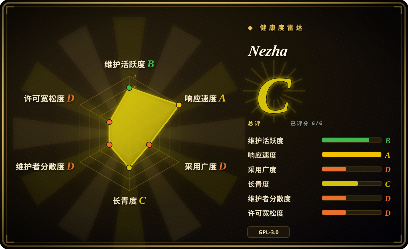
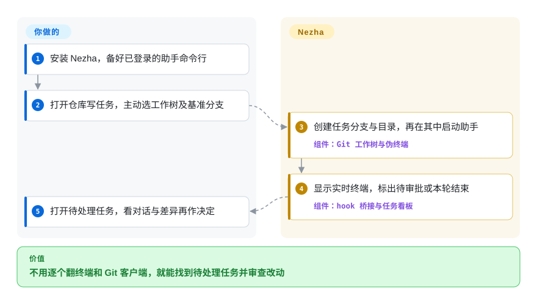
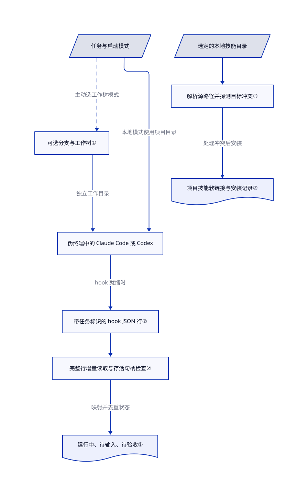

# Nezha

你来回切换项目，才找到等审批的编程助手；看它改了什么，又得打开另一个工具。Nezha 把 Claude Code 和 Codex 的任务、待办状态、会话记录与 Git 差异放进同一个桌面窗口，也能为并行任务另建工作目录。

## 何时使用

你同时用 Claude Code 或 Codex 维护几个本地仓库。一个终端等审批，另一个已结束本轮，看起来却都没动静；你只能翻终端、日志和 Git 客户端，找该介入的任务。需要按项目和任务管理的桌面界面，同时保留助手原生终端、查看历史对话并就地审查改动时，选 Nezha。它提供 macOS、Windows 和 Linux 安装包，不是只面向 Mac 的终端替代品。

决定性取舍是本地小工作台，而非更大的编排平台。相比 [Agent Orchestrator](agent-orchestrator.zh.md)，选它是为了 Claude Code／Codex 的任务、编辑器与 Git 闭环，不是跨多种助手自动回传 PR 和 CI 反馈。相比 [CloudCLI](claudecodeui.zh.md)，选它是为了在执行机器上操作桌面，而不是从手机或浏览器接入。助手安装、模型访问、任务拆分和验收仍归你负责。

## 何时不用

- **并行任务必须自动独立检出。** 新任务默认 `local`，不是工作树模式。你得主动选择工作树；想按 worker 自动分工作区，选 [Agent Orchestrator](agent-orchestrator.zh.md)。Git 工作树只分开文件，不隔离操作系统权限。
- **任务管理必须接 OpenCode、Kilo 等助手。** 本次读取的启动和 hook 路径区分 Claude Code 与 Codex；需要更广适配器，选 [Agent Orchestrator](agent-orchestrator.zh.md)。在 shell 里运行命令，不等于状态和会话解析已接通。
- **你要手机访问，或桌面断开后任务继续跑。** 浏览器接入可信主机选 [CloudCLI](claudecodeui.zh.md)，服务器进程保活选 [tmux](../../terminal-ui/tmux.zh.md)。Nezha 持有任务进程；[Windows 托盘退出路径明确终止子进程](https://github.com/hanshuaikang/nezha/blob/49a1c642e05b1f65448d78d53e21b283e73dc444/src-tauri/src/lib.rs#L200-L207)。关窗口可能只是隐藏，但真正退出后恢复对话，不等于进程保活。
- **全局助手配置不能被改。** 启动会安装桥接脚本，并向 `~/.codex/config.toml` 追加托管 hook 块，也会对 Claude 配置做旧版迁移清理。当前 Claude hook 改用启动时传入的独立配置文件。若配置变更政策不允许这些动作，保留现有命令行并用 [tmux](../../terminal-ui/tmux.zh.md)。证据见[启动路径](https://github.com/hanshuaikang/nezha/blob/49a1c642e05b1f65448d78d53e21b283e73dc444/src-tauri/src/lib.rs#L272-L282)与[安装实现](https://github.com/hanshuaikang/nezha/blob/49a1c642e05b1f65448d78d53e21b283e73dc444/src-tauri/src/hooks.rs#L515-L561)。
- **你需要不可信任务的安全边界。** 保留助手自身限制，或另设隔离环境；[tmux](../../terminal-ui/tmux.zh.md) 可承载你选择的受限命令行，不强加 Nezha 的启动参数。`full_access` 会传跳过权限或沙箱的标志；另外，Codex hook 可用时，即使不是全权限模式，也会加 `--dangerously-bypass-hook-trust`。桌面和工作树都不是沙箱。证据见[命令构造](https://github.com/hanshuaikang/nezha/blob/49a1c642e05b1f65448d78d53e21b283e73dc444/src-tauri/src/pty.rs#L476-L549)与[hook 信任处理](https://github.com/hanshuaikang/nezha/blob/49a1c642e05b1f65448d78d53e21b283e73dc444/src-tauri/src/pty.rs#L877-L888)。

## 横向对比

| 替代品 | 是否收录 | 我们的评价 | 取舍 |
|---|---|---|---|
| [Agent Orchestrator](agent-orchestrator.zh.md) | ✅ | 要把 CI 失败和评审意见自动送回不同助手，选 AO；由人驾驶本地 Claude Code／Codex 任务与 Git 流程，选 Nezha。 | AO 增加守护进程、更多适配器和反馈路由；Nezha 是 Tauri 桌面，聚焦两种助手。 |
| [CloudCLI](claudecodeui.zh.md) | ✅ | 需要手机访问工作站会话，选 CloudCLI；任务看板和编辑器就放在工作站上，选 Nezha。 | Web 服务与远程访问安全责任，换本机桌面安装；网络服务的 AGPL 条款，换桌面分发的 GPL 条款。 |
| [cmux](../../agent-frameworks/coding-agents/agent-multiplexers/cmux.zh.md) | ✅ | 在 Mac 上重视可编程终端窗格和内嵌浏览器，选 cmux；重视任务记录、代码编辑及跨桌面平台的工作树控件，选 Nezha。 | 原生 Mac 终端的命令行与 socket 原语，换 Tauri 任务工作台；两者都不替你验收。 |
| [tmux](../../terminal-ui/tmux.zh.md) | ✅ | 远程服务器断线后 shell 必须存活，选 tmux；想在本地直接看助手状态和差异、不手写界面，选 Nezha。 | tmux 提供保活和成熟脚本接口；助手状态、工作树与评审界面要自己搭。 |

## 快速上手

先独立安装并登录 Claude Code 或 Codex，再从 [v0.5.0 发布页](https://github.com/hanshuaikang/nezha/releases/tag/v0.5.0)选择系统安装包。README 说明 macOS 包未签名；应先核来源，再决定政策是否允许打开，别把移除隔离标记当作例行安装步骤。打开仓库，新建任务，选择助手和权限模式；并行改动时主动选择工作树及基准分支，工作树就是另一个带独立 Git 分支的目录。Nezha 启动命令行，展示终端与待处理状态，并提供会话和差异视图；你负责批准动作、测试结果、决定提交与合并。模型费用和命令行凭据仍由你承担；启动时全局 hook 变更属于集成本身，不是运行任务后才出现的可选动作。用法依据是 [README](https://github.com/hanshuaikang/nezha/blob/49a1c642e05b1f65448d78d53e21b283e73dc444/README_EN.md#L52-L103)、[任务选择器](https://github.com/hanshuaikang/nezha/blob/49a1c642e05b1f65448d78d53e21b283e73dc444/src/components/NewTaskView.tsx#L110-L115)与[提交路径](https://github.com/hanshuaikang/nezha/blob/49a1c642e05b1f65448d78d53e21b283e73dc444/src/App.tsx#L789-L850)。

<!-- flow-steps:begin (generated from flows/nezha.json by tools/flow_card.py — do not edit) -->

流程文字版

1. **你**：安装 Nezha，备好已登录的助手命令行
2. **你**：打开仓库写任务，主动选工作树及基准分支
3. **Nezha**：创建任务分支与目录，再在其中启动助手 — 组件：`Git 工作树与伪终端`
4. **Nezha**：显示实时终端，标出待审批或本轮结束 — 组件：`hook 桥接与任务看板`
5. **你**：打开待处理任务，看对话与差异再作决定

**价值**：不用逐个翻终端和 Git 客户端，就能找到待处理任务并审查改动

<!-- flow-steps:end -->

## 技术要点

<!-- mechanism:begin (generated from mechanisms/nezha.json by tools/mechanism_card.py; do not edit) -->

机制文字版

- 任务与启动模式
- 可选分支与工作树①
- 伪终端中的 Claude Code 或 Codex
- 带任务标识的 hook JSON 行②
- 完整行增量读取与存活句柄检查②
- 运行中、待输入、待验收②
- 选定的本地技能目录
- 解析源路径并探测目标冲突③
- 项目技能软链接与安装记录③

- 任务与启动模式 → 可选分支与工作树①（主动选工作树模式）〔可选／兜底〕
- 任务与启动模式 → 伪终端中的 Claude Code 或 Codex（本地模式使用项目目录）
- 可选分支与工作树① → 伪终端中的 Claude Code 或 Codex（独立工作目录）
- 伪终端中的 Claude Code 或 Codex → 带任务标识的 hook JSON 行②（hook 就绪时）
- 带任务标识的 hook JSON 行② → 完整行增量读取与存活句柄检查②
- 完整行增量读取与存活句柄检查② → 运行中、待输入、待验收②（映射并去重状态）
- 选定的本地技能目录 → 解析源路径并探测目标冲突③
- 解析源路径并探测目标冲突③ → 项目技能软链接与安装记录③（处理冲突后安装）

<!-- mechanism:end -->

### 1. 可选任务分支，明确合并条件

- **解决：** 多个助手在同一个检出目录写文件，容易覆盖彼此的改动。
- **做法：** 工作树模式在选定基准分支上创建 `.nezha/worktrees/<task_id>` 与 `nezha/task-<suffix>` 分支，再在该目录启动助手。合并前拒绝工作树未提交改动；主检出正在基准分支时创建合并提交，否则只做本地分支引用的快进更新。
- **边界：** 默认仍是本地模式。分支分叉可能需要手工合并；丢弃会强制删除工作树和分支，能销毁未提交或未合并工作。这只分开文件，不构成安全隔离。
- **源码：** [创建与合并](https://github.com/hanshuaikang/nezha/blob/49a1c642e05b1f65448d78d53e21b283e73dc444/src-tauri/src/git.rs#L1451-L1629)、[启动目录](https://github.com/hanshuaikang/nezha/blob/49a1c642e05b1f65448d78d53e21b283e73dc444/src/App.tsx#L789-L850)、[本地模式默认值](https://github.com/hanshuaikang/nezha/blob/49a1c642e05b1f65448d78d53e21b283e73dc444/src/components/NewTaskView.tsx#L110-L115)。

### 2. 分开待审批与本轮结束

- **解决：** 终端安静下来，不代表你知道它在等审批、结束一轮，还是已经退出。
- **做法：** Node 桥接脚本统一两种助手的 hook 字段，追加带任务标识的 JSON 行。监听器增量读取完整行，把审批映射为 `input_required`，Stop 映射为 `awaiting_review`，提示词或工具活动映射为 `running`。它只向仍有进程句柄的任务发状态，并去重重复状态。
- **边界：** hook 就绪要求 Node，以及 Claude 2.1.87 或 Codex 0.131.0 起的版本；不就绪时启动路径退回状态与会话轮询。桥接脚本写入失败也返回成功，所以状态角标不是执行审计，更不证明任务做对了。
- **源码：** [桥接脚本](https://github.com/hanshuaikang/nezha/blob/49a1c642e05b1f65448d78d53e21b283e73dc444/src-tauri/src/nezha-hook.mjs#L9-L72)、[增量读取与状态映射](https://github.com/hanshuaikang/nezha/blob/49a1c642e05b1f65448d78d53e21b283e73dc444/src-tauri/src/event_watcher.rs#L127-L285)、[版本门槛](https://github.com/hanshuaikang/nezha/blob/49a1c642e05b1f65448d78d53e21b283e73dc444/src-tauri/src/hooks.rs#L24-L28)、[回退路径](https://github.com/hanshuaikang/nezha/blob/49a1c642e05b1f65448d78d53e21b283e73dc444/src-tauri/src/pty.rs#L945-L959)。

### 3. 用有记录的软链接共享本地技能源

- **解决：** 把技能复制到每个项目的助手目录，会留下多份待同步版本。
- **做法：** Skill Hub 使用你选定的本地源目录。安装时校验解析后的源仍在目录内，查找目标项目，再向对应助手的技能目录创建软链接。已有同目标链接时幂等处理；探测模式返回冲突，不直接覆盖，并用安装记录保存源与目标。
- **边界：** 这分发本地文件，不替你判断可信度和兼容性。覆盖模式能删除已有真实目录；常规卸载只删链接，不删源。把第三方技能交给助手前，仍需审查内容。
- **源码：** [路径检查、冲突与建链](https://github.com/hanshuaikang/nezha/blob/49a1c642e05b1f65448d78d53e21b283e73dc444/src-tauri/src/skills.rs#L679-L784)、[覆盖删除](https://github.com/hanshuaikang/nezha/blob/49a1c642e05b1f65448d78d53e21b283e73dc444/src-tauri/src/skills.rs#L445-L457)、[卸载](https://github.com/hanshuaikang/nezha/blob/49a1c642e05b1f65448d78d53e21b283e73dc444/src-tauri/src/skills.rs#L799-L833)。

## 技术栈

- TypeScript、React 19 与 Vite；CodeMirror 6 编辑器、xterm.js 6 终端渲染，DOMPurify 与 marked 处理 Markdown。见[前端依赖](https://github.com/hanshuaikang/nezha/blob/49a1c642e05b1f65448d78d53e21b283e73dc444/package.json)。
- Rust 后端使用 Tauri 2、portable-pty、Tokio、notify 与 reqwest。Windows 随包携带 ConPTY 组件，并保留 Microsoft MIT 许可证及第三方声明。见 [Cargo 依赖](https://github.com/hanshuaikang/nezha/blob/49a1c642e05b1f65448d78d53e21b283e73dc444/src-tauri/Cargo.toml)与 [ConPTY 许可](https://github.com/hanshuaikang/nezha/blob/49a1c642e05b1f65448d78d53e21b283e73dc444/src-tauri/resources/conpty/LICENSE)。
- 项目与任务 JSON 放在 `~/.nezha`，经临时文件、文件同步与重命名写入；会话视图解析助手自己的日志。见[存储实现](https://github.com/hanshuaikang/nezha/blob/49a1c642e05b1f65448d78d53e21b283e73dc444/src-tauri/src/storage.rs#L99-L212)与[会话解析](https://github.com/hanshuaikang/nezha/blob/49a1c642e05b1f65448d78d53e21b283e73dc444/src-tauri/src/session.rs)。

## 依赖

- 桌面系统及 Tauri 使用的系统 WebView；仓库和工作树操作需要 Git。Claude Code 或 Codex 要自行安装并登录；它只是外层工作台，不内置模型推理。
- PATH 中的 Node 用于 hook 桥接；命令行太旧或 hook 未就绪时走轮询。源码构建还需要 Node／pnpm、Rust 与对应平台的 Tauri 工具链。
- 助手和模型供应商需要网络。Nezha 也会从 `nezha.hanshutx.com/notifications.json` 获取公告；Claude 用量功能读取 macOS 钥匙串凭据，再请求 Anthropic 用量接口。本地任务存储不等于应用完全离线。见[公告请求](https://github.com/hanshuaikang/nezha/blob/49a1c642e05b1f65448d78d53e21b283e73dc444/src-tauri/src/notification.rs#L225-L277)与[用量请求](https://github.com/hanshuaikang/nezha/blob/49a1c642e05b1f65448d78d53e21b283e73dc444/src-tauri/src/usage.rs#L365-L449)。

## 运维难度

**单人使用低到中。** 不必运维外部数据库，但命令行登录、模型费用、全局 hook 兼容、本地 JSON 备份及工作树清理由你负责。打开项目会创建项目级 Nezha 配置；丢弃可以强制删除任务工作树和分支。依赖 hook 状态前，固定应用和命令行版本。[Linux 输入法问题仍有开放报告](https://github.com/hanshuaikang/nezha/issues/385)，提供安装包不等于平台体验已验证一致。

## 健康度与可持续性

- **维护，截至 2026-10-22：** [v0.5.0](https://github.com/hanshuaikang/nezha/releases/tag/v0.5.0) 于 9 月 17 日发布，前版 v0.4.7 为 8 月 1 日；本次读取的 main 提交日期为 9 月 16 日。仓库未归档，但不是日更发布节奏。
- **治理：** 仓库属于个人账号；[贡献者接口](https://api.github.com/repos/hanshuaikang/nezha/contributors)给出 owner 241 次贡献，另外九人合计 33 次。本次目录未见治理文件或 CODEOWNERS，路线明显集中在作者身上。
- **年龄与持续性：** 2026 年 3 月 22 日建仓，核验时约七个月。[推断：依据仓库年龄与未到 1.0 的发布历史] 适合可撤回的个人工作台试用，不宜直接当作长期团队平台标准；林迪证据仍少。
- **采用与护栏：** 1,908 个星标代表关注，不是活跃安装量。目录含 25 个前端测试文件和 82 处 Rust 测试标记；[CI](https://github.com/hanshuaikang/nezha/blob/49a1c642e05b1f65448d78d53e21b283e73dc444/.github/workflows/checks.yml)运行前端 lint、测试、构建和 cargo-audit。存在测试不代表本次运行过。[审计配置](https://github.com/hanshuaikang/nezha/blob/49a1c642e05b1f65448d78d53e21b283e73dc444/src-tauri/.cargo/audit.toml)解释并豁免两条构建路径上的 quick-xml 公告。
- **风险与许可：** [GPLv3](https://github.com/hanshuaikang/nezha/blob/49a1c642e05b1f65448d78d53e21b283e73dc444/LICENSE)、未签名 macOS 安装、命令行格式耦合、自动全局 hook 改动及显式绕过标志，是实际选型检查点。根许可证是标准 GPLv3 文本，不代表无关第三方资源自动变成 GPL。评分器的原始分类 `strong_network_copyleft` 把 GPL 和 AGPL 放在同一评分组，不能读成此 GPLv3 应用承担 AGPL 式网络源码义务。

## 存疑（未验证）

- [未验证：本批只读调研，禁止执行上游] 安装、界面渲染、hook 投递、会话恢复、工作树合并及三平台行为仅核对源码，未实际运行。Linux 输入法问题来自用户报告，本次没有复现。
- [推断：依据 2026 年 3 月建仓、未到 1.0 的发布历史与贡献集中度] 可撤回试用是选型判断，不是预言项目会停止维护。
- [未验证：已读材料没有受控基准或活跃用户数据] 不采信 README 的固定 7 MB 安装包和五倍吞吐为实测收益；v0.5.0 包大小随平台不同，下载量和星标都不能证明生产采用或效率提升。
