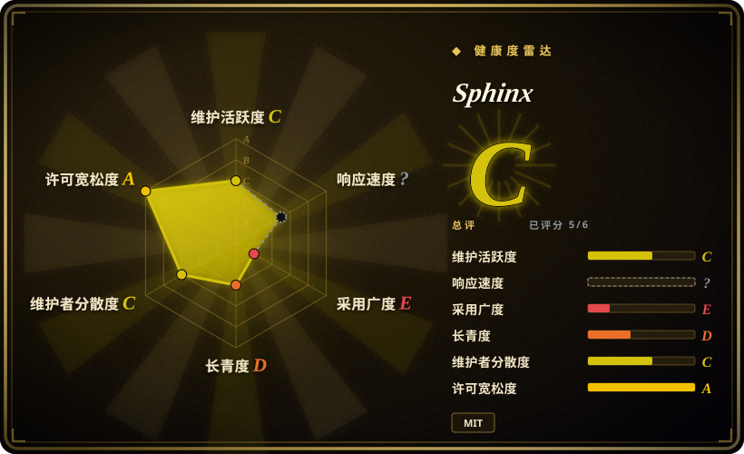
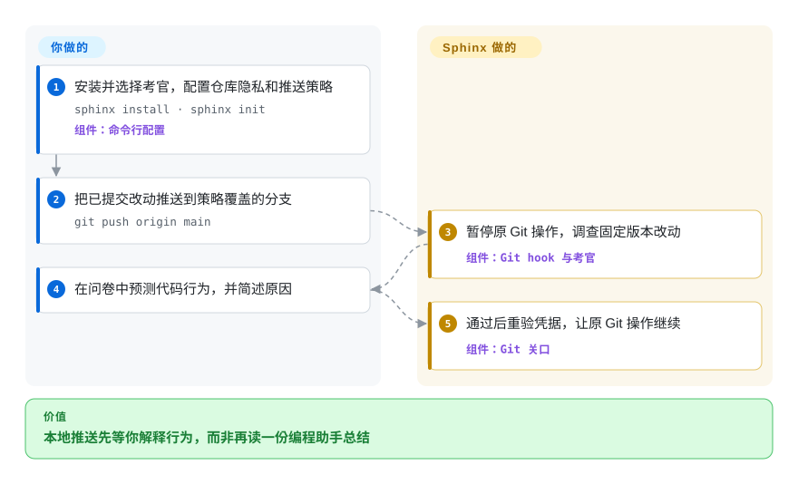
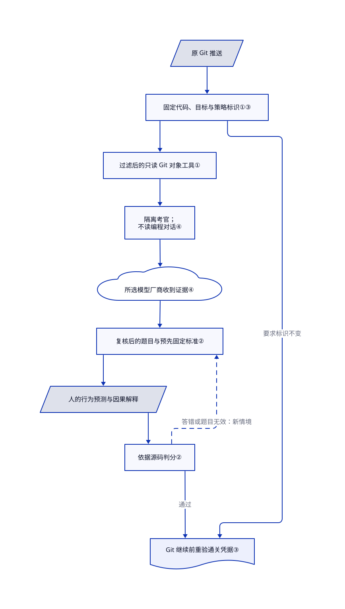

# Sphinx

agent 改完代码，你却说不清“写完数据后进程崩溃，重试会怎样”。Sphinx 暂停 Git 推送，让独立模型按已提交的代码出题，请你预测行为。

## 何时使用

你要发布 agent 写的改动，看得懂差异，却答不上“重试会不会把操作执行两次”。你希望本地推送前，先做一次可查阅代码的短问答，而非再收一份机器评审。Sphinx 调查固定版本的改动与相关代码，请你预测结果并解释原因；答错后，它换个情境考同一概念。

若缺的是证明自己理解，而不是告诉 agent 哪行需要修，选它而非批注工具。代价是主动打断工作、消耗模型额度，也可能遇到判分错误；代码评审与发布批准仍由你负责。

## 何时不用

- **你要找缺陷或建议补丁。** 选 [PR-Agent](../../ai-code-review/pr-agent.zh.md)。Sphinx 考的是你能否解释真实行为；理解某个缺陷不等于修复它。
- **你要批注计划或代码差异。** 选 [Plannotator](plannotator.zh.md)。它把你的修改意见交给编程助手，不给你的答案打分。
- **你需要先看懂大改动的全貌。** 选 [PR Lens](../../diagramming/pr-lens.zh.md) 生成结构图；问卷不是架构文档生成器。
- **你要不可绕过的发布授权。** 使用 Git 托管端的分支保护与强制评审。本地 hook、跳过按钮和 `sphinx yolo` 均可绕过；网页合并、CI 强制检查与部署不在 v0.1 覆盖内。
- **你不能授权代码外发或全局 hook 修改。** 保留现有 Git 客户端中的人工评审。云端考官会收到源码与答案；除非显式选择仓库范围，安装会修改全局 `core.hooksPath`。
- **错误考官可能耽误紧急工作。** 用 [Plannotator](plannotator.zh.md) 直接人工评审。上游评测保留了把充分答案误判为未通过的未解决样例，不能把通关当作可靠能力认证。

## 横向对比

| 替代品 | 是否收录 | 我们的评价 | 取舍 |
|---|---|---|---|
| [Plannotator](plannotator.zh.md) | ✅ | 要指出计划或差异中的具体错误，选 Plannotator；要在推送前验证自己的行为预测，选 Sphinx。 | 人工批注保留你的判断；Sphinx 增加考官、模型费用与判分不确定性。 |
| [PR Lens](../../diagramming/pr-lens.zh.md) | ✅ | 大片差异需要结构导览时，选 PR Lens；读者必须解释故障或边界情境时，选 Sphinx。 | 自动结构图帮助阅读且不阻塞 Git；问卷增加个人检查点，却不产出长期架构地图。 |
| [PR-Agent](../../ai-code-review/pr-agent.zh.md) | ✅ | 要在托管端拉取请求上自动找问题，选 PR-Agent；要脱离编程对话、本地由人作答，选 Sphinx。 | PR-Agent 跨托管平台发布描述与建议；Sphinx 在本地 Git 内等待，不替代代码评审。 |

## 快速上手

用 `npm install -g sphinx-understand` 安装，再运行 `sphinx install`，选择考官账户与需要的客户端集成。默认会修改整台机器的 Git hooks，先检查现有 hook 归属；仓库覆盖了 hook 路径时，需要 `sphinx install --repo`。进入项目运行 `sphinx init`，在首次外发源码前编辑 `.sphinxignore`，再用 `sphinx doctor` 检查接线。启动新的编程客户端会话，并亲自完成信任确认。匹配策略的 `git push origin main` 会等待你在本地问卷或终端作答；通过后原 Git 操作继续，不重放推送。模型费用由你承担，或消耗已登录编程账户的额度；默认调用数无限制，建议设置 `sphinx config --max-model-calls 30`；本页仅核对了源码中的使用路径，没有执行这些命令。

<!-- flow-steps:begin (generated from flows/sphinx.json by tools/flow_card.py — do not edit) -->

流程文字版

1. **你**：安装并选择考官，配置仓库隐私和推送策略 — `sphinx install · sphinx init` — 组件：`命令行配置`
2. **你**：把已提交改动推送到策略覆盖的分支 — `git push origin main`
3. **Sphinx**：暂停原 Git 操作，调查固定版本改动 — 组件：`Git hook 与考官`
4. **你**：在问卷中预测代码行为，并简述原因
5. **Sphinx**：通过后重验凭据，让原 Git 操作继续 — 组件：`Git 关口`

**价值**：本地推送先等你解释行为，而非再读一份编程助手总结

<!-- flow-steps:end -->

## 技术要点

<!-- mechanism:begin (generated from mechanisms/sphinx.json by tools/mechanism_card.py; do not edit) -->

机制文字版

- 原 Git 推送
- 固定代码、目标与策略标识①③
- 过滤后的只读 Git 对象工具①
- 隔离考官； 不读编程对话④
- 所选模型厂商收到证据④
- 复核后的题目与预先固定标准②
- 人的行为预测与因果解释
- 依据源码判分②
- Git 继续前重验通关凭据③

- 原 Git 推送 → 固定代码、目标与策略标识①③
- 固定代码、目标与策略标识①③ → 过滤后的只读 Git 对象工具①
- 过滤后的只读 Git 对象工具① → 隔离考官； 不读编程对话④
- 隔离考官； 不读编程对话④ → 所选模型厂商收到证据④
- 所选模型厂商收到证据④ → 复核后的题目与预先固定标准②
- 复核后的题目与预先固定标准② → 人的行为预测与因果解释
- 人的行为预测与因果解释 → 依据源码判分②
- 依据源码判分② → 复核后的题目与预先固定标准②（答错或题目无效：新情境）〔可选／兜底〕
- 依据源码判分② → Git 继续前重验通关凭据③（通过）
- 固定代码、目标与策略标识①③ → Git 继续前重验通关凭据③（要求标识不变）

<!-- mechanism:end -->

### 1. 通过小型工具界面读取不可变 Git 对象

- **解决：** 考官直接读取脏工作区，可能考到并未推送的代码，或读到无关凭据。
- **做法：** 固定基线与目标提交，或暂存区文件清单。考官只能通过有界工具列文件、读文件与差异、搜索字面文本；取内容前先应用忽略规则，不跟随软链和子模块。
- **边界：** 隐私边界是路径，不是秘密内容识别。允许的未改依赖也可读取，二进制内容不能读，字节限制也会约束证据覆盖。
- **源码：** [快照标识](https://github.com/parthh01/sphinx/blob/7485020c1e8784c060d9a616adcb5ddeea6da2fb/src/git.js#L103-L168)、[工作区工具](https://github.com/parthh01/sphinx/blob/7485020c1e8784c060d9a616adcb5ddeea6da2fb/src/review-workspace.js#L197-L274)、[不可撤销的忽略项](https://github.com/parthh01/sphinx/blob/7485020c1e8784c060d9a616adcb5ddeea6da2fb/src/ignore.js#L7-L13)。

### 2. 听答案前先固定最小判分标准

- **解决：** 模型可能追问题目从未要求的细节，也可能仅因答案听起来合理就放行。
- **做法：** 新题预先固定“预测结果”和“因果原因”两项最低要求。新请求先根据保留的源码证据复核题目；判分先检查题目有效性，答错则必须换个情境考同一概念。
- **边界：** 复核仍是模型请求，不是另一位人类，也不保证换模型。结构校验不能消灭语义误判；申诉和模糊结果均不算通过。
- **源码：** [题目标准](https://github.com/parthh01/sphinx/blob/7485020c1e8784c060d9a616adcb5ddeea6da2fb/src/evaluator.js#L24-L80)、[独立请求复核](https://github.com/parthh01/sphinx/blob/7485020c1e8784c060d9a616adcb5ddeea6da2fb/src/evaluator.js#L445-L473)、[判分与迁移题](https://github.com/parthh01/sphinx/blob/7485020c1e8784c060d9a616adcb5ddeea6da2fb/src/evaluator.js#L508-L568)。

### 3. 唤醒原 Git 进程，再验证通关凭据

- **解决：** 客户端回调重放推送可能造成重复操作；旧通关结果也可能已经不对应当前代码。
- **做法：** 原 hook 等待问答结束，随后独立检查通关凭据。快照标识包含目标、代码、策略、忽略项与上下文；默认有效期为 24 小时，放行前拒绝源码或策略变化。
- **边界：** 暂停或超时会终止 Git，之后需要重试。跳过与 yolo 明确绕过检查；纯文档改动可以不出题直接通过，因此成功状态不代表真的考过。
- **源码：** [等待与最终验证](https://github.com/parthh01/sphinx/blob/7485020c1e8784c060d9a616adcb5ddeea6da2fb/src/git-gate.js#L29-L129)、[源码重验](https://github.com/parthh01/sphinx/blob/7485020c1e8784c060d9a616adcb5ddeea6da2fb/src/git.js#L171-L194)、[凭据与文档路径](https://github.com/parthh01/sphinx/blob/7485020c1e8784c060d9a616adcb5ddeea6da2fb/src/sessions.js#L48-L114)。

### 4. 把考官与编程对话分开

- **解决：** 写代码的 agent 已经有一套解释，也可能代人作答。
- **做法：** 内嵌 Pi 会话禁用环境中的技能、agent 指令文件、内建工具和遥测，只使用 Sphinx 的工具与传输层。命令行请求在新临时目录启动，清理父对话标识并设置隔离参数；浏览器服务仅绑定回环地址，检查随机令牌、主机与来源。
- **边界：** 这些限制的是预期交互界面，不是恶意本地用户或 agent。云端厂商仍收到证据和答案；本地会话文件也不是同一操作系统用户之间的授权边界。
- **源码：** [Pi 资源隔离](https://github.com/parthh01/sphinx/blob/7485020c1e8784c060d9a616adcb5ddeea6da2fb/src/pi-runtime.js#L23-L108)、[子进程环境](https://github.com/parthh01/sphinx/blob/7485020c1e8784c060d9a616adcb5ddeea6da2fb/src/evaluator.js#L219-L232)、[命令行参数](https://github.com/parthh01/sphinx/blob/7485020c1e8784c060d9a616adcb5ddeea6da2fb/src/evaluator.js#L374-L408)、[浏览器校验](https://github.com/parthh01/sphinx/blob/7485020c1e8784c060d9a616adcb5ddeea6da2fb/src/browser-interview.js#L54-L199)。

## 技术栈

- JavaScript ES 模块，运行于 Node.js 22.19+；使用 Git 子进程、内建 HTTP 问卷和本地 JSON 状态。
- 运行时固定依赖 `@earendil-works/pi-ai` 与 `@earendil-works/pi-coding-agent` 1.2.0。独立的 Next.js 宣传站不是检查所需组件。
- Node 测试运行器和合成 Git 仓库测试流程。固定 SHA 下有 54 个源码 JavaScript 文件、56 个测试目录文件；数量不代表覆盖率。

## 依赖

- Git、Node.js，以及 macOS、Linux 或 WSL；不支持原生 Windows。无需数据库或 Sphinx 托管账户。
- 已登录 Claude Code 或 Codex CLI，或 OpenRouter 凭据，或配置好的 OpenAI 兼容接口。编程客户端选择与考官认证相互独立。
- 全局安装会管理 hook 目录并修改 Git 配置；客户端集成会编辑用户设置。已有 hook 先运行，仓库自定义 hook 路径需显式接入。
- 源码、允许的相关文件、项目上下文与答案会送到考官厂商。内建凭据路径排除规则发现不了普通代码中的秘密。
- 内嵌 Pi 的安装遥测与分析被关闭；独立的[宣传站](https://github.com/parthh01/sphinx/blob/7485020c1e8784c060d9a616adcb5ddeea6da2fb/site/app/layout.jsx)则加载 Vercel Analytics。问卷启动另有 npm 更新检查，可用 `SPHINX_UPDATE_CHECK=0` 关闭。若 `gh` 已登录，默认发布 GitHub 提交状态；PR 评论和附带答案须主动启用。见[更新源码](https://github.com/parthh01/sphinx/blob/7485020c1e8784c060d9a616adcb5ddeea6da2fb/src/update.js#L25-L36)与[GitHub 发布路径](https://github.com/parthh01/sphinx/blob/7485020c1e8784c060d9a616adcb5ddeea6da2fb/src/github.js#L90-L161)。

## 运维难度

**个人工作站为中等。** 不需要常驻服务器，但要管理 hook 归属、客户端信任、凭据、费用与厂商兼容性。Git 最多等待 25 分钟，编程宿主可能更早超时。卸载后，问答与凭据仍保留在 `~/.config/sphinx`；安装也支持写入设置软链的目标，可能直接修改 dotfiles 仓库。因此要审查安装范围，不能把它当成被动命令行工具。

## 健康度与可持续性

- **维护，2026-10-19：** 核对的头提交为 `7485020`，包声明版本 0.1.9，但 GitHub releases 与 tags 均为空。近期改动与较大的测试目录支持试用，不代表稳定发行承诺。
- **治理，2026-10-19：** 仓库由个人账户持有；贡献者接口显示 owner 为 81 次贡献，另两账户各一次。这些信号不能证明存在基金会治理。
- **年龄与采用，2026-10-19：** 创建于五个 UTC 日历日前，有 120 星、四个 fork。极短窗口中的关注度，不是林迪耐久记录，也不是生产采用证据。
- **许可与正确性风险：** LICENSE 实文采用 MIT 条款，版权方署名 Sphinx contributors。[评测文档](https://github.com/parthh01/sphinx/blob/7485020c1e8784c060d9a616adcb5ddeea6da2fb/eval/README.md#L36-L38)明确保留了 V18 样式题、V20 授权题的未解决误判，问卷完成不能作为可靠认证。[推断：依据项目年龄与记录的判分失败] 建议只作可选学习辅助，不作组织强制控制。

## 存疑（未验证）

- [未验证：本轮只读调研，未安装或运行付费模型] hook 兼容性、界面行为、命令行隔离参数与问卷准确度只核对源码和样例，未做端到端运行。
- [推断：依据五天仓库历史与已记录的误判] 个人可选学习试用比组织强制批准更稳妥；本轮没有独立能力认证或长期记忆保持研究。
