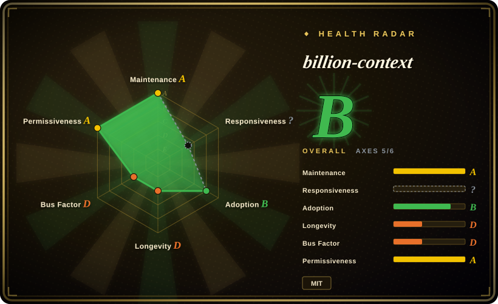
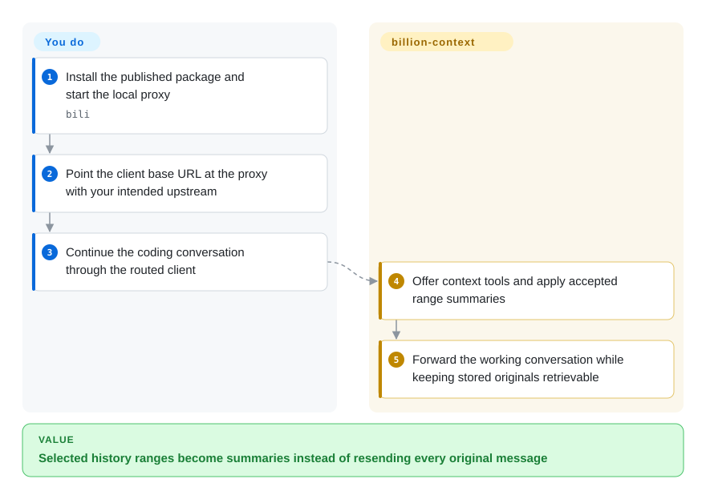
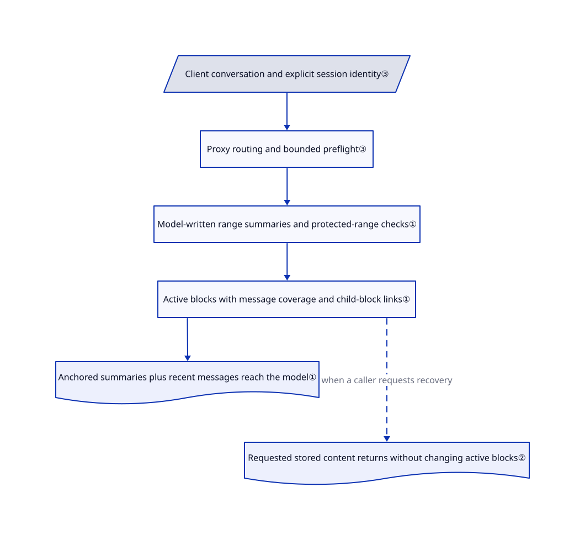

# billion-context

Your coding session repeatedly summarizes away yesterday's exact errors and decisions. billion-context folds selected history ranges into linked summaries and keeps stored originals available for later retrieval.

## When to use

You keep an existing coding agent running through a multi-step migration, but its full-history summaries keep replacing the context you still need. Choose billion-context when you want the model to select smaller history ranges to summarize, with searchable blocks and a recovery path for stored details. Unlike shell-output filters, it acts on model-bound conversation history across supported clients; unlike a cross-session memory service, its main job is keeping the current conversation usable.

You must accept a local proxy on the model-request path, additional model calls for some compression paths, and client-specific integration work. The repository contains a substantial proxy, compression kernel, native adapters and tests; it is not merely the accompanying paper.

## When NOT to use

- **You need a literal billion-token model window or guaranteed savings.** Keep the client's native compaction until your own task benchmark proves a benefit. The name refers to cumulative traffic, not simultaneous model attention. The paper separates observational totals, modeled capacity and controlled pilot results; none proves universal quality retention or fivefold savings.
- **Only shell output is wasting context.** Choose [RTK](rtk.md); it avoids routing model credentials and full conversations through another HTTP service.
- **You want local payload filtering rather than model-selected summaries.** Evaluate [Headroom](headroom.md); billion-context depends on summarizer behavior and adds context-management tools and prompts.
- **You need remembered facts in tomorrow's new session.** Choose [claude-mem](../../agent-memory/coding-agent-memory/claude-mem.md) for cross-session capture and recall. A fold ledger is not a curated, portable memory policy.
- **You require standard MIT or Apache terms.** Choose Headroom or RTK. The actual root and kernel licenses add visible product/documentation attribution; the package manifest's plain `MIT` label is incomplete.
- **You cannot accept updater-controlled installs or local history exposure.** Use native client compaction in an isolated user environment. Ordinary self-update and the independent critical-advisory installer are separate controls; disabling only auto-update does not freeze the package. Management endpoints are loopback-gated, not per-user or per-session authenticated.
- **Your OpenCode provider plugins validate upstream URLs.** Keep native OpenCode compaction until the combination is tested. [Issue #4276](https://github.com/ranxianglei/billion-context/issues/4276) reports Kiro and Antigravity conflicts; the reviewed native route does rewrite the shared request URL. Do not install another compressor alongside it to compensate.

## Comparison

| Alternative | In index | Our verdict | Tradeoff |
| --- | --- | --- | --- |
| [Headroom](headroom.md) | ✅ | Choose Headroom for content-specific payload compression; choose billion-context when model-selected history ranges and hierarchical summary blocks decide. | Headroom offers Apache-2.0 and local transforms; both add a proxy and original-retention responsibilities. |
| [RTK](rtk.md) | ✅ | Choose RTK when passing-test logs dominate; choose billion-context when conversation history, not just command output, fills the window. | RTK avoids model-API routing but cannot manage the whole conversation or summary hierarchy. |
| [claude-mem](../../agent-memory/coding-agent-memory/claude-mem.md) | ✅ | Choose claude-mem to reintroduce prior-session observations; choose billion-context to manage the working history of an ongoing conversation. | Lifecycle capture and recall versus in-flight request rewriting; neither removes model costs or privacy review. |

## Quick start

The documented package path is `npm install -g billion-context --prefix=~/.local`, followed by `bili` to start a local proxy. Point a compatible client's base URL at `http://localhost:8787/bili/https://api.openai.com/v1`, retaining your intended upstream and credentials. Send normal agent requests; the proxy offers context tools, applies accepted summaries and forwards the resulting conversation. You still supply the client, model account, storage and a task-level quality check; compression calls also consume model quota. For a frozen evaluation, set both `ACP_AUTO_UPDATE=0` and `BILI_ADVISORY_CHECK=0` before starting; native installation is a separate path that writes client configuration and can disable native compaction. This page used static inspection only; the [README usage path](https://github.com/ranxianglei/billion-context/blob/94f75ccea1b2e509a29ca46e44768dcf9364940f/README.md) was not executed.

<!-- flow-steps:begin (generated from flows/billion-context.json by tools/flow_card.py — do not edit) -->

Text version of the flow

1. **You**: Install the published package and start the local proxy — `bili`
2. **You**: Point the client base URL at the proxy with your intended upstream
3. **You**: Continue the coding conversation through the routed client
4. **billion-context**: Offer context tools and apply accepted range summaries
5. **billion-context**: Forward the working conversation while keeping stored originals retrievable

**Value**: Selected history ranges become summaries instead of resending every original message

<!-- flow-steps:end -->

## Key techniques

<!-- mechanism:begin (generated from mechanisms/billion-context.json by tools/mechanism_card.py; do not edit) -->

Text version of the mechanism

- Client conversation and explicit session identity③
- Proxy routing and bounded preflight③
- Model-written range summaries and protected-range checks①
- Active blocks with message coverage and child-block links①
- Anchored summaries plus recent messages reach the model①
- Requested stored content returns without changing active blocks②

- Client conversation and explicit session identity③ → Proxy routing and bounded preflight③
- Proxy routing and bounded preflight③ → Model-written range summaries and protected-range checks①
- Model-written range summaries and protected-range checks① → Active blocks with message coverage and child-block links①
- Active blocks with message coverage and child-block links① → Anchored summaries plus recent messages reach the model①
- Active blocks with message coverage and child-block links① → Requested stored content returns without changing active blocks② (when a caller requests recovery) [optional/fallback]

<!-- mechanism:end -->

### 1. Fold ranges into a hierarchy, not one replacement history

- **Problem:** Replacing a full conversation summary repeatedly can erase exact details and rewrite already-cached content.
- **How:** The kernel resolves message or block references, checks protected ranges, and records a summary with direct-message, child-block and effective-message coverage. Consumed child blocks become inactive; rendering inserts the active summary at its direct-range anchor.
- **Limits:** Higher tiers summarize summaries. Reference bookkeeping and range validation do not prove that a model-written summary preserves task intent or factual detail.
- **Source:** [Block creation and guards](https://github.com/ranxianglei/billion-context/blob/94f75ccea1b2e509a29ca46e44768dcf9364940f/kernel/src/compress.ts#L1474-L1583), [summary anchoring](https://github.com/ranxianglei/billion-context/blob/94f75ccea1b2e509a29ca46e44768dcf9364940f/kernel/src/prune.ts#L193-L237).

### 2. Retrieve stored content without unfolding the cached prefix

- **Problem:** Restoring an old detail by rewriting earlier messages can invalidate the provider's reusable request prefix.
- **How:** The content collector returns a block's messages as text without changing its active state. Default collection keeps nested active children as summaries; full collection traverses their effective message coverage. A caller can append the returned text as a tool result.
- **Limits:** Recovery needs retained originals and a caller that requests the right block. The paper reports that its pilot model used recovery when instructed, not spontaneously; recoverability is not automatic recall.
- **Source:** [Non-mutating content collection](https://github.com/ranxianglei/billion-context/blob/94f75ccea1b2e509a29ca46e44768dcf9364940f/kernel/src/decompress.ts#L147-L224), [pilot restorability discussion](https://github.com/ranxianglei/billion-context/blob/94f75ccea1b2e509a29ca46e44768dcf9364940f/paper/model-driven-incremental-hierarchical-compression-training-free-multi-generational-context-management-for-long-lived-coding-agents.md#L267).

### 3. Bind compression state to the conversation, not the provider account

- **Problem:** A model, credential or upstream switch must not silently orphan the conversation's existing fold ledger.
- **How:** Client conversation headers take priority, with the cooperative plugin's marker-gated identity first. OpenCode's own session header outranks inherited cache affinity, separating child sessions. Native adapters route requests through the proxy; preflight can issue bounded summarization calls before an oversized request is sent.
- **Limits:** These are identity and routing rules, not an authorization boundary. Client transport differences and shared hook mutation can still break provider plugins; preflight adds latency and paid calls.
- **Source:** [Header precedence](https://github.com/ranxianglei/billion-context/blob/94f75ccea1b2e509a29ca46e44768dcf9364940f/src/session-id.ts#L38-L90), [native URL rewrite](https://github.com/ranxianglei/billion-context/blob/94f75ccea1b2e509a29ca46e44768dcf9364940f/src/agent/opencode-native.ts#L153-L224), [preflight purpose and bounds](https://github.com/ranxianglei/billion-context/blob/94f75ccea1b2e509a29ca46e44768dcf9364940f/src/preflight.ts#L33-L84).

## Tech stack

TypeScript on Node.js, an embedded `acp-kernel`, HTTP/stream/WebSocket adapters, local SQLite storage, and optional MySQL storage. The package declares `mysql2` and Zod runtime dependencies, with Jimp optional for image handling. Native integrations include JavaScript plugins and a Python Hermes adapter.

## Dependencies

You need a compatible agent, a model endpoint and credentials, and writable local data/config/state directories. The manifest permits Node.js 20+, but the README warns that the downloaded SQLite engine needs Node.js 22+; Node.js 24 is the shipped Docker baseline. Prefer that baseline rather than treating the manifest minimum as a storage compatibility promise. Source builds require building the bundled kernel and subagent packages before the proxy; the published npm artifact contains `dist/`.

## Ops difficulty

**Medium on a personal workstation; higher on shared infrastructure.** Own proxy lifetime, client routing, disk retention, backups and version control. Some launchers use TLS interception with a local certificate authority; the explicit base-URL path above avoids needing that mode. The [management gate](https://github.com/ranxianglei/billion-context/blob/94f75ccea1b2e509a29ca46e44768dcf9364940f/src/server/admin.ts#L129-L206) checks loopback, host/origin and tunnel markers, but does not authenticate individual local users. Do not expose the proxy as a public or multi-tenant service. The [advisory watcher](https://github.com/ranxianglei/billion-context/blob/94f75ccea1b2e509a29ca46e44768dcf9364940f/src/advisory.ts#L1-L27) can force an install independently of ordinary self-update; review both update channels.

## Health & viability

- **2026-10-22 — active, not mature.** GitHub lists v0.1.204 from October 21 and same-day default-branch development. Frequent fixes and releases demonstrate maintenance, not stable client compatibility.
- **Concentrated governance.** The repository belongs to a User account; the leading contributor has 2964 commits versus 50 for the next listed human contributor. Additional contributors exist, but the observed maintenance burden is highly concentrated.
- **Young and unproven.** Created 2026-08-06, it has about two and a half months of repository history. [推断：依据是创建时间和近期发布] It is suitable for controlled evaluation, not a strong Lindy durability bet. Stars are not evidence of task-quality preservation.
- **License and evidence need care.** [LICENSE](https://github.com/ranxianglei/billion-context/blob/94f75ccea1b2e509a29ca46e44768dcf9364940f/LICENSE) is MIT text plus an extra product-attribution term, not unmodified MIT. The machine's license grade A comes from npm's `MIT` metadata and does not account for that extra obligation; the actual license text takes precedence. The paper itself limits its deployment evidence to observational use and distinguishes pilot tests from modeled ceilings; retain those distinctions when comparing tools.

## Caveats (unverified)

- [未验证：本批仅允许静态阅读，禁止运行上游] Installation, live client routing, restarts and end-to-end recovery were not exercised. The OpenCode provider-plugin issue is a public report corroborated by the reviewed URL-rewrite code, not a local reproduction.
- [未验证：没有独立复现上游实验，也未取得原始实验环境] Billion-token session claims, fivefold savings, cache-hit percentages and quality-retention claims remain author-reported or modeled. Cumulative inputs include repeated cache reads; they do not enlarge the model's simultaneous context window.
- [推断：依据是创建时间、发布节奏和贡献分布] Long-term durability and upgrade stability remain unproven despite current activity.
