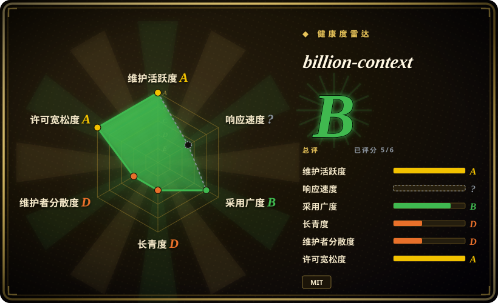
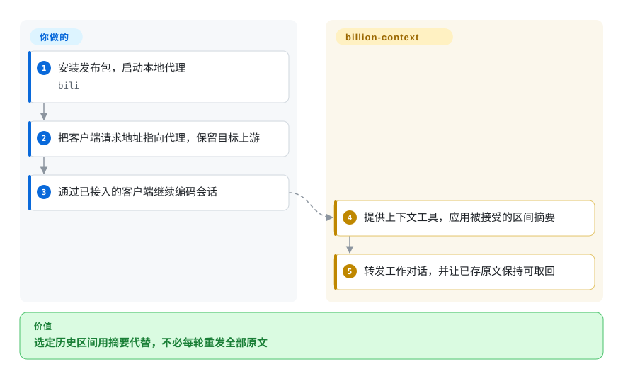
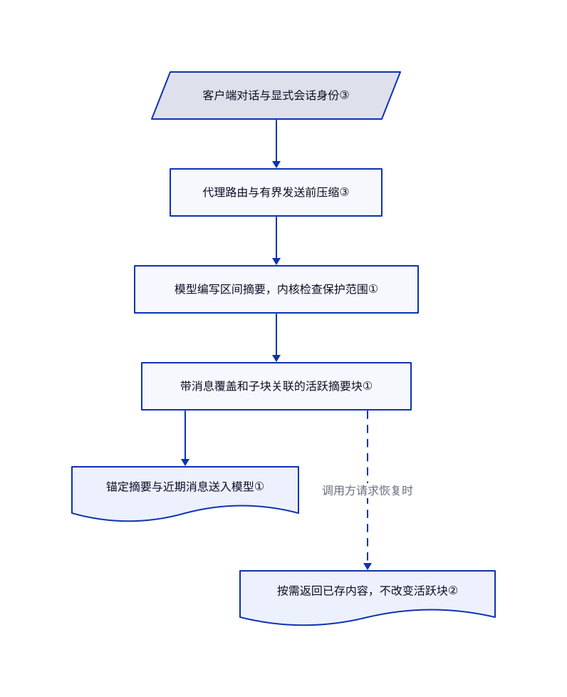

# billion-context

长会话反复压缩后，昨天的报错原文和决策理由找不回来了。billion-context 把选定历史区间折成有关联的摘要块，并保留可按需取回的原文。

## 何时使用

你用现有编码智能体做多步骤迁移。每次整段历史压缩后，仍需使用的细节又被替换掉。你希望模型只挑部分历史写摘要，并能搜索摘要块、取回已存原文，这时可评估 billion-context。它不同于只过滤命令输出的工具，会处理受支持客户端发给模型的会话历史；它也不同于跨会话记忆服务，主目标是维持当前对话的可用上下文。

你要接受模型请求经过本地代理，部分压缩路径额外调用模型，并承担客户端适配工作。仓库包含代理、压缩内核、原生适配器和测试，不是只有随附论文。

## 何时不用

- **你需要模型同时读入十亿 token，或要求保证节省费用。** 先保留客户端原生压缩，用自己的任务基准证明收益。项目名称指累计流量，不是模型同时注意的窗口。论文区分观测总量、容量推演和受控试验，不能据此保证无质量损失或普遍省五倍。
- **只有 shell 输出占用太多上下文。** 选 [RTK](rtk.zh.md)，避免让另一项 HTTP 服务经手模型凭据和完整对话。
- **你要本地内容过滤，而不是让模型挑区间写摘要。** 评估 [Headroom](headroom.zh.md)。billion-context 依赖摘要模型的行为，还会增加上下文管理工具与提示词。
- **你要在明天的新会话找回事实。** 选 [claude-mem](../../agent-memory/coding-agent-memory/claude-mem.zh.md) 做跨会话捕获与召回。折叠账本不是经过筛选、可迁移的记忆策略。
- **你要求标准 MIT 或 Apache 许可。** 选 Headroom 或 RTK。根目录和内核许可都附加产品界面或文档显著署名义务，包清单里的纯 `MIT` 标注并不完整。
- **你不能接受更新器自主安装，或本机其他用户能读历史。** 在隔离用户环境保留客户端原生压缩。普通自动更新与独立的严重缺陷公告安装器是两套控制，只关闭前者不能冻结版本。管理接口限制回环地址，但不鉴别本地用户或会话权限。
- **你的 OpenCode 提供商插件会校验上游 URL。** 先用 OpenCode 原生压缩，验证组合后再接入。[问题 #4276](https://github.com/ranxianglei/billion-context/issues/4276) 报告了 Kiro 与 Antigravity 冲突；本次读到的原生路由确实改写共享请求 URL。不要再叠加另一个压缩器补救。

## 横向对比

| 替代品 | 是否收录 | 我们的评价 | 取舍 |
| --- | --- | --- | --- |
| [Headroom](headroom.zh.md) | ✅ | 按内容类型压缩请求选 Headroom；需要模型挑选历史区间、组织分层摘要块，选 billion-context。 | Headroom 提供 Apache-2.0 与本地变换；两者都增加代理和原文保留责任。 |
| [RTK](rtk.zh.md) | ✅ | 主要是通过测试的日志太长，选 RTK；整个会话历史撑满窗口，才评估 billion-context。 | RTK 不接管模型 API 路由，但不管理完整对话或摘要层级。 |
| [claude-mem](../../agent-memory/coding-agent-memory/claude-mem.zh.md) | ✅ | 要把旧会话观察带回新会话，选 claude-mem；要管理当前对话的工作历史，选 billion-context。 | 生命周期捕获与召回，对比请求途中的改写；两者都不能免除模型费用与隐私审查。 |

## 快速上手

文档给出的安装方式是 `npm install -g billion-context --prefix=~/.local`，再运行 `bili` 启动本地代理。把兼容客户端的模型请求地址设为 `http://localhost:8787/bili/https://api.openai.com/v1`，保留你原本要用的上游与凭据。正常发送智能体请求后，代理提供上下文工具、应用被接受的摘要，再转发对话。客户端、模型账号、磁盘存储和任务质量检查仍由你负责，压缩调用也消耗模型额度。若要冻结版本做评估，启动前同时设置 `ACP_AUTO_UPDATE=0` 和 `BILI_ADVISORY_CHECK=0`；原生安装是另一条路径，会修改客户端配置，并可能关闭原生压缩。本页只做静态检查，没有执行 [README 的使用路径](https://github.com/ranxianglei/billion-context/blob/94f75ccea1b2e509a29ca46e44768dcf9364940f/README.md)。

<!-- flow-steps:begin (generated from flows/billion-context.json by tools/flow_card.py — do not edit) -->

流程文字版

1. **你**：安装发布包，启动本地代理 — `bili`
2. **你**：把客户端请求地址指向代理，保留目标上游
3. **你**：通过已接入的客户端继续编码会话
4. **billion-context**：提供上下文工具，应用被接受的区间摘要
5. **billion-context**：转发工作对话，并让已存原文保持可取回

**价值**：选定历史区间用摘要代替，不必每轮重发全部原文

<!-- flow-steps:end -->

## 技术要点

<!-- mechanism:begin (generated from mechanisms/billion-context.json by tools/mechanism_card.py; do not edit) -->

机制文字版

- 客户端对话与显式会话身份③
- 代理路由与有界发送前压缩③
- 模型编写区间摘要，内核检查保护范围①
- 带消息覆盖和子块关联的活跃摘要块①
- 锚定摘要与近期消息送入模型①
- 按需返回已存内容，不改变活跃块②

- 客户端对话与显式会话身份③ → 代理路由与有界发送前压缩③
- 代理路由与有界发送前压缩③ → 模型编写区间摘要，内核检查保护范围①
- 模型编写区间摘要，内核检查保护范围① → 带消息覆盖和子块关联的活跃摘要块①
- 带消息覆盖和子块关联的活跃摘要块① → 锚定摘要与近期消息送入模型①
- 带消息覆盖和子块关联的活跃摘要块① → 按需返回已存内容，不改变活跃块②（调用方请求恢复时）〔可选／兜底〕

<!-- mechanism:end -->

### 1. 把区间折成层级，不替换整份历史

- **解决：** 反复替换整份会话摘要，会丢细节，也会改写服务商已缓存的内容。
- **做法：** 内核解析消息或摘要块引用，检查受保护区间，再记录摘要、直接消息、子块与完整覆盖关系。被合并的子块转为不活跃，渲染时把活跃摘要放到直接区间的锚点。
- **边界：** 高层会再次概括低层摘要。引用账本和区间校验不能证明模型保住了任务意图或事实细节。
- **源码：** [块创建与保护检查](https://github.com/ranxianglei/billion-context/blob/94f75ccea1b2e509a29ca46e44768dcf9364940f/kernel/src/compress.ts#L1474-L1583)、[摘要锚点](https://github.com/ranxianglei/billion-context/blob/94f75ccea1b2e509a29ca46e44768dcf9364940f/kernel/src/prune.ts#L193-L237)。

### 2. 取回原文，不展开已缓存的前缀

- **解决：** 把旧消息重新展开来找一个细节，可能使服务商缓存的请求前缀失效。
- **做法：** 内容收集器返回块内消息的文本，不改变块的活跃状态。默认保留嵌套活跃子块的摘要，完整收集则遍历其消息覆盖范围。调用方可以把文本作为工具结果追加。
- **边界：** 恢复依赖原文仍被保留，也依赖调用方找对块。论文报告试验模型需要明确指示才调用恢复工具；可恢复不等于会主动回忆。
- **源码：** [不改状态的内容收集](https://github.com/ranxianglei/billion-context/blob/94f75ccea1b2e509a29ca46e44768dcf9364940f/kernel/src/decompress.ts#L147-L224)、[试验中的恢复边界](https://github.com/ranxianglei/billion-context/blob/94f75ccea1b2e509a29ca46e44768dcf9364940f/paper/model-driven-incremental-hierarchical-compression-training-free-multi-generational-context-management-for-long-lived-coding-agents.md#L267)。

### 3. 压缩状态绑定会话，不绑定服务商账号

- **解决：** 切换模型、凭据或上游时，不该悄悄丢掉当前对话的折叠账本。
- **做法：** 客户端会话请求头优先，携带插件标记的协作式身份排在最前。OpenCode 自身会话头优先于继承的缓存亲和标识，避免子会话混用。原生适配器让请求经过代理，发送前检查还能通过有界摘要调用收缩超大请求。
- **边界：** 这些规则管理身份和路由，不提供访问授权。客户端传输差异和共享钩子改写仍会破坏提供商插件，发送前压缩也增加延迟与付费调用。
- **源码：** [请求头优先级](https://github.com/ranxianglei/billion-context/blob/94f75ccea1b2e509a29ca46e44768dcf9364940f/src/session-id.ts#L38-L90)、[原生 URL 改写](https://github.com/ranxianglei/billion-context/blob/94f75ccea1b2e509a29ca46e44768dcf9364940f/src/agent/opencode-native.ts#L153-L224)、[发送前压缩的用途和上限](https://github.com/ranxianglei/billion-context/blob/94f75ccea1b2e509a29ca46e44768dcf9364940f/src/preflight.ts#L33-L84)。

## 技术栈

基于 Node.js 的 TypeScript，内嵌 `acp-kernel`，包含 HTTP、流式响应与 WebSocket 适配器、本地 SQLite，以及可选 MySQL 存储。包清单声明 `mysql2` 和 Zod 运行时依赖，Jimp 是可选图片处理依赖。原生集成包含 JavaScript 插件和 Python 编写的 Hermes 适配器。

## 依赖

需要兼容智能体、模型地址与凭据，以及可写的数据、配置和状态目录。包清单允许 Node.js 20 及以上，但 README 警告下载的 SQLite 引擎要求 Node.js 22 及以上；随附 Docker 以 Node.js 24 为基线。应优先使用该基线，不把清单最低版本当成存储兼容承诺。源码构建要先构建内嵌的内核与子智能体包，再构建代理；npm 发布包已含 `dist/`。

## 运维难度

**个人工作站中等，共享基础设施更高。** 你负责代理生命周期、客户端路由、磁盘保留、备份与版本管理。部分启动器使用本地证书机构做 TLS 解密代理；上述显式修改请求地址的路径不需要该模式。[管理门禁](https://github.com/ranxianglei/billion-context/blob/94f75ccea1b2e509a29ca46e44768dcf9364940f/src/server/admin.ts#L129-L206) 校验回环地址、主机与来源、隧道标记，但不鉴别各本地用户。不要把它作为公开或多租户服务。[公告监听器](https://github.com/ranxianglei/billion-context/blob/94f75ccea1b2e509a29ca46e44768dcf9364940f/src/advisory.ts#L1-L27) 可独立于普通自动更新强制安装，须分别审查两条更新通道。

## 健康度与可持续性

- **截至 2026-10-22，活跃但不成熟。** GitHub 显示 10 月 21 日发布 v0.1.204，默认分支当天仍有开发。频繁修复与发布证明有人维护，不代表客户端组合稳定。
- **治理集中。** 仓库归属 User 账号，首位贡献者有 2964 次提交，列表中下一位人类贡献者为 50 次。虽然存在其他贡献者，观察到的维护负担仍高度集中。
- **年轻，缺少长期验证。** 建仓于 2026-08-06，仓库历史约两个半月。[推断：依据是创建时间和近期发布] 适合受控评估，不足以形成强 Lindy 持续性判断。星数不能证明任务质量保留。
- **许可与证据需逐项看。** [LICENSE](https://github.com/ranxianglei/billion-context/blob/94f75ccea1b2e509a29ca46e44768dcf9364940f/LICENSE) 是 MIT 文本加产品署名条款，不是原版 MIT。机器许可评分 A 取自 npm 的 `MIT` 元数据，未计入附加义务，应以许可原文为准。论文本身限制了观测证据的适用范围，并区分小规模试验与容量推演；选型时也须保持这些区别。

## 存疑（未验证）

- [未验证：本批仅允许静态阅读，禁止运行上游] 未执行安装、真实客户端路由、重启或端到端恢复。OpenCode 提供商插件问题来自公开报告，并得到 URL 改写源码佐证，不是本地复现。
- [未验证：没有独立复现上游实验，也未取得原始实验环境] 十亿级会话、五倍节省、缓存命中率和质量保留属于作者报告或推演。累计输入含重复读取的缓存 token，不会扩大模型同时可读的窗口。
- [推断：依据是创建时间、发布节奏和贡献分布] 当前活跃仍不足以证明长期可持续性和升级稳定性。
