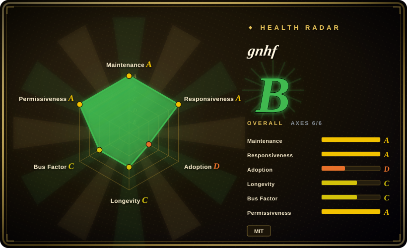
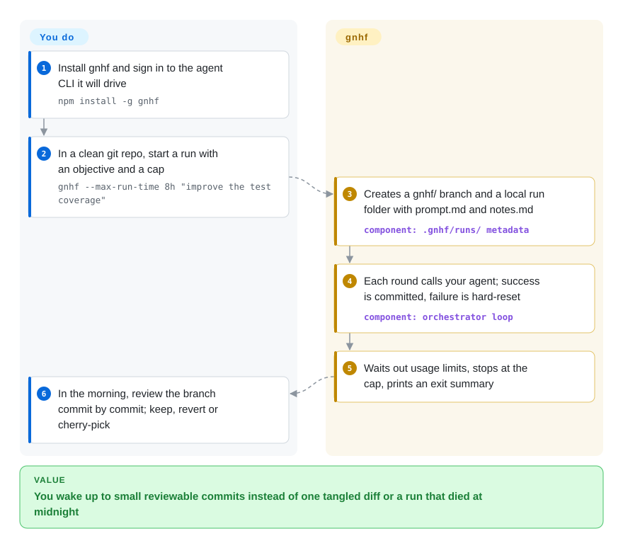
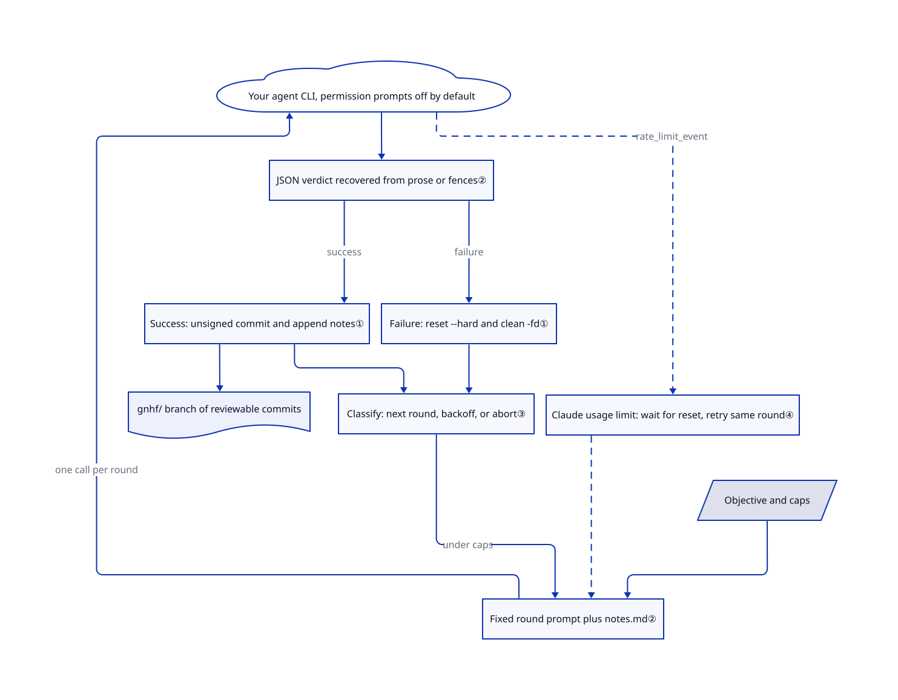

# gnhf

You leave a coding agent running overnight and wake up to one huge uncommitted diff, or to a loop that died at 1 a.m. on a usage limit. gnhf re-runs your agent in small rounds, commits each round that succeeds, throws away each round that fails, and sleeps through usage-limit windows, so a branch of reviewable commits is waiting in the morning.

## When to use

You already use Claude Code, Codex, Copilot CLI, Cursor, OpenCode or another agent CLI, and you want it to keep working on one objective while you sleep — "raise test coverage", "reduce complexity without changing behavior". A bare `while true; do claude -p ...; done` loop gives you two bad mornings: a single tangled diff you cannot partly revert, or a log that ends at `You've hit your usage limit` six hours ago. You run `gnhf --max-run-time 8h "improve the test coverage"` in a clean repo instead. Each round gets a fixed prompt plus the accumulated `notes.md`, must answer with a JSON verdict, and becomes exactly one commit on a `gnhf/` branch or is hard-reset away.

Pick gnhf over [Ralph for Claude Code](ralph-claude-code.md) when you want one loop across several agent CLIs (seven native adapters plus any ACP target) and a commit-or-rollback contract per round, rather than a Claude-only Bash loop over a checklist. Pick it over [LoopX](loopx.md) when "keep going until a cap" is enough and you do not need durable goals, human gates or evidence across days.

## When NOT to use

- **You need someone to check the work, not just record it.** gnhf trusts the agent's own `success: true`; the prompt only asks the agent to run tests "if available". Put a gate in front of the branch — [no-mistakes](../../ai-code-review/no-mistakes.md) from the same author, or your CI — before anything merges.
- **You cannot let the agent run without permission prompts.** Unless you pass your own permission flag, gnhf launches Claude with `--dangerously-skip-permissions`, Copilot with `--allow-all`, Cursor with `--force`, and gives OpenCode a blanket allow rule. On a machine that holds secrets or production credentials, run it inside a container or VM, or use [GitHub Agentic Workflows](../../agent-frameworks/coding-agents/orchestration-and-review/gh-aw.md), which runs agents read-only behind a firewall on Actions.
- **Your work tree holds untracked files you care about.** A failed round runs `git reset --hard HEAD` plus `git clean -fd`. gnhf refuses to start on a dirty tree, but anything you drop into that checkout mid-run can be cleaned away. Use `--worktree` so the loop never touches your main checkout.
- **You rely on usage-limit waiting with a non-Claude agent.** Only the Claude adapter reads the provider's reset time and overage signal; other agents get generic retries and backoff. Issue #245 (open, 2026-10-25) reports Pi aborting on a usage-limit rejection. For multi-day, multi-runtime continuation with quotas, use [LoopX](loopx.md).
- **The objective needs a plan, dependencies or several steps that must happen in order.** gnhf's only state is an append-only `notes.md`; each round picks "the next smallest unit" itself. Keep the plan in [beads](beads.md) or [Planning with Files](planning-with-files.md) and point the prompt at it, or use [CCPM](ccpm.md) for PRD-to-issue breakdown.
- **Network egress must be explicit.** npm builds send anonymous usage telemetry by default (one pageview at start, one run event with agent, mode, token and iteration counts at the end). Set `GNHF_TELEMETRY=0` before the first run.

## Comparison

| Alternative | In index | Our verdict | Tradeoff |
| --- | --- | --- | --- |
| [Ralph for Claude Code](ralph-claude-code.md) | ✅ | Pick Ralph when you have a `fix_plan.md` checklist, only use Claude Code, and want a tmux monitor plus a dual-condition exit gate; pick gnhf when the loop must drive several agent CLIs and every round must be its own commit or be rolled back. | Ralph: Bash, Claude-only, checklist-driven, no tagged releases. gnhf: Node CLI, agent-agnostic, but no exit gate beyond the agent's own JSON and a natural-language `--stop-when`. |
| [LoopX](loopx.md) | ✅ | Pick LoopX when work must survive days, restarts and runtime swaps with human gates and an evidence ledger; pick gnhf when one unattended night with iteration, token and time caps is the whole job. | LoopX: durable goals and quota gates, heavier protocol. gnhf: one command, but state is just a run directory and `notes.md`. |
| [no-mistakes](../../ai-code-review/no-mistakes.md) | ✅ | Use gnhf to produce the overnight branch and no-mistakes to review, test and publish it; they cover opposite ends of the same handoff, from the same author. | gnhf never reviews, opens PRs or judges results by design; no-mistakes adds a local daemon and needs publication credentials. |
| [GitHub Agentic Workflows (gh-aw)](../../agent-frameworks/coding-agents/orchestration-and-review/gh-aw.md) | ✅ | Pick gh-aw when unattended agent work should run on GitHub Actions with read-only, firewalled agents and declared writes; pick gnhf when the loop runs on your own machine with your signed-in agent CLIs and subscription limits. | gh-aw: cloud sandboxing, GitHub-only, preview status. gnhf: local and agent-agnostic, but the agent runs with broad permissions on your machine. |
| Harness-native loops (Claude Code `/loop`, Codex goals) | not a repo | Try your agent's own loop first for a short bounded task; reach for gnhf when you need per-round commits, rollback on failure and a sleep-through-usage-limit loop across CLIs. | Built into the vendor CLI with nothing to install, but tied to one vendor and without gnhf's git commit and rollback rules. |

## Quick start

Install with `npm install -g gnhf` (Node 20+), and sign in to the agent CLI you want it to drive — Claude Code is the default; others are chosen with `--agent`, for example `--agent codex` or `--agent acp:gemini` (ACP, the Agent Client Protocol, is a common way to talk to agent CLIs). From a git repository with a clean working tree, run `gnhf` with an objective and at least one cap: `--max-iterations`, `--max-tokens`, `--max-run-time` (wall-clock), or `--stop-when` (a natural-language condition the agent reports). gnhf creates a `gnhf/<slug>` branch, keeps its run files in a git-ignored `.gnhf/runs/` folder, calls your agent once per round, and commits or rolls back each round. What stays yours: the agent subscription or API bill, the quality of the objective, and reviewing, squashing or merging the branch — gnhf prints review commands in its exit summary but never opens a PR. Add `--worktree` to run several loops on one repo at once, each in its own git worktree.

<!-- flow-steps:begin (generated from flows/gnhf.json by tools/flow_card.py — do not edit) -->

Text version of the flow

1. **You**: Install gnhf and sign in to the agent CLI it will drive — `npm install -g gnhf`
2. **You**: In a clean git repo, start a run with an objective and a cap — `gnhf --max-run-time 8h "improve the test coverage"`
3. **gnhf**: Creates a gnhf/ branch and a local run folder with prompt.md and notes.md — component: `.gnhf/runs/ metadata`
4. **gnhf**: Each round calls your agent; success is committed, failure is hard-reset — component: `orchestrator loop`
5. **gnhf**: Waits out usage limits, stops at the cap, prints an exit summary
6. **You**: In the morning, review the branch commit by commit; keep, revert or cherry-pick

**Value**: You wake up to small reviewable commits instead of one tangled diff or a run that died at midnight

<!-- flow-steps:end -->

## Key techniques

<!-- mechanism:begin (generated from mechanisms/gnhf.json by tools/mechanism_card.py; do not edit) -->

Text version of the mechanism

- Objective and caps
- Fixed round prompt plus notes.md②
- Your agent CLI, permission prompts off by default
- JSON verdict recovered from prose or fences②
- Success: unsigned commit and append notes①
- Failure: reset --hard and clean -fd①
- Classify: next round, backoff, or abort③
- Claude usage limit: wait for reset, retry same round④
- gnhf/ branch of reviewable commits

- Objective and caps → Fixed round prompt plus notes.md②
- Fixed round prompt plus notes.md② → Your agent CLI, permission prompts off by default (one call per round)
- Your agent CLI, permission prompts off by default → JSON verdict recovered from prose or fences②
- JSON verdict recovered from prose or fences② → Success: unsigned commit and append notes① (success)
- JSON verdict recovered from prose or fences② → Failure: reset --hard and clean -fd① (failure)
- Your agent CLI, permission prompts off by default → Claude usage limit: wait for reset, retry same round④ (rate_limit_event) [optional/fallback]
- Claude usage limit: wait for reset, retry same round④ → Fixed round prompt plus notes.md② [optional/fallback]
- Success: unsigned commit and append notes① → gnhf/ branch of reviewable commits
- Success: unsigned commit and append notes① → Classify: next round, backoff, or abort③
- Failure: reset --hard and clean -fd① → Classify: next round, backoff, or abort③
- Classify: next round, backoff, or abort③ → Fixed round prompt plus notes.md② (under caps)

<!-- mechanism:end -->

### 1. One commit per successful round, a hard reset per failed round

- **Problem:** A long unattended session leaves one mixed diff in which good and bad changes cannot be separated.
- **How:** After a round reports success, gnhf runs `git add -A` and commits with signing disabled (`-c commit.gpgsign=false`) so a GPG prompt cannot block the night; then it appends the round's summary to `notes.md`. A failed round runs `git reset --hard HEAD` and `git clean -fd`. If the commit itself fails (for example a pre-commit hook rejects it), the changes are kept and the next round gets a "repair this commit" prompt instead of new work.
- **Limits:** The rollback also removes untracked files in that work tree, not only the agent's. Commits are unsigned. A commit is only as good as the agent's own verdict.
- **Source:** [commitAll and resetHard](https://github.com/kunchenguid/gnhf/blob/98d6a5f3d588ee6e241558f06dfc0d495e6354d6/src/core/git.ts#L238-L296), [success, repair prompt and commit failure](https://github.com/kunchenguid/gnhf/blob/98d6a5f3d588ee6e241558f06dfc0d495e6354d6/src/core/orchestrator.ts#L788-L869), [failure rollback](https://github.com/kunchenguid/gnhf/blob/98d6a5f3d588ee6e241558f06dfc0d495e6354d6/src/core/orchestrator.ts#L888-L926).

### 2. A fixed round prompt, a JSON verdict and notes.md as the only memory

- **Problem:** Each agent call starts with an empty context, so later rounds repeat or undo earlier ones.
- **How:** Every round gets the same template: read `notes.md`, pick the next smallest verifiable step, do not commit, stop background processes, then answer with `success`, `summary`, `key_changes_made` and `key_learnings` (plus `should_fully_stop` when `--stop-when` is set). A round with no file changes and no new learning must answer `success=false`. The orchestrator, not the agent, appends each verdict to `notes.md`. Agents that wrap the JSON in prose or code fences are parsed by a balanced-brace extractor.
- **Limits:** `notes.md` only grows; nothing summarizes or trims it, so very long runs feed an ever larger file into each round. Success and the stop condition are the agent's self-report.
- **Source:** [round prompt](https://github.com/kunchenguid/gnhf/blob/98d6a5f3d588ee6e241558f06dfc0d495e6354d6/src/templates/iteration-prompt.ts#L13-L61), [appendNotes](https://github.com/kunchenguid/gnhf/blob/98d6a5f3d588ee6e241558f06dfc0d495e6354d6/src/core/run.ts#L408-L423), [JSON recovery](https://github.com/kunchenguid/gnhf/blob/98d6a5f3d588ee6e241558f06dfc0d495e6354d6/src/core/agents/json-extract.ts#L1-L60), [output validation](https://github.com/kunchenguid/gnhf/blob/98d6a5f3d588ee6e241558f06dfc0d495e6354d6/src/core/agents/types.ts#L83-L109).

### 3. Sort failures into retry, back off or abort

- **Problem:** A loop that retries everything burns the night on a dead credit card; one that stops on any error ends at the first network hiccup.
- **How:** A failure the agent reports moves straight to the next round. A thrown agent error starts an exponential backoff of 60 s × 2^(n−1). A permanent error such as a low credit balance aborts at once. Three consecutive failures (`maxConsecutiveFailures`, configurable) abort the run, and the iteration, token and run-time caps are checked after every round.
- **Limits:** Which errors count as permanent is decided per adapter; only the Claude, Cursor and ACP adapters raise one. A run that fails three times in a row early in the night stops for the rest of it.
- **Source:** [abort on consecutive failures](https://github.com/kunchenguid/gnhf/blob/98d6a5f3d588ee6e241558f06dfc0d495e6354d6/src/core/orchestrator.ts#L463-L470), [exponential backoff](https://github.com/kunchenguid/gnhf/blob/98d6a5f3d588ee6e241558f06dfc0d495e6354d6/src/core/orchestrator.ts#L530-L558), [rate-limit and permanent error paths](https://github.com/kunchenguid/gnhf/blob/98d6a5f3d588ee6e241558f06dfc0d495e6354d6/src/core/orchestrator.ts#L756-L778).

### 4. Sleep through the usage window instead of failing or paying

- **Problem:** Subscription windows (such as a 5-hour limit) run out mid-night; failing ends the run, and paid overage silently spends money.
- **How:** The Claude adapter reads `rate_limit_event` messages. On a rejection, the round is rolled back without counting as a failure, and gnhf waits until the reported reset time plus a buffer, then retries the same round (once on `--fallback-model` if set). When overage billing is active, a successful round keeps its commit and gnhf then waits for the reset before the next round. With no reset time, or one beyond a single 24 h wait, it aborts rather than keep buying rounds. `--max-rate-limit-wait` caps the total waiting.
- **Limits:** Claude-only: other adapters do not emit these signals (see issue #245 for Pi). If no reset time comes with a rejection, it retries on an escalating interval capped at 30 minutes.
- **Source:** [Claude rate-limit parsing](https://github.com/kunchenguid/gnhf/blob/98d6a5f3d588ee6e241558f06dfc0d495e6354d6/src/core/agents/claude.ts#L428-L456), [rejection wait loop](https://github.com/kunchenguid/gnhf/blob/98d6a5f3d588ee6e241558f06dfc0d495e6354d6/src/core/orchestrator.ts#L379-L419), [overage wait](https://github.com/kunchenguid/gnhf/blob/98d6a5f3d588ee6e241558f06dfc0d495e6354d6/src/core/orchestrator.ts#L472-L527), [wait caps](https://github.com/kunchenguid/gnhf/blob/98d6a5f3d588ee6e241558f06dfc0d495e6354d6/src/core/orchestrator.ts#L1031-L1052), [issue #245](https://github.com/kunchenguid/gnhf/issues/245).

## Tech stack

TypeScript compiled by tsdown into a single ESM bundle (`dist/cli.mjs`) for Node 20+. Runtime dependencies are only `commander` and `js-yaml`; the `acpx` ACP runtime is bundled into the build. Git is driven through `execFileSync` with explicit arguments. Tests use Vitest, with end-to-end tests against mock agent CLIs; releases are automated by release-please.

## Dependencies

- Node.js 20+ and git on the machine; macOS, Linux and Windows are supported.
- At least one installed and signed-in agent CLI (Claude Code by default; Codex, Copilot CLI, Pi, Cursor, Rovo Dev's `acli`, OpenCode, or an ACP target), and its subscription or API account.
- Sleep prevention uses `caffeinate` (macOS), `systemd-inhibit` (Linux) or a PowerShell helper (Windows); a missing helper is reported, not fatal.
- Outbound HTTPS to the author's self-hosted Umami analytics unless `GNHF_TELEMETRY=0`.

## Ops difficulty

**Low.** One global npm install and one command; config is a single `~/.gnhf/config.yml` created on first run. The work that remains is safety rather than operations: deciding whether the agent may run without permission prompts on this machine, choosing caps, using `--worktree` to protect your checkout, opting out of telemetry, and reviewing every commit the next morning. Fast weekly releases mean flags still change; pin a version for scripted use.

## Health & viability

- **Maintenance (2026-11-18):** very active — 53 releases from v0.1.1 (2026-03-31) to v0.1.53 (2026-11-17), roughly weekly, with release-please changelogs and CI on every PR.
- **Governance:** a personal repository; the author has 81 of the non-bot commits and every other contributor has 5 or fewer. Direction is set by a written `VISION.md` (shrink native adapters, grow through ACP). Bus factor is effectively one.
- **Age / Lindy:** about 7.5 months old and still v0.1.x — too young for a durability prior; the commit-per-round loop is simple enough to rebuild if the project stops.
- **Adoption:** ~4.3k stars and 323 forks on GitHub, 5,555 npm downloads in the last month (health snapshot, 2026-11-18) — real usage for a single-author CLI.
- **Risk flags:** MIT (copyright Kun Chen), no relicensing history. Telemetry is on by default in npm builds, and the agents run with permission prompts disabled by default — both are documented, not hidden.

## Caveats (unverified)

- [未验证：本批不执行上游代码] No overnight run was made here; commit/rollback, backoff and usage-limit waits are described from source and README, not observed.
- [未验证：无法看到服务端] What the Umami telemetry endpoint stores beyond the fields sent in `src/cli.ts` cannot be checked from the repository.
- [推断：依据是 issue #245 与适配器源码] Usage-limit waiting is Claude-only today; other adapters may add it later, so re-check before relying on it with Codex, Pi or ACP agents.
- [推断：依据是提交分布] The project depends on one maintainer; star count growth in under eight months is not a durability signal.
