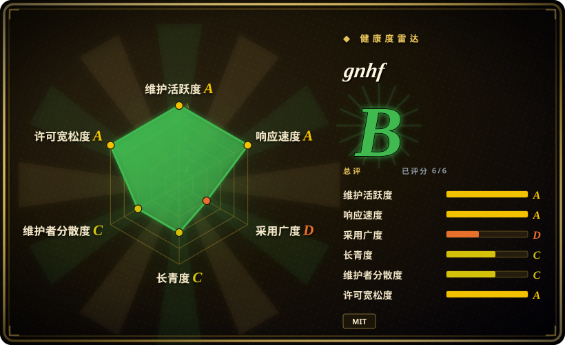
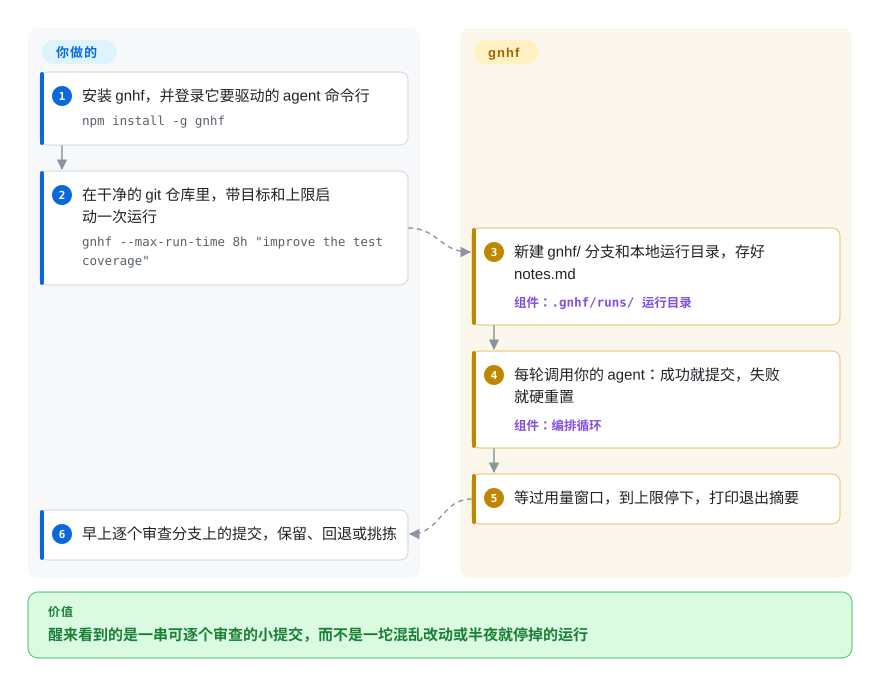
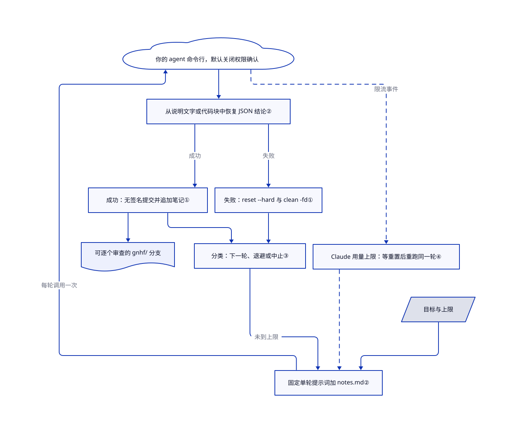

# gnhf

睡前让编码 agent 接着干活，早上醒来要么是一大坨没提交、拆不开的改动，要么发现它凌晨一点撞上用量上限就停了。gnhf 把你的 agent 拆成一轮一轮地跑：成功的一轮提交一次，失败的一轮整轮丢掉，撞上用量窗口就睡到重置再接着跑，早上等着你的是一条可以逐个审查的提交分支。

## 何时使用

你已经在用 Claude Code、Codex、Copilot CLI、Cursor、OpenCode 或别的 agent 命令行工具，想让它在你睡觉时围绕一个目标持续干活，比如“提高测试覆盖率”“在不改行为的前提下降低复杂度”。自己写一个 `while true; do claude -p ...; done` 的裸循环，早上通常是两种结局之一：一整块缠在一起、没法部分回退的改动；或者日志停在六小时前的 `You've hit your usage limit`。换成在干净仓库里跑 `gnhf --max-run-time 8h "improve the test coverage"`：每一轮拿到固定的提示词和累积的 `notes.md`，必须用一段 JSON 交代结果，然后要么在 `gnhf/` 分支上变成恰好一个提交，要么被硬重置掉。

和 [Ralph for Claude Code](ralph-claude-code.zh.md) 比，选 gnhf 是因为你要一个能驱动多种 agent 命令行（七个原生适配器，外加任意 ACP 目标）、每轮“要么提交、要么回滚”的循环，而不是只认 Claude、按清单推进的 Bash 循环。和 [LoopX](loopx.zh.md) 比，选 gnhf 是因为“跑到上限为止”就够了，不需要跨天的持久目标、人工门禁和证据台账。

## 何时不用

- **你需要有人检查成果，而不只是记录成果。** gnhf 相信 agent 自己报的 `success: true`；提示词只是让 agent “如果有的话”跑一下测试。合并之前在分支前面加一道关：同一作者的 [no-mistakes](../../ai-code-review/no-mistakes.zh.md)，或者你自己的 CI。
- **你不能让 agent 在没有权限确认的情况下运行。** 除非你自己传权限参数，gnhf 默认用 `--dangerously-skip-permissions` 启动 Claude，用 `--allow-all` 启动 Copilot，用 `--force` 启动 Cursor，并给 OpenCode 一条全放行规则。机器上有密钥或生产凭据时，放进容器或虚拟机里跑，或者改用 [GitHub Agentic Workflows](../../agent-frameworks/coding-agents/orchestration-and-review/gh-aw.zh.md)，它在 Actions 上以只读、带防火墙的方式运行 agent。
- **工作区里有你在意的未跟踪文件。** 失败的一轮会执行 `git reset --hard HEAD` 和 `git clean -fd`。gnhf 不会在脏工作区上启动，但运行过程中你放进这个目录的文件也可能被清掉。用 `--worktree`，让循环永远不碰你的主检出目录。
- **你指望非 Claude 的 agent 也能等用量窗口。** 只有 Claude 适配器会读取服务商给出的重置时间和超额计费信号；其他 agent 只有通用的重试和退避。issue #245（2026-10-25 提出，仍开着）报告 Pi 撞上用量拒绝时直接中止。需要跨天、跨运行时、带配额的持续推进，用 [LoopX](loopx.zh.md)。
- **目标需要计划、依赖关系，或必须按顺序完成的多个步骤。** gnhf 唯一的状态是只追加的 `notes.md`，每轮自己挑“下一个最小单元”。把计划放进 [beads](beads.zh.md) 或 [Planning with Files](planning-with-files.zh.md)，在提示词里指向它；要从 PRD 拆到 issue，用 [CCPM](ccpm.zh.md)。
- **网络出站必须显式放行。** npm 发布版默认发送匿名使用统计：启动时一次页面访问，结束时一次运行事件，带 agent 名、模式、token 和轮次计数。首次运行前设置 `GNHF_TELEMETRY=0`。

## 横向对比

| 替代品 | 是否收录 | 我们的评价 | 取舍 |
| --- | --- | --- | --- |
| [Ralph for Claude Code](ralph-claude-code.zh.md) | ✅ | 手里有 `fix_plan.md` 清单、只用 Claude Code、想要 tmux 监控和双条件退出闸门时选 Ralph；循环要驱动多种 agent 命令行、且每轮都必须单独提交或回滚时选 gnhf。 | Ralph：Bash 实现、只认 Claude、按清单推进、没有打标签的发布。gnhf：Node 命令行、不绑定 agent，但除了 agent 自己的 JSON 和自然语言的 `--stop-when` 之外没有退出闸门。 |
| [LoopX](loopx.zh.md) | ✅ | 工作要熬过多天、重启和更换运行时，并需要人工门禁和证据台账时选 LoopX；一个带轮次、token、时长上限的无人值守夜晚就是全部需求时选 gnhf。 | LoopX：持久目标与配额门禁，协议更重。gnhf：一条命令，但状态只是一个运行目录和 `notes.md`。 |
| [no-mistakes](../../ai-code-review/no-mistakes.zh.md) | ✅ | 用 gnhf 产出过夜分支，用 no-mistakes 审查、测试并发布它；两者是同一作者做的、同一次交接的两端。 | gnhf 按设计不做审查、不开 PR、不评判结果；no-mistakes 多一个本地守护进程，并需要发布凭据。 |
| [GitHub Agentic Workflows (gh-aw)](../../agent-frameworks/coding-agents/orchestration-and-review/gh-aw.zh.md) | ✅ | 无人值守的 agent 工作应当跑在 GitHub Actions 上、agent 只读且有防火墙、写操作事先声明时选 gh-aw；循环跑在自己机器上、用你已登录的 agent 命令行和订阅额度时选 gnhf。 | gh-aw：云端沙箱，只支持 GitHub，处于预览阶段。gnhf：本地运行、不绑定 agent，但 agent 在你的机器上拥有宽泛权限。 |
| 各 agent 自带的循环（Claude Code `/loop`、Codex goals） | 非仓库 | 短小、有边界的任务先试 agent 自带的循环；需要每轮提交、失败回滚、能睡过用量上限、跨多种命令行时再上 gnhf。 | 内置在厂商命令行里，无需安装；但绑定单一厂商，也没有 gnhf 的 git 提交与回滚规则。 |

## 快速上手

用 `npm install -g gnhf` 安装（需要 Node 20+），并登录你要它驱动的 agent 命令行——默认是 Claude Code，其他用 `--agent` 指定，比如 `--agent codex` 或 `--agent acp:gemini`（ACP 即 Agent Client Protocol，一种与 agent 命令行通信的通用协议）。在一个工作区干净的 git 仓库里运行 `gnhf`，给出目标和至少一个上限：`--max-iterations`、`--max-tokens`、`--max-run-time`（按墙钟时间），或 `--stop-when`（由 agent 判断是否达成的自然语言条件）。gnhf 会新建 `gnhf/<slug>` 分支，把运行文件放在被 git 忽略的 `.gnhf/runs/` 目录，每轮调用一次你的 agent，并逐轮提交或回滚。留给你的部分：agent 的订阅或 API 账单、目标写得好不好，以及审查、压缩或合并这条分支——gnhf 会在退出摘要里打印审查命令，但从不开 PR。加 `--worktree` 可以在同一个仓库上同时跑多个循环，各自在独立的 git worktree 里。

<!-- flow-steps:begin (generated from flows/gnhf.json by tools/flow_card.py — do not edit) -->

流程文字版

1. **你**：安装 gnhf，并登录它要驱动的 agent 命令行 — `npm install -g gnhf`
2. **你**：在干净的 git 仓库里，带目标和上限启动一次运行 — `gnhf --max-run-time 8h "improve the test coverage"`
3. **gnhf**：新建 gnhf/ 分支和本地运行目录，存好 notes.md — 组件：`.gnhf/runs/ 运行目录`
4. **gnhf**：每轮调用你的 agent：成功就提交，失败就硬重置 — 组件：`编排循环`
5. **gnhf**：等过用量窗口，到上限停下，打印退出摘要
6. **你**：早上逐个审查分支上的提交，保留、回退或挑拣

**价值**：醒来看到的是一串可逐个审查的小提交，而不是一坨混乱改动或半夜就停掉的运行

<!-- flow-steps:end -->

## 技术要点

<!-- mechanism:begin (generated from mechanisms/gnhf.json by tools/mechanism_card.py; do not edit) -->

机制文字版

- 目标与上限
- 固定单轮提示词加 notes.md②
- 你的 agent 命令行，默认关闭权限确认
- 从说明文字或代码块中恢复 JSON 结论②
- 成功：无签名提交并追加笔记①
- 失败：reset --hard 与 clean -fd①
- 分类：下一轮、退避或中止③
- Claude 用量上限：等重置后重跑同一轮④
- 可逐个审查的 gnhf/ 分支

- 目标与上限 → 固定单轮提示词加 notes.md②
- 固定单轮提示词加 notes.md② → 你的 agent 命令行，默认关闭权限确认（每轮调用一次）
- 你的 agent 命令行，默认关闭权限确认 → 从说明文字或代码块中恢复 JSON 结论②
- 从说明文字或代码块中恢复 JSON 结论② → 成功：无签名提交并追加笔记①（成功）
- 从说明文字或代码块中恢复 JSON 结论② → 失败：reset --hard 与 clean -fd①（失败）
- 你的 agent 命令行，默认关闭权限确认 → Claude 用量上限：等重置后重跑同一轮④（限流事件）〔可选／兜底〕
- Claude 用量上限：等重置后重跑同一轮④ → 固定单轮提示词加 notes.md②〔可选／兜底〕
- 成功：无签名提交并追加笔记① → 可逐个审查的 gnhf/ 分支
- 成功：无签名提交并追加笔记① → 分类：下一轮、退避或中止③
- 失败：reset --hard 与 clean -fd① → 分类：下一轮、退避或中止③
- 分类：下一轮、退避或中止③ → 固定单轮提示词加 notes.md②（未到上限）

<!-- mechanism:end -->

### 1. 成功一轮提交一次，失败一轮硬重置

- **解决：** 长时间无人值守留下一整块混在一起的改动，好的坏的分不开。
- **做法：** 一轮报告成功后，gnhf 执行 `git add -A`，并在关闭签名（`-c commit.gpgsign=false`）的情况下提交，免得 GPG 密码提示卡住整晚；然后把这一轮的摘要追加到 `notes.md`。失败的一轮执行 `git reset --hard HEAD` 和 `git clean -fd`。如果提交本身失败（比如被 pre-commit 钩子拒绝），改动会保留下来，下一轮拿到的是“修好这次提交”的提示词，而不是新任务。
- **边界：** 回滚会删掉该工作区里所有未跟踪文件，不只是 agent 产生的。提交不带签名。提交的质量只取决于 agent 自己的判断。
- **源码：** [commitAll 与 resetHard](https://github.com/kunchenguid/gnhf/blob/98d6a5f3d588ee6e241558f06dfc0d495e6354d6/src/core/git.ts#L238-L296)、[成功、修复提示与提交失败](https://github.com/kunchenguid/gnhf/blob/98d6a5f3d588ee6e241558f06dfc0d495e6354d6/src/core/orchestrator.ts#L788-L869)、[失败回滚](https://github.com/kunchenguid/gnhf/blob/98d6a5f3d588ee6e241558f06dfc0d495e6354d6/src/core/orchestrator.ts#L888-L926)。

### 2. 固定的单轮提示词、JSON 结论，notes.md 是唯一记忆

- **解决：** 每次调用 agent 都从空上下文开始，后面的轮次会重复甚至推翻前面的工作。
- **做法：** 每一轮都拿同一个模板：先读 `notes.md`，挑下一个最小、可验证的步骤，不要自己提交，结束前停掉后台进程，最后用 `success`、`summary`、`key_changes_made`、`key_learnings` 作答（设置了 `--stop-when` 时再加 `should_fully_stop`）。既没改文件、也没有新收获的一轮必须答 `success=false`。把结论追加进 `notes.md` 的是编排器，不是 agent。agent 把 JSON 包在说明文字或代码块里时，由一个括号配平提取器解析出来。
- **边界：** `notes.md` 只增不减，没有任何摘要或裁剪，很长的运行会把越来越大的文件塞进每一轮。成功与否、停止条件是否达成，都是 agent 自报。
- **源码：** [单轮提示词](https://github.com/kunchenguid/gnhf/blob/98d6a5f3d588ee6e241558f06dfc0d495e6354d6/src/templates/iteration-prompt.ts#L13-L61)、[appendNotes](https://github.com/kunchenguid/gnhf/blob/98d6a5f3d588ee6e241558f06dfc0d495e6354d6/src/core/run.ts#L408-L423)、[JSON 恢复](https://github.com/kunchenguid/gnhf/blob/98d6a5f3d588ee6e241558f06dfc0d495e6354d6/src/core/agents/json-extract.ts#L1-L60)、[输出校验](https://github.com/kunchenguid/gnhf/blob/98d6a5f3d588ee6e241558f06dfc0d495e6354d6/src/core/agents/types.ts#L83-L109)。

### 3. 把失败分成重试、退避、中止三类

- **解决：** 什么错都重试的循环，会在一张欠费的卡上耗掉整晚；一遇错就停的循环，第一次网络抖动就结束了。
- **做法：** agent 自己报告的失败直接进入下一轮。agent 抛出的错误触发指数退避，等待 60 秒 × 2^(n−1)。余额不足这类永久错误立即中止。连续三次失败（`maxConsecutiveFailures`，可配置）中止整次运行；轮次、token、运行时长上限在每轮结束后检查。
- **边界：** 哪些错误算永久错误由各适配器决定，目前只有 Claude、Cursor 和 ACP 适配器会报。夜里早早连续失败三次，后半夜就不再跑了。
- **源码：** [连续失败中止](https://github.com/kunchenguid/gnhf/blob/98d6a5f3d588ee6e241558f06dfc0d495e6354d6/src/core/orchestrator.ts#L463-L470)、[指数退避](https://github.com/kunchenguid/gnhf/blob/98d6a5f3d588ee6e241558f06dfc0d495e6354d6/src/core/orchestrator.ts#L530-L558)、[限流与永久错误分支](https://github.com/kunchenguid/gnhf/blob/98d6a5f3d588ee6e241558f06dfc0d495e6354d6/src/core/orchestrator.ts#L756-L778)。

### 4. 睡过用量窗口，而不是失败或多花钱

- **解决：** 订阅的用量窗口（比如 5 小时上限）会在半夜用完；直接失败会结束运行，悄悄进入超额计费则在花钱。
- **做法：** Claude 适配器读取 `rate_limit_event` 消息。被拒绝时，这一轮回滚但不计为失败，gnhf 等到服务商报告的重置时间再加一段缓冲，然后重跑同一轮（设置了 `--fallback-model` 时，第一次改用该模型重试）。超额计费已开启时，成功的一轮保留提交，然后等到重置再开下一轮。没有重置时间、或重置时间超过单次 24 小时等待时，直接中止，而不是继续花钱买新轮次。`--max-rate-limit-wait` 限制整次运行的总等待时长。
- **边界：** 只支持 Claude：其他适配器不产生这些信号（Pi 的情况见 issue #245）。被拒绝却没给重置时间时，按逐步拉长的间隔重试，最长 30 分钟。
- **源码：** [Claude 限流事件解析](https://github.com/kunchenguid/gnhf/blob/98d6a5f3d588ee6e241558f06dfc0d495e6354d6/src/core/agents/claude.ts#L428-L456)、[拒绝后等待循环](https://github.com/kunchenguid/gnhf/blob/98d6a5f3d588ee6e241558f06dfc0d495e6354d6/src/core/orchestrator.ts#L379-L419)、[超额等待](https://github.com/kunchenguid/gnhf/blob/98d6a5f3d588ee6e241558f06dfc0d495e6354d6/src/core/orchestrator.ts#L472-L527)、[等待上限](https://github.com/kunchenguid/gnhf/blob/98d6a5f3d588ee6e241558f06dfc0d495e6354d6/src/core/orchestrator.ts#L1031-L1052)、[issue #245](https://github.com/kunchenguid/gnhf/issues/245)。

## 技术栈

TypeScript，由 tsdown 打包成单个 ESM 文件（`dist/cli.mjs`），运行在 Node 20+ 上。运行时依赖只有 `commander` 和 `js-yaml`；ACP 运行时 `acpx` 被打进构建产物。git 通过 `execFileSync` 以显式参数调用。测试用 Vitest，端到端测试对接模拟的 agent 命令行；发布由 release-please 自动完成。

## 依赖

- 机器上要有 Node.js 20+ 和 git；支持 macOS、Linux、Windows。
- 至少一个已安装并登录的 agent 命令行（默认 Claude Code；也可用 Codex、Copilot CLI、Pi、Cursor、Rovo Dev 的 `acli`、OpenCode 或 ACP 目标），以及它的订阅或 API 账户。
- 防休眠在 macOS 上用 `caffeinate`，Linux 上用 `systemd-inhibit`，Windows 上用一个 PowerShell 辅助脚本；缺了只会在摘要里报告，不会中止。
- 除非设置 `GNHF_TELEMETRY=0`，否则会向作者自建的 Umami 统计服务发出 HTTPS 请求。

## 运维难度

**低。** 一次全局 npm 安装、一条命令；配置只有首次运行时生成的 `~/.gnhf/config.yml`。剩下的是安全问题而不是运维问题：决定这台机器上是否允许 agent 不经权限确认运行、选好上限、用 `--worktree` 保护你的检出目录、关闭统计，以及第二天早上逐个审查提交。发布节奏接近每周，参数仍在变；脚本化使用时固定版本。

## 健康度与可持续性

- **维护（2026-11-18）：** 非常活跃——从 v0.1.1（2026-03-31）到 v0.1.53（2026-11-17）共 53 个发布，约每周一次，release-please 生成变更日志，每个 PR 都跑 CI。
- **治理：** 个人仓库；非机器人提交里作者占 81 次，其他贡献者每人不超过 5 次。方向由成文的 `VISION.md` 约束（原生适配器只减不增，通过 ACP 扩展）。实际巴士因子为 1。
- **年龄与 Lindy：** 约 7.5 个月，仍是 v0.1.x，太年轻，谈不上耐久性先验；不过“每轮一个提交”的循环足够简单，项目停了也能自己重建。
- **采用度：** GitHub 约 4.3k 星、323 个 fork，最近一个月 npm 下载 5,555 次（2026-11-18 健康度快照）——对一个单人维护的命令行工具来说是真实使用量。
- **风险信号：** MIT（版权人 Kun Chen），没有改许可证的历史。npm 发布版默认开启统计，agent 默认关闭权限确认运行——两者都写在文档里，不是暗藏的。

## 存疑（未验证）

- [未验证：本批不执行上游代码] 这里没有实际跑过一整夜；提交与回滚、退避、用量等待都来自源码和 README，不是观察结果。
- [未验证：无法看到服务端] Umami 统计服务除了 `src/cli.ts` 里发送的字段之外还存了什么，从仓库里查不到。
- [推断：依据是 issue #245 与适配器源码] 目前只有 Claude 支持用量窗口等待；其他适配器以后可能补上，在 Codex、Pi 或 ACP agent 上依赖这一点之前要重新核对。
- [推断：依据是提交分布] 项目依赖单一维护者；不到八个月涨起来的星数不能当耐久性信号。
