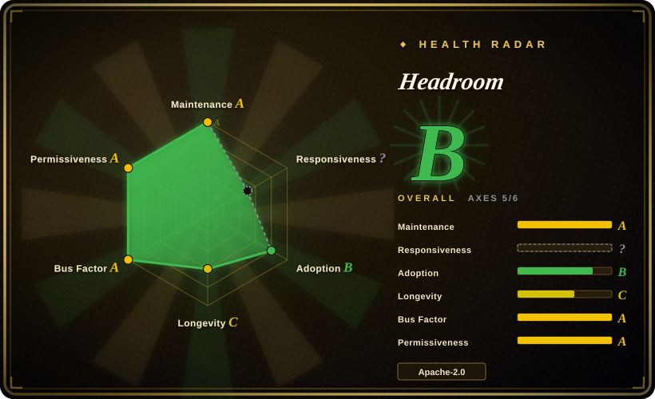
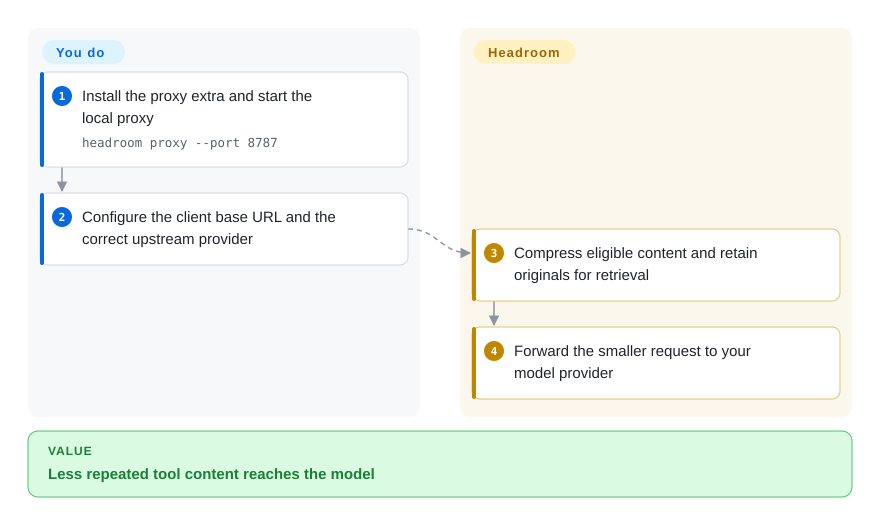
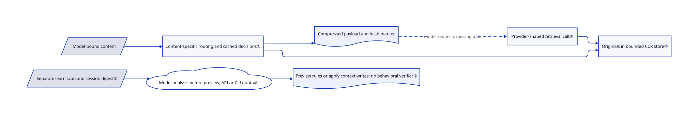

# Headroom

Your agent sends the same long JSON and logs on every turn; Headroom compresses model-bound payloads locally and keeps originals available through a retrieval tool.

## When to use

You run coding agents against verbose search results and incident logs, and a single tool response consumes thousands of tokens. Pick Headroom over shell-only filters when file content and API messages also need compression, and you can operate a local proxy between the agent and model provider. The decisive benefit is retrieval of omitted originals, not a promise that every answer survives compression unchanged.

## When NOT to use

- For shell noise alone, choose [RTK](rtk.md); it avoids another model-API proxy and its credential-routing surface.
- For searchable raw output in a sandbox, choose [Context Mode](context-mode.md); Headroom retrieval depends on cache lifetime and capacity.
- For a few short chats, keep the client's native compaction; proxy deployment and model downloads buy little on small inputs.
- If private session history must not reach a model without explicit authorization, do not run ordinary `headroom learn`, even in its default preview mode. Use an approved local review instead: preview disables recommendation-file writes, not model analysis or its API/subscription cost.
- For centrally managed SSO and organization policy, evaluate the commercial Headroom Enterprise service rather than assuming those controls ship in this OSS tree.

## Comparison

| Alternative | In index | Our verdict | Tradeoff |
| --- | --- | --- | --- |
| [RTK](rtk.md) | ✅ | Choose RTK for command-output filtering; choose Headroom when model-bound JSON, code and prose all consume context. | RTK changes commands; Headroom sees API traffic and adds routing responsibility. |
| [Context Mode](context-mode.md) | ✅ | Choose Context Mode to search retained tool output; choose Headroom to keep an existing client's model API integration. | Sandbox and indexing versus a proxy with time-bounded original retrieval. |
| [Token Optimizer](token-optimizer.md) | ✅ | Choose Token Optimizer for hook-level compaction checkpoints; choose Headroom when a permissive license and API-layer integration decide. | Token Optimizer is noncommercial; Headroom adds a persistent local process. |

## Quick start

Install the Python package with `pip install "headroom-ai[proxy]"` and start `headroom proxy --port 8787`. Point your client's model base URL at that local proxy, with the correct upstream provider URL and credentials. Headroom compresses eligible payloads before forwarding them; you still pay the provider and operate the proxy. The npm package is an SDK, not the CLI. Agent wrapping additionally installs Serena by default and can write client configuration; review that path before using it. See the [reviewed README](https://github.com/headroomlabs-ai/headroom/blob/fbf7bc3278c11975299b9bd0a2ecf200dfd25a05/README.md).

<!-- flow-steps:begin (generated from flows/headroom.json by tools/flow_card.py — do not edit) -->

Text version of the flow

1. **You**: Install the proxy extra and start the local proxy — `headroom proxy --port 8787`
2. **You**: Configure the client base URL and the correct upstream provider
3. **Headroom**: Compress eligible content and retain originals for retrieval
4. **Headroom**: Forward the smaller request to your model provider

**Value**: Less repeated tool content reaches the model

<!-- flow-steps:end -->

## Key techniques

<!-- mechanism:begin (generated from mechanisms/headroom.json by tools/mechanism_card.py; do not edit) -->

Text version of the mechanism

- Model-bound content
- Content-specific routing and cached decisions①
- Compressed payload and hash marker
- Originals in bounded CCR store②
- Provider-shaped retrieval call②
- Separate learn scan and session digest③
- Model analysis before preview; API or CLI quota③
- Preview rules or apply context writes; no behavioral verifier③

- Model-bound content → Content-specific routing and cached decisions①
- Content-specific routing and cached decisions① → Compressed payload and hash marker
- Content-specific routing and cached decisions① → Originals in bounded CCR store②
- Compressed payload and hash marker → Provider-shaped retrieval call② (model requests missing data) [optional/fallback]
- Provider-shaped retrieval call② → Originals in bounded CCR store②
- Separate learn scan and session digest③ → Model analysis before preview; API or CLI quota③
- Model analysis before preview; API or CLI quota③ → Preview rules or apply context writes; no behavioral verifier③

<!-- mechanism:end -->

### 1. Route content instead of applying one text filter

- **Problem:** Repeated JSON rows and source code lose different information when shortened.
- **How:** ContentRouter selects specialized compression paths and caches compressed results and skip decisions; per-block decision freezing helps keep repeated payloads stable.
- **Limits:** Selection and compression remain workload-sensitive; a shorter prompt is not proof of equivalent answers.
- **Source:** [Router and caches](https://github.com/headroomlabs-ai/headroom/blob/fbf7bc3278c11975299b9bd0a2ecf200dfd25a05/headroom/transforms/content_router.py#L1561-L1700), [decision state](https://github.com/headroomlabs-ai/headroom/blob/fbf7bc3278c11975299b9bd0a2ecf200dfd25a05/headroom/transforms/content_router.py#L2460-L2500).

### 2. Keep originals behind content-addressed retrieval

- **Problem:** A model may need a row that compression omitted.
- **How:** CCR stores the original under a content hash and inserts a marker. Provider-shaped retrieval calls identify the hash so the runtime can recover it. SQLite is the persistent Rust store default.
- **Limits:** The store has capacity, idle expiry and maximum lifetime; retrieval also requires the model to request the missing data. This is not unconditional losslessness.
- **Source:** [CCR contract and limits](https://github.com/headroomlabs-ai/headroom/blob/fbf7bc3278c11975299b9bd0a2ecf200dfd25a05/crates/headroom-core/src/ccr/mod.rs#L1-L99), [tool-call parsing](https://github.com/headroomlabs-ai/headroom/blob/fbf7bc3278c11975299b9bd0a2ecf200dfd25a05/headroom/ccr/tool_calls.py#L152-L176).

### 3. Analyze history before previewing learned rules

- **Problem:** Local compression and a dry-run label can make history analysis look offline and free when it is neither guaranteed.
- **How:** Ordinary `headroom learn` scans sessions, builds a digest containing project context, user messages, tool-input summaries and error excerpts, then sends it to a model selected from keys or installed CLIs. Only afterwards does the writer preview changes or, with `--apply`, write rules: Claude defaults to `CLAUDE.local.md` and agent memory, with `--target CLAUDE.md` opting into the shared file; other writers use `AGENTS.md`/`instructions.md`, `GEMINI.md` or `GROK.md`.
- **Limits:** Preview is not an egress or spending gate; API calls can cost money and CLI calls can consume plan quota. The Anthropic API path explicitly selects the official API rather than an overridden proxy base URL. `--verbosity` is a separate behavioral-heuristic path, using a model only with `--llm-judge`; generating or writing failure rules does not rerun tasks or verify reduced recurrence, so obtain authorization and review rules before applying them.
- **Source:** [Analyze before dry-run write](https://github.com/headroomlabs-ai/headroom/blob/fbf7bc3278c11975299b9bd0a2ecf200dfd25a05/headroom/cli/learn.py#L296-L359), [distinct verbosity path](https://github.com/headroomlabs-ai/headroom/blob/fbf7bc3278c11975299b9bd0a2ecf200dfd25a05/headroom/cli/learn.py#L186-L210), [model selection and digest](https://github.com/headroomlabs-ai/headroom/blob/fbf7bc3278c11975299b9bd0a2ecf200dfd25a05/headroom/learn/analyzer.py#L174-L287), [digest fields](https://github.com/headroomlabs-ai/headroom/blob/fbf7bc3278c11975299b9bd0a2ecf200dfd25a05/headroom/learn/analyzer.py#L355-L512), [official Anthropic target](https://github.com/headroomlabs-ai/headroom/blob/fbf7bc3278c11975299b9bd0a2ecf200dfd25a05/headroom/learn/analyzer.py#L1063-L1097), [writers](https://github.com/headroomlabs-ai/headroom/blob/fbf7bc3278c11975299b9bd0a2ecf200dfd25a05/headroom/learn/writer.py#L487-L695).

## Tech stack

Python 3.10+, a Rust extension built with maturin, FastAPI/Uvicorn for the proxy, and a separate TypeScript SDK. Optional compression paths use ONNX, PyTorch and tree-sitter.

## Dependencies

The proxy extra brings model SDKs and HTTP/WebSocket transport. Model-backed paths need downloaded weights; optional memory defaults to SQLite-backed storage. The upstream model service and its account remain yours. Full installation has substantially more dependencies than the proxy extra.

## Ops difficulty

**Medium.** Maintain the local process, upstream URL, TLS roots, cache storage and agent-specific configuration. Third-party provider keys must not accidentally go to the default OpenAI upstream. Anonymous metrics are enabled by default; the documented opt-out includes `HEADROOM_TELEMETRY=off`.

## Health & viability

- On 2026-10-18, GitHub lists v0.41.0 from October 14 and several substantial contributors; this is active, not abandoned.
- Created January 2026, the project has less than a year of history. [推断：依据是创建时间和近期发布] Activity supports trying it, but not a strong Lindy durability claim.
- The organization markets a separate Enterprise tier. Apache-2.0 covers this repository; managed controls and support are a separate product commitment.

## Caveats (unverified)

- [未验证：本批禁止执行上游代码] Compression ratios, latency and answer retention were not benchmarked here; README measurements are workload-specific.
- [未验证：只读源码与文档] Telemetry opt-out and every client wrapper were not exercised end to end.
- [未验证：未授权发送私密历史或调用模型] Ordinary learn's actual bill, digest egress and proposed-rule effectiveness were not exercised. Static source confirms analysis precedes preview; it does not establish that the rules prevent future failures.
- [推断：依据是创建时间和近期发布] Long-term durability remains unproven despite current activity.
