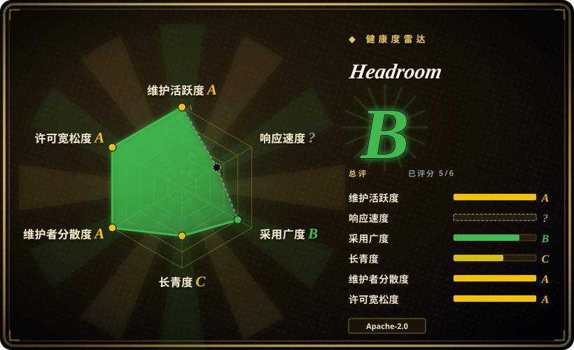
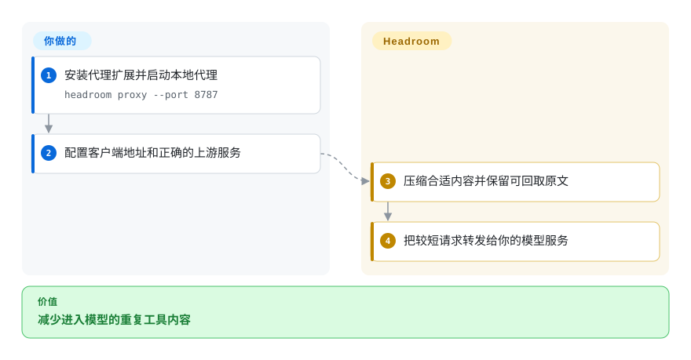
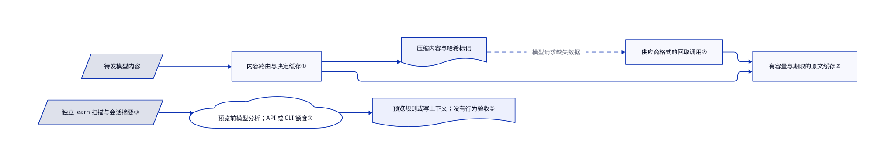

# Headroom

agent 每轮都把长串 JSON 和日志发给模型。Headroom 在本机压缩请求，并保留可按需取回的原文。

## 何时使用

你让编码 agent 排查故障，一次搜索或日志读取就占掉数千 token。若浪费不只来自命令输出，还来自文件和 API 消息，可以把 Headroom 放在客户端与模型之间。相较只过滤命令输出的工具，它覆盖模型请求，并让模型按需取回删减的原文。选它的理由是可取回原文，不是相信所有压缩都不损伤答案。

## 何时不用

- 只想减少命令输出，选 [RTK](rtk.zh.md)。它不增加模型 API 代理及密钥路由面。
- 想在沙箱中检索完整工具输出，选 [Context Mode](context-mode.zh.md)。Headroom 的原文缓存有期限和容量。
- 只聊几句，保留客户端原生压缩即可。小输入不值得增加代理和模型下载。
- 私密会话未经明确授权不得送给模型时，不要运行普通 `headroom learn`，默认预览也不例外。改用获准的本地审阅；预览只是不写建议文件，不会阻止模型分析和 API 费用或订阅额度消耗。
- 要统一登录和组织策略，应评估商业 Headroom Enterprise，不能把这些能力算进本仓库。

## 横向对比

| 替代品 | 是否收录 | 我们的评价 | 取舍 |
| --- | --- | --- | --- |
| [RTK](rtk.zh.md) | ✅ | 命令输出太长选 RTK；JSON、代码和文本都占上下文时选 Headroom。 | 前者改写命令；后者经手模型请求，需要管理上游路由。 |
| [Context Mode](context-mode.zh.md) | ✅ | 要检索完整输出选 Context Mode；要保留现有模型 API 接法选 Headroom。 | 沙箱加索引，对比代理加限时原文回取。 |
| [Token Optimizer](token-optimizer.zh.md) | ✅ | 要压缩前后的检查点选 Token Optimizer；要宽松许可证和 API 层接入选 Headroom。 | 前者限制商业使用；后者增加本地常驻进程。 |

## 快速上手

用 `pip install "headroom-ai[proxy]"` 安装 Python 包，再运行 `headroom proxy --port 8787`。把客户端的模型地址指向本机代理，并配置正确的上游地址和密钥。Headroom 压缩合适的请求内容后转发；你仍负责模型费用和代理运行。npm 包只有开发库，不包含命令行工具。包装 agent 的路径还会默认安装 Serena，并可能改写客户端配置，使用前应检查。来源为[已读说明](https://github.com/headroomlabs-ai/headroom/blob/fbf7bc3278c11975299b9bd0a2ecf200dfd25a05/README.md)。

<!-- flow-steps:begin (generated from flows/headroom.json by tools/flow_card.py — do not edit) -->

流程文字版

1. **你**：安装代理扩展并启动本地代理 — `headroom proxy --port 8787`
2. **你**：配置客户端地址和正确的上游服务
3. **Headroom**：压缩合适内容并保留可回取原文
4. **Headroom**：把较短请求转发给你的模型服务

**价值**：减少进入模型的重复工具内容

<!-- flow-steps:end -->

## 技术要点

<!-- mechanism:begin (generated from mechanisms/headroom.json by tools/mechanism_card.py; do not edit) -->

机制文字版

- 待发模型内容
- 内容路由与决定缓存①
- 压缩内容与哈希标记
- 有容量与期限的原文缓存②
- 供应商格式的回取调用②
- 独立 learn 扫描与会话摘要③
- 预览前模型分析；API 或 CLI 额度③
- 预览规则或写上下文；没有行为验收③

- 待发模型内容 → 内容路由与决定缓存①
- 内容路由与决定缓存① → 压缩内容与哈希标记
- 内容路由与决定缓存① → 有容量与期限的原文缓存②
- 压缩内容与哈希标记 → 供应商格式的回取调用②（模型请求缺失数据）〔可选／兜底〕
- 供应商格式的回取调用② → 有容量与期限的原文缓存②
- 独立 learn 扫描与会话摘要③ → 预览前模型分析；API 或 CLI 额度③
- 预览前模型分析；API 或 CLI 额度③ → 预览规则或写上下文；没有行为验收③

<!-- mechanism:end -->

### 1. 按内容选压缩器，而非统一删文本

- **解决：** 重复 JSON 行和源代码，被删短后丢失的信息不同。
- **做法：** ContentRouter 选择专用压缩路径，并缓存压缩结果和跳过决定。按内容块冻结决定，帮助重复请求保持稳定。
- **边界：** 选择与压缩效果取决于负载；请求变短不等于答案等价。
- **源码：** [路由与缓存](https://github.com/headroomlabs-ai/headroom/blob/fbf7bc3278c11975299b9bd0a2ecf200dfd25a05/headroom/transforms/content_router.py#L1561-L1700)、[决定状态](https://github.com/headroomlabs-ai/headroom/blob/fbf7bc3278c11975299b9bd0a2ecf200dfd25a05/headroom/transforms/content_router.py#L2460-L2500)。

### 2. 用内容标识取回原文

- **解决：** 模型可能需要压缩时被省略的一行。
- **做法：** CCR 按内容哈希保存原文，并写入标记。运行时解析不同供应商的工具调用，再按哈希回取。Rust 存储默认使用持久化 SQLite。
- **边界：** 缓存有容量、空闲期限和最长寿命；模型也必须主动请求缺失内容。这不是无条件无损。
- **源码：** [存储契约与期限](https://github.com/headroomlabs-ai/headroom/blob/fbf7bc3278c11975299b9bd0a2ecf200dfd25a05/crates/headroom-core/src/ccr/mod.rs#L1-L99)、[工具调用解析](https://github.com/headroomlabs-ai/headroom/blob/fbf7bc3278c11975299b9bd0a2ecf200dfd25a05/headroom/ccr/tool_calls.py#L152-L176)。

### 3. 先分析历史，再预览学习规则

- **解决：** 本地压缩与试运行标签，容易让人误以为历史分析必然离线、免费。
- **做法：** 普通 `headroom learn` 扫描会话，把项目背景、用户消息、工具输入摘要和错误片段整理后，送给按密钥或已装 CLI 选择的模型。之后 writer 才预览改动，或在 `--apply` 时写规则：Claude 默认写 `CLAUDE.local.md` 与 agent 记忆，`--target CLAUDE.md` 才明确选择共享文件；其他 writer 使用 `AGENTS.md`、`instructions.md`、`GEMINI.md` 或 `GROK.md`。
- **边界：** 预览不是外发或费用门；API 可能收费，CLI 可能消耗套餐额度。Anthropic API 路径明确选择官方地址，不沿用覆盖的代理地址。`--verbosity` 是独立的行为启发式路径，仅加 `--llm-judge` 才用模型；生成或写入失败规则不代表重跑任务和验收防复发效果，须先获授权并审核规则再应用。
- **源码：** [先分析后试写](https://github.com/headroomlabs-ai/headroom/blob/fbf7bc3278c11975299b9bd0a2ecf200dfd25a05/headroom/cli/learn.py#L296-L359)、[独立简洁度路径](https://github.com/headroomlabs-ai/headroom/blob/fbf7bc3278c11975299b9bd0a2ecf200dfd25a05/headroom/cli/learn.py#L186-L210)、[模型选择与分析](https://github.com/headroomlabs-ai/headroom/blob/fbf7bc3278c11975299b9bd0a2ecf200dfd25a05/headroom/learn/analyzer.py#L174-L287)、[摘要字段](https://github.com/headroomlabs-ai/headroom/blob/fbf7bc3278c11975299b9bd0a2ecf200dfd25a05/headroom/learn/analyzer.py#L355-L512)、[官方 Anthropic 地址](https://github.com/headroomlabs-ai/headroom/blob/fbf7bc3278c11975299b9bd0a2ecf200dfd25a05/headroom/learn/analyzer.py#L1063-L1097)、[写入器](https://github.com/headroomlabs-ai/headroom/blob/fbf7bc3278c11975299b9bd0a2ecf200dfd25a05/headroom/learn/writer.py#L487-L695)。

## 技术栈

Python 3.10+，maturin 构建的 Rust 扩展，FastAPI 和 Uvicorn 代理，以及独立 TypeScript 开发库。可选压缩路径使用 ONNX、PyTorch 和 tree-sitter。

## 依赖

代理扩展依赖模型开发库及 HTTP、WebSocket 传输。模型压缩路径需要下载权重；可选记忆默认使用 SQLite 存储。模型服务和账号由你提供。完整安装的依赖明显多于代理扩展。

## 运维难度

**中等。** 需要维护进程、上游地址、证书、缓存和客户端配置。第三方密钥不能误发给默认 OpenAI 上游。匿名指标默认开启，文档提供 `HEADROOM_TELEMETRY=off` 等关闭方法。

## 健康度与可持续性

- 截至 2026-10-18，最近版本为 10 月 14 日的 v0.41.0，多名贡献者持续提交，未见停更信号。
- 仓库创建于 2026 年 1 月，历史不足一年。[推断：依据是创建时间和近期发布] 活跃度支持试用，但不能当作长期存续证明。
- 所属组织另售企业版。本仓库采用 Apache-2.0；集中管理和商业支持是另一项产品承诺。

## 存疑（未验证）

- [未验证：本批禁止执行上游代码] 未实测压缩率、延迟与答案保留率；说明中的数据取决于负载。
- [未验证：只读源码与文档] 未端到端测试遥测关闭与全部客户端包装器。
- [未验证：未授权发送私密历史或调用模型] 未实测普通 learn 的实际账单、摘要外发和规则效果；源码确认先分析后预览，但不证明规则能防止后续失败。
- [推断：依据是创建时间和近期发布] 当前活跃，但长期可持续性仍未获证明。
