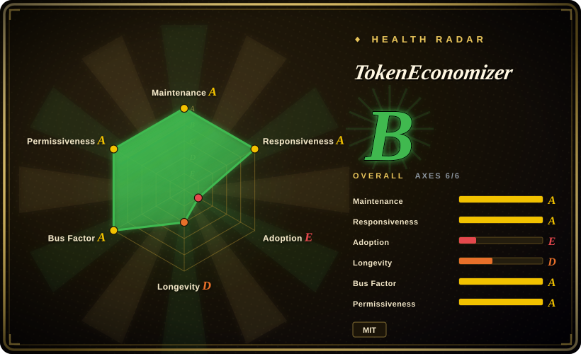
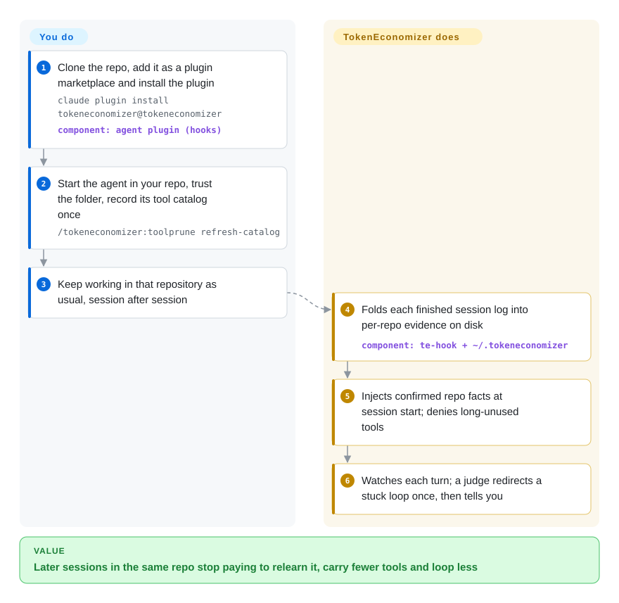
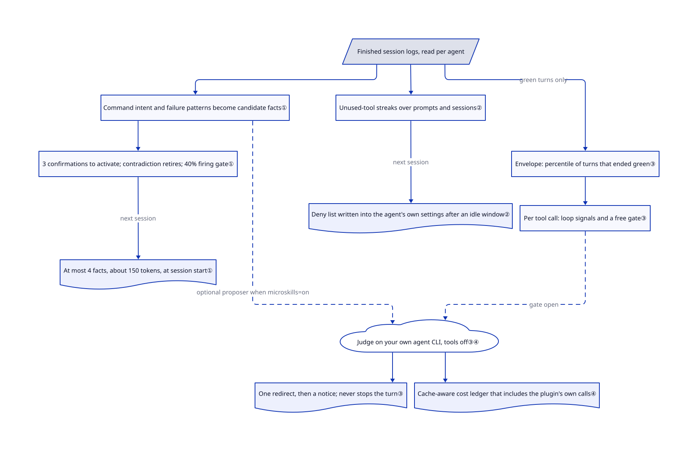

# TokenEconomizer

Every new agent session in the same repository pays again to discover that `pytest` is missing and `python -m pytest` works, ships the same never-used tool definitions with every request, and sometimes burns forty tool calls retrying one failing edit. TokenEconomizer reads the sessions you already ran in that repository and feeds the lessons forward: a few confirmed facts at session start, unused tools switched off in the agent's own settings, and a one-time nudge when a turn is going in circles.

## When to use

You use Claude Code, Codex or the Copilot CLI on the same few repositories every day, often on API billing or a metered plan. Reading back through a week of sessions you see the same waste repeat: the first three tool calls of every session are `pytest` → `command not found` → `python -m pytest`; the request payload still carries `NotebookEdit` and a browser MCP server nobody has called in a month; and once in a while a turn edits the same file twelve times against the same assertion error until you notice and press Esc. None of that is a single long output you can compress — it is the agent *not remembering* what earlier sessions in this repo already found out.

You reach for TokenEconomizer when you want that cross-session learning without changing the agent: install it as a plugin, keep working, and after a few sessions it starts acting on what it saw. You pick it over output compressors such as [RTK](rtk.md) or [Headroom](headroom.md) because it attacks a different cost — repeated discovery, unused tool schemas and failure loops — and composes with them (its paper even benchmarks TokenEconomizer+RTK). You pick it over a hand-maintained `CLAUDE.md` or memory plugin because its facts form only from evidence repeated across three sessions and retire themselves when contradicted, and because each saving it claims is billed against its own model calls in one cache-aware ledger.

## When NOT to use

- **If your sessions are mostly one-off repositories** (drive-by fixes, a new repo per task) — use [RTK](rtk.md) or [Headroom](headroom.md) instead, because TokenEconomizer's mechanisms need history in *that* repository before they act: facts need three confirming sessions, tool pruning needs 10 unused prompts across 2 sessions (or 5 sessions), and the loop guard waits for 5 turns that ended well. The paper's cross-repository security benchmarks show smaller savings (6–20%) than the same-repo SWE-Bench runs.
- **If the cost is one huge tool output or a long transcript** — use [RTK](rtk.md) (shell output), [Headroom](headroom.md) (model-bound payloads) or [Token Optimizer](token-optimizer.md) (re-reads and compaction checkpoints), because TokenEconomizer does not shrink any payload; it only removes tool definitions, adds a few facts, and interrupts loops.
- **If you open untrusted repositories with the plugin installed** — hold off, or set `TE_DISABLE=1` for those sessions, until issue #260 / PR #261 land: at the reviewed commit the plugin spawns `python -m tokeneconomizer.plugin.cli` with the repository as working directory and no `-I`/`-P`, so a planted `json.py` in the repo root runs with the hook's unsandboxed privileges, and its temp-file write in `denylist.py` follows a planted symlink (both reported 2026-11-17, still open on 2026-11-18).
- **If your agent version is outside the tested window** — pin the agent or wait, because the plugin reads each agent's private session-log format and lists exact ranges (Claude Code 2.1.300–2.1.310, Codex 0.153.1–0.164.0, Copilot CLI 1.0.83–1.0.102); newer releases are explicitly untested, and opencode, Cursor, Grok Build, Hermes, Antigravity and Factory Droid are experimental with partial mechanisms (no tool pruning on any of them).
- **If you need a guard that actually stops runaway turns, especially headless (`claude -p`, `codex exec`)** — use the agent's own turn/budget limits or an unattended-loop driver with a circuit breaker such as [Ralph for Claude Code](ralph-claude-code.md), because TokenEconomizer's loop guard only redirects once and then prints a notice; in a headless run nobody sees it and the turn runs until the agent's own limits.
- **If repository settings files must not be touched by tooling** — use `toolprune=propose` or turn tool pruning off, because under the default `auto` it writes deny entries into `.claude/settings.local.json`, `.codex/config.toml` or `.github/copilot/settings.local.json` by itself after an idle window (it adds them to `.git/info/exclude` and refuses committed or symlinked files, but it still edits your repo's agent config).

## Comparison

| Alternative | In index | Our verdict | Tradeoff |
| --- | --- | --- | --- |
| [RTK](rtk.md) | ✅ | When the waste is noisy shell output inside one session, pick RTK; pick TokenEconomizer when the waste is the same rediscovery, unused tools and loops repeating across sessions in the same repo. | RTK pays off from the first command with no learning period but only touches Bash output; TokenEconomizer needs several sessions of history and touches tool schemas, injected facts and turn control instead. The two compose. |
| [Token Optimizer](token-optimizer.md) | ✅ | When re-reads, compaction loss and a per-dollar dashboard are the problem and a noncommercial license is acceptable, pick Token Optimizer; pick TokenEconomizer for MIT-licensed cross-session learning with a published benchmark. | Token Optimizer rewrites payloads within a session and checkpoints compaction; TokenEconomizer never shrinks a payload but learns per repository and charges its own model calls to the same ledger. |
| [Headroom](headroom.md) | ✅ | When long JSON, logs and code in every request dominate the bill, pick Headroom's proxy; pick TokenEconomizer when you cannot or will not route model traffic through a local proxy. | Headroom compresses at the API layer and needs a persistent process and upstream routing; TokenEconomizer runs only inside agent hooks and leaves model traffic untouched. |
| [claude-mem](../../agent-memory/coding-agent-memory/claude-mem.md) | ✅ | When you want the agent to recall what it did and why across sessions, pick claude-mem; pick TokenEconomizer when the goal is cost, and you want only a handful of evidence-gated environment facts injected. | claude-mem stores and retrieves rich session memory (more context, more recall); TokenEconomizer caps its block at 4 facts and about 150 tokens, and each fact must be confirmed in three sessions and keep preventing a failure. |
| Hand-written `CLAUDE.md` / `AGENTS.md` notes plus manual `permissions.deny` | not a repo | For a single repository you know well, write the three facts and deny rules yourself; adopt TokenEconomizer when you work across many repos and agents and want the facts and deny lists maintained from evidence. | Manual notes are free and transparent but drift silently; TokenEconomizer keeps them current and retires stale facts, at the cost of a hook process on every tool call and model calls for the judge. |

## Quick start

On Claude Code you clone the repository, register the clone as a plugin marketplace (`claude plugin marketplace add "$PWD/TokenEconomizer"`), install the plugin, start `claude` in one of your repositories, trust the folder, and run `/tokeneconomizer:toolprune refresh-catalog` once per machine so tool pruning knows every tool a session loads; Codex, Copilot CLI and Pi have equivalent one-line installs, and the clone must stay in place because the agents run the plugin from it. After that you just work: the plugin's hooks — scripts the agent runs at session start, on each prompt, after each tool call and at session end — fold every finished session into per-repository state under `~/.tokeneconomizer`, inject confirmed facts at the next session start, write a deny list into the agent's own settings, and judge suspicious turns. You keep the responsibilities it cannot take: Python 3.10+ on `PATH`, an agent version inside the tested range, deciding whether to turn on micro-skills (off by default because its fact proposer costs model calls), and pressing Esc when it tells you a turn is still stuck. `/tokeneconomizer:status` (or `~/.tokeneconomizer/bin/te status` from a terminal, which costs no model turn) shows what it learned and what your sessions cost.

<!-- flow-steps:begin (generated from flows/tokeneconomizer.json by tools/flow_card.py — do not edit) -->

Text version of the flow

1. **You**: Clone the repo, add it as a plugin marketplace and install the plugin — `claude plugin install tokeneconomizer@tokeneconomizer` — component: `agent plugin (hooks)`
2. **You**: Start the agent in your repo, trust the folder, record its tool catalog once — `/tokeneconomizer:toolprune refresh-catalog`
3. **You**: Keep working in that repository as usual, session after session
4. **TokenEconomizer**: Folds each finished session log into per-repo evidence on disk — component: `te-hook + ~/.tokeneconomizer`
5. **TokenEconomizer**: Injects confirmed repo facts at session start; denies long-unused tools
6. **TokenEconomizer**: Watches each turn; a judge redirects a stuck loop once, then tells you

**Value**: Later sessions in the same repo stop paying to relearn it, carry fewer tools and loop less

<!-- flow-steps:end -->

## Key techniques

<!-- mechanism:begin (generated from mechanisms/tokeneconomizer.json by tools/mechanism_card.py; do not edit) -->

Text version of the mechanism

- Finished session logs, read per agent
- Command intent and failure patterns become candidate facts①
- 3 confirmations to activate; contradiction retires; 40% firing gate①
- At most 4 facts, about 150 tokens, at session start①
- Unused-tool streaks over prompts and sessions②
- Deny list written into the agent's own settings after an idle window②
- Per tool call: loop signals and a free gate③
- Envelope: percentile of turns that ended green③
- Judge on your own agent CLI, tools off③④
- One redirect, then a notice; never stops the turn③
- Cache-aware cost ledger that includes the plugin's own calls④

- Finished session logs, read per agent → Command intent and failure patterns become candidate facts①
- Command intent and failure patterns become candidate facts① → 3 confirmations to activate; contradiction retires; 40% firing gate①
- 3 confirmations to activate; contradiction retires; 40% firing gate① → At most 4 facts, about 150 tokens, at session start① (next session)
- Finished session logs, read per agent → Unused-tool streaks over prompts and sessions②
- Unused-tool streaks over prompts and sessions② → Deny list written into the agent's own settings after an idle window② (next session)
- Finished session logs, read per agent → Envelope: percentile of turns that ended green③ (green turns only)
- Per tool call: loop signals and a free gate③ → Judge on your own agent CLI, tools off③④ (gate open) [optional/fallback]
- Envelope: percentile of turns that ended green③ → Per tool call: loop signals and a free gate③
- Judge on your own agent CLI, tools off③④ → One redirect, then a notice; never stops the turn③
- Command intent and failure patterns become candidate facts① → Judge on your own agent CLI, tools off③④ (optional proposer when microskills=on) [optional/fallback]
- Judge on your own agent CLI, tools off③④ → Cache-aware cost ledger that includes the plugin's own calls④

<!-- mechanism:end -->

### 1. Promote repository facts only from repeated evidence

- **Problem:** A note written after one session ("use `python -m pytest`") can be a coincidence of that session, and a stale note keeps costing tokens and misleading the agent.
- **How:** Each finished session's shell commands are split and classified by intent (run tests, build, fetch, probe git) and by how they were spelled; five LLM-free families turn recurring shapes into candidate facts — a failing form followed by a working one, a host always refused, an env var a later run sets. An optional model proposer adds candidates when `microskills=on`. A candidate becomes active after confirmations in 3 sessions (sessions that edited different files, for code facts), retires on contradiction, and is injected only while it fired in at least 40% of at least 4 sessions that exercised it; the injected block is capped at 4 facts and about 150 tokens, and a lint refuses facts that read like "you're done" advice.
- **Limits:** Nothing is injected until three sessions agree, so short-lived repos never benefit; the LLM-free families recognize command spelling and environment problems, not design knowledge. Micro-skills is off by default.
- **Source:** [Lifecycle constants and promotion:1–23](https://github.com/microsoft/TokenEconomizer/blob/f1b91a40e9537c3e5fce146385366cbb009f5ecc/tokeneconomizer/microskills/lifecycle.py#L1-L23), [firing gate and update:97–120](https://github.com/microsoft/TokenEconomizer/blob/f1b91a40e9537c3e5fce146385366cbb009f5ecc/tokeneconomizer/microskills/lifecycle.py#L97-L120), [block caps:49–50](https://github.com/microsoft/TokenEconomizer/blob/f1b91a40e9537c3e5fce146385366cbb009f5ecc/tokeneconomizer/microskills/envfacts.py#L49-L50), [micro-skills overview](https://github.com/microsoft/TokenEconomizer/blob/f1b91a40e9537c3e5fce146385366cbb009f5ecc/tokeneconomizer/microskills/README.md).

### 2. Prune tools by cross-session evidence and write the deny list when the cache is cold anyway

- **Problem:** Every loaded tool's schema is resent with every request, but dropping a tool on one session's evidence removes something the next task needs, and changing tools mid-conversation forces a full prompt-cache rewrite.
- **How:** A never-used tool qualifies after 10 unused prompts spread over at least 2 sessions, or 5 sessions of any length (three times as long for high-risk tools like `NotebookEdit`); protected work-surface tools and anything ever used are never proposed. Under `toolprune=auto` the list is written only after the repository's sessions have been idle 60 minutes (or a day at most), when the prompt cache has expired anyway, into the agent's own settings — single tools on Claude Code, capability packages on Codex, whole MCP servers on Copilot CLI.
- **Limits:** Only Claude Code, Codex and Copilot CLI support pruning; it acts from the next session, and an unreadable, committed or symlinked settings file leaves the list as a proposal. Savings depend on how many unused tools your setup loads.
- **Source:** [Evidence rule:143–152](https://github.com/microsoft/TokenEconomizer/blob/f1b91a40e9537c3e5fce146385366cbb009f5ecc/tokeneconomizer/plugin/fold.py#L143-L152), [quiet-window apply:426–458](https://github.com/microsoft/TokenEconomizer/blob/f1b91a40e9537c3e5fce146385366cbb009f5ecc/tokeneconomizer/plugin/fold.py#L426-L458), [settings writer and git exclude:111–150](https://github.com/microsoft/TokenEconomizer/blob/f1b91a40e9537c3e5fce146385366cbb009f5ecc/tokeneconomizer/plugin/denylist.py#L111-L150), [tool pruning overview](https://github.com/microsoft/TokenEconomizer/blob/f1b91a40e9537c3e5fce146385366cbb009f5ecc/tokeneconomizer/toolprune/README.md).

### 3. Judge stuck turns against what a healthy turn looks like in this repo

- **Problem:** A fixed "N tool calls" cutoff either kills long productive turns in big repos or never fires in small ones; asking a model about every step would cost more than the loop.
- **How:** Per tool call, the guard folds edits per file, error outputs and repeated failures (including edits made via `sed -i` or redirects) into a state. The envelope is a percentile (p90 by default) of the lengths of turns that ended well — the agent stopped on its own and no check after the last edit failed — and stays empty until 5 such turns exist. A free rule-based gate decides whether a turn is worth a look; only then does a model judge decide, and at confidence ≥ 0.7 the agent gets one redirect attached to the tool result. A hard backstop redirects without the judge past 2.5× the usual length while churning.
- **Limits:** It never stops a turn — after its redirect it only tells you; in headless runs that notice may go unseen. Each agent learns its own envelope, so a new repo is unguarded until five green turns accumulate.
- **Source:** [TurnGuard design:1–18](https://github.com/microsoft/TokenEconomizer/blob/f1b91a40e9537c3e5fce146385366cbb009f5ecc/tokeneconomizer/loopguard/turn.py#L1-L18), [gate, judge and backstop cascade:109–135](https://github.com/microsoft/TokenEconomizer/blob/f1b91a40e9537c3e5fce146385366cbb009f5ecc/tokeneconomizer/loopguard/rules.py#L109-L135), [envelope from green turns:30–88](https://github.com/microsoft/TokenEconomizer/blob/f1b91a40e9537c3e5fce146385366cbb009f5ecc/tokeneconomizer/loopguard/envelope.py#L30-L88).

### 4. Run its own model calls through your signed-in agent CLI, tools off, and bill them

- **Problem:** A cost optimizer that needs its own API key, or whose overhead is not counted, can look cheaper than it is and widens the credential surface.
- **How:** The judge, the redirect writer and the fact proposer are side calls through the agent you are already signed in to — on Claude Code `claude -p --tools "" --max-turns 1` with no MCP servers on `haiku` by default, on Codex `codex exec -s read-only --ephemeral`, on Copilot a pure text completion with every tool denied — run in a throwaway directory with `TE_SIDECALL=1` so the nested agent does not recurse into the plugin's hooks. Their cost is read back and priced with cache-aware rates into the same ledger as your sessions; any hook exception returns `{}` and a line in `errors.log`, so a plugin failure leaves the session running as if it were not installed.
- **Limits:** Side calls consume your plan quota (a Codex side call carries Codex's ~25k-token base prompt), and on Antigravity no side call is possible, so only LLM-free facts work there. Fail-open hooks still execute on your machine outside the agent's sandbox (see the open issue under When NOT to use).
- **Source:** [Side-call design per agent:1–57](https://github.com/microsoft/TokenEconomizer/blob/f1b91a40e9537c3e5fce146385366cbb009f5ecc/tokeneconomizer/plugin/sidecall.py#L1-L57), [Claude call construction:293–302](https://github.com/microsoft/TokenEconomizer/blob/f1b91a40e9537c3e5fce146385366cbb009f5ecc/tokeneconomizer/plugin/sidecall.py#L293-L302), [fail-open hook entry:1–10](https://github.com/microsoft/TokenEconomizer/blob/f1b91a40e9537c3e5fce146385366cbb009f5ecc/tokeneconomizer/plugin/hook.py#L1-L10), [one cost definition](https://github.com/microsoft/TokenEconomizer/blob/f1b91a40e9537c3e5fce146385366cbb009f5ecc/docs/ARCHITECTURE.md).

## Tech stack

- **Python 3.10+, standard library only** — `pyproject.toml` declares `dependencies = []`; the mechanisms (`microskills`, `toolprune`, `loopguard`), the per-agent session-log readers (`trace/`, one module per agent) and the plugin runtime (`plugin/`) import nothing outside the stdlib.
- **Per-agent plugin shells** — JSON hook manifests and POSIX/Windows launchers (`plugin/scripts/te-hook`, `te-hook.cmd`) for Claude Code, Codex, Copilot CLI, Cursor, Droid; TypeScript extensions for Pi and opencode; a Python plugin for Hermes.
- **State** — locked atomic JSON files under `~/.tokeneconomizer` (`injection.json`, `untool.json`, `envelope.json`), one set per agent and repository.
- **Benchmark harness (separate, not installed)** — `experiments/` runs agents on SWE-Bench and Web-Bench in Docker with RTK and aider RepoMap baselines; excluded from the package by `pyproject.toml`.

## Dependencies

- A supported coding agent, signed in any way it supports, at a version inside the tested range, and Python ≥ 3.10 on `PATH`. No separate API key: model calls go through the agent CLI and your plan.
- The cloned repository must stay on disk (Claude Code, Codex, Copilot CLI and opencode run the plugin from it); Factory Droid, Cursor and Antigravity need a bundle built with `scripts/build_plugin.py`.
- Optional: aider (`pip install '.[baselines]'`) only for the opt-in repository map; Docker, benchmark images and an agent API key only if you rerun `experiments/`.

## Ops difficulty

**Low to install, medium to keep healthy.** Install is three commands per agent and there is no daemon. The recurring work is version coupling: supported agent ranges are narrow and listed per release, Codex needs `codex plugin add` again after each `git pull`, and Claude Code and Copilot need `toolprune refresh-catalog` again after agent updates. Expect to check `te status` / `te doctor` (side-call failures land in `~/.tokeneconomizer/errors.log`) and to decide per repository whether `toolprune=auto` may edit agent settings. `TE_DISABLE=1` turns it off for one session; `toolprune restore` returns pruned tools.

## Health & viability

- **Maintenance (2026-11-18): very active.** Default branch pushed 2026-11-18; one tagged release, v0.1.0 (2026-10-26); 34 PRs merged in the seven days to 2026-11-18 (97 in total), mostly new agent hosts and command-parser fixes.
- **Governance & backing:** a Microsoft-org repository from Microsoft Research, Microsoft Security and UC Berkeley (the arXiv paper 2610.22732 lists 11 authors). The first author, aaron-jx-li, has 140 commits — far ahead of the next contributor (SakshamUboweja, 36) — while a growing group of external contributors (each ≤ 12) sends fixes. Roadmap ownership is effectively one research team. [推断：依据是贡献者分布与论文作者单位] Its long-term maintenance depends on whether the team keeps funding it after the paper.
- **Age / Lindy:** created 2026-10-13, about five weeks old — the Lindy prior says nothing yet; judge it on activity.
- **Adoption:** ~7.5k stars and 511 forks within five weeks, plus Trendshift "#1 Python repository of the day" badges — a launch spike rather than proven long-term use. It is not published to PyPI or npm, the scorer found 0 dependent repos, and install counts are not published (hence the E on the adoption axis).
- **Risk flags:** license churn — MIT at migration, relicensed to Apache-2.0 on 2026-10-18, back to MIT with Microsoft copyright on 2026-11-17; the current LICENSE file is MIT. An open security report (#260, 2026-11-17) describes repository-planted module shadowing and a symlink write-through in the hook path, with a fix PR (#261) not merged as of 2026-11-18. The plugin reads private, unversioned session-log formats of several vendors, so agent updates can break it.

## Caveats (unverified)

- [未验证：未复现论文实验] The headline 18.4–30.9% lower mean cost and Pass@1 changes on 277 SWE-Bench tasks are the authors' Table 1; not rerun here, and they measure same-repository task streams, not your workload.
- [未验证：未在本机安装运行插件] Hook behavior, fact injection and deny-list writing were read from source and docs at commit `f1b91a4`, not observed in a live agent session.
- [推断：依据是 issue #260 正文与 context.py 第 84–95 行] The module-shadowing path matches the reviewed source (`-m` with `cwd=repo.root`); exploitability against a real install was not reproduced.
- [未验证：上游未公开安装量] Adoption beyond stars and forks (active installs, organizations using it) is unknown.
- [推断：依据是许可证提交历史] The two relicense commits within a month suggest licensing was unsettled at launch; whether MIT is final was not confirmed with the maintainers.
- [未验证：未逐个测试实验性宿主] Behavior on opencode, Cursor, Grok Build, Hermes, Antigravity and Factory Droid is as documented by upstream, not checked.
- [推断：依据是许可证提交历史与 health.py 原始值] The health radar's `relicense_36mo: false` does not reflect the MIT → Apache-2.0 → MIT changes of 2026-10-18 and 2026-11-17; read the Risk flags bullet, not the A on the license axis, for license stability.
