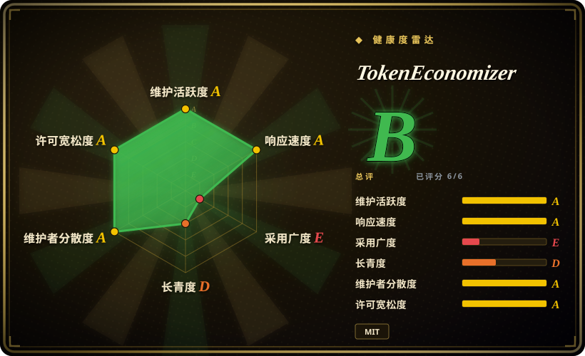
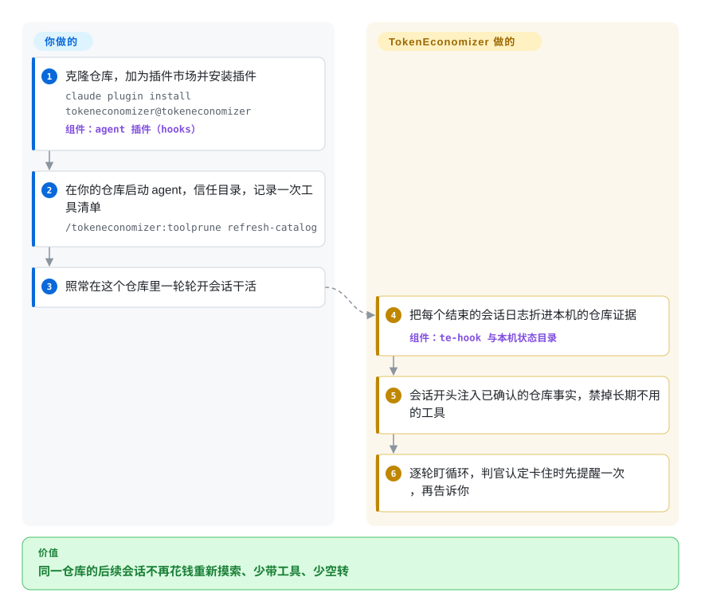
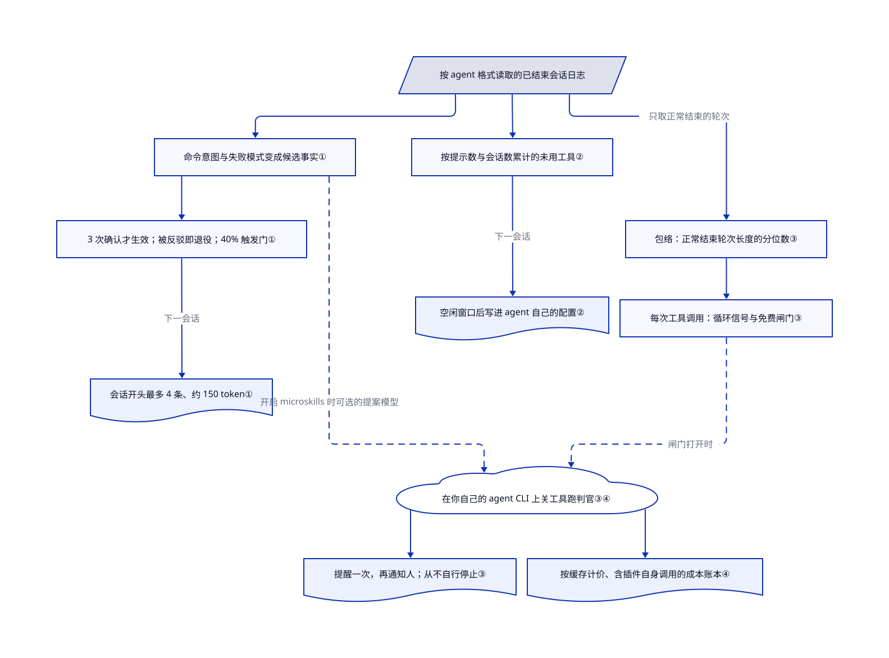

# TokenEconomizer

同一个仓库里，agent 每开一个新会话都要重新花钱试出“`pytest` 不存在、得用 `python -m pytest`”，每个请求都带着从没用过的工具定义，偶尔还会对着同一个失败改四十次。TokenEconomizer 读你在这个仓库已经跑完的会话，把教训带到下一次：会话开头注入几条反复验证过的事实，在 agent 自己的配置里关掉长期不用的工具，发现某一轮在原地打转时提醒一次。

## 何时使用

你每天在同几个仓库里用 Claude Code、Codex 或 Copilot CLI，多半按 API 计费或额度有限。翻一周的会话记录，浪费总是同一批：每个会话前三次工具调用都是 `pytest` → `command not found` → `python -m pytest`；请求里一直带着 `NotebookEdit` 和一个一个月没人调用的浏览器 MCP 服务；偶尔某一轮对着同一个断言错误把同一个文件改了十二遍，直到你发现并按下 Esc。这些都不是某段超长输出可以压缩掉的问题，而是 agent 不记得这个仓库之前的会话已经摸清了什么。

想在不改 agent 本身的前提下获得这种跨会话学习，就用 TokenEconomizer：装成插件，照常干活，几个会话之后它开始按看到的证据行动。选它而不是 [RTK](rtk.zh.md) 或 [Headroom](headroom.zh.md) 这类输出压缩工具，是因为它针对的是另一类成本：重复摸索、没用到的工具定义和失败循环，而且能和它们叠加（论文里就测了 TokenEconomizer+RTK）。选它而不是手写 `CLAUDE.md` 或记忆插件，是因为它的事实必须在三个会话里重复出现才生效、被反驳就自动退役，而且它报的每一分节省都扣掉了它自己的模型调用，记在同一本按缓存计价的账里。

## 何时不用

- **会话大多发生在一次性仓库里**（顺手修一下、每个任务一个新仓库）：改用 [RTK](rtk.zh.md) 或 [Headroom](headroom.zh.md)。TokenEconomizer 的三个机制都要先在这个仓库里积累历史：事实要三个会话确认，工具裁剪要 2 个会话里累计 10 个提示没用（或 5 个会话），循环守卫要先有 5 个正常结束的轮次。论文里每题一个新仓库的安全审计基准，节省（6–20%）也比同仓库的 SWE-Bench 小。
- **成本来自某段超长工具输出或很长的对话**：改用 [RTK](rtk.zh.md)（shell 输出）、[Headroom](headroom.zh.md)（发往模型的内容）或 [Token Optimizer](token-optimizer.zh.md)（重复读取与压缩检查点）。TokenEconomizer 不压缩任何内容，只删工具定义、加几条事实、打断循环。
- **装着插件去打开不受信任的仓库**：在 issue #260 和 PR #261 合入之前先别这么做，或对这类会话设 `TE_DISABLE=1`。在本页审阅的提交上，插件以仓库目录为工作目录、不带 `-I`/`-P` 启动 `python -m tokeneconomizer.plugin.cli`，仓库根目录里放一个 `json.py` 就能以 hook 的沙箱外权限运行；`denylist.py` 写临时文件时也会跟随预埋的符号链接（2026-11-17 报告，2026-11-18 仍未关闭）。
- **agent 版本不在测试范围内**：先固定 agent 版本或等它跟进。插件读的是各家 agent 私有的会话日志格式，并列出了精确的支持范围（Claude Code 2.1.300–2.1.310、Codex 0.153.1–0.164.0、Copilot CLI 1.0.83–1.0.102），更新的版本明确写着未测试；opencode、Cursor、Grok Build、Hermes、Antigravity 和 Factory Droid 都是实验性支持，机制不全，且都没有工具裁剪。
- **需要真正掐断失控的轮次，尤其是无人值守运行（`claude -p`、`codex exec`）**：用 agent 自带的轮数和预算上限，或带熔断的无人值守循环驱动器，比如 [Ralph for Claude Code](ralph-claude-code.zh.md)。TokenEconomizer 的循环守卫只提醒一次，之后只打印通知；无人值守时没人看得到，这一轮会一直跑到 agent 自己的上限。
- **仓库里的配置文件不允许工具改动**：用 `toolprune=propose` 或关掉工具裁剪。默认的 `auto` 会在空闲窗口后自行把禁用项写进 `.claude/settings.local.json`、`.codex/config.toml` 或 `.github/copilot/settings.local.json`（会加进 `.git/info/exclude`，遇到已提交或软链接的文件会拒绝写，但终究在改你仓库里的 agent 配置）。

## 横向对比

| 替代品 | 是否收录 | 我们的评价 | 取舍 |
| --- | --- | --- | --- |
| [RTK](rtk.zh.md) | ✅ | 浪费来自单个会话里啰嗦的 shell 输出，选 RTK；浪费来自同一仓库跨会话重复的摸索、闲置工具和循环，选 TokenEconomizer。 | RTK 第一条命令就见效、无需学习期，但只管 Bash 输出；TokenEconomizer 要几次会话的历史，管的是工具定义、注入事实和轮次干预。两者可以叠加。 |
| [Token Optimizer](token-optimizer.zh.md) | ✅ | 问题在重复读取、压缩丢上下文、想看美元仪表盘，且能接受非商业许可，选 Token Optimizer；要 MIT 许可、带公开基准的跨会话学习，选 TokenEconomizer。 | Token Optimizer 在会话内改写内容并给压缩打检查点；TokenEconomizer 从不缩短内容，而是按仓库学习，并把自己的模型调用记进同一本账。 |
| [Headroom](headroom.zh.md) | ✅ | 每个请求里的长 JSON、日志和代码占大头，选 Headroom 的代理；不能或不愿让模型流量经过本地代理，选 TokenEconomizer。 | Headroom 在 API 层压缩，需要常驻进程和上游路由；TokenEconomizer 只在 agent 的 hook 里运行，不碰模型流量。 |
| [claude-mem](../../agent-memory/coding-agent-memory/claude-mem.zh.md) | ✅ | 想让 agent 跨会话记得自己做过什么、为什么，选 claude-mem；目标是省钱、只想注入少量有证据的环境事实，选 TokenEconomizer。 | claude-mem 存取丰富的会话记忆（上下文更多、能回忆更多）；TokenEconomizer 把注入块限制在 4 条、约 150 token，每条都要三次会话确认并持续起作用。 |
| 手写 `CLAUDE.md` / `AGENTS.md` 加手配 `permissions.deny` | 非仓库 | 只有一个熟悉的仓库时，自己写三条事实和禁用规则就够；跨很多仓库和 agent 工作、希望事实和禁用列表按证据自动维护时，用 TokenEconomizer。 | 手写免费透明，但会悄悄过时；TokenEconomizer 保持更新并淘汰过时事实，代价是每次工具调用都多一个 hook 进程，判官还要花模型调用。 |

## 快速上手

以 Claude Code 为例：克隆仓库，把克隆目录注册为插件市场（`claude plugin marketplace add "$PWD/TokenEconomizer"`），安装插件，在你自己的某个仓库里启动 `claude`、信任目录，然后每台机器执行一次 `/tokeneconomizer:toolprune refresh-catalog`，让工具裁剪知道会话会加载哪些工具；Codex、Copilot CLI 和 Pi 也各有一行安装命令，克隆目录要一直留着，因为 agent 直接从那里运行插件。之后照常干活：插件的 hook（agent 在会话开始、每次提问、每次工具调用后和会话结束时运行的脚本）会把每个结束的会话折进 `~/.tokeneconomizer` 下按仓库存放的状态，在下次会话开头注入已确认的事实，把禁用列表写进 agent 自己的配置，并对可疑的轮次做判断。它替你做不了的事仍归你：`PATH` 上要有 Python 3.10+，agent 版本要在测试范围内，要不要开 micro-skills 由你决定（默认关，因为它的事实提案要花模型调用），它提示某一轮仍卡住时由你按 Esc。`/tokeneconomizer:status`（或在终端运行 `~/.tokeneconomizer/bin/te status`，不花模型轮次）可以查看它学到了什么、你的会话花了多少。

<!-- flow-steps:begin (generated from flows/tokeneconomizer.json by tools/flow_card.py — do not edit) -->

流程文字版

1. **你**：克隆仓库，加为插件市场并安装插件 — `claude plugin install tokeneconomizer@tokeneconomizer` — 组件：`agent 插件（hooks）`
2. **你**：在你的仓库启动 agent，信任目录，记录一次工具清单 — `/tokeneconomizer:toolprune refresh-catalog`
3. **你**：照常在这个仓库里一轮轮开会话干活
4. **TokenEconomizer**：把每个结束的会话日志折进本机的仓库证据 — 组件：`te-hook 与本机状态目录`
5. **TokenEconomizer**：会话开头注入已确认的仓库事实，禁掉长期不用的工具
6. **TokenEconomizer**：逐轮盯循环，判官认定卡住时先提醒一次，再告诉你

**价值**：同一仓库的后续会话不再花钱重新摸索、少带工具、少空转

<!-- flow-steps:end -->

## 技术要点

<!-- mechanism:begin (generated from mechanisms/tokeneconomizer.json by tools/mechanism_card.py; do not edit) -->

机制文字版

- 按 agent 格式读取的已结束会话日志
- 命令意图与失败模式变成候选事实①
- 3 次确认才生效；被反驳即退役；40% 触发门①
- 会话开头最多 4 条、约 150 token①
- 按提示数与会话数累计的未用工具②
- 空闲窗口后写进 agent 自己的配置②
- 每次工具调用：循环信号与免费闸门③
- 包络：正常结束轮次长度的分位数③
- 在你自己的 agent CLI 上关工具跑判官③④
- 提醒一次，再通知人；从不自行停止③
- 按缓存计价、含插件自身调用的成本账本④

- 按 agent 格式读取的已结束会话日志 → 命令意图与失败模式变成候选事实①
- 命令意图与失败模式变成候选事实① → 3 次确认才生效；被反驳即退役；40% 触发门①
- 3 次确认才生效；被反驳即退役；40% 触发门① → 会话开头最多 4 条、约 150 token①（下一会话）
- 按 agent 格式读取的已结束会话日志 → 按提示数与会话数累计的未用工具②
- 按提示数与会话数累计的未用工具② → 空闲窗口后写进 agent 自己的配置②（下一会话）
- 按 agent 格式读取的已结束会话日志 → 包络：正常结束轮次长度的分位数③（只取正常结束的轮次）
- 每次工具调用：循环信号与免费闸门③ → 在你自己的 agent CLI 上关工具跑判官③④（闸门打开时）〔可选／兜底〕
- 包络：正常结束轮次长度的分位数③ → 每次工具调用：循环信号与免费闸门③
- 在你自己的 agent CLI 上关工具跑判官③④ → 提醒一次，再通知人；从不自行停止③
- 命令意图与失败模式变成候选事实① → 在你自己的 agent CLI 上关工具跑判官③④（开启 microskills 时可选的提案模型）〔可选／兜底〕
- 在你自己的 agent CLI 上关工具跑判官③④ → 按缓存计价、含插件自身调用的成本账本④

<!-- mechanism:end -->

### 1. 仓库事实只从重复证据中晋升

- **解决：** 一次会话后写下的笔记（“用 `python -m pytest`”）可能只是那次的巧合，而过时的笔记会持续花 token、误导 agent。
- **做法：** 每个结束会话里的 shell 命令被拆开，按意图（跑测试、构建、联网、查 git）和写法分类；五类不用模型的规则把反复出现的形状变成候选事实，例如先失败后成功的写法、总被拒绝的主机、后来某次运行补上的环境变量。开启 `microskills=on` 时还有一个模型提案器补充候选。候选在 3 个会话里得到确认才生效（关于代码的事实要求这些会话改的是不同文件），被反驳就退役，并且只有在至少 4 个相关会话里有 40% 以上真的起作用时才注入；注入块最多 4 条、约 150 token，读起来像“已经完成”之类建议的事实会被拒绝。
- **边界：** 三个会话一致之前什么都不注入，短命仓库永远享受不到；不用模型的规则只认得命令写法和环境问题，不认识设计层面的知识。micro-skills 默认关闭。
- **源码：** [生命周期常量与晋升第 1–23 行](https://github.com/microsoft/TokenEconomizer/blob/f1b91a40e9537c3e5fce146385366cbb009f5ecc/tokeneconomizer/microskills/lifecycle.py#L1-L23)、[触发门与更新第 97–120 行](https://github.com/microsoft/TokenEconomizer/blob/f1b91a40e9537c3e5fce146385366cbb009f5ecc/tokeneconomizer/microskills/lifecycle.py#L97-L120)、[注入块上限第 49–50 行](https://github.com/microsoft/TokenEconomizer/blob/f1b91a40e9537c3e5fce146385366cbb009f5ecc/tokeneconomizer/microskills/envfacts.py#L49-L50)、[micro-skills 说明](https://github.com/microsoft/TokenEconomizer/blob/f1b91a40e9537c3e5fce146385366cbb009f5ecc/tokeneconomizer/microskills/README.md)。

### 2. 按跨会话证据裁剪工具，并在缓存反正已失效时写入

- **解决：** 每个已加载工具的定义都随每个请求重发，但只凭一次会话就删工具，会删掉下个任务要用的东西；对话中途改工具还会迫使整段提示缓存重写。
- **做法：** 一个从未用过的工具，要在至少 2 个会话里累计 10 个提示都没用，或 5 个会话（长短不论）都没用，才进入候选；`NotebookEdit` 这类高风险工具要求三倍证据，受保护的核心工具和用过一次的工具永不提出。默认 `toolprune=auto` 下，要等这个仓库的会话空闲 60 分钟（最多等一天）、提示缓存反正已过期时，才写进 agent 自己的配置：Claude Code 按单个工具，Codex 按能力包，Copilot CLI 按整个 MCP 服务。
- **边界：** 只有 Claude Code、Codex 和 Copilot CLI 支持裁剪，且从下一个会话生效；配置文件不可读、已提交或是软链接时，列表只停留在提案。能省多少取决于你的配置加载了多少闲置工具。
- **源码：** [证据规则第 143–152 行](https://github.com/microsoft/TokenEconomizer/blob/f1b91a40e9537c3e5fce146385366cbb009f5ecc/tokeneconomizer/plugin/fold.py#L143-L152)、[空闲窗口后写入第 426–458 行](https://github.com/microsoft/TokenEconomizer/blob/f1b91a40e9537c3e5fce146385366cbb009f5ecc/tokeneconomizer/plugin/fold.py#L426-L458)、[配置写入与 git 排除第 111–150 行](https://github.com/microsoft/TokenEconomizer/blob/f1b91a40e9537c3e5fce146385366cbb009f5ecc/tokeneconomizer/plugin/denylist.py#L111-L150)、[工具裁剪说明](https://github.com/microsoft/TokenEconomizer/blob/f1b91a40e9537c3e5fce146385366cbb009f5ecc/tokeneconomizer/toolprune/README.md)。

### 3. 以本仓库正常轮次为基准判断是否卡住

- **解决：** 固定的“N 次工具调用”阈值，在大仓库里会误杀长而有效的轮次，在小仓库里又永远不触发；每一步都问模型，花的钱比循环本身还多。
- **做法：** 每次工具调用，守卫都把按文件计的修改次数、错误输出和重复失败（包括通过 `sed -i` 或重定向做的修改）累进状态。包络取正常结束轮次长度的分位数（默认 p90）；正常结束指 agent 自己停下、且最后一次修改后的检查没有失败；凑满 5 个这样的轮次之前包络为空。先由免费的规则闸门判断这一轮值不值得看，只有闸门打开才请模型判官裁决，置信度不低于 0.7 时把一次提醒附在工具结果上交给 agent。另有硬兜底：一轮超过平常长度 2.5 倍且在原地反复改时，不经判官直接提醒。
- **边界：** 它从不停止轮次，提醒之后只会告诉你；无人值守时这条通知可能没人看见。每个 agent 各自学习包络，新仓库在攒够五个正常轮次之前没有守卫。
- **源码：** [TurnGuard 设计第 1–18 行](https://github.com/microsoft/TokenEconomizer/blob/f1b91a40e9537c3e5fce146385366cbb009f5ecc/tokeneconomizer/loopguard/turn.py#L1-L18)、[闸门、判官与兜底级联第 109–135 行](https://github.com/microsoft/TokenEconomizer/blob/f1b91a40e9537c3e5fce146385366cbb009f5ecc/tokeneconomizer/loopguard/rules.py#L109-L135)、[由正常轮次学习包络第 30–88 行](https://github.com/microsoft/TokenEconomizer/blob/f1b91a40e9537c3e5fce146385366cbb009f5ecc/tokeneconomizer/loopguard/envelope.py#L30-L88)。

### 4. 自身模型调用走你已登录的 agent CLI、关掉工具并计入账本

- **解决：** 一个省钱工具如果需要单独的 API key，或者不计算自己的开销，就会看起来比实际更省，还会扩大凭据暴露面。
- **做法：** 判官、提醒撰写和事实提案都是通过你已登录的 agent 发起的旁路调用：Claude Code 上是 `claude -p --tools "" --max-turns 1`、不带 MCP 服务、默认 `haiku`，Codex 上是 `codex exec -s read-only --ephemeral`，Copilot 上是禁用全部工具的纯文本补全；都在临时目录里运行并带 `TE_SIDECALL=1`，防止嵌套的 agent 再触发插件的 hook。这些调用的用量被读回，按缓存价格记进和你的会话同一本账；hook 出任何异常都只返回 `{}` 并在 `errors.log` 记一行，插件失败时会话照常运行，就像没装一样。
- **边界：** 旁路调用消耗你的套餐额度（Codex 每次旁路调用都带着约 25k token 的基础提示词）；Antigravity 上无法旁路调用，只有不用模型的事实可用。fail-open 的 hook 仍在你的机器上、agent 沙箱之外执行（见“何时不用”里的未关闭 issue）。
- **源码：** [各 agent 旁路调用设计第 1–57 行](https://github.com/microsoft/TokenEconomizer/blob/f1b91a40e9537c3e5fce146385366cbb009f5ecc/tokeneconomizer/plugin/sidecall.py#L1-L57)、[Claude 调用拼装第 293–302 行](https://github.com/microsoft/TokenEconomizer/blob/f1b91a40e9537c3e5fce146385366cbb009f5ecc/tokeneconomizer/plugin/sidecall.py#L293-L302)、[fail-open 的 hook 入口第 1–10 行](https://github.com/microsoft/TokenEconomizer/blob/f1b91a40e9537c3e5fce146385366cbb009f5ecc/tokeneconomizer/plugin/hook.py#L1-L10)、[统一的成本定义](https://github.com/microsoft/TokenEconomizer/blob/f1b91a40e9537c3e5fce146385366cbb009f5ecc/docs/ARCHITECTURE.md)。

## 技术栈

- **Python 3.10+，只用标准库**：`pyproject.toml` 声明 `dependencies = []`；三个机制（`microskills`、`toolprune`、`loopguard`）、按 agent 分模块的会话日志读取器（`trace/`）和插件运行时（`plugin/`）都不引入标准库以外的包。
- **各 agent 的插件外壳**：Claude Code、Codex、Copilot CLI、Cursor、Droid 用 JSON hook 清单加 POSIX/Windows 启动脚本（`plugin/scripts/te-hook`、`te-hook.cmd`）；Pi 和 opencode 用 TypeScript 扩展；Hermes 用 Python 插件。
- **状态**：`~/.tokeneconomizer` 下带锁、原子写入的 JSON 文件（`injection.json`、`untool.json`、`envelope.json`），每个 agent、每个仓库一套。
- **基准实验框架（独立，不随插件安装）**：`experiments/` 在 Docker 里让 agent 跑 SWE-Bench 和 Web-Bench，带 RTK 与 aider RepoMap 两个对照组；`pyproject.toml` 把它排除在包之外。

## 依赖

- 一个受支持的编程 agent（任何登录方式都行），版本在测试范围内，`PATH` 上有 Python ≥ 3.10。不需要单独的 API key：模型调用走 agent CLI 和你的套餐。
- 克隆目录要一直留在磁盘上（Claude Code、Codex、Copilot CLI 和 opencode 直接从那里运行插件）；Factory Droid、Cursor 和 Antigravity 需要先用 `scripts/build_plugin.py` 打包。
- 可选：只有启用仓库地图时才需要 aider（`pip install '.[baselines]'`）；只有重跑 `experiments/` 时才需要 Docker、基准镜像和 agent 的 API key。

## 运维难度

**安装低，保持正常运转中等。** 每个 agent 三条命令装好，没有常驻进程。持续的工作量在版本耦合：支持的 agent 版本范围很窄、每次发布单独列出，Codex 每次 `git pull` 后要重新 `codex plugin add`，Claude Code 和 Copilot 升级后要重新 `toolprune refresh-catalog`。要不时看 `te status` / `te doctor`（旁路调用失败记在 `~/.tokeneconomizer/errors.log`），并按仓库决定是否允许 `toolprune=auto` 改 agent 配置。`TE_DISABLE=1` 可对单个会话关闭插件，`toolprune restore` 可还原被裁掉的工具。

## 健康度与可持续性

- **维护（2026-11-18）：非常活跃。** 默认分支 2026-11-18 有推送；仅一个正式版本 v0.1.0（2026-10-26）；截至 2026-11-18 的七天内合并了 34 个 PR（累计 97 个），大多是新增 agent 宿主和命令解析修复。
- **治理与背书：** 仓库在 Microsoft 组织下，来自 Microsoft Research、Microsoft Security 和 UC Berkeley（arXiv 论文 2610.22732 署名 11 位作者）。第一作者 aaron-jx-li 有 140 次提交，远超第二名（SakshamUboweja，36 次），越来越多的外部贡献者（每人不超过 12 次）在提交修复。路线图实际由一个研究团队掌握。[推断：依据是贡献者分布与论文作者单位] 论文发表后团队是否继续投入，决定了它的长期维护。
- **年龄与 Lindy：** 2026-10-13 创建，约五周，Lindy 先验还说明不了什么，只能看活跃度。
- **采用度：** 五周内约 7.5k star、511 fork，README 上挂着 Trendshift “当日 Python 第一”徽章，更像发布热度而非经过验证的长期使用。它没有发布到 PyPI 或 npm，评分器查到的下游依赖仓库为 0，安装量也没有公开（所以采用度轴是 E）。
- **风险信号：** 许可证反复：迁移时为 MIT，2026-10-18 改为 Apache-2.0，2026-11-17 又改回署名 Microsoft 的 MIT，当前 LICENSE 文件是 MIT。一份公开的安全报告（#260，2026-11-17）指出 hook 路径存在仓库预埋模块遮蔽和符号链接写穿问题，修复 PR #261 截至 2026-11-18 未合并。插件依赖多家厂商私有、无版本承诺的会话日志格式，agent 一升级就可能失效。

## 存疑（未验证）

- [未验证：未复现论文实验] 标题里 277 个 SWE-Bench 任务上平均成本降低 18.4–30.9% 及 Pass@1 变化，来自作者论文的表 1；本页未重跑，且它测的是同仓库连续任务，不是你的实际工作负载。
- [未验证：未在本机安装运行插件] hook 行为、事实注入和禁用列表写入，是在提交 `f1b91a4` 上读源码和文档得出的，没有在真实 agent 会话里观察。
- [推断：依据是 issue #260 正文与 context.py 第 84–95 行] 模块遮蔽路径与审阅的源码一致（`-m` 加 `cwd=repo.root`），但没有在真实安装上复现可利用性。
- [未验证：上游未公开安装量] star 和 fork 之外的采用情况（活跃安装、在用的组织）未知。
- [推断：依据是许可证提交历史] 一个月内两次改许可证，说明发布时许可尚未定型；MIT 是否为最终选择，没有向维护者确认。
- [未验证：未逐个测试实验性宿主] opencode、Cursor、Grok Build、Hermes、Antigravity 和 Factory Droid 上的行为以上游文档为准，未实测。
- [推断：依据是许可证提交历史与 health.py 原始值] 健康度雷达的 `relicense_36mo: false` 没有反映 2026-10-18 和 2026-11-17 的 MIT → Apache-2.0 → MIT 变更；判断许可证稳定性请看“风险信号”一条，而不是许可证轴上的 A。
