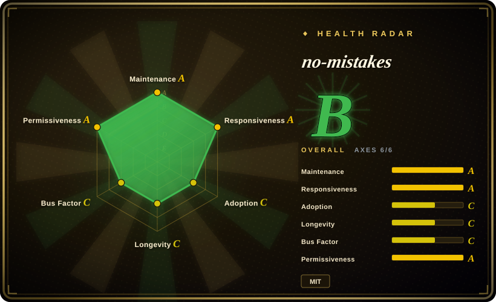
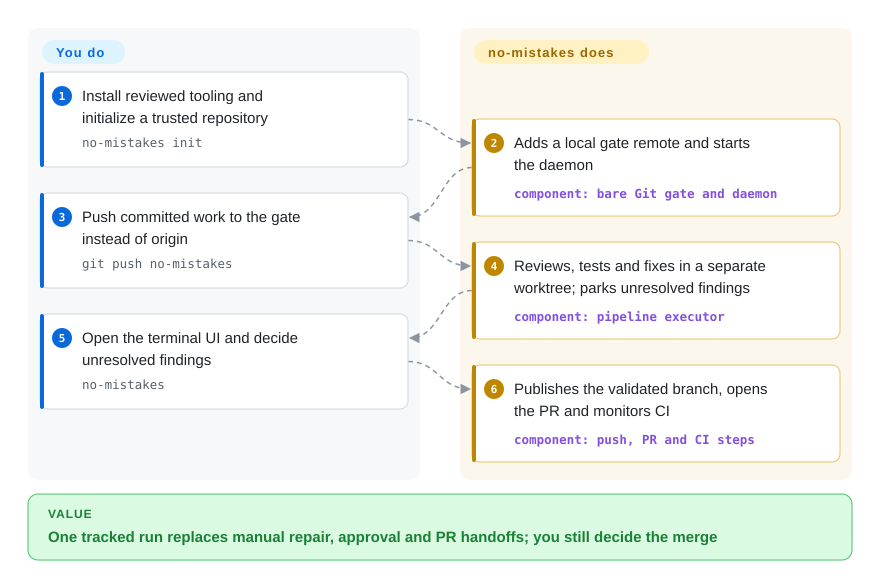
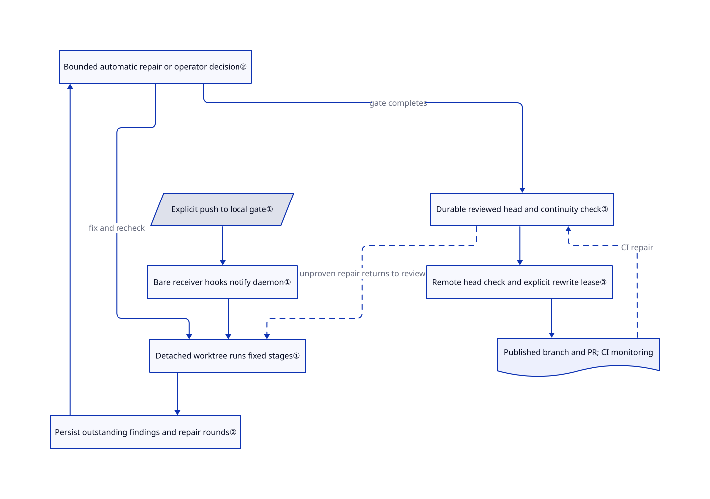

# no-mistakes

You push a branch, then spend the next hour relaying review findings and CI failures to a coding agent. no-mistakes receives that push locally, runs a repair-and-review loop in a separate checkout, and publishes the branch and PR through one tracked pipeline.

## When to use

You already use an authenticated coding-agent CLI and want your next feature branch checked before it reaches the shared remote. Today you manually ask for review, run tests, copy failures back, prepare the PR, and watch CI. Choose no-mistakes when you want executable orchestration of that whole handoff, rather than just review comments or a Markdown development methodology. You explicitly push committed work to a local `no-mistakes` remote; its daemon runs intent, rebase, review, test, documentation, lint, push, PR and CI stages in a disposable worktree.

It fits a trusted developer workstation where you accept agent-written fixes, automatic publication and occasional approval pauses. The terminal UI and the non-interactive `axi` interface control the same persisted run. You still choose test commands, judge intent-sensitive changes and decide whether to merge. The project name is not an accuracy guarantee.

## When NOT to use

- **You only want findings, with no edits or publication authority.** Choose [Open Code Review](open-code-review.md). no-mistakes can rebase, edit, commit, push and create PRs; a separate worktree protects your active checkout, not the rest of your machine.
- **You need review after every contributor opens a PR, without installing a local daemon.** Choose [PR-Agent](pr-agent.md) in a reviewed CI workflow. The named local remote is opt-in: `origin` stays usable, so this alone is not a compulsory server-side quality gate. Keep branch protection and required checks separately.
- **You want guidance during design and implementation, not a shipping pipeline for committed work.** Choose [Superpowers](../agent-dev-methodology/coding-agent-harnesses/superpowers.md). Its workflow skills shape development; no-mistakes adds a stateful Git publication boundary and can duplicate an existing delivery orchestrator.
- **You cannot authorize broad agent execution or code disclosure.** Prefer Open Code Review against an approved private endpoint, or human review with deterministic tests. The Claude adapter defaults to skipping permission prompts and Codex defaults to bypassing approvals and sandboxing; configured overrides can change those defaults. Agent/model access, local transcript-based intent extraction and release telemetry need separate review before adoption.

## Comparison

| Alternative | In index | Our verdict | Tradeoff |
|---|---|---|---|
| [Open Code Review](open-code-review.md) | Indexed | Pick Open Code Review when a calling workflow should receive findings without handing over Git publication; pick no-mistakes when the missing part is the repair, approval and CI handoff. | A review CLI is easier to embed; no-mistakes owns a daemon, local Git gate, worktree state and publication credentials. |
| [PR-Agent](pr-agent.md) | Indexed | Pick PR-Agent when review should start from PR events on a shared host; pick no-mistakes when a developer wants fixes and checks before the initial remote push. | PR-Agent posts descriptions and suggestions in the host; no-mistakes starts on the workstation and may rewrite and publish the branch. |
| [Superpowers](../agent-dev-methodology/coding-agent-harnesses/superpowers.md) | Indexed | Pick Superpowers when the agent skips planning or test-first implementation; pick no-mistakes when committed changes need a durable delivery loop independent of the editing session. | Prompt-based methodology versus executable state management; neither substitutes for independent acceptance evidence. |

## Quick start

Install a reviewed, pinned release binary; the alternative [documented command](https://github.com/kunchenguid/no-mistakes/blob/f0c91d3f4a7e382cf6946c44a61e757225e70ef9/docs/src/content/docs/start-here/installation.md#L28-L34) is `go install github.com/kunchenguid/no-mistakes/cmd/no-mistakes@latest`, which tracks mutable latest and needs Go 1.25.0 for the reviewed source. Supply Git, an authenticated supported agent and, for GitHub PR/CI integration, authenticated `gh`; you pay the model costs and provide the repository's toolchain. In your trusted repository, run `no-mistakes init`, knowing that it adds a local Git remote, starts the daemon and writes the user-level skill into both `.claude/skills` and `.agents/skills`, following existing symlinks. Commit your change, run `git push no-mistakes`, and open `no-mistakes` to resolve findings in its terminal interface; it publishes the checked branch, creates or updates the PR and monitors CI. Before starting a release binary, decide whether to disable its analytics with `NO_MISTAKES_TELEMETRY=0`; you remain responsible for permissions, data disclosure, acceptance tests and merging. These are source-verified instructions, not an installation performed for this entry.

<!-- flow-steps:begin (generated from flows/no-mistakes.json by tools/flow_card.py — do not edit) -->

Text version of the flow

1. **You**: Install reviewed tooling and initialize a trusted repository — `no-mistakes init`
2. **no-mistakes**: Adds a local gate remote and starts the daemon — component: `bare Git gate and daemon`
3. **You**: Push committed work to the gate instead of origin — `git push no-mistakes`
4. **no-mistakes**: Reviews, tests and fixes in a separate worktree; parks unresolved findings — component: `pipeline executor`
5. **You**: Open the terminal UI and decide unresolved findings — `no-mistakes`
6. **no-mistakes**: Publishes the validated branch, opens the PR and monitors CI — component: `push, PR and CI steps`

**Value**: One tracked run replaces manual repair, approval and PR handoffs; you still decide the merge

<!-- flow-steps:end -->

## Key techniques

<!-- mechanism:begin (generated from mechanisms/no-mistakes.json by tools/mechanism_card.py; do not edit) -->

Text version of the mechanism

- Explicit push to local gate①
- Bare receiver hooks notify daemon①
- Detached worktree runs fixed stages①
- Persist outstanding findings and repair rounds②
- Bounded automatic repair or operator decision②
- Durable reviewed head and continuity check③
- Remote head check and explicit rewrite lease③
- Published branch and PR; CI monitoring

- Explicit push to local gate① → Bare receiver hooks notify daemon①
- Bare receiver hooks notify daemon① → Detached worktree runs fixed stages①
- Detached worktree runs fixed stages① → Persist outstanding findings and repair rounds②
- Persist outstanding findings and repair rounds② → Bounded automatic repair or operator decision②
- Bounded automatic repair or operator decision② → Detached worktree runs fixed stages① (fix and recheck)
- Bounded automatic repair or operator decision② → Durable reviewed head and continuity check③ (gate completes)
- Durable reviewed head and continuity check③ → Remote head check and explicit rewrite lease③
- Remote head check and explicit rewrite lease③ → Published branch and PR; CI monitoring
- Published branch and PR; CI monitoring → Durable reviewed head and continuity check③ (CI repair) [optional/fallback]
- Durable reviewed head and continuity check③ → Detached worktree runs fixed stages① (unproven repair returns to review) [optional/fallback]

<!-- mechanism:end -->

### 1. Put a deliberate local Git receiver before publication

- **Problem:** A normal push exposes the branch before the review-and-fix loop finishes.
- **How:** Initialization provisions a bare repository with managed receive hooks and a named remote. The daemon receives the notification and runs validation in a detached worktree, while the working repository's `origin` remains unchanged.
- **Limits:** This is an opt-in routing boundary, not host isolation or a server-enforced prohibition on direct pushes. Initialization also installs user-level skills and ensures a daemon is running.
- **Source:** [Gate provisioning](https://github.com/kunchenguid/no-mistakes/blob/f0c91d3f4a7e382cf6946c44a61e757225e70ef9/internal/gate/gate.go#L190-L250), [push lifecycle](https://github.com/kunchenguid/no-mistakes/blob/f0c91d3f4a7e382cf6946c44a61e757225e70ef9/docs/src/content/docs/concepts/gate-model.md#L30-L76), [skill writes](https://github.com/kunchenguid/no-mistakes/blob/f0c91d3f4a7e382cf6946c44a61e757225e70ef9/internal/skill/install.go#L10-L61).

### 2. Carry unresolved findings across repair rounds

- **Problem:** A fixer can claim success while the next review silently forgets the original defect.
- **How:** The executor merges outstanding findings with each round's result. Selected findings clear through positive reviewed-path coverage without the defect being reported again; it records rounds and selections in SQLite, limits automatic repair attempts, and durably parks unresolved gates for user decisions.
- **Limits:** The coverage record still comes from a model and is intersected with the real changed-file set; it is not proof of semantic correctness. Operators can approve or skip, and those decisions differ from a clean automatic pass.
- **Source:** [Carry-forward and bounded repairs](https://github.com/kunchenguid/no-mistakes/blob/f0c91d3f4a7e382cf6946c44a61e757225e70ef9/internal/pipeline/executor.go#L1530-L1679), [persisted approval and responses](https://github.com/kunchenguid/no-mistakes/blob/f0c91d3f4a7e382cf6946c44a61e757225e70ef9/internal/pipeline/executor.go#L1682-L1819), [coverage contract](https://github.com/kunchenguid/no-mistakes/blob/f0c91d3f4a7e382cf6946c44a61e757225e70ef9/internal/pipeline/pipeline.go#L169-L202).

### 3. Bind publication to reviewed history and a live remote lease

- **Problem:** A late CI repair or concurrent push can replace history that the reviewer never approved.
- **How:** Initial pushes and CI repairs share a publication function that checks durable review authority, examines the current remote head, uses an explicit lease for permitted rewrites and verifies the resulting remote SHA. A CI repair with unproven continuity stays local and returns to Review; `ci.revalidate_repairs: true` requests revalidation even for descendant repairs.
- **Limits:** Descending from a reviewed commit does not mean the new code was reviewed. Default policy can publish descendant CI repairs without repeating Review; a provable pure rebase replay can carry approval but reruns Test onward. Enable the stricter repair policy when every repair needs another review.
- **Source:** [Shared publication path](https://github.com/kunchenguid/no-mistakes/blob/f0c91d3f4a7e382cf6946c44a61e757225e70ef9/internal/pipeline/steps/push.go#L102-L240), [remote safety decision](https://github.com/kunchenguid/no-mistakes/blob/f0c91d3f4a7e382cf6946c44a61e757225e70ef9/internal/pipeline/steps/forcepush.go#L53-L165), [repair policy and exceptions](https://github.com/kunchenguid/no-mistakes/blob/f0c91d3f4a7e382cf6946c44a61e757225e70ef9/internal/pipeline/steps/ci_fix.go#L732-L917).

## Tech stack

- Go CLI with Cobra, Bubble Tea terminal UI and Lip Gloss styling; YAML configuration and TOON output for agents.
- Local SQLite through `modernc.org/sqlite`; native Git commands, receive hooks, detached worktrees and OS-specific daemon services.
- Source manifest and dependency versions: [go.mod at the reviewed SHA](https://github.com/kunchenguid/no-mistakes/blob/f0c91d3f4a7e382cf6946c44a61e757225e70ef9/go.mod).

## Dependencies

- Git and a runnable configured coding agent are required even for command-backed validation gates. Install and authenticate the agent separately; model quota and repository build dependencies are not bundled.
- PR and CI operations require the matching forge integration: `gh` for GitHub, `glab` for GitLab, or the documented adapters for other hosts. GitHub fork routing keeps the parent in `origin` and accepts a separate fork push URL.
- State defaults to `~/.no-mistakes`: bare repositories, worktrees, SQLite and logs. `NM_HOME` relocates this state but does not redirect the user-skill installation in the home directory.
- Official binaries send command/run analytics to the default Umami host `https://a.kunchenguid.com`; the [environment reference](https://github.com/kunchenguid/no-mistakes/blob/f0c91d3f4a7e382cf6946c44a61e757225e70ef9/docs/src/content/docs/reference/environment.md#L268-L331) documents fields and opt-out. Model requests and Git/forge traffic remain separate data flows.

## Ops difficulty

**Medium.** There is no remote database to deploy, but this is not a stateless reviewer: you operate a user daemon, Git mirrors, worktrees, agent credentials and forge access. The installer starts or restarts a managed service, and `init` overwrites its installed user skill, including through symlinks. Pin releases, configure explicit test/lint commands and review permissions before allowing automatic publication. Recovery and removal need attention to unpublished commits; `eject` removes a repository's gate and history, not the globally installed skill. See the [installation lifecycle](https://github.com/kunchenguid/no-mistakes/blob/f0c91d3f4a7e382cf6946c44a61e757225e70ef9/docs/src/content/docs/start-here/installation.md) and [actual installer](https://github.com/kunchenguid/no-mistakes/blob/f0c91d3f4a7e382cf6946c44a61e757225e70ef9/docs/install.sh).

## Health & viability

- **Maintenance, 2026-10-26:** not archived; v1.101.0 shipped on October 25, after releases on October 23 and 24. This page reviews main commit `f0c91d3f4a7e382cf6946c44a61e757225e70ef9`, which includes a later CI-failure freshness fix; do not assume all described guards exist in v1.101.0.
- **Governance, 2026-10-26:** user-owned by Kun Chen; the contributors endpoint reports 422 commits from the owner, 195 from the release bot and 27 from the next listed human. CONTRIBUTING requires contributions through its own gate. [Inference: ownership and contributor counts indicate maintainer concentration, not a measured operational bus factor.]
- **Age and adoption, 2026-10-26:** created April 5, about seven months old, with 8,966 stars. [Inference: recent activity supports trying it on a reversible pilot, but the short history and fast release cadence do not establish long-term durability.]
- **Risk, 2026-10-26:** the actual LICENSE is MIT, copyright 2026 Kun Chen. Issue [#1615](https://github.com/kunchenguid/no-mistakes/issues/1615) reports a Windows gate-path regression in v1.101.0; treat that as an open report, not a reproduced diagnosis. Broad execution permissions, telemetry and automatic publication are adoption constraints even with a permissive license.

## Caveats (unverified)

- [Unverified: no upstream installation or authenticated run was authorized.] Runtime compatibility, review accuracy, cost and latency were not reproduced; no zero-error or production-reliability claim is made.
- [Inference: based on GitHub ownership and visible contributor totals.] Maintainer concentration is a continuity risk; actual on-call coverage, funding and organizational commitments were not established.
- [Inference: based on repository creation date and dated releases.] A reversible pilot is a selection judgment, not a durability or quality measurement; stars are attention rather than proof of successful deployments.
- [Unverified: no Windows reproduction environment was used.] The v1.101.0 path regression is reported in issue #1615, not confirmed by this entry.
