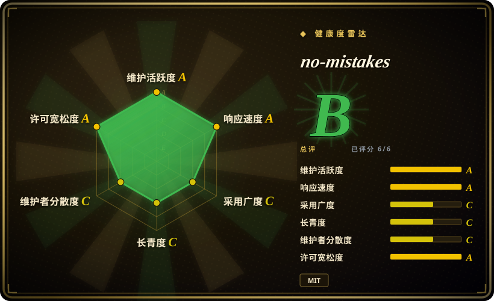
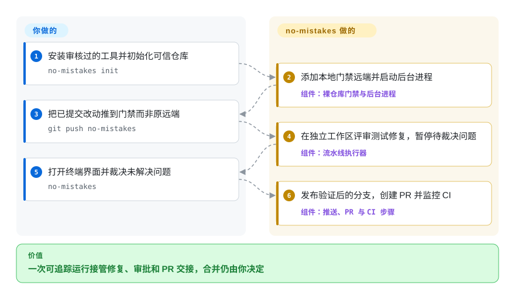
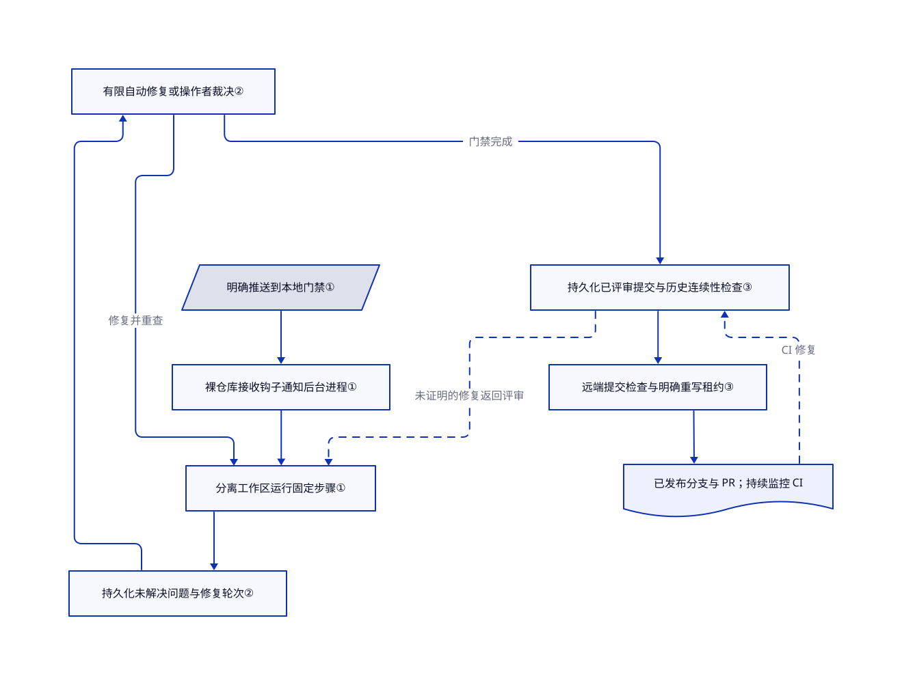

# no-mistakes

分支推上去后，你还得把评审意见和 CI 失败反复转给编程助手。no-mistakes 先在本地接住推送，在独立工作区里审查和修复，再由同一条流水线发布分支与 PR。

## 何时使用

你已经有登录好的编程 agent 命令行工具，想在功能分支进入共享远端前检查它。现在你要手动发起评审、运行测试、转交失败、整理 PR，再盯 CI。缺口若是把这些交接真正执行起来，而非只增加评论或开发方法提示词，就考虑 no-mistakes。你明确把已提交改动推到本地的 `no-mistakes` 远端；后台进程在一次性工作区里依次处理意图、变基、评审、测试、文档、代码检查、推送、PR 和 CI。

它适合可信开发者工作站，你愿意授权 agent 改代码、自动发布，并在需要时停下来裁决。终端界面与非交互的 `axi` 接口控制同一个持久化运行。你仍要选择测试命令、判断涉及需求意图的改动，并决定是否合并。项目名不代表“零错误”保证。

## 何时不用

- **只要问题清单，不授权修改和发布。** 选 [Open Code Review](open-code-review.zh.md)。no-mistakes 能变基、编辑、提交、推送并创建 PR；独立工作区保护的是当前检出，不是整台机器的权限边界。
- **希望每个贡献者提交 PR 后自动评审，不装本地后台进程。** 在审核过的 CI 工作流里使用 [PR-Agent](pr-agent.zh.md)。本地命名远端是主动选择，`origin` 仍可直接推送；它本身不是强制服务端质量门禁，分支保护和必需检查仍要单独配置。
- **需要设计和编码阶段的纪律，不是已提交改动的交付流水线。** 选 [Superpowers](../agent-dev-methodology/coding-agent-harnesses/superpowers.zh.md)。前者用工作流技能塑造开发过程，no-mistakes 则增加有状态的 Git 发布边界，可能与已有交付编排重复。
- **不能授权宽权限执行或代码外发。** 优先用接入获批私有模型的 Open Code Review，或人工评审加确定性测试。Claude 适配器默认跳过权限询问，Codex 默认绕过审批和沙箱；配置覆盖可改变这些默认值。采用前还需分别审核模型访问、本地会话记录提取意图和发行版遥测。

## 横向对比

| 替代品 | 是否收录 | 我们的评价 | 取舍 |
|---|---|---|---|
| [Open Code Review](open-code-review.zh.md) | 已收录 | 调用方只需要问题清单、不交出 Git 发布权时，选 Open Code Review；缺少修复、审批和 CI 交接时，选 no-mistakes。 | 评审命令更容易嵌入已有流程；no-mistakes 还管理后台进程、本地 Git 门禁、工作区状态和发布凭据。 |
| [PR-Agent](pr-agent.zh.md) | 已收录 | 团队要从共享托管平台的 PR 事件触发评审时，选 PR-Agent；开发者要在首次远端推送前修复并检查时，选 no-mistakes。 | PR-Agent 在平台发布说明和建议；no-mistakes 从工作站开始，可能重写并发布分支。 |
| [Superpowers](../agent-dev-methodology/coding-agent-harnesses/superpowers.zh.md) | 已收录 | agent 总跳过规划或测试先行时，选 Superpowers；已提交改动需要脱离编辑会话的持久交付循环时，选 no-mistakes。 | 一个用提示词组织方法，一个用可执行程序管理状态；都不能替代独立验收证据。 |

## 快速上手

安装经过审核并固定版本的发行二进制；[文档中的另一条命令](https://github.com/kunchenguid/no-mistakes/blob/f0c91d3f4a7e382cf6946c44a61e757225e70ef9/docs/src/content/docs/start-here/installation.md#L28-L34)是 `go install github.com/kunchenguid/no-mistakes/cmd/no-mistakes@latest`，但它跟随可变的最新版，审阅源码要求 Go 1.25.0。你提供 Git、已登录的受支持 agent，以及 GitHub PR 和 CI 所需的已登录 `gh`，并承担模型费用与项目构建环境。在可信项目中运行 `no-mistakes init`，注意它会添加本地 Git 远端、启动后台进程，并向用户级 `.claude/skills` 和 `.agents/skills` 写入技能，且会跟随现有软链。提交改动后运行 `git push no-mistakes`，再打开 `no-mistakes`，在终端界面处理问题；工具会发布检查后的分支、创建或更新 PR，并监控 CI。首次运行发行二进制前，决定是否用 `NO_MISTAKES_TELEMETRY=0` 关闭统计；权限、数据外发、验收测试与合并仍由你负责。这里核对了源码与文档，没有实际安装上游。

<!-- flow-steps:begin (generated from flows/no-mistakes.json by tools/flow_card.py — do not edit) -->

流程文字版

1. **你**：安装审核过的工具并初始化可信仓库 — `no-mistakes init`
2. **no-mistakes**：添加本地门禁远端并启动后台进程 — 组件：`裸仓库门禁与后台进程`
3. **你**：把已提交改动推到门禁而非原远端 — `git push no-mistakes`
4. **no-mistakes**：在独立工作区评审测试修复，暂停待裁决问题 — 组件：`流水线执行器`
5. **你**：打开终端界面并裁决未解决问题 — `no-mistakes`
6. **no-mistakes**：发布验证后的分支，创建 PR 并监控 CI — 组件：`推送、PR 与 CI 步骤`

**价值**：一次可追踪运行接管修复、审批和 PR 交接，合并仍由你决定

<!-- flow-steps:end -->

## 技术要点

<!-- mechanism:begin (generated from mechanisms/no-mistakes.json by tools/mechanism_card.py; do not edit) -->

机制文字版

- 明确推送到本地门禁①
- 裸仓库接收钩子通知后台进程①
- 分离工作区运行固定步骤①
- 持久化未解决问题与修复轮次②
- 有限自动修复或操作者裁决②
- 持久化已评审提交与历史连续性检查③
- 远端提交检查与明确重写租约③
- 已发布分支与 PR；持续监控 CI

- 明确推送到本地门禁① → 裸仓库接收钩子通知后台进程①
- 裸仓库接收钩子通知后台进程① → 分离工作区运行固定步骤①
- 分离工作区运行固定步骤① → 持久化未解决问题与修复轮次②
- 持久化未解决问题与修复轮次② → 有限自动修复或操作者裁决②
- 有限自动修复或操作者裁决② → 分离工作区运行固定步骤①（修复并重查）
- 有限自动修复或操作者裁决② → 持久化已评审提交与历史连续性检查③（门禁完成）
- 持久化已评审提交与历史连续性检查③ → 远端提交检查与明确重写租约③
- 远端提交检查与明确重写租约③ → 已发布分支与 PR；持续监控 CI
- 已发布分支与 PR；持续监控 CI → 持久化已评审提交与历史连续性检查③（CI 修复）〔可选／兜底〕
- 持久化已评审提交与历史连续性检查③ → 分离工作区运行固定步骤①（未证明的修复返回评审）〔可选／兜底〕

<!-- mechanism:end -->

### 1. 在发布前放一个明确的本地 Git 接收端

- **解决：** 普通推送会在评审和修复完成前，把分支暴露给共享远端。
- **做法：** 初始化创建裸仓库、受管理的接收钩子和命名远端。后台进程收到通知后，在分离工作区里运行验证，工作仓库的 `origin` 保持不变。
- **边界：** 这是主动选择的路由边界，不是主机隔离，也不是服务端禁止直接推送的策略。初始化还会安装用户级技能并确保后台进程运行。
- **源码：** [门禁创建](https://github.com/kunchenguid/no-mistakes/blob/f0c91d3f4a7e382cf6946c44a61e757225e70ef9/internal/gate/gate.go#L190-L250)、[推送生命周期](https://github.com/kunchenguid/no-mistakes/blob/f0c91d3f4a7e382cf6946c44a61e757225e70ef9/docs/src/content/docs/concepts/gate-model.md#L30-L76)、[技能写入](https://github.com/kunchenguid/no-mistakes/blob/f0c91d3f4a7e382cf6946c44a61e757225e70ef9/internal/skill/install.go#L10-L61)。

### 2. 让未解决问题跨修复轮次保留

- **解决：** 修复者宣称成功后，下一轮评审可能不再提原来的缺陷。
- **做法：** 执行器把未解决问题与每轮结果合并。被选中修复的问题，只有得到明确路径覆盖且不再报告缺陷才会清除；轮次与选择写入 SQLite，自动修复次数受限，未解决门禁持久化等待用户裁决。
- **边界：** 覆盖记录仍来自模型，只是会与真实变更文件集合求交集，不构成语义正确性证明。操作者可以批准或跳过，这些决定不等于自动检查无问题。
- **源码：** [问题保留与有限修复](https://github.com/kunchenguid/no-mistakes/blob/f0c91d3f4a7e382cf6946c44a61e757225e70ef9/internal/pipeline/executor.go#L1530-L1679)、[持久化审批与响应](https://github.com/kunchenguid/no-mistakes/blob/f0c91d3f4a7e382cf6946c44a61e757225e70ef9/internal/pipeline/executor.go#L1682-L1819)、[覆盖记录契约](https://github.com/kunchenguid/no-mistakes/blob/f0c91d3f4a7e382cf6946c44a61e757225e70ef9/internal/pipeline/pipeline.go#L169-L202)。

### 3. 把发布绑定到已评审历史和远端当前提交

- **解决：** 后续 CI 修复或并发推送，可能替换评审者从未认可的历史。
- **做法：** 首次推送和 CI 修复共用发布函数，读取持久化评审授权、核对远端当前提交，允许重写时使用明确提交锚点的租约，并验证推送后的远端 SHA。无法证明延续已评审历史的 CI 修复保留在本地，返回评审；`ci.revalidate_repairs: true` 则要求后代修复也重新验证。
- **边界：** 是已评审提交的后代，不代表新增代码也经过评审。默认策略能直接发布后代 CI 修复；能证明纯变基重放时，可继承评审授权，但重跑测试及后续步骤。每次修复都要重新评审时，应启用更严格策略。
- **源码：** [共享发布路径](https://github.com/kunchenguid/no-mistakes/blob/f0c91d3f4a7e382cf6946c44a61e757225e70ef9/internal/pipeline/steps/push.go#L102-L240)、[远端安全决策](https://github.com/kunchenguid/no-mistakes/blob/f0c91d3f4a7e382cf6946c44a61e757225e70ef9/internal/pipeline/steps/forcepush.go#L53-L165)、[修复策略与例外](https://github.com/kunchenguid/no-mistakes/blob/f0c91d3f4a7e382cf6946c44a61e757225e70ef9/internal/pipeline/steps/ci_fix.go#L732-L917)。

## 技术栈

- Go 命令行程序，使用 Cobra、Bubble Tea 终端界面和 Lip Gloss 样式；YAML 配置，面向 agent 输出 TOON。
- 通过 `modernc.org/sqlite` 使用本地 SQLite；调用原生 Git、接收钩子、分离工作区和系统特定的后台服务。
- [固定提交的依赖清单](https://github.com/kunchenguid/no-mistakes/blob/f0c91d3f4a7e382cf6946c44a61e757225e70ef9/go.mod)记录实际模块版本。

## 依赖

- 必须有 Git 和可运行的已配置编程 agent，即使验证门禁主要执行固定命令。agent 需另行安装和登录；模型额度与项目构建依赖不随工具附送。
- PR 和 CI 操作依赖对应托管平台集成，例如 GitHub 的 `gh`、GitLab 的 `glab` 或其他文档所列适配器。GitHub 派生仓库路径把父仓库留在 `origin`，另设派生仓库推送地址。
- 状态默认保存在 `~/.no-mistakes`，包含裸仓库、工作区、SQLite 和日志。`NM_HOME` 可迁移这些状态，但不会把用户主目录下的技能安装一并迁走。
- 官方二进制默认把命令和运行统计发到 Umami 地址 `https://a.kunchenguid.com`；[环境变量说明](https://github.com/kunchenguid/no-mistakes/blob/f0c91d3f4a7e382cf6946c44a61e757225e70ef9/docs/src/content/docs/reference/environment.md#L268-L331)列出字段与关闭方式。模型请求、Git 和托管平台通信是另外的数据流。

## 运维难度

**中。** 不需要部署远端数据库，但它不是无状态评审器：你要管理用户后台进程、Git 镜像、工作区、agent 凭据和托管平台权限。安装器会启动或重启受管理服务，`init` 会覆盖已安装的用户技能，也会沿软链写入。允许自动发布前，应固定版本、配置明确的测试与代码检查命令，并审核权限。恢复和卸载要留意尚未发布的提交；`eject` 删除某项目的门禁与历史，不删除全局安装的技能。依据见[安装生命周期](https://github.com/kunchenguid/no-mistakes/blob/f0c91d3f4a7e382cf6946c44a61e757225e70ef9/docs/src/content/docs/start-here/installation.md)和[实际安装脚本](https://github.com/kunchenguid/no-mistakes/blob/f0c91d3f4a7e382cf6946c44a61e757225e70ef9/docs/install.sh)。

## 健康度与可持续性

- **维护，2026-10-26：** 未归档；v1.101.0 于 10 月 25 日发布，前两天也有发布。本页审阅主干提交 `f0c91d3f4a7e382cf6946c44a61e757225e70ef9`，含发行后新增的 CI 失败新鲜度修复；不要假设 v1.101.0 已具备本文所有保护逻辑。
- **治理，2026-10-26：** Kun Chen 个人持有仓库；贡献者接口显示所有者 422 次提交、发布机器人 195 次，下一位所列人类贡献者 27 次。贡献说明要求通过自身门禁提交 PR。[推断：所有权和贡献计数表明维护集中，不等于实测的运维接班能力。]
- **年龄与采用，2026-10-26：** 创建于 4 月 5 日，约七个月，8,966 星。[推断：近期活跃支持可回退试用，但历史短、发布快，尚不能证明长期耐久性。]
- **风险，2026-10-26：** 实际许可证为 MIT，版权归 2026 Kun Chen。问题 [#1615](https://github.com/kunchenguid/no-mistakes/issues/1615)报告 v1.101.0 的 Windows 门禁路径回归；这是未复现的开放报告，不是已确认诊断。宽执行权限、遥测和自动发布仍是采用约束，不会因宽松许可证而消失。

## 存疑（未验证）

- [未验证：未获授权安装上游或运行已认证流程。] 未复现运行兼容性、评审准确率、成本和耗时，不作零错误或生产可靠性承诺。
- [推断：依据 GitHub 所有权与可见贡献总数。] 维护集中是连续性风险，未确认实际值班覆盖、资金与组织承诺。
- [推断：依据仓库创建时间与带日期的发布记录。] 可回退试用是选型判断，不是耐久性或质量测量；星数代表关注，不证明部署成功。
- [未验证：未使用 Windows 复现环境。] v1.101.0 路径回归来自问题 #1615，本页未独立确认。
