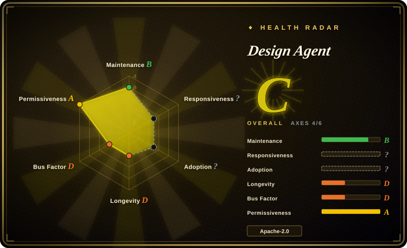
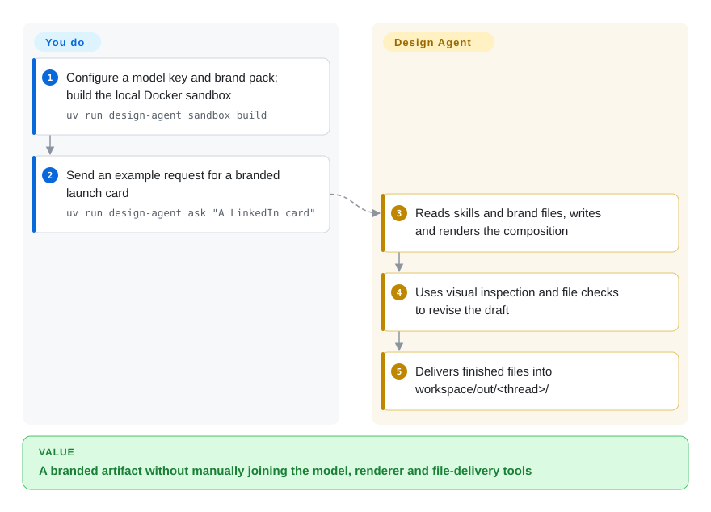
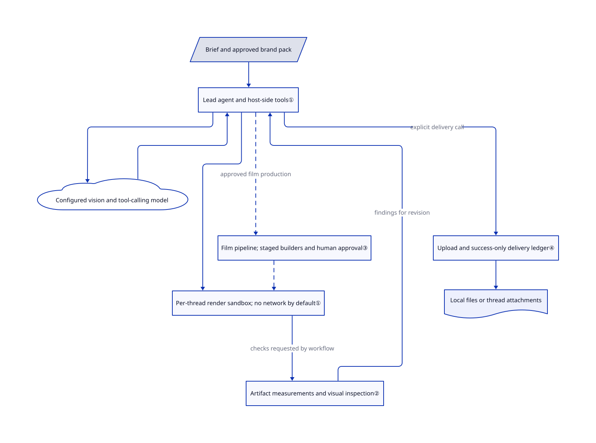

# Design Agent

Your team keeps asking for the same launch card in three sizes, then a deck and a short film, while designers redo the brand checks. Design Agent turns a chat brief into code-rendered files in a per-thread computer, with brand checks and a delivery workflow.

**Service and rights boundary:** the default team deployment uses paid LangSmith Cloud Managed Deep Agents, plus separately billed models. Self-hosting exists; neither route grants rights to someone else's brand, fonts or media. This is a content-production agent, not a reusable UI component system.

## When to use

You run marketing or developer relations for a team. A launch needs a 1200×627 card, a square crop and a short animated teaser; a Slack reply says “use the old logo and make the headline shorter.” You want requests, source files, revisions and delivered assets to stay in one thread rather than be passed between a chatbot, a browser renderer and a designer's export folder.

Choose this when you can supply an approved brand pack and operate a shared production agent. Unlike a personal desktop studio such as [Open Design](open-design.md), it supplies a thread-oriented team service with background helpers, persistent production state and file delivery. Unlike a screenshot replica tool, it authors new branded stills, charts, decks and motion from a brief. You still approve the creative work and pay for inference and rendering infrastructure.

## When NOT to use

- **You need application components or a general design system.** Use [Open Design](open-design.md) for code-based UI prototypes; this repository's brand pack governs exported marketing artifacts, not your application's component API or accessibility lifecycle.
- **You only need to copy a screen from pixels.** Use [screenshot-to-code](screenshot-to-code.md), whose pipeline is organized around screenshot replication and original-asset extraction, rather than operate a brand-content service.
- **You want a personal slide workspace, not a shared agent.** Use [open-slide](open-slide.md) for React-authored browser decks with click-to-comment revisions. Design Agent adds model calls, sandbox operations and a multi-artifact production workflow.
- **Slack DMs must be private from every other bot user.** Do not deploy the default trace-reading configuration. [SECURITY.md](https://github.com/langchain-ai/design-agent/blob/de9394b9b10b8134d9de06fd29647c1ab2318ba3/SECURITY.md#L28-L35) says anyone messaging the agent can ask about other threads, including DMs; set `DESIGN_AGENT_ENABLE_TRACES=0` and review memory policy, or prefer an individual Open Design workspace. MDA also mounts personal memory in shared Slack runs; the prohibition on repeating it is a prompt instruction.
- **You cannot operate a privileged Docker host or pay for managed sandboxes.** Prefer Open Design's local desktop workflow. The self-hosted API mounts the Docker socket, which is root-equivalent on that host; sandbox network isolation does not remove the host controller's privilege.
- **You require free, offline creative inference or automatic brand approval.** The keyless demo uses a scripted model, not a free creative model. Prefer open-slide with your existing agent for deck-only work, and keep human review: numerical checks do not certify taste, truth or legal rights.

## Comparison

| Alternative | In index | Our verdict | Tradeoff |
|---|---|---|---|
| [Open Design](open-design.md) | Indexed | Choose Open Design for an individual's local studio and existing coding agent; choose Design Agent for shared chat intake and background content production. | Desktop ownership avoids running this team service, but does not supply its thread-based production and delivery harness. |
| [screenshot-to-code](screenshot-to-code.md) | Indexed | Choose screenshot-to-code when the input is a screen to replicate; choose Design Agent when the brief must become new branded cards, charts or motion. | Replica-specific asset extraction and multiple variants replace the broader brand pack, workflow and team-service responsibilities. |
| [open-slide](open-slide.md) | Indexed | Choose open-slide when a React slide project and visual comments are the whole job; choose Design Agent when decks share a queue with stills and films. | A narrower local workspace costs less operational effort; Design Agent brings its own model-driven production service and sandbox lifecycle. |

## Quick start

The documented local path is a reviewed checkout plus `uv sync`, then `uv run design-agent sandbox build` and `uv run design-agent demo`; Docker is required, and the scripted demo writes cards and a four-second teaser to `workspace/out/demo/` without model keys. For real work, supply a tool-calling vision model key in `.env`, put approved tokens, logos and copy rules in `workspace/brand/`, then use `uv run design-agent ask` with a brief; files arrive under `workspace/out/<thread>/`. The default model is Anthropic's Opus 5.5 in upstream configuration; provider selection and an OpenAI-compatible endpoint are configurable, but no weights ship here. For a team, the separate hosted path publishes a sandbox snapshot and runs `uv run mda deploy` into a paid LangSmith Cloud workspace, where you authorize its Slack app; self-hosting instead uses the supplied Docker Compose API, Postgres and your own Slack app. You own service accounts, credentials, brand permissions, model bills and final review; the agent composes, renders, checks and delivers files. These are source-verified instructions, not an installation or live run performed for this page.

<!-- flow-steps:begin (generated from flows/design-agent.json by tools/flow_card.py — do not edit) -->

Text version of the flow

1. **You**: Configure a model key and brand pack; build the local Docker sandbox — `uv run design-agent sandbox build`
2. **You**: Send an example request for a branded launch card — `uv run design-agent ask "A LinkedIn card"`
3. **Design Agent**: Reads skills and brand files, writes and renders the composition
4. **Design Agent**: Uses visual inspection and file checks to revise the draft
5. **Design Agent**: Delivers finished files into workspace/out/<thread>/

**Value**: A branded artifact without manually joining the model, renderer and file-delivery tools

<!-- flow-steps:end -->

## Key techniques

<!-- mechanism:begin (generated from mechanisms/design-agent.json by tools/mechanism_card.py; do not edit) -->

Text version of the mechanism

- Brief and approved brand pack
- Lead agent and host-side tools①
- Configured vision and tool-calling model
- Per-thread render sandbox; no network by default①
- Film pipeline; staged builders and human approval③
- Artifact measurements and visual inspection②
- Upload and success-only delivery ledger④
- Local files or thread attachments

- Brief and approved brand pack → Lead agent and host-side tools①
- Lead agent and host-side tools① → Configured vision and tool-calling model
- Configured vision and tool-calling model → Lead agent and host-side tools①
- Lead agent and host-side tools① → Per-thread render sandbox; no network by default①
- Lead agent and host-side tools① → Film pipeline; staged builders and human approval③ (approved film production) [optional/fallback]
- Film pipeline; staged builders and human approval③ → Per-thread render sandbox; no network by default① [optional/fallback]
- Per-thread render sandbox; no network by default① → Artifact measurements and visual inspection② (checks requested by workflow)
- Artifact measurements and visual inspection② → Lead agent and host-side tools① (findings for revision)
- Lead agent and host-side tools① → Upload and success-only delivery ledger④ (explicit delivery call)
- Upload and success-only delivery ledger④ → Local files or thread attachments

<!-- mechanism:end -->

### 1. Keep creative code away from service credentials

- **Problem:** An agent needs to execute generated render code without giving that code model keys or the host's network access.
- **How:** Docker assigns one container and volume per thread. Commands run as uid 1000 with no network and resource limits; the host stages brand files and checks as root-owned content, while host-side tools fetch, generate and deliver assets.
- **Limits:** This separates the render sandbox, not the whole deployment: the controller holds credentials and the Docker socket. Managed deployment uses a different LangSmith sandbox adapter, not a local Docker container.
- **Source:** [Container creation and staging](https://github.com/langchain-ai/design-agent/blob/de9394b9b10b8134d9de06fd29647c1ab2318ba3/src/design_agent/runtime/sandbox/docker.py#L174-L250), [execution user](https://github.com/langchain-ai/design-agent/blob/de9394b9b10b8134d9de06fd29647c1ab2318ba3/src/design_agent/runtime/sandbox/docker.py#L270-L296), [host privilege](https://github.com/langchain-ai/design-agent/blob/de9394b9b10b8134d9de06fd29647c1ab2318ba3/docs/self-hosting.md#L65-L74).

### 2. Measure deliverables rather than trusting the model's description

- **Problem:** A plausible “finished” reply can hide a missing file, wrong image size or blank video frame.
- **How:** The artifact checker validates a requirements record and measures actual output files. It checks image headers, uses ffprobe for video dimensions and duration, and checks end frames; the prompt also asks for brand checks and visual inspection before delivery.
- **Limits:** These checks measure enumerated properties, not overall design quality. Running the checks for arbitrary jobs is a prompt obligation, not a universal upload authorization gate; the delivery wrapper separately deduplicates uploads.
- **Source:** [Checker contract](https://github.com/langchain-ai/design-agent/blob/de9394b9b10b8134d9de06fd29647c1ab2318ba3/workspace/tools/artifact-contract.mjs#L1-L21), [actual file measurement](https://github.com/langchain-ai/design-agent/blob/de9394b9b10b8134d9de06fd29647c1ab2318ba3/workspace/tools/artifact-contract.mjs#L500-L582), [prompt obligation](https://github.com/langchain-ai/design-agent/blob/de9394b9b10b8134d9de06fd29647c1ab2318ba3/instructions.md#L12-L18).

### 3. Encode film production order while keeping human approval

- **Problem:** A long film built through free-form chat can assemble scenes before they are reviewed or lose progress after interruption.
- **How:** The launch-film pipeline builds the defining act first, then bounds parallel builders, reviews each act, allows a fix pass and assembles the result. The workflow stores completed steps for replay, and asks a person before the final render.
- **Limits:** This pipeline starts after an approved storyboard and animatic; it is not the automatic path for every request. A critic's pass is model judgment, and final rendering can proceed after the person's approval rather than a hard artistic score threshold.
- **Source:** [Production sequence and approval](https://github.com/langchain-ai/design-agent/blob/de9394b9b10b8134d9de06fd29647c1ab2318ba3/src/design_agent/pipelines/launch_film.py#L79-L202), [step replay and persistence](https://github.com/langchain-ai/design-agent/blob/de9394b9b10b8134d9de06fd29647c1ab2318ba3/src/design_agent/harness/workflow.py#L420-L498), [background start and resume](https://github.com/langchain-ai/design-agent/blob/de9394b9b10b8134d9de06fd29647c1ab2318ba3/src/design_agent/middleware/pipeline_tools.py#L112-L155).

### 4. Record confirmed delivery by path and content hash

- **Problem:** Retrying a successful production turn can send the same large file to the thread again.
- **How:** Middleware hashes candidate files, removes path-and-hash pairs already delivered to that thread, and appends a record to `DELIVERY.json` only after the tool reports success. Adapters deliver to local output folders, Slack or LangSmith trace attachments.
- **Limits:** Upload success and ledger persistence are separate operations, so this is retry deduplication, not a transactional exactly-once guarantee. Changed content is a new delivery; external copies are not recalled by changing the ledger.
- **Source:** [Planning and recording](https://github.com/langchain-ai/design-agent/blob/de9394b9b10b8134d9de06fd29647c1ab2318ba3/src/design_agent/tools/delivery.py#L237-L276), [success boundary](https://github.com/langchain-ai/design-agent/blob/de9394b9b10b8134d9de06fd29647c1ab2318ba3/src/design_agent/tools/delivery.py#L286-L334).

## Tech stack

- Agent runtime: Python ≥3.11, Deep Agents, LangChain, LangGraph and the Managed Deep Agents SDK. The manifest labels the project Alpha, `0.1.0.dev0`; GitHub's primary language is JavaScript because this is also a render/skills repository.
- Service: FastAPI, uvicorn, optional Slack Bolt, SQLite or Postgres persistence. One assembly supplies hosted, CLI and self-hosted surfaces.
- Rendering: Node tooling, Chrome Headless Shell, FFmpeg, HyperFrames, D2, ECharts and sharp in a separately built sandbox image. The repository includes authored checks and vendored skills, not model weights.

## Dependencies

- **Local creative runs:** uv/Python, Docker, a built sandbox image and an API or compatible vision/tool-calling model endpoint. The demo alone substitutes a scripted model.
- **Hosted team path:** LangSmith account, paid Managed Deep Agents hosting in public beta, sandbox publication and model credentials. The LangSmith model gateway is optional, not required for direct-provider calls.
- **Self-hosted path:** Docker Compose ≥2.24 on Linux or macOS Docker Desktop, Postgres for durable deployment, bearer tokens per caller, and a dedicated host or managed sandbox alternative because the controller mounts Docker's socket. Expose the loopback API only through an appropriately secured TLS proxy.
- **Optional integrations:** OpenAI key for generated images, ElevenLabs for voice/music, Paper Desktop or a bridge for the editable canvas, and configured MCP services for outside tools. You supply their accounts and permissions; they are not free bundled infrastructure.
- **License scope:** root code is Apache-2.0; `NOTICE.md` preserves MIT SDK/skill origins and lists OFL fonts, GSAP's separate terms, D2 MPL-2.0 and FFmpeg build-dependent licensing. Root LICENSE still says “Paid Media Agent contributors,” while NOTICE names LangChain; both texts are retained in the evidence. Review third-party and brand rights before commercial redistribution, especially sandbox images.

## Ops difficulty

**Medium for local use, high for a shared self-hosted service.** You maintain a render image, fonts, model compatibility, API costs and persistent per-thread workspaces. Managed hosting removes much of the infrastructure work but adds paid beta-service dependence. Self-hosting adds backups, tokens, TLS, Slack authorization and privileged container management; it does not mount MDA's team/personal memory layers. Trace-reading is enabled by default across the deployment's LangSmith project, and template/version tags are enabled with `DESIGN_AGENT_TEMPLATE_TELEMETRY=0` as the opt-out. Before retiring a deployment, stop its API/Slack workers and schedules, revoke its app and provider credentials, and handle stored files, traces and sandbox volumes separately; idle stopping intentionally preserves volumes. [Operations](https://github.com/langchain-ai/design-agent/blob/de9394b9b10b8134d9de06fd29647c1ab2318ba3/OPERATIONS.md) documents state and backups.

## Health & viability

- **2026-10-30 maintenance:** created 2026-10-18, last pushed 2026-10-29, not archived; no GitHub releases. Pin the reviewed commit rather than assume a stable packaged release.
- **Governance:** LangChain organization ownership, CONTRIBUTING rules and a security-reporting policy exist. The contributors API returned one human with 35 contributions and Dependabot with 10; vendor ownership is not evidence of a broad maintainer bus factor.
- **Age and adoption:** a twelve-day public history gives almost no Lindy evidence. The README's internal deployment story predates the public repo, but 489 stars do not establish independent production adoption.
- **Machine score:** C, with four of six axes scored. Responsiveness has no qualifying window signal and adoption has no structurally measurable package signal; the two question marks mean missing measurement, not proof of no users or no replies.
- **Risk verdict:** [推断：based on alpha manifest, short public history and service-dependent architecture] suitable for an owned pilot with brand review, not a maintenance-free foundation. The Apache license and self-host adapter reduce code lock-in, but runtime parity, third-party rights and model costs still need active ownership.

## Caveats (unverified)

- [未验证：upstream execution was prohibited] No sandbox was built, deployment created, model invoked or output quality benchmark reproduced; provider availability and hosted/self-hosted behavior were checked in docs and source only.
- [未验证：only the vendor's README supplies these figures] The claimed 3,000 internal assets, social reach and roughly $0.50 median model spend are not independently audited and are not budgets or service guarantees.
- [推断：alpha manifest, twelve-day public history and one visible human contributor] A controlled pilot is a safer commitment than assuming long-term operational stability; internal access rights and staffing are not public.
- [推断：upload precedes ledger recording in the reviewed code] A crash between these operations can leave a confirmed external upload unrecorded; this page does not claim atomic exactly-once delivery.
- [未验证：not a full third-party rights audit] Preserved notices and the root license support introducing the project, not blanket clearance for all brands, private fonts, generated media or redistribution of the assembled sandbox image.
