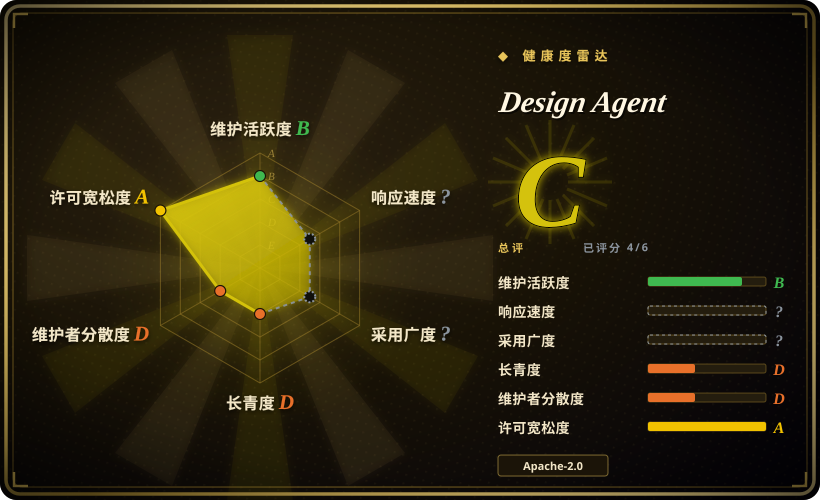
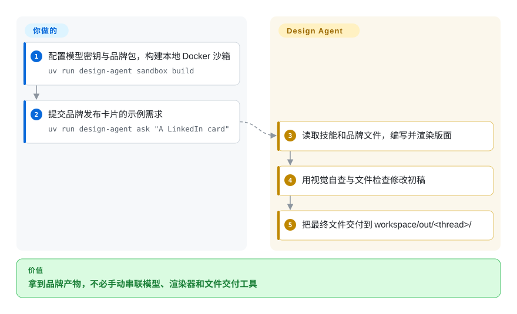
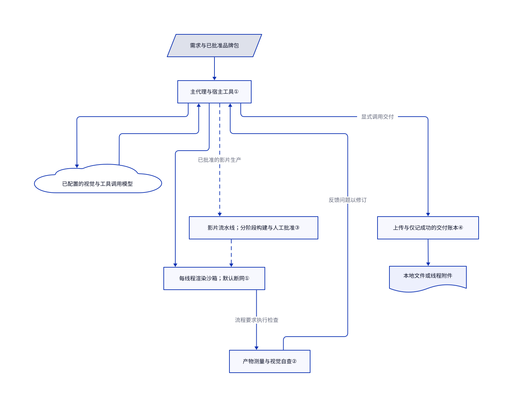

# Design Agent

同一张发布卡片要改三个尺寸，随后又要幻灯片和短片，设计师还得重复查品牌规范。Design Agent 把聊天需求变成代码渲染的文件，并提供每线程独立电脑、品牌检查和交付流程。

**服务与权利边界：**默认团队部署使用付费的 LangSmith Cloud Managed Deep Agents，模型费用另计。它支持自托管，但两条路线都不授予他人品牌、字体或素材的使用权。它是内容生产代理，不是通用 UI 组件系统。

## 何时使用

你负责团队营销或开发者关系。一次发布需要 1200×627 卡片、方形裁切和动画预告；Slack 回复又说“用旧版标志，标题再短些”。你希望需求、源文件、改稿和最终素材留在同一线程，不再手动串联聊天模型、浏览器渲染器和设计师的导出目录。

当你能提供审核过的品牌包，也愿意运行共享生产代理时，选它。相比个人桌面工作室 [Open Design](open-design.zh.md)，它提供按线程组织的团队服务，带后台助手、持久化生产状态和文件交付。相比截图复刻工具，它从需求创作新的品牌图片、图表、幻灯片和动效。创意批准、推理费用和渲染基础设施仍由你负责。

## 何时不用

- **需要应用组件或通用设计系统。**用 [Open Design](open-design.zh.md) 做代码式 UI 原型；本仓库的品牌包约束营销产物，不管理应用组件 API 和无障碍生命周期。
- **只需按像素复刻屏幕。**选 [screenshot-to-code](screenshot-to-code.zh.md)，其流程围绕截图复刻和原图素材提取，而不是运营品牌内容服务。
- **只要个人幻灯片工作区。**选 [open-slide](open-slide.zh.md)，用 React 写浏览器幻灯片并点选留言改稿。Design Agent 额外引入模型调用、沙箱运维和多类型产物流程。
- **Slack 私聊必须对其他机器人用户保密。**不要照默认设置部署追踪读取功能。[安全说明](https://github.com/langchain-ai/design-agent/blob/de9394b9b10b8134d9de06fd29647c1ab2318ba3/SECURITY.md#L28-L35)明确说，任何能向代理发消息的人都能询问其他线程，包括私聊；应设置 `DESIGN_AGENT_ENABLE_TRACES=0` 并审查记忆策略，或使用个人 Open Design 工作区。MDA 也会在共享 Slack 运行中挂载个人记忆；禁止复述它靠提示词约束。
- **不能管理高权限 Docker 主机，也不愿支付托管沙箱。**优先选 Open Design 本地桌面流程。自托管 API 挂载 Docker socket，相当于拥有该主机的 root 权限；渲染沙箱断网不消除宿主控制器的权限。
- **需要免费离线创作推理或自动品牌审批。**无密钥演示使用脚本模型，不是免费创作模型。仅做幻灯片可选 open-slide 配已有代理，并保留人工审核；数值检查不证明审美、事实或法律权利合格。

## 横向对比

| 替代品 | 是否收录 | 我们的评价 | 取舍 |
|---|---|---|---|
| [Open Design](open-design.zh.md) | 已收录 | 个人本地工作室且已有编码代理时选 Open Design；需要共享聊天入口和后台内容生产时选 Design Agent。 | 桌面工作区省去团队服务运维，但不提供本项目按线程组织的生产与交付执行框架。 |
| [screenshot-to-code](screenshot-to-code.zh.md) | 已收录 | 输入是待复刻屏幕时选 screenshot-to-code；需要从需求创作品牌卡片、图表或动效时选 Design Agent。 | 专用裁图和多版本复刻替代了更宽的品牌包、生产流程及团队服务职责。 |
| [open-slide](open-slide.zh.md) | 已收录 | 只要 React 幻灯片项目与可视化留言时选 open-slide；幻灯片与图片、影片共用生产队列时选 Design Agent。 | 窄范围本地工作区更省运维；Design Agent 自带模型驱动的生产服务和沙箱生命周期。 |

## 快速上手

文档中的本地路线是审查后的仓库副本加 `uv sync`，随后运行 `uv run design-agent sandbox build` 和 `uv run design-agent demo`；需要 Docker，脚本演示无需模型密钥，会把卡片和四秒预告写到 `workspace/out/demo/`。真实创作需在 `.env` 配置支持视觉和工具调用的模型密钥，把批准后的色彩、标志和文案规则放进 `workspace/brand/`，再用 `uv run design-agent ask` 提交需求；文件落到 `workspace/out/<thread>/`。上游默认配置为 Anthropic Opus 5.5，可更换提供商或配置兼容 OpenAI 的接口，但仓库不带模型权重。团队托管是另一条路线：发布沙箱快照，再用 `uv run mda deploy` 部署到付费 LangSmith Cloud 工作区，并授权 Slack 应用；自托管则使用附带的 Docker Compose API、Postgres 和自己的 Slack 应用。服务账号、凭据、品牌授权、模型账单和最终审核由你负责；代理负责排版、渲染、检查与交付。本页核对了源码与操作文档，未安装或实跑这些命令。

<!-- flow-steps:begin (generated from flows/design-agent.json by tools/flow_card.py — do not edit) -->

流程文字版

1. **你**：配置模型密钥与品牌包，构建本地 Docker 沙箱 — `uv run design-agent sandbox build`
2. **你**：提交品牌发布卡片的示例需求 — `uv run design-agent ask "A LinkedIn card"`
3. **Design Agent**：读取技能和品牌文件，编写并渲染版面
4. **Design Agent**：用视觉自查与文件检查修改初稿
5. **Design Agent**：把最终文件交付到 workspace/out/<thread>/

**价值**：拿到品牌产物，不必手动串联模型、渲染器和文件交付工具

<!-- flow-steps:end -->

## 技术要点

<!-- mechanism:begin (generated from mechanisms/design-agent.json by tools/mechanism_card.py; do not edit) -->

机制文字版

- 需求与已批准品牌包
- 主代理与宿主工具①
- 已配置的视觉与工具调用模型
- 每线程渲染沙箱；默认断网①
- 影片流水线；分阶段构建与人工批准③
- 产物测量与视觉自查②
- 上传与仅记成功的交付账本④
- 本地文件或线程附件

- 需求与已批准品牌包 → 主代理与宿主工具①
- 主代理与宿主工具① → 已配置的视觉与工具调用模型
- 已配置的视觉与工具调用模型 → 主代理与宿主工具①
- 主代理与宿主工具① → 每线程渲染沙箱；默认断网①
- 主代理与宿主工具① → 影片流水线；分阶段构建与人工批准③（已批准的影片生产）〔可选／兜底〕
- 影片流水线；分阶段构建与人工批准③ → 每线程渲染沙箱；默认断网①〔可选／兜底〕
- 每线程渲染沙箱；默认断网① → 产物测量与视觉自查②（流程要求执行检查）
- 产物测量与视觉自查② → 主代理与宿主工具①（反馈问题以修订）
- 主代理与宿主工具① → 上传与仅记成功的交付账本④（显式调用交付）
- 上传与仅记成功的交付账本④ → 本地文件或线程附件

<!-- mechanism:end -->

### 1. 把创意代码与服务凭据分开

- **解决：**代理要执行生成的渲染代码，但不应把模型密钥和宿主网络权限交给这些代码。
- **做法：**Docker 为每个线程分配容器和卷。命令以 uid 1000 运行，默认断网并限制资源；宿主把品牌文件和检查器放成 root 所有，外部取材、生成与交付则由宿主工具执行。
- **边界：**隔离的是渲染沙箱，不是整个部署；控制器仍持有凭据和 Docker socket。托管部署使用另一套 LangSmith 沙箱适配器，不是本地 Docker 容器。
- **源码：**[容器创建与文件放置](https://github.com/langchain-ai/design-agent/blob/de9394b9b10b8134d9de06fd29647c1ab2318ba3/src/design_agent/runtime/sandbox/docker.py#L174-L250)、[执行用户](https://github.com/langchain-ai/design-agent/blob/de9394b9b10b8134d9de06fd29647c1ab2318ba3/src/design_agent/runtime/sandbox/docker.py#L270-L296)、[宿主权限](https://github.com/langchain-ai/design-agent/blob/de9394b9b10b8134d9de06fd29647c1ab2318ba3/docs/self-hosting.md#L65-L74)。

### 2. 测量真实产物，不信模型自述

- **解决：**一句看似可信的“完成”，可能掩盖文件缺失、图片尺寸错误或视频空白帧。
- **做法：**产物检查器验证需求记录并测量真实文件。图片读文件头，视频用 ffprobe 核尺寸和时长，并检查首尾帧；提示词另要求交付前做品牌检查和视觉自查。
- **边界：**检查只覆盖列举的属性，不评整体设计质量。普通任务是否执行检查依赖提示词，不是所有上传必经的授权闸门；交付包装层另外负责去重。
- **源码：**[检查器合同](https://github.com/langchain-ai/design-agent/blob/de9394b9b10b8134d9de06fd29647c1ab2318ba3/workspace/tools/artifact-contract.mjs#L1-L21)、[真实文件测量](https://github.com/langchain-ai/design-agent/blob/de9394b9b10b8134d9de06fd29647c1ab2318ba3/workspace/tools/artifact-contract.mjs#L500-L582)、[提示词义务](https://github.com/langchain-ai/design-agent/blob/de9394b9b10b8134d9de06fd29647c1ab2318ba3/instructions.md#L12-L18)。

### 3. 用代码固定影片工序，保留人工批准

- **解决：**长片仅靠自由聊天编排，容易先合成后评审，或在中断后丢失进度。
- **做法：**发布影片流水线先制作定义风格的主段，再限制并发构建者数量，逐段评审、允许一轮修正并合成。执行器存储已完成步骤以便重放，最终渲染前询问人工批准。
- **边界：**这条流水线从已批准的分镜和动态预演之后开始，不是每个请求的自动路径。评论员的通过仍是模型判断；最终渲染看人的批准，不是硬性艺术评分阈值。
- **源码：**[生产顺序与批准](https://github.com/langchain-ai/design-agent/blob/de9394b9b10b8134d9de06fd29647c1ab2318ba3/src/design_agent/pipelines/launch_film.py#L79-L202)、[步骤重放与持久化](https://github.com/langchain-ai/design-agent/blob/de9394b9b10b8134d9de06fd29647c1ab2318ba3/src/design_agent/harness/workflow.py#L420-L498)、[后台启动与恢复](https://github.com/langchain-ai/design-agent/blob/de9394b9b10b8134d9de06fd29647c1ab2318ba3/src/design_agent/middleware/pipeline_tools.py#L112-L155)。

### 4. 按路径和内容哈希记录确认交付

- **解决：**重试已成功的生产轮次，可能再次向线程发送同一个大文件。
- **做法：**中间件计算候选文件哈希，去掉本线程已交付的路径与哈希组合，工具返回成功后才向 `DELIVERY.json` 追加记录。适配器分别交付到本地目录、Slack 或 LangSmith 追踪附件。
- **边界：**上传成功与账本持久化是两步，因此它是重试去重，不是事务式恰好一次保证。内容改变就是新交付；修改账本不会撤回外部副本。
- **源码：**[规划与记录](https://github.com/langchain-ai/design-agent/blob/de9394b9b10b8134d9de06fd29647c1ab2318ba3/src/design_agent/tools/delivery.py#L237-L276)、[成功边界](https://github.com/langchain-ai/design-agent/blob/de9394b9b10b8134d9de06fd29647c1ab2318ba3/src/design_agent/tools/delivery.py#L286-L334)。

## 技术栈

- 代理运行时使用 Python ≥3.11、Deep Agents、LangChain、LangGraph 和 Managed Deep Agents SDK。清单标为 Alpha，版本 `0.1.0.dev0`；GitHub 主语言为 JavaScript，因为仓库也包含渲染代码与技能。
- 服务使用 FastAPI、uvicorn、可选 Slack Bolt，以及 SQLite 或 Postgres 持久化。托管、CLI 和自托管入口共用一套组装逻辑。
- 渲染环境另构建沙箱镜像，包含 Node 工具、Chrome Headless Shell、FFmpeg、HyperFrames、D2、ECharts 与 sharp。仓库包含自写检查器和引入的技能，不包含模型权重。

## 依赖

- **本地真实创作：**uv／Python、Docker、已构建的沙箱镜像，以及支持视觉和工具调用的 API 模型或兼容接口。只有演示用脚本模型替代。
- **团队托管：**LangSmith 账号、公开测试中的付费 Managed Deep Agents、沙箱发布和模型凭据。LangSmith 模型网关只是可选项，直连提供商不要求它。
- **自托管：**Linux 或 macOS Docker Desktop 上的 Docker Compose ≥2.24，持久部署需 Postgres，每调用者分配 bearer token。控制器挂载 Docker socket，故应使用专用主机，或改托管沙箱；对外开放回环 API 前需正确配置 TLS 代理。
- **可选集成：**图片生成用 OpenAI key，语音与音乐用 ElevenLabs，可编辑画布用 Paper Desktop 或桥接，外部工具用已配置的 MCP 服务。账号和权限由你提供，不是免费附送的基础设施。
- **许可范围：**根代码为 Apache-2.0；`NOTICE.md` 保留 MIT SDK／技能来源，并列出 OFL 字体、GSAP 独立条款、D2 的 MPL-2.0 和取决于构建的 FFmpeg 许可。根 LICENSE 仍写“Paid Media Agent contributors”，NOTICE 则写 LangChain；证据保留两份原文。商业再分发，尤其沙箱镜像，须另审第三方和品牌权利。

## 运维难度

**本地中等，共享自托管服务较高。**你要维护渲染镜像、字体、模型兼容性、API 费用和每线程持久工作区。托管减轻基础设施工作，但增加付费测试服务依赖。自托管另需备份、令牌、TLS、Slack 授权和高权限容器管理，且不挂载 MDA 的团队／个人记忆层。默认开启整个 LangSmith 项目的追踪读取，模板与版本标签也默认开启，可用 `DESIGN_AGENT_TEMPLATE_TELEMETRY=0` 关闭后者。停用时应停止 API／Slack 工作进程和调度，撤销应用及提供商凭据，再分别处理存储文件、追踪和沙箱卷；空闲停止故意保留卷。[运维文档](https://github.com/langchain-ai/design-agent/blob/de9394b9b10b8134d9de06fd29647c1ab2318ba3/OPERATIONS.md)列明状态和备份职责。

## 健康度与可持续性

- **截至 2026-10-30 的维护：**创建于 2026-10-18，最后推送为 2026-10-29，未归档，没有 GitHub release。应固定所读提交，不要假定已有稳定发布包。
- **治理：**仓库属 LangChain 组织，存在贡献规则和安全报告政策。贡献者 API 返回一位人类，35 次贡献，另有 Dependabot 的 10 次；厂商持有仓库不证明维护者充分分散。
- **年龄与采用：**公开历史只有十二天，几乎没有林迪证据。README 的内部部署故事早于公开仓库，但 489 个星标不证明独立生产采用。
- **机器评分：**总评 C，六轴中四轴有分数。响应速度没有合格窗口信号，采用广度没有可结构化计量的软件包信号；两处问号代表缺少测量，不代表没有用户或没有回复。
- **风险判断：**[推断：依据是 Alpha 清单、短公开历史和服务依赖架构]适合有负责人的品牌试点，不宜当作免维护底座。Apache 许可和自托管适配降低代码锁定，但运行时差异、第三方权利和模型费用仍需主动管理。

## 存疑（未验证）

- [未验证：用户禁止执行上游]未构建沙箱、创建部署、调用模型或复现产物质量评测；提供商可用性和托管／自托管行为只核对了文档及源码。
- [未验证：数字只来自厂商 README]内部 3,000 件素材、社交曝光量和约 0.50 美元模型费用中位数未经独立审计，不是预算或服务保证。
- [推断：依据是 Alpha 清单、十二天公开历史和一位可见人类贡献者]受控试点比假定长期稳定更稳妥；内部权限与人员配置不公开。
- [推断：所读代码先上传，再记录账本]两步之间崩溃可能导致已确认的外部上传未记账；本页不宣称原子式恰好一次交付。
- [未验证：未做完整第三方权利审计]已保留通知和根许可足以支持介绍，不等于全部品牌、私有字体、生成媒体或组合沙箱镜像已获复制商用再分发授权。
