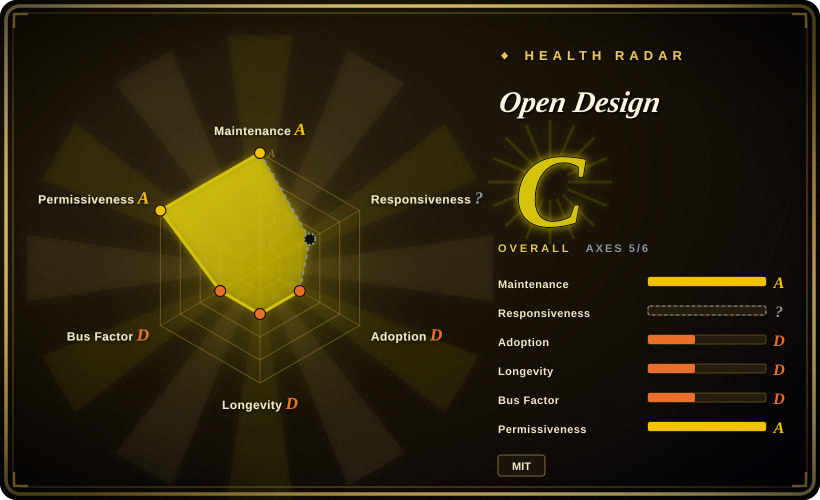
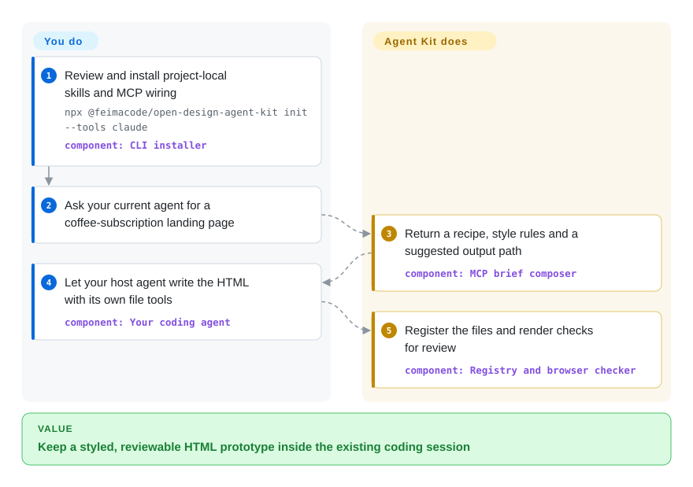
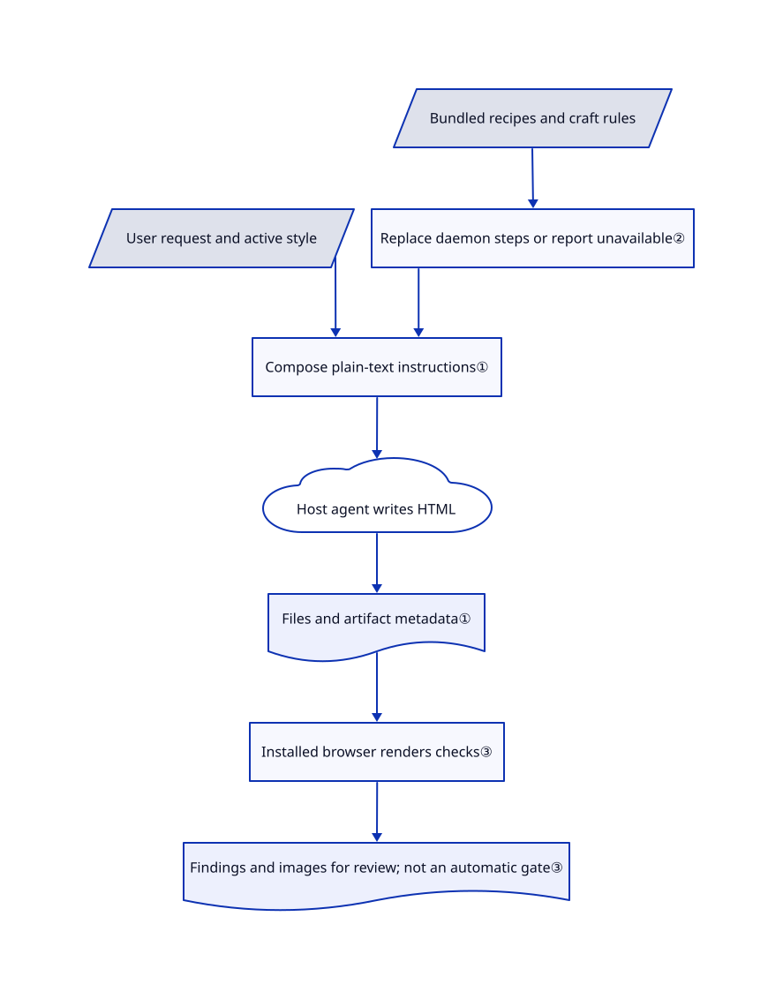

# Open Design

Your coding agent makes every landing page look alike, but moving into another design app breaks your workflow. Open Design Agent Kit feeds it a bundled recipe, brand tokens and craft rules, then checks and exports the files your agent writes in the current project. This page uses the short display name Open Design for the kit, not the separate desktop studio.

## When to use

You are a developer preparing a coffee-subscription landing page and an investor deck inside an existing repository. The agent keeps giving both the same gradient hero and three identical cards. You want rendered examples to remix, reusable colors and spacing, and comments tied to the resulting files, without opening the separate Open Design desktop app or configuring another model provider. Install the CLI/MCP integration or VS Code extension; your current agent does the generation while the kit supplies recipes, local artifact bookkeeping, browser checks and exports.

Choose it over a bare design skill when you need the surrounding tools as well as prose guidance. Choose it over the desktop studio when staying in Claude Code, Codex or Copilot matters more than the studio's media-generation daemon. It supplies neither inference nor free model usage.

## When NOT to use

- **You need the full Open Design media backend.** Use [Open Design](open-design.md) instead. This kit deliberately omits its daemon; recipes that require it receive a replacement instruction or an unavailable-step notice, not equivalent image/audio generation.
- **You need multiplayer vector editing or editable design documents.** Use [Penpot](../design-editors/penpot.md). The kit centers on code-rendered artifacts; its PowerPoint export places one screenshot on each slide, not editable text and shapes.
- **Your main need is a repeatable frontend lint gate.** Prefer [Impeccable](impeccable.md). Here taste findings are warnings, an MCP check returns findings rather than blocking generation, and CLI checks need an explicit `--fail-on` policy to fail on findings.
- **Designs must never leave the machine.** Prefer Penpot on controlled infrastructure and a separately approved local agent. The kit reuses the host model's data policy; its [Claude skill](https://github.com/feimacode/open-design-agent-kit/blob/e0f829f1f2600491264fca0b7ce28ee646329c1c/packages/claude-plugin/skills/open-design/SKILL.md#L70-L81) requests private claude.ai artifact publication when that tool exists, without another confirmation. Private cloud storage is still egress.
- **You run the Claude plugin on Windows with Node under a path containing spaces.** Open [issue #66](https://github.com/feimacode/open-design-agent-kit/issues/66) reports startup failure; the reviewed launcher still enables a shell on Windows. Use the VS Code surface or wait for a verified plugin fix, rather than assuming the issue's suggested patch shipped.

## Comparison

| Alternative | In index | Our verdict | Tradeoff |
| --- | --- | --- | --- |
| [Open Design](open-design.md) | Indexed | Pick Agent Kit for designs inside your current coding-agent session; pick Open Design when the separate studio and daemon-backed media workflows are essential. | Agent Kit avoids a second model setup and database, but does not reproduce every upstream workflow. |
| [Impeccable](impeccable.md) | Indexed | Pick Impeccable for an existing frontend that needs repeatable design lint; pick Agent Kit when bundled examples, persistent styles and file export are the main job. | A narrower quality layer avoids adopting the kit's artifact workflow; the kit provides a broader generation-to-export path. |
| [Penpot](../design-editors/penpot.md) | Indexed | Pick Penpot for a team editing one vector document with accounts and collaboration; pick Agent Kit for agent-written HTML prototypes in a code repository. | Penpot requires a service stack; Agent Kit needs no document server but supplies no equivalent shared canvas. |

## Quick start

In a project you trust, run `npx @feimacode/open-design-agent-kit init --tools claude` after reviewing the installer and choosing a package version. It copies skills into `.claude/skills/`, merges its server into `.mcp.json`, and adds a preview launch entry; the MCP version follows the CLI version. Ask for a one-page coffee-subscription site and name a style if you have one. The kit assembles instructions; your logged-in agent writes HTML and supporting assets, then registers them under `.open-design/` with a JSON metadata file. It can render checks and exports using an installed browser, while you pay for the host model and review the result, external assets and production integration yourself. The commands are source-verified, not executed during this intake.

<!-- flow-steps:begin (generated from flows/open-design-agent-kit.json by tools/flow_card.py — do not edit) -->

Text version of the flow

1. **You**: Review and install project-local skills and MCP wiring — `npx @feimacode/open-design-agent-kit init --tools claude` — component: `CLI installer`
2. **You**: Ask your current agent for a coffee-subscription landing page
3. **Open Design**: Return a recipe, style rules and a suggested output path — component: `MCP brief composer`
4. **You**: Let your host agent write the HTML with its own file tools — component: `Your coding agent`
5. **Open Design**: Register the files and render checks for review — component: `Registry and browser checker`

**Value**: Keep a styled, reviewable HTML prototype inside the existing coding session

<!-- flow-steps:end -->

## Key techniques

<!-- mechanism:begin (generated from mechanisms/open-design-agent-kit.json by tools/mechanism_card.py; do not edit) -->

Text version of the mechanism

- User request and active style
- Bundled recipes and craft rules
- Replace daemon steps or report unavailable②
- Compose plain-text instructions①
- Host agent writes HTML
- Files and artifact metadata①
- Installed browser renders checks③
- Findings and images for review; not an automatic gate③

- User request and active style → Compose plain-text instructions①
- Bundled recipes and craft rules → Replace daemon steps or report unavailable②
- Replace daemon steps or report unavailable② → Compose plain-text instructions①
- Compose plain-text instructions① → Host agent writes HTML
- Host agent writes HTML → Files and artifact metadata①
- Files and artifact metadata① → Installed browser renders checks③
- Installed browser renders checks③ → Findings and images for review; not an automatic gate③

<!-- mechanism:end -->

### 1. Compose a design brief without owning inference

- **Problem:** A recipe copied alone loses the project's style and rules, while a second generation app duplicates model setup.
- **How:** The composer combines the user's brief, active design-system text, skill body, host override and selected craft documents. The MCP tool returns instructions and a suggested file path; the host agent writes the design and registers a sidecar describing it.
- **Limits:** These are model instructions, not enforced design constraints. Existing application detection only nudges the agent toward local components; a standalone prototype does not become production code automatically.
- **Source:** [Composer, lines 208–289](https://github.com/feimacode/open-design-agent-kit/blob/e0f829f1f2600491264fca0b7ce28ee646329c1c/packages/core/src/generation/composeInstructions.ts#L208-L289), [brief tool, lines 206–249](https://github.com/feimacode/open-design-agent-kit/blob/e0f829f1f2600491264fca0b7ce28ee646329c1c/packages/mcp-server/src/index.ts#L206-L249).

### 2. Adapt upstream recipes instead of pretending the daemon exists

- **Problem:** Vendored recipes can call Open Design binaries unavailable in a coding-agent host.
- **How:** A daemon-reference matcher selects a per-recipe override or an explicit unavailable-step notice. HyperFrames receives direct CLI instructions; other daemon-dependent media steps are replaced by a request to explain the gap and label placeholders.
- **Limits:** The matcher covers known invocation forms, not all possible dependencies. The HyperFrames text suggests rerunning outside a sandbox if rendering stalls; that suggestion is untrusted workflow text, not authorization to bypass host policy.
- **Source:** [Host overrides, lines 1–46](https://github.com/feimacode/open-design-agent-kit/blob/e0f829f1f2600491264fca0b7ce28ee646329c1c/packages/core/src/generation/hostOverrides.ts#L1-L46), [content snapshot](https://github.com/feimacode/open-design-agent-kit/blob/e0f829f1f2600491264fca0b7ce28ee646329c1c/packages/content/assets/open-design/MANIFEST.json).

### 3. Render registered files, then expose findings rather than a quality guarantee

- **Problem:** Plausible HTML can overflow, lose keyboard focus indicators or render a blank slide.
- **How:** The checker requires registration, discovers a local browser and dispatches to page, card or deck checks. Page checks include hover/focus sampling, small-screen reflow and reduced motion; results and images are saved for review. Each render session uses a temporary browser profile and closes its browser and server afterward.
- **Limits:** Page state sampling caps at 60 targets; the documented checks do not cover screen-reader names or keyboard traps. Successful execution can still contain error findings; the CLI only makes findings fatal when `--fail-on error` or `--fail-on warning` is supplied. Taste rules do not certify aesthetics.
- **Source:** [Checker, lines 219–364](https://github.com/feimacode/open-design-agent-kit/blob/e0f829f1f2600491264fca0b7ce28ee646329c1c/packages/core/src/export/checkArtifact.ts#L219-L364), [state cap](https://github.com/feimacode/open-design-agent-kit/blob/e0f829f1f2600491264fca0b7ce28ee646329c1c/packages/core/src/export/checkArtifact.ts#L123-L135), [CLI exit policy](https://github.com/feimacode/open-design-agent-kit/blob/e0f829f1f2600491264fca0b7ce28ee646329c1c/packages/cli/src/checkCommand.ts#L103-L146), [render lifecycle](https://github.com/feimacode/open-design-agent-kit/blob/e0f829f1f2600491264fca0b7ce28ee646329c1c/packages/core/src/export/artifactPage.ts#L26-L58).

## Tech stack

- TypeScript npm-workspaces monorepo: shared core, CLI, stdio MCP server, VS Code extension, and generated Claude/Codex skills. Bundled HTML content explains GitHub's HTML language classification; the runtime is TypeScript.
- Core uses `puppeteer-core`, `pptxgenjs`, `pdf-lib`, JSZip, Cheerio and PostCSS for rendering, document packaging and parsing. Skills and catalogs are bundled data, not a model.
- Root [MIT license](https://github.com/feimacode/open-design-agent-kit/blob/e0f829f1f2600491264fca0b7ce28ee646329c1c/LICENSE) names Iven Xu. [Port records](https://github.com/feimacode/open-design-agent-kit/blob/e0f829f1f2600491264fca0b7ce28ee646329c1c/docs/contributing/upstream-ports.md) distinguish Apache-2.0 Open Design code/content and additional MIT sources; do not treat the whole bundle as MIT-only or brand examples as trademark clearance.

## Dependencies

- A working coding agent with model access. CLI/MCP manifests declare Node.js 18 or later, but the [locked Commander 14.0.3 dependency](https://github.com/feimacode/open-design-agent-kit/blob/e0f829f1f2600491264fca0b7ce28ee646329c1c/package-lock.json#L3018-L3025) requires Node.js 20 or later. Do not rely on the advertised Node 18 floor for this CLI; host compatibility still needs testing in your environment.
- Installed Chrome, Chromium or Edge for rendered checks and image/PDF/PPTX export; `puppeteer-core` does not supply a browser. FFmpeg is needed for motion export; HyperFrames is a separate CLI path.
- Optional Figma credentials/connectors, `pdftotext` for PDF extraction, and external publishing services depend on the chosen workflow. The Figma token can be read from an environment variable or `~/.config/open-design/figma-token`.
- No database or separate Open Design daemon is required for the basic project workflow. Remote models, fonts, images, connectors and publication remain separate network boundaries.

## Ops difficulty

**Low for local HTML, medium for export and managed environments.** You manage package/host compatibility, browser and optional media dependencies, and approval of newly installed skills and MCP tools. Back up existing agent configuration before `init`: its skill writer removes previously generated directories and copies bundled files, while its Claude setup replaces the `open-design` server entry. To stop, end active preview/MCP processes and remove only this kit's skill directories and configuration entries; keep other servers and launch configurations. Back up `.open-design/` before removing artifacts, comments, checks and styles. Remove an optional saved Figma token only if no other installation uses it, revoke credentials at the provider, and separately remove published/cloud copies; local deletion does not retract them.

## Health & viability

- **2026-10-30 maintenance:** latest GitHub release is v0.3.0 from October 24; the reviewed main commit is from October 30 and the plugin manifest is already v0.3.1. Release and source versions differ, so pin the installation path you actually use.
- **Governance:** feimacode is an organization, but contributor history is concentrated in `ivenxu` and an account named `claude`; that is not evidence of two independent maintainers. The root copyright matches Iven Xu. No foundation backing or support commitment was found in the read governance material.
- **Age and Lindy:** created September 19, 2026, only 40 complete days before review. [Inferred: creation date and ongoing commits] Active development supports experimentation, not a long-term durability claim; keep generated files usable without the kit.
- **Adoption:** GitHub reports 495 stars and 47 forks on the review date. Multiple host integrations and a tested package structure are observable; stars do not establish production usage or visual quality.
- **Risk:** mixed-license vendoring requires retained attribution, and installing the skill grants broad workflow influence. Its automatic private-artifact publication instruction deserves explicit review even when public publication is approval-gated. Windows issue #66 remains open. The automatic health scorer reads the GitHub MIT classification, not the bundle's full license inventory. Use the page's license scope, not the radar badge, for reuse decisions.

## Caveats (unverified)

- [Unverified: no upstream package installation or model/browser execution was authorized] Visual quality, host-version compatibility and export fidelity were not reproduced; the page describes the fixed source rather than an executed demo.
- [Inferred: creation date and ongoing commits] The project is suitable for a reversible trial, not a proven long-lived design platform.
- [Unverified: no full third-party asset rights audit] Source licenses and selected retained notices were read, but brand marks, example imagery, fonts and all transitive redistribution obligations were not cleared. This introduction grants no commercial reuse or redistribution rights.
- [Unverified: no authenticated cloud-service test] Private Claude artifact storage, external connector permissions and remote deletion behavior were not tested; audit them before sending confidential designs.
