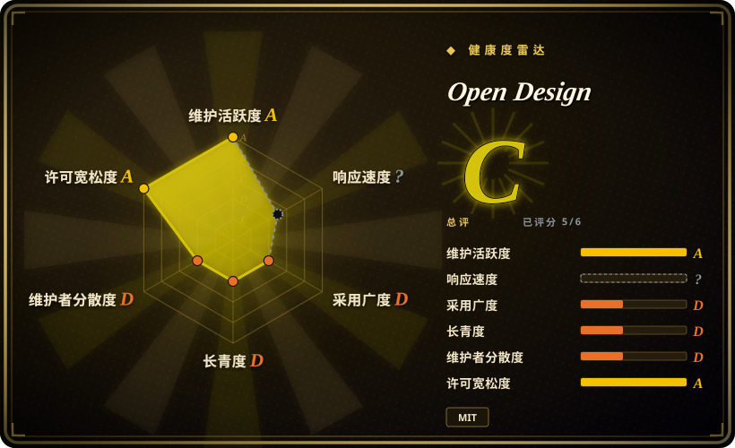
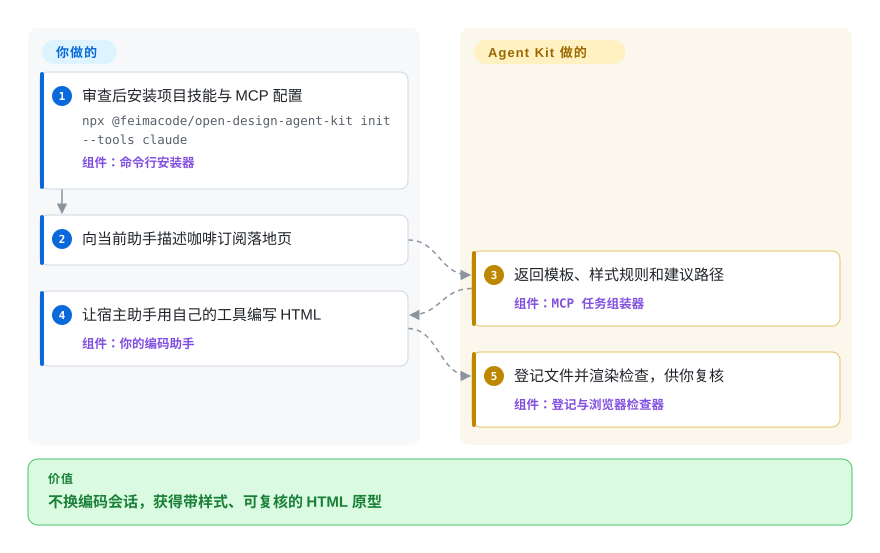
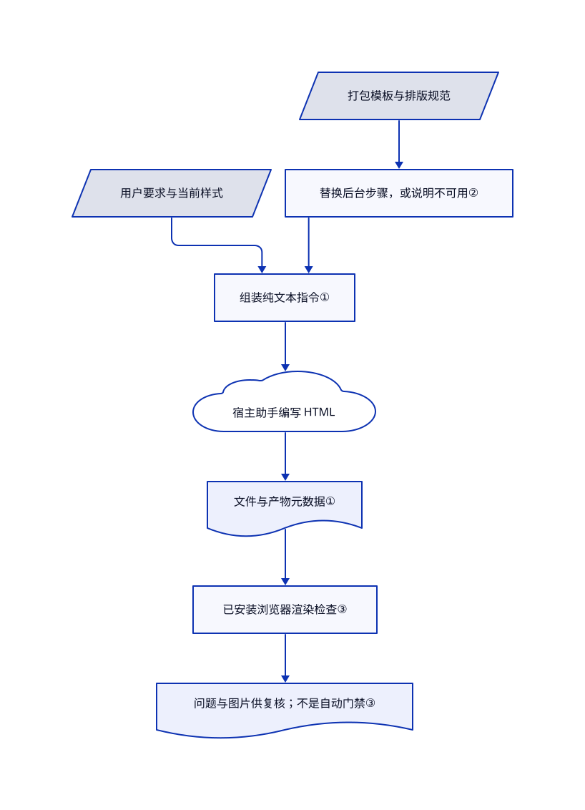

# Open Design

编码助手做的每张落地页都一个样，换设计应用又打断当前工作。Open Design Agent Kit 把模板、品牌配色和排版规则交给当前助手，再检查和导出助手写进项目的文件。本页用 Open Design 作为工具包的短显示名，不指独立桌面工作室。

## 何时使用

你在现有仓库里做咖啡订阅落地页和融资演示稿，助手却把两者都写成渐变大标题加三张同款卡片。你想改现成样稿、复用配色和间距，并直接给文件留下修改意见，不想再打开 Open Design 桌面应用或配置第二套模型。安装命令行与 MCP 集成或 VS Code 扩展后，仍由当前助手生成；工具包提供模板、本地产物登记、浏览器检查和导出。

当你需要的不只是提示词，还有预览和导出工具时，选它而非单个设计技能。留在 Claude Code、Codex 或 Copilot 比桌面工作室的媒体生成后台更重要时，选它而非完整桌面版。它不提供推理模型，也不免除宿主模型费用。

## 何时不用

- **需要完整的媒体生成后台。** 选 [Open Design](open-design.zh.md)。本工具包明确不带它的后台进程；依赖该进程的模板只会得到替代步骤或不可用提示，并非等价的图像、音频生成能力。
- **需要多人编辑矢量稿或可编辑设计文档。** 选 [Penpot](../design-editors/penpot.zh.md)。本项目围绕代码渲染产物；导出的 PowerPoint 每页是一张截图，不是可编辑文字和形状。
- **主要需求是可重复的前端质量门禁。** 优先看 [Impeccable](impeccable.zh.md)。这里的审美检查给警告，MCP 检查返回问题而非阻止生成；命令行也要明确配置 `--fail-on` 才因发现问题失败。
- **设计稿绝不能离开本机。** 选受控基础设施上的 Penpot，并另配获准的本地助手。工具包沿用宿主模型的数据政策；当 Claude 产物工具可用时，其 [Claude 技能](https://github.com/feimacode/open-design-agent-kit/blob/e0f829f1f2600491264fca0b7ce28ee646329c1c/packages/claude-plugin/skills/open-design/SKILL.md#L70-L81)要求无需再次确认就发布到私有 claude.ai 产物。私有云存储仍是外发。
- **Windows 上的 Claude 插件使用含空格路径的 Node。** 尚未关闭的[议题 #66](https://github.com/feimacode/open-design-agent-kit/issues/66)报告启动失败，所审查的启动器仍在 Windows 启用 shell。可选 VS Code 入口或等修复得到验证，不把议题里的建议补丁当成已经发布。

## 横向对比

| 替代品 | 是否收录 | 我们的评价 | 取舍 |
| --- | --- | --- | --- |
| [Open Design](open-design.zh.md) | 已收录 | 要在当前编码助手里做设计，选 Agent Kit；需要独立工作室和后台媒体流程，选 Open Design。 | 工具包省去第二套模型设置和数据库，但不复刻全部上游流程。 |
| [Impeccable](impeccable.zh.md) | 已收录 | 现有前端需要重复执行设计检查，选 Impeccable；主要需要样稿、持久样式和文件导出，选 Agent Kit。 | 单独质量层不要求采纳本项目的产物流程；本项目覆盖从生成到导出的更多环节。 |
| [Penpot](../design-editors/penpot.zh.md) | 已收录 | 团队需要账号、协作并编辑同一矢量文档，选 Penpot；要让助手把 HTML 原型写进代码仓库，选 Agent Kit。 | Penpot 要运维服务栈；工具包不需要文档服务器，但也没有等价的共享画布。 |

## 快速上手

先审查安装器并选定包版本，再在可信项目运行 `npx @feimacode/open-design-agent-kit init --tools claude`。它把技能复制到 `.claude/skills/`，向 `.mcp.json` 合并服务器，并添加预览启动配置；MCP 版本跟随命令行版本。告诉助手做一张咖啡订阅落地页，有既定风格时一起说明。工具包组装指令，已登录的助手编写 HTML 和素材，再把文件登记到 `.open-design/`，附上记录产物信息的 JSON 文件。工具可用本机浏览器检查和导出，你仍负责模型费用、结果审查、外部素材和正式应用接入。本轮只核对源码里的命令，没有执行安装。

<!-- flow-steps:begin (generated from flows/open-design-agent-kit.json by tools/flow_card.py — do not edit) -->

流程文字版

1. **你**：审查后安装项目技能与 MCP 配置 — `npx @feimacode/open-design-agent-kit init --tools claude` — 组件：`命令行安装器`
2. **你**：向当前助手描述咖啡订阅落地页
3. **Open Design**：返回模板、样式规则和建议路径 — 组件：`MCP 任务组装器`
4. **你**：让宿主助手用自己的工具编写 HTML — 组件：`你的编码助手`
5. **Open Design**：登记文件并渲染检查，供你复核 — 组件：`登记与浏览器检查器`

**价值**：不换编码会话，获得带样式、可复核的 HTML 原型

<!-- flow-steps:end -->

## 技术要点

<!-- mechanism:begin (generated from mechanisms/open-design-agent-kit.json by tools/mechanism_card.py; do not edit) -->

机制文字版

- 用户要求与当前样式
- 打包模板与排版规范
- 替换后台步骤，或说明不可用②
- 组装纯文本指令①
- 宿主助手编写 HTML
- 文件与产物元数据①
- 已安装浏览器渲染检查③
- 问题与图片供复核；不是自动门禁③

- 用户要求与当前样式 → 组装纯文本指令①
- 打包模板与排版规范 → 替换后台步骤，或说明不可用②
- 替换后台步骤，或说明不可用② → 组装纯文本指令①
- 组装纯文本指令① → 宿主助手编写 HTML
- 宿主助手编写 HTML → 文件与产物元数据①
- 文件与产物元数据① → 已安装浏览器渲染检查③
- 已安装浏览器渲染检查③ → 问题与图片供复核；不是自动门禁③

<!-- mechanism:end -->

### 1. 组装设计任务，不接管模型推理

- **解决：** 单独复制模板容易丢失项目样式和规则，另开生成应用又要重复配置模型。
- **做法：** 组装器合并用户要求、当前设计系统文本、技能正文、宿主覆盖规则和选中的排版规范。MCP 工具返回指令与建议路径；宿主助手写设计文件，并登记描述文件的旁置元数据。
- **边界：** 这些是模型指令，不是强制设计约束。检测到现有应用只会提示助手参考组件，独立原型不会自动变成生产代码。
- **源码：** [组装器第 208–289 行](https://github.com/feimacode/open-design-agent-kit/blob/e0f829f1f2600491264fca0b7ce28ee646329c1c/packages/core/src/generation/composeInstructions.ts#L208-L289)、[任务工具第 206–249 行](https://github.com/feimacode/open-design-agent-kit/blob/e0f829f1f2600491264fca0b7ce28ee646329c1c/packages/mcp-server/src/index.ts#L206-L249)。

### 2. 适配上游模板，不假装后台存在

- **解决：** 复制来的模板可能调用当前宿主没有的 Open Design 程序。
- **做法：** 匹配后台调用文本，再选用该模板的替代指令，或明确说明相关步骤不可用。HyperFrames 得到直接调用其命令行的步骤；其他依赖后台的媒体步骤要求说明缺口并标出占位内容。
- **边界：** 匹配器只覆盖已知调用形式，不穷尽全部依赖。HyperFrames 文本建议渲染卡住时退出沙箱重跑；这是不可信的流程文本，不是绕过宿主政策的授权。
- **源码：** [宿主覆盖第 1–46 行](https://github.com/feimacode/open-design-agent-kit/blob/e0f829f1f2600491264fca0b7ce28ee646329c1c/packages/core/src/generation/hostOverrides.ts#L1-L46)、[内容快照](https://github.com/feimacode/open-design-agent-kit/blob/e0f829f1f2600491264fca0b7ce28ee646329c1c/packages/content/assets/open-design/MANIFEST.json)。

### 3. 渲染已登记文件，返回问题而非质量保证

- **解决：** 看似合理的 HTML 可能溢出、缺少键盘焦点标记，或把幻灯片渲染成空白。
- **做法：** 检查器要求先登记文件，发现本机浏览器，再分别检查页面、卡片或幻灯片。页面检查含悬停与焦点采样、小屏重排及减少动效；问题和图片保存后供复核。每次渲染使用临时浏览器配置，结束后关闭浏览器与服务器。
- **边界：** 页面状态检查最多采样 60 个目标；文档明确不覆盖屏幕阅读器命名或键盘陷阱。执行成功仍可包含错误级问题；只有传入 `--fail-on error` 或 `--fail-on warning`，命令行才因此失败。审美规则不证明页面好看。
- **源码：** [检查器第 219–364 行](https://github.com/feimacode/open-design-agent-kit/blob/e0f829f1f2600491264fca0b7ce28ee646329c1c/packages/core/src/export/checkArtifact.ts#L219-L364)、[采样上限](https://github.com/feimacode/open-design-agent-kit/blob/e0f829f1f2600491264fca0b7ce28ee646329c1c/packages/core/src/export/checkArtifact.ts#L123-L135)、[命令行退出策略](https://github.com/feimacode/open-design-agent-kit/blob/e0f829f1f2600491264fca0b7ce28ee646329c1c/packages/cli/src/checkCommand.ts#L103-L146)、[渲染生命周期](https://github.com/feimacode/open-design-agent-kit/blob/e0f829f1f2600491264fca0b7ce28ee646329c1c/packages/core/src/export/artifactPage.ts#L26-L58)。

## 技术栈

- TypeScript 的 npm 工作区仓库：共享核心、命令行、标准输入输出 MCP 服务器、VS Code 扩展，以及生成的 Claude／Codex 技能。大量 HTML 内容使 GitHub 把主语言记为 HTML，实际运行代码为 TypeScript。
- 核心用 `puppeteer-core`、`pptxgenjs`、`pdf-lib`、JSZip、Cheerio 和 PostCSS 做渲染、文档打包与解析。技能和目录是打包数据，不是模型。
- 根 [MIT 许可证](https://github.com/feimacode/open-design-agent-kit/blob/e0f829f1f2600491264fca0b7ce28ee646329c1c/LICENSE)署名 Iven Xu。[移植记录](https://github.com/feimacode/open-design-agent-kit/blob/e0f829f1f2600491264fca0b7ce28ee646329c1c/docs/contributing/upstream-ports.md)区分 Apache-2.0 的 Open Design 代码与内容，以及额外的 MIT 来源；不能把整包视为纯 MIT，也不能把品牌样例视为商标使用授权。

## 依赖

- 已有模型访问权限的编码助手。命令行和 MCP 清单声明 Node.js 18 起，但[锁定的 Commander 14.0.3 依赖](https://github.com/feimacode/open-design-agent-kit/blob/e0f829f1f2600491264fca0b7ce28ee646329c1c/package-lock.json#L3018-L3025)要求 Node.js 20 起。不能据入口声明把本命令行的最低版本当成 Node 18；宿主兼容性仍须在目标环境验证。
- 渲染检查及图片、PDF、PPTX 导出要求已安装 Chrome、Chromium 或 Edge；`puppeteer-core` 不附带浏览器。动效导出需要 FFmpeg，HyperFrames 另走自己的命令行。
- Figma 凭据与连接器、提取 PDF 的 `pdftotext`、外部发布服务取决于所选流程。Figma 令牌可从环境变量或 `~/.config/open-design/figma-token` 读取。
- 基本项目流程不要求数据库，也不要求独立的 Open Design 后台。远程模型、字体、图片、连接器和发布仍是不同的网络边界。

## 运维难度

**本地 HTML 低，导出和受管环境中等。** 你负责包与宿主兼容、本机浏览器、可选媒体依赖，以及批准新安装的技能和 MCP 工具。运行 `init` 前备份现有助手配置：技能写入器会移除此前生成的目录，再复制打包文件；Claude 设置会替换 `open-design` 服务器项。停用时先结束预览与 MCP 进程，仅移除本工具包的技能目录和配置项，保留其他服务器及启动项。删除产物、评论、检查记录和样式前备份 `.open-design/`。可选 Figma 令牌只有在其他安装不共用时才移除，并在服务端撤销凭据；云端和已发布副本须另行删除，本地删除不会撤回它们。

## 健康度与可持续性

- **2026-10-30 维护状况：** 最新 GitHub 发布为 10 月 24 日的 v0.3.0，所审查主分支提交在 10 月 30 日，插件清单已为 v0.3.1。发布包与源码版本不同，应锁定实际使用入口。
- **治理：** feimacode 是组织账号，但贡献记录集中在 `ivenxu` 和名为 `claude` 的账号；不能据此认为有两名独立维护者。根版权署名与 Iven Xu 一致。所读治理材料未见基金会背书或支持承诺。
- **年龄与长期性：** 仓库创建于 2026 年 9 月 19 日，审查时仅满 40 天。[推断：依据创建时间与持续提交] 活跃开发支持试用，不构成长期可靠证明；应让生成文件能脱离工具包继续使用。
- **采用信号：** 当日 GitHub 为 495 星、47 个分叉。多宿主适配和测试文件可见，但星数不证明生产使用或视觉质量。
- **风险：** 混合许可的复用要求保留归属，安装技能也会带来广泛的流程影响。即便公开发布要求确认，自动发布私有 Claude 产物的指令仍须单独审查。Windows 议题 #66 尚未关闭。自动健康评分读取 GitHub 的 MIT 分类，不代表整包许可清单。复用决策应看正文许可边界，不能只看图内徽章。

## 存疑（未验证）

- [未验证：本轮未获准安装上游包或运行模型与浏览器] 未复现视觉质量、宿主版本兼容和导出保真；页面描述固定源码，不冒充执行演示。
- [推断：依据创建时间与持续提交] 适合可回退的试用，尚非经过长期检验的设计平台。
- [未验证：未做全量第三方素材权利审计] 已读源码许可和部分保留声明，但未核清所有品牌标识、样例图片、字体及传递性再分发义务。本介绍不授予商用或再分发权利。
- [未验证：未登录测试云服务] 私有 Claude 产物存储、外部连接器权限和远程删除行为未经实测；发送保密设计前须核查。
