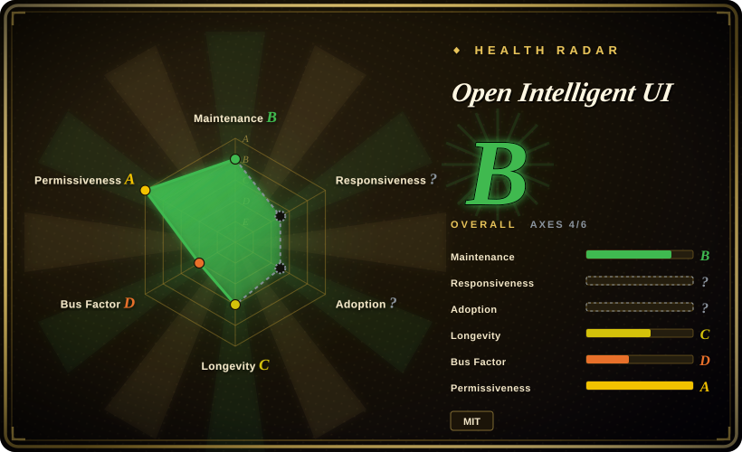
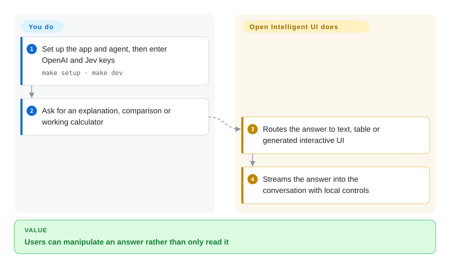
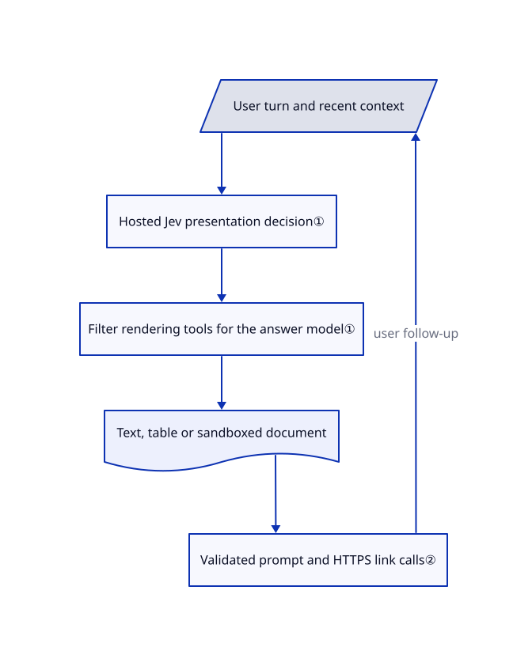

# Open Intelligent UI

A user asks how an airplane rotates, and a paragraph cannot let them move the angles. Open Intelligent UI turns chat answers into text, tables or generated interactive controls inside the conversation.

## When to use

You are building an educational or decision-support chat where a slider, map or calculator helps more than another text bubble. You want a runnable reference with a Python agent and React chat rather than designing the streaming renderer yourself. Choose this over json-render when the model must create a custom little interactive document, not merely assemble your registered component catalog. Choose Open Design when you need files and a design studio instead of interactive answers inside a chat.

## When NOT to use

- **You require local-only or one-provider inference:** the current routing code calls hosted Jev and the browser asks for both OpenAI and Jev keys. [json-render](json-render.md) lets your application choose its own model path, but you build the integration.
- **The model must never generate arbitrary UI code:** choose [json-render](json-render.md) for catalog-based rendering. This app deliberately streams custom HTML, CSS and JavaScript into a sandbox.
- **Durable multi-instance chat storage:** the documented checkpoint store is process memory with a 200-thread bound. Use a product with persistent chat storage such as [Open WebUI](../llm-chat-ui/open-webui.md), or replace this template's storage before production.
- **A downloadable prototype or publishing artifact:** choose [Open Design](open-design.md) or [HTML Anything](html-anything.md); prior answers here are separate snapshots, not a cross-turn editable project.

## Comparison

| Alternative | In index | Our verdict | Tradeoff |
|---|---|---|---|
| [json-render](json-render.md) | ✅ | Pick json-render when brand-safe registered components decide the design; pick this app when users need custom generated simulations or calculators in chat. | A component catalog narrows the code surface; arbitrary generated UI is more expressive but adds sandbox and bridge responsibilities. |
| [Open Design](open-design.md) | ✅ | Pick Open Design for a local artifact studio and file exports; pick this app for agent-chosen interactive answers during a conversation. | Open Design orchestrates existing coding agents and output files; this template operates a Python agent plus a web chat and hosted router. |
| [HTML Anything](html-anything.md) | ✅ | Pick HTML Anything to turn existing Markdown into publishable HTML with your logged-in CLI; pick this app when the answer itself must become an interactive tool. | Publishing/export workflows differ from conversation-state and in-frame interaction; this app requires two provider credentials. |

## Quick start

Clone the repository and run `make setup`, then `make dev`; prerequisites are Node.js 22+, pnpm 9+, Python 3.12+ and uv. Open `http://localhost:3000` and add OpenAI and Jev keys in the chat header, or configure server credentials as documented. Ask for an explanation or calculator; the agent selects a presentation and the browser renders the streamed answer. You provide keys, pay provider usage and implement real data connections; the bundled sample values are not live business data. Keys entered in the browser pass through the application server, so trust that operator even though the UI keeps them only in memory.

<!-- flow-steps:begin (generated from flows/open-intelligent-ui.json by tools/flow_card.py — do not edit) -->

Text version of the flow

1. **You**: Set up the app and agent, then enter OpenAI and Jev keys — `make setup · make dev`
2. **You**: Ask for an explanation, comparison or working calculator
3. **Open Intelligent UI**: Routes the answer to text, table or generated interactive UI
4. **Open Intelligent UI**: Streams the answer into the conversation with local controls

**Value**: Users can manipulate an answer rather than only read it

<!-- flow-steps:end -->

## Key techniques

<!-- mechanism:begin (generated from mechanisms/open-intelligent-ui.json by tools/mechanism_card.py; do not edit) -->

Text version of the mechanism

- User turn and recent context
- Hosted Jev presentation decision①
- Filter rendering tools for the answer model①
- Text, table or sandboxed document
- Validated prompt and HTTPS link calls②

- User turn and recent context → Hosted Jev presentation decision①
- Hosted Jev presentation decision① → Filter rendering tools for the answer model①
- Filter rendering tools for the answer model① → Text, table or sandboxed document
- Text, table or sandboxed document → Validated prompt and HTTPS link calls②
- Validated prompt and HTTPS link calls② → User turn and recent context (user follow-up)

<!-- mechanism:end -->

### 1. Select presentation before generating content

- **Problem:** One model can overuse charts or choose incompatible rendering tools during a turn.
- **How:** Middleware sends recent conversation context to Jev, validates a finite presentation choice and filters the model's available rendering tools. Text gets no rendering tool, basic tables get A2UI and other visuals get `generateSandboxedUi`.
- **Limits:** This is an extra hosted provider request, not a local heuristic. Invalid decisions, missing keys and timeouts raise errors rather than silently selecting another router.
- **Source:** [Visualization routing](https://github.com/CopilotKit/OpenIntelligentUI/blob/8391a94c1c3939c679e40ddd7bfc08a9ef690e70/apps/agent/src/visualization_router.py#L53-L238).

### 2. Give generated controls a narrow host bridge

- **Problem:** An isolated generated page still needs a way to ask a follow-up without receiving the host application's full authority.
- **How:** The host exposes a validated `sendPrompt` text call and an HTTPS-only `openLink`. Prompt text has a length bound and a live listener must claim the request; link origins can be restricted through configuration.
- **Limits:** Without an origin allowlist, any HTTPS origin passes the link check. Controls do not automatically synchronize arbitrary state back to the agent, and a follow-up makes a new answer rather than patching prior output.
- **Source:** [Host bridge](https://github.com/CopilotKit/OpenIntelligentUI/blob/8391a94c1c3939c679e40ddd7bfc08a9ef690e70/apps/app/src/lib/sandbox/sandbox-functions.ts#L11-L116), [snapshot behavior](https://github.com/CopilotKit/OpenIntelligentUI/blob/8391a94c1c3939c679e40ddd7bfc08a9ef690e70/docs/architecture.md#L34-L59).

## Tech stack

Next.js 16 and React 19, CopilotKit prerelease packages, JetBrains Websandbox, TypeScript; Python FastAPI, LangGraph and Deep Agents with provider clients. Separate Node and Python services; optional standalone MCP HTML assembler.

## Dependencies

Node/pnpm and Python/uv runtimes; OpenAI and Typesafe/Jev provider access on the default browser path; network for selected CDN libraries, map tiles and photos. No durable shared conversation database is supplied by the documented in-memory checkpoint setup.

## Ops difficulty

**Medium for a local demo, high as a shared product.** You operate two services, protect provider credentials, replace ephemeral storage, scope generated-code bridges and verify real provider access. The optional MCP assembler only returns HTML text; it does not supply the web app's renderer or deploy the result.

## Health & viability

- **2026-10-18:** last visible push was October 13; no GitHub releases were published in the checked list. Treat this as a changing application template rather than a stable framework contract.
- Created March 2026, about seven months old; little Lindy evidence. CopilotKit owns the project, and visible commits are concentrated in `jerelvelarde`.
- MIT text names Atai Barkai. The permissive repository license does not eliminate the current hosted-routing dependency or provider costs.
- Tests cover routing, credentials and sandbox bridge behavior; dependency manifests still include prerelease CopilotKit versions.

## Caveats (unverified)

- [未验证：未提供模型凭据，且本批禁止运行上游程序] Live generation quality, provider cost and browser sandbox behavior were not tested.
- [推断：依据是进程内检查点与独立服务架构] A durable shared deployment needs storage and security work beyond the local quick start.
