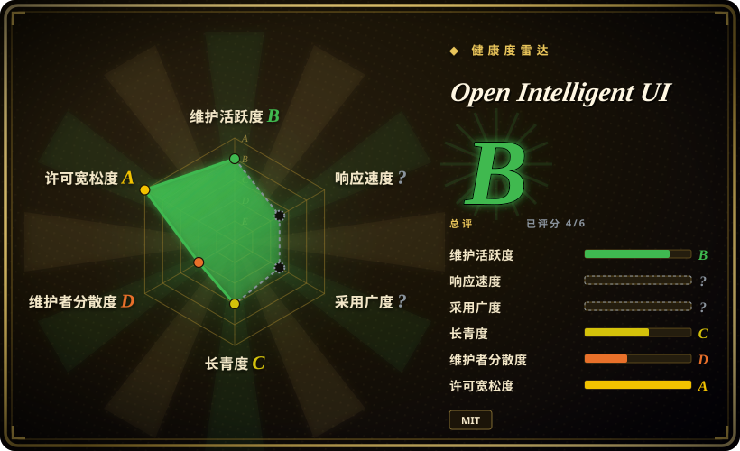
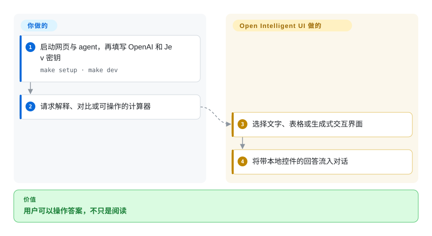
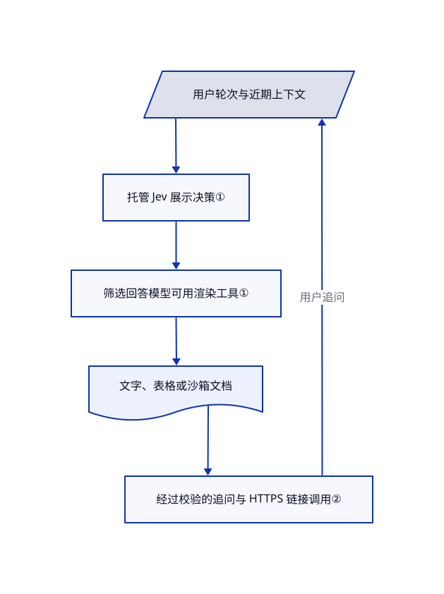

# Open Intelligent UI

用户问飞机如何转动，一段文字却不能让他亲手调角度。Open Intelligent UI 在聊天里选择文字、表格或生成的交互控件，让回答本身可以操作。

## 何时使用

你在做教学或决策聊天产品，滑块、地图或计算器比文字气泡更有帮助。你想拿到带 Python agent 和 React 聊天的可运行参考，而不是自己搭流式渲染器。相比 json-render，本项目允许模型定制小型交互文档，不只拼已注册组件；若需要文件与设计工作台，而非聊天中的交互答案，则该选 Open Design。

## 何时不用

- **必须全本地或只用一家模型：** 当前路由调用托管 Jev，网页要求同时提供 OpenAI 和 Jev 密钥。[json-render](json-render.zh.md) 允许应用自己选模型路线，但集成要自己做。
- **不允许模型生成任意界面代码：** 选目录约束的 [json-render](json-render.zh.md)；本应用刻意将 HTML、CSS 与 JavaScript 流入沙箱。
- **需要多副本持久会话：** 文档中的检查点是最多 200 个线程的进程内存。可选持久保存聊天的 [Open WebUI](../llm-chat-ui/open-webui.zh.md)，或先替换本模板的存储。
- **要下载原型或发布文件：** 选 [Open Design](open-design.zh.md) 或 [HTML Anything](html-anything.zh.md)；这里的历史回答是独立快照，不是跨轮可编辑工程。

## 横向对比

| 替代品 | 是否收录 | 我们的评价 | 取舍 |
|---|---|---|---|
| [json-render](json-render.zh.md) | ✅ | 品牌统一且只能用注册组件，选 json-render；要在聊天里定制模拟器与计算器，选本应用。 | 组件目录缩小代码面；任意生成界面更自由，但增加沙箱和通信桥责任。 |
| [Open Design](open-design.zh.md) | ✅ | 本地设计工作台与导出文件，选 Open Design；对话中由 agent 选择交互答案，选本应用。 | Open Design 调度已有编程助手并产出文件；本模板运营 Python agent、网页聊天和托管路由。 |
| [HTML Anything](html-anything.zh.md) | ✅ | 已有 Markdown，要用登录的命令行助手生成可发布 HTML，选 HTML Anything；回答要变成工具，选本应用。 | 发布与导出流程不同于对话状态和框内交互；本应用要两套模型凭据。 |

## 快速上手

克隆仓库，运行 `make setup` 和 `make dev`；需要 Node.js 22 及以上、pnpm 9 及以上、Python 3.12 及以上和 uv。打开 `http://localhost:3000`，在聊天顶部填写 OpenAI 与 Jev 密钥，或按文档配置服务端凭据。提问或要求计算器后，agent 选择表现形式，浏览器渲染流式答案。你提供密钥、支付模型费用并接真实数据；内置样例不代表实时业务数据。浏览器填入的密钥会经过应用服务器，即使只暂存在内存，也必须信任部署者。

<!-- flow-steps:begin (generated from flows/open-intelligent-ui.json by tools/flow_card.py — do not edit) -->

流程文字版

1. **你**：启动网页与 agent，再填写 OpenAI 和 Jev 密钥 — `make setup · make dev`
2. **你**：请求解释、对比或可操作的计算器
3. **Open Intelligent UI**：选择文字、表格或生成式交互界面
4. **Open Intelligent UI**：将带本地控件的回答流入对话

**价值**：用户可以操作答案，不只是阅读

<!-- flow-steps:end -->

## 技术要点

<!-- mechanism:begin (generated from mechanisms/open-intelligent-ui.json by tools/mechanism_card.py; do not edit) -->

机制文字版

- 用户轮次与近期上下文
- 托管 Jev 展示决策①
- 筛选回答模型可用渲染工具①
- 文字、表格或沙箱文档
- 经过校验的追问与 HTTPS 链接调用②

- 用户轮次与近期上下文 → 托管 Jev 展示决策①
- 托管 Jev 展示决策① → 筛选回答模型可用渲染工具①
- 筛选回答模型可用渲染工具① → 文字、表格或沙箱文档
- 文字、表格或沙箱文档 → 经过校验的追问与 HTTPS 链接调用②
- 经过校验的追问与 HTTPS 链接调用② → 用户轮次与近期上下文（用户追问）

<!-- mechanism:end -->

### 1. 先决定表现形式，再生成内容

- **解决：** 一个模型可能滥用图表，或在同轮选用冲突渲染工具。
- **做法：** 中间件把近期对话送给 Jev，校验有限的展示选项，再筛选模型可调用工具。文字不分配渲染工具，普通表格用 A2UI，其余视觉用 `generateSandboxedUi`。
- **边界：** 这是额外托管请求，不是本地规则。无效决策、缺密钥与超时都会报错，不会静默切换路由。
- **源码：** [展示形式路由](https://github.com/CopilotKit/OpenIntelligentUI/blob/8391a94c1c3939c679e40ddd7bfc08a9ef690e70/apps/agent/src/visualization_router.py#L53-L238)。

### 2. 只给生成控件窄范围的宿主通信桥

- **解决：** 隔离页面需要追问能力，但不应获得宿主应用的完整权限。
- **做法：** 宿主只暴露经过校验的 `sendPrompt` 文本调用和仅限 HTTPS 的 `openLink`。文本有长度限制，并要求活动监听者接管；链接来源可通过配置限制。
- **边界：** 不设来源白名单时，任意 HTTPS 来源都通过链接检查。任意控件状态不会自动同步给 agent，追问会生成新答案而不是修改旧输出。
- **源码：** [宿主通信桥](https://github.com/CopilotKit/OpenIntelligentUI/blob/8391a94c1c3939c679e40ddd7bfc08a9ef690e70/apps/app/src/lib/sandbox/sandbox-functions.ts#L11-L116)、[独立快照行为](https://github.com/CopilotKit/OpenIntelligentUI/blob/8391a94c1c3939c679e40ddd7bfc08a9ef690e70/docs/architecture.md#L34-L59)。

## 技术栈

Next.js 16、React 19、CopilotKit 预发布包、JetBrains Websandbox 与 TypeScript；Python FastAPI、LangGraph、Deep Agents 及供应商客户端。Node 与 Python 分开运行；另有可选 MCP HTML 组装器。

## 依赖

Node、pnpm、Python 和 uv；默认网页路线需要 OpenAI 与 Typesafe/Jev 访问权；所选 CDN 库、地图瓦片和照片需要联网。文档采用内存检查点，没有提供持久共享会话数据库。

## 运维难度

**本地演示中，共享产品高。** 你要运行两个服务、保护凭据、替换临时存储、收窄生成代码通信桥，并验证真实模型连通。可选 MCP 组装器只返回 HTML 文字，不提供网页应用的渲染器，也不负责部署。

## 健康度与可持续性

- **2026-10-18：** 最近可见推送为 10 月 13 日，检查的 GitHub Releases 列表为空。应当作持续变化的应用模板，不是稳定框架契约。
- 创建于 2026 年 3 月，约七个月，林迪证据少。项目归 CopilotKit 所有，可见提交集中于 `jerelvelarde`。
- MIT 正文署名 Atai Barkai；宽松仓库许可不消除当前托管路由依赖和调用成本。
- 测试覆盖路由、凭据与沙箱通信桥；依赖清单仍包含 CopilotKit 预发布版本。

## 存疑（未验证）

- [未验证：未提供模型凭据，且本批禁止运行上游程序] 未实测生成质量、调用费用与浏览器沙箱行为。
- [推断：依据是进程内检查点与独立服务架构] 持久共享部署还需本地快速启动之外的存储和安全工作。
