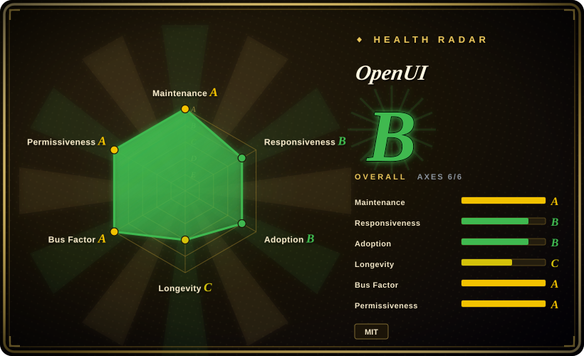
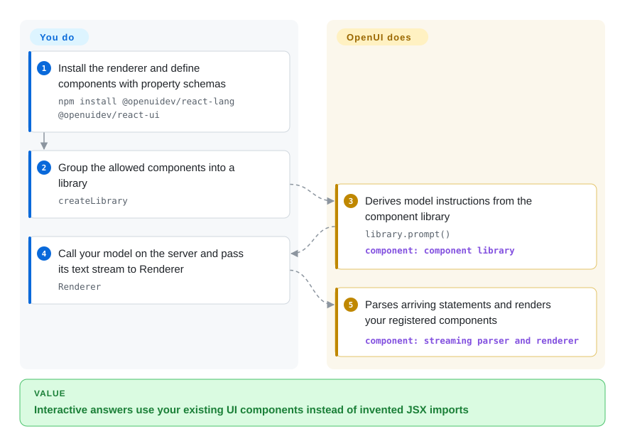
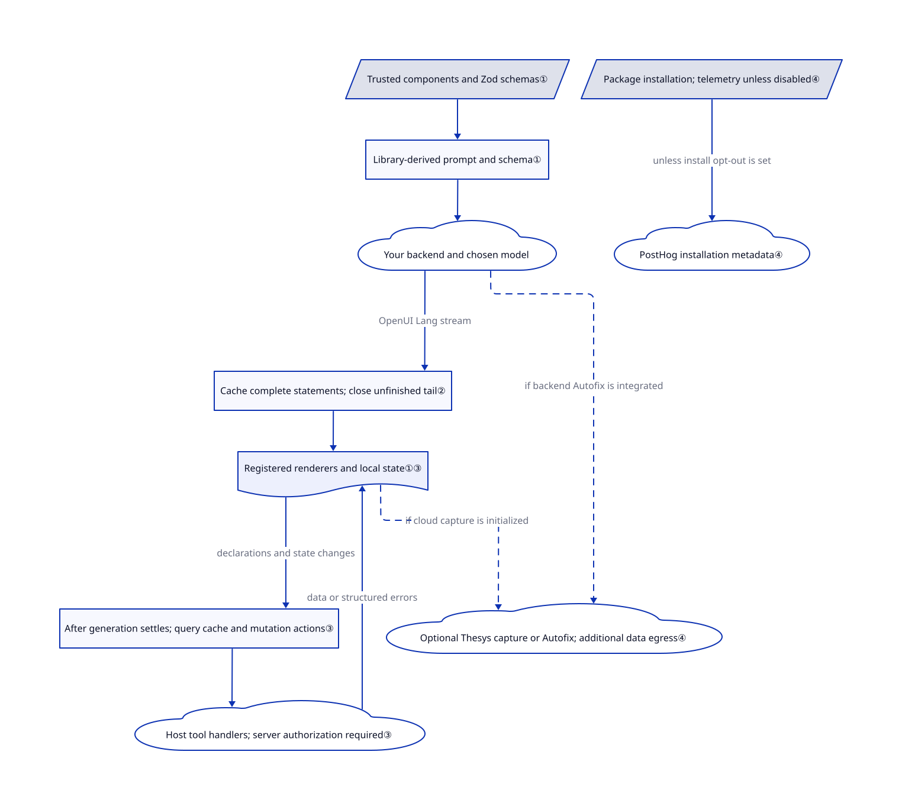

# OpenUI

Your chat answer needs a filterable table, but the model keeps inventing components your app cannot render. OpenUI turns your registered components into model instructions and renders its compact, function-call-like output while it arrives.

This page covers **Thesys's SDK**, not the unrelated `wandb/openui` HTML-generation project. Source review is pinned to [`9d73d17`](https://github.com/thesysdev/openui/tree/9d73d17d2bbac565672a85e78f6eb7740cb0d9ca).

## When to use

You maintain a React product where a support answer should contain your own table, chart or form. A generated `GlowCard` import cannot ship, and a plain Markdown answer cannot expose the filters users need. Register the components and their property schemas, generate the model instructions from that library, then let OpenUI render the returned program inside your application.

Choose it over [json-render](json-render.md) when you prefer a compact positional-call language with incremental parsing and built-in reactive queries over a JSON UI specification. Choose it over [Open Intelligent UI](open-intelligent-ui.md) when reusing your component vocabulary matters more than generating arbitrary interactive documents. Neither choice removes your responsibility for the model backend or business authorization.

## When NOT to use

- **Your integration contract must remain JSON.** Choose [json-render](json-render.md) for a JSON component tree and patch stream. OpenUI requires your model and integration to handle OpenUI Lang, not JSX or ordinary JSON.
- **Each answer needs a new simulator with arbitrary HTML and JavaScript.** [Open Intelligent UI](open-intelligent-ui.md) supplies a sandboxed-document approach. OpenUI's registered-component path cannot invent a renderer you did not provide.
- **You need files to export, not UI inside a running product.** Choose [Open Design](open-design.md) for a desktop artifact studio. OpenUI is an embedded runtime, not a prototype-file editor.
- **You expect a production service after scaffolding.** Stay with your existing application backend and embed only the renderer, or use [json-render](json-render.md) as a narrower rendering layer. OpenUI's self-hosted template has an unauthenticated chat route and no configured durable storage; swapping renderers does not solve either problem.

## Comparison

| Alternative | In index | Our verdict | Tradeoff |
|---|---|---|---|
| [json-render](json-render.md) | ✅ | Pick json-render when your model pipeline and validators already speak JSON; pick OpenUI when compact calls and reactive data queries justify adopting another output language. | Both use registered components. OpenUI adds a language parser and query lifecycle; JSON keeps the wire format familiar. |
| [Open Intelligent UI](open-intelligent-ui.md) | ✅ | Pick OpenUI for answers assembled from your existing design system; pick Open Intelligent UI for custom calculators or simulations whose layout and behavior are generated together. | Registered renderers narrow the generated-code surface, but limit invention. Generated documents gain freedom and require sandbox and bridge controls. |
| [Open Design](open-design.md) | ✅ | Pick Open Design when the result must be an exported prototype, deck or video; pick OpenUI when a user must manipulate the answer inside your application. | A desktop studio owns artifact workflows; an SDK leaves application hosting, data access and credentials with you. |

## Quick start

In an existing React app, install `npm install @openuidev/react-lang @openuidev/react-ui`; use Zod's `zod/v4` entry to describe component properties. Define components with `defineComponent`, group them with `createLibrary`, and call `library.prompt()` to obtain the system instructions sent to your model. Your server calls the model and sends its text stream to the browser; pass the accumulated text, library and streaming flag to `Renderer`. OpenUI supplies parsing, component lookup and form/query state; you supply trusted component implementations, provider credentials and spend, storage, authorization and any tool handlers. For an end-to-end starter, the repository documents `npx @openuidev/cli@latest create --name genui-chat-app`; the self-hosted template uses an in-process LangGraph agent and your OpenAI-compatible provider, not a mandatory Thesys inference service. Before installing, set `OPENUI_TELEMETRY_DISABLED=1` or `DO_NOT_TRACK=1` if installation telemetry is unacceptable; review the separate optional cloud integrations below.

<!-- flow-steps:begin (generated from flows/openui.json by tools/flow_card.py — do not edit) -->

Text version of the flow

1. **You**: Install the renderer and define components with property schemas — `npm install @openuidev/react-lang @openuidev/react-ui`
2. **You**: Group the allowed components into a library — `createLibrary`
3. **OpenUI**: Derives model instructions from the component library — `library.prompt()` — component: `component library`
4. **You**: Call your model on the server and pass its text stream to Renderer — `Renderer`
5. **OpenUI**: Parses arriving statements and renders your registered components — component: `streaming parser and renderer`

**Value**: Interactive answers use your existing UI components instead of invented JSX imports

<!-- flow-steps:end -->

## Key techniques

<!-- mechanism:begin (generated from mechanisms/openui.json by tools/mechanism_card.py; do not edit) -->

Text version of the mechanism

- Trusted components and Zod schemas①
- Library-derived prompt and schema①
- Your backend and chosen model
- Cache complete statements; close unfinished tail②
- Registered renderers and local state①③
- After generation settles; query cache and mutation actions③
- Host tool handlers; server authorization required③
- Package installation; telemetry unless disabled④
- PostHog installation metadata④
- Optional Thesys capture or Autofix; additional data egress④

- Trusted components and Zod schemas① → Library-derived prompt and schema①
- Library-derived prompt and schema① → Your backend and chosen model
- Your backend and chosen model → Cache complete statements; close unfinished tail② (OpenUI Lang stream)
- Cache complete statements; close unfinished tail② → Registered renderers and local state①③
- Registered renderers and local state①③ → After generation settles; query cache and mutation actions③ (declarations and state changes)
- After generation settles; query cache and mutation actions③ → Host tool handlers; server authorization required③
- Host tool handlers; server authorization required③ → Registered renderers and local state①③ (data or structured errors)
- Package installation; telemetry unless disabled④ → PostHog installation metadata④ (unless install opt-out is set)
- Registered renderers and local state①③ → Optional Thesys capture or Autofix; additional data egress④ (if cloud capture is initialized) [optional/fallback]
- Your backend and chosen model → Optional Thesys capture or Autofix; additional data egress④ (if backend Autofix is integrated) [optional/fallback]

<!-- mechanism:end -->

### 1. Derive instructions and renderer lookup from one component library

- **Problem:** A hand-written prompt can drift from the component names and properties the application actually ships.
- **How:** `defineComponent` records a Zod 4 schema and renderer; `createLibrary` derives prompt signatures and a JSON Schema from those definitions. The React renderer looks up each parsed name in `library.components` and returns nothing for an unknown renderer.
- **Limits:** This is not a security sandbox or token-level constrained decoding. Property validation reports errors, applies defaults or drops invalid nodes; your registered components and callbacks retain application authority.
- **Source:** [Library construction and schema generation](https://github.com/thesysdev/openui/blob/9d73d17d2bbac565672a85e78f6eb7740cb0d9ca/packages/lang-core/src/library.ts#L246-L379), [lookup](https://github.com/thesysdev/openui/blob/9d73d17d2bbac565672a85e78f6eb7740cb0d9ca/packages/react-lang/src/Renderer.tsx#L147-L190), [validation](https://github.com/thesysdev/openui/blob/9d73d17d2bbac565672a85e78f6eb7740cb0d9ca/packages/lang-core/src/parser/materialize.ts#L352-L423).

### 2. Cache completed statements and temporarily close the unfinished tail

- **Problem:** A response can stop halfway through a string, component call or reference while users are already watching it render.
- **How:** The streaming parser tracks completed top-level statements, then automatically closes the unfinished tail to build a provisional tree. Replacing the accumulated text resets the cache; incomplete rewrites of existing statement IDs retain the prior completed value.
- **Limits:** Tolerance is not correctness. Forward references and incomplete nodes can remain; the React hook reports settled errors separately. Preprocessing and tree construction still revisit accumulated content, so statement caching is not a proof of constant work per chunk.
- **Source:** [Streaming cache and tail handling](https://github.com/thesysdev/openui/blob/9d73d17d2bbac565672a85e78f6eb7740cb0d9ca/packages/lang-core/src/parser/parser.ts#L478-L680), [React stream consumption](https://github.com/thesysdev/openui/blob/9d73d17d2bbac565672a85e78f6eb7740cb0d9ca/packages/react-lang/src/hooks/useOpenUIState.ts#L90-L141).

### 3. Separate reactive data reads from mutation actions

- **Problem:** A generated dashboard should refresh when a filter changes without asking the model to rewrite the whole answer.
- **How:** Query statements carry tool names, arguments and state dependencies; the query manager keys cached results by those values and ignores stale responses. The React hook submits new query declarations after generation settles; mutations are registered separately and invoked through action handling.
- **Limits:** The function map or MCP client is not an authorization policy: validate arguments, tenant access and write permissions on the server. Plain `Renderer` can retain default or cached data after failure, so provide error/retry controls; Cloud script bundles only contribute names and revision metadata in the reviewed renderer path, not an automatic script executor.
- **Source:** [Query cache and dispatch](https://github.com/thesysdev/openui/blob/9d73d17d2bbac565672a85e78f6eb7740cb0d9ca/packages/lang-core/src/runtime/queryManager.ts#L130-L307), [generation gate](https://github.com/thesysdev/openui/blob/9d73d17d2bbac565672a85e78f6eb7740cb0d9ca/packages/react-lang/src/hooks/useOpenUIState.ts#L208-L259), [provider dispatch](https://github.com/thesysdev/openui/blob/9d73d17d2bbac565672a85e78f6eb7740cb0d9ca/packages/react-lang/src/Renderer.tsx#L210-L237), [failure presentation](https://github.com/thesysdev/openui/blob/9d73d17d2bbac565672a85e78f6eb7740cb0d9ca/packages/react-lang/README.md#L21-L50), [Cloud bundle extraction](https://github.com/thesysdev/openui/blob/9d73d17d2bbac565672a85e78f6eb7740cb0d9ca/packages/react-lang/src/responseBundle.ts#L41-L125).

### 4. Keep local rendering distinct from optional cloud data paths

- **Problem:** A self-hosted renderer can still disclose data through installation hooks or separately enabled cloud features.
- **How:** Lang Core's postinstall sends pseudonymous installation metadata unless disabled. Runtime parser telemetry instead requires opt-in. The separate cloud observability package requires initialization and defaults to full capture, including generated response text; server Autofix posts invalid generations, library instructions and supplied repair context to an API.
- **Limits:** Install opt-out is not a universal cloud kill switch. Audit observability initialization, Autofix, history storage and your model/tool destinations separately; minimal capture removes response and free-text error messages, not all identifiers. The MIT runtime does not include the hosted Gateway service.
- **Source:** [Install payload and opt-out](https://github.com/thesysdev/openui/blob/9d73d17d2bbac565672a85e78f6eb7740cb0d9ca/packages/lang-core/src/telemetry/install.ts#L129-L177), [runtime opt-in](https://github.com/thesysdev/openui/blob/9d73d17d2bbac565672a85e78f6eb7740cb0d9ca/packages/lang-core/src/telemetry/shared.ts#L24-L31), [cloud defaults](https://github.com/thesysdev/openui/blob/9d73d17d2bbac565672a85e78f6eb7740cb0d9ca/packages/observability-cloud/src/index.ts#L6-L86), [capture fields](https://github.com/thesysdev/openui/blob/9d73d17d2bbac565672a85e78f6eb7740cb0d9ca/packages/observability-cloud/src/events/stream.ts#L88-L165), [Autofix request](https://github.com/thesysdev/openui/blob/9d73d17d2bbac565672a85e78f6eb7740cb0d9ca/packages/server/src/shared/fix.ts#L19-L47).

## Tech stack

- TypeScript pnpm monorepo; framework-independent `@openuidev/lang-core` handles parsing, schemas and evaluation. `react-lang` wraps that core; `react-headless` supplies chat state and adapters; `react-ui` supplies chat surfaces and component libraries.
- Separate Vue, Svelte, Angular, A2UI and email packages exist; this review follows the React integration. The pinned React manifest uses wildcard React peers, while its README says React 19+; do not treat that mismatch as verified React 18 support.
- Component schemas require Zod 4 API objects through `zod/v4`, even though the workspace accepts the Zod 3.25 or 4 package lines. The self-hosted starter adds Next.js and LangChain/LangGraph.

## Dependencies

- Embedded use needs a host application, the chosen UI framework and Zod. It does not require a standalone OpenUI database or model server.
- You operate the model connection and tool endpoints. The self-hosted template reads `OPENAI_MODEL`, `OPENAI_BASE_URL` and provider credentials; its chat route streams the in-process graph and stores nothing server-side.
- Optional `@openuidev/server` cloud repair/history helpers and `@openuidev/observability-cloud` add Thesys credentials and network destinations. Installing the renderer also pulls Lang Core's postinstall; set its opt-out before installation when needed.

## Ops difficulty

**Medium as an embedded feature; higher as a public chat service.** Maintaining component schemas and stream/error handling is application work, not a separate renderer deployment. The [starter route](https://github.com/thesysdev/openui/blob/9d73d17d2bbac565672a85e78f6eb7740cb0d9ca/templates/openui-self-hosted/src/app/api/chat/route.ts#L12-L28) forwards posted messages without an authentication or rate-limit check. Add those controls, durable storage and server-side tool authorization before exposing it. Provider requests and optional cloud capture determine data egress; merely hosting the Next.js app yourself does not settle that boundary.

## Health & viability

- **Checked 2026-10-26:** the default-branch SHA still matches the reviewed snapshot; its commit is dated October 23. Cached release evidence records `react-lang` 1.0.1 on October 15, not a fresh release observation today. Different packages use different version lines.
- The repository was created December 2, 2024, about 23 months ago. That is repository age, not proof that today's SDK API existed for that entire period; do not borrow the unrelated older project's history as Lindy evidence.
- Thesys owns the repository and package manifests name its engineering team. `CONTRIBUTING.md` requires an approved issue before a PR, and `SECURITY.md` directs private vulnerability reports to GitHub advisories. This is vendor-led governance, not foundation stewardship.
- Today's automated radar scores all six axes. Registry download volume supplies the adoption signal, while its public dependent-repository count is zero; that contrast does not establish production deployment share. Active contributors do not imply independent roadmap control.
- Root code is MIT, naming Thesys Inc.; documentation assets retain LobeHub's MIT notice and Inter's SIL OFL. Hosted Gateway, repair and observability are separate service dependencies, not evidence that their server implementation is in this repository.

## Caveats (unverified)

- [未验证：upstream execution and browser use prohibited for this task] Live generation quality, rendered accessibility, provider costs and framework compatibility were not exercised; the usage path is verified against source and examples only.
- [未验证：upstream benchmarks not rerun] The README's token-saving figures do not establish latency or cost savings for your component library and model; no numeric performance promise is used here.
- [未验证：pinned React manifest conflicts with README; no compatibility matrix run] The wildcard React peer declaration does not settle support for older React versions.
- [推断：based on registry, backend and cloud-call source review, not penetration testing] The registered-component path reduces arbitrary generated UI code, but host components, tools and separately integrated cloud script handlers remain distinct trust decisions.
