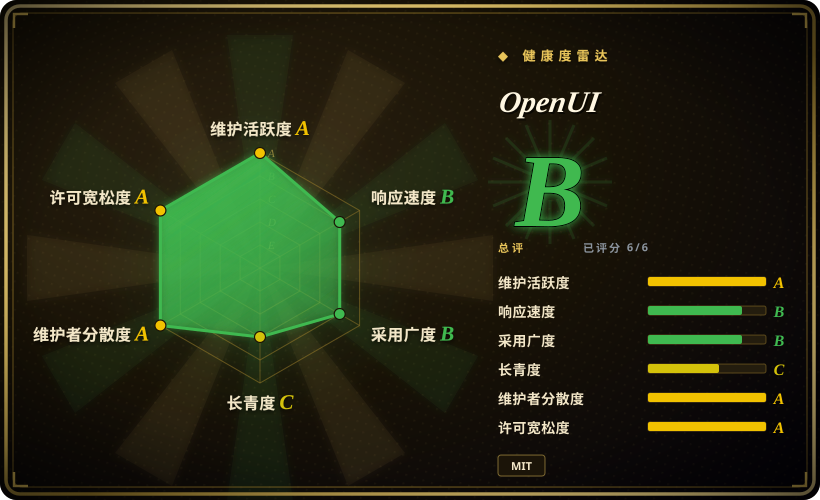
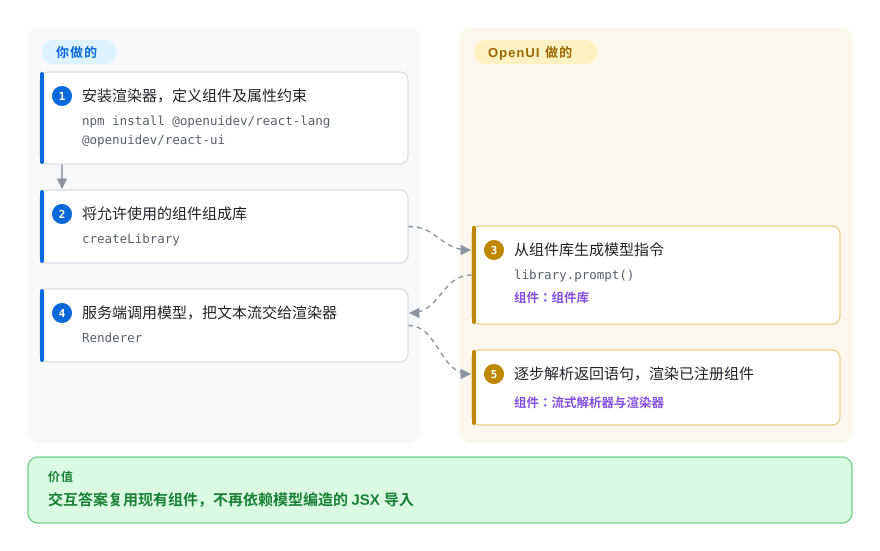
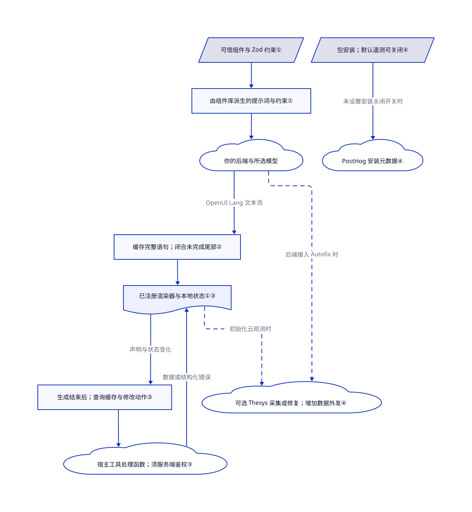

# OpenUI

聊天答案需要一张能筛选的表，模型却总编出应用里不存在的组件。OpenUI 把你注册的组件变成模型指令，再把陆续返回的紧凑调用文本渲染成界面。

本页收录 **Thesys 的 SDK**，不是无关的 `wandb/openui` HTML 生成项目。源码核实固定于 [`9d73d17`](https://github.com/thesysdev/openui/tree/9d73d17d2bbac565672a85e78f6eb7740cb0d9ca)。

## 何时使用

你维护一个 React 产品，客服答案需要嵌入现有的表格、图表或表单。模型生成的 `GlowCard` 导入无法上线，普通 Markdown 又无法提供筛选控件。你注册组件及其属性约束，从同一份组件库生成模型指令，再让 OpenUI 在应用内渲染返回的程序。

相比 [json-render](json-render.zh.md)，你愿意采用紧凑的位置参数调用语言，换取增量解析和内置响应式查询，而非坚持 JSON 界面规格。相比 [Open Intelligent UI](open-intelligent-ui.zh.md)，你更重视复用自己的组件词表，不需要模型凭空编一个交互文档。两种选择都不会替你承担模型后端和业务鉴权。

## 何时不用

- **集成协议必须保持 JSON。** 选 [json-render](json-render.zh.md) 的 JSON 组件树和补丁流。OpenUI 要求模型与集成层处理 OpenUI Lang，不是 JSX 或普通 JSON。
- **每次答案都要生成全新的 HTML 与 JavaScript 模拟器。** [Open Intelligent UI](open-intelligent-ui.zh.md) 提供沙箱文档路线。OpenUI 的注册组件路线不能凭空提供你没实现的渲染器。
- **交付物是可导出的文件，不是产品内界面。** 选桌面产物工作台 [Open Design](open-design.zh.md)。OpenUI 是嵌入式运行时，不是原型文件编辑器。
- **以为脚手架等于生产服务。** 保留现有应用后端，只接渲染器；或选更窄的 [json-render](json-render.zh.md) 渲染层。OpenUI 自托管模板的聊天路由未鉴权，也没配置持久存储；换渲染器同样不能解决这两项问题。

## 横向对比

| 替代品 | 是否收录 | 我们的评价 | 取舍 |
|---|---|---|---|
| [json-render](json-render.zh.md) | 已收录 | 模型管线和校验器已经使用 JSON，选 json-render；紧凑调用与响应式查询值得引入新输出语言，选 OpenUI。 | 两者都注册组件。OpenUI 增加语言解析器和查询生命周期；JSON 则保留熟悉的传输格式。 |
| [Open Intelligent UI](open-intelligent-ui.zh.md) | 已收录 | 答案要复用现有设计系统，选 OpenUI；计算器或模拟器需要一起生成布局与行为，选 Open Intelligent UI。 | 注册渲染器缩小生成代码面，也限制自由度；生成文档更灵活，但要管好沙箱与通信桥。 |
| [Open Design](open-design.zh.md) | 已收录 | 要导出原型、幻灯片或视频，选 Open Design；用户要在应用内操作答案，选 OpenUI。 | 桌面工作台负责产物工作流；SDK 把应用托管、数据接入和凭据管理留给你。 |

## 快速上手

在现有 React 应用安装 `npm install @openuidev/react-lang @openuidev/react-ui`，用 Zod 的 `zod/v4` 入口描述组件属性。通过 `defineComponent` 定义组件，用 `createLibrary` 组成库，再调用 `library.prompt()` 生成发给模型的系统指令。你的服务端调用模型，将文本流送回浏览器；把累计文本、组件库和流状态交给 `Renderer`。OpenUI 负责解析、组件查找和表单／查询状态；你负责可信组件实现、模型凭据与费用、存储、鉴权和工具处理函数。完整起步项目可用仓库文档中的 `npx @openuidev/cli@latest create --name genui-chat-app`；自托管模板在进程内运行 LangGraph agent，调用你提供的兼容 OpenAI 服务，不强制使用 Thesys 推理服务。若不能接受安装遥测，安装前设置 `OPENUI_TELEMETRY_DISABLED=1` 或 `DO_NOT_TRACK=1`；可选云集成还须单独审查。

<!-- flow-steps:begin (generated from flows/openui.json by tools/flow_card.py — do not edit) -->

流程文字版

1. **你**：安装渲染器，定义组件及属性约束 — `npm install @openuidev/react-lang @openuidev/react-ui`
2. **你**：将允许使用的组件组成库 — `createLibrary`
3. **OpenUI**：从组件库生成模型指令 — `library.prompt()` — 组件：`组件库`
4. **你**：服务端调用模型，把文本流交给渲染器 — `Renderer`
5. **OpenUI**：逐步解析返回语句，渲染已注册组件 — 组件：`流式解析器与渲染器`

**价值**：交互答案复用现有组件，不再依赖模型编造的 JSX 导入

<!-- flow-steps:end -->

## 技术要点

<!-- mechanism:begin (generated from mechanisms/openui.json by tools/mechanism_card.py; do not edit) -->

机制文字版

- 可信组件与 Zod 约束①
- 由组件库派生的提示词与约束①
- 你的后端与所选模型
- 缓存完整语句；闭合未完成尾部②
- 已注册渲染器与本地状态①③
- 生成结束后；查询缓存与修改动作③
- 宿主工具处理函数；须服务端鉴权③
- 包安装；默认遥测可关闭④
- PostHog 安装元数据④
- 可选 Thesys 采集或修复；增加数据外发④

- 可信组件与 Zod 约束① → 由组件库派生的提示词与约束①
- 由组件库派生的提示词与约束① → 你的后端与所选模型
- 你的后端与所选模型 → 缓存完整语句；闭合未完成尾部②（OpenUI Lang 文本流）
- 缓存完整语句；闭合未完成尾部② → 已注册渲染器与本地状态①③
- 已注册渲染器与本地状态①③ → 生成结束后；查询缓存与修改动作③（声明与状态变化）
- 生成结束后；查询缓存与修改动作③ → 宿主工具处理函数；须服务端鉴权③
- 宿主工具处理函数；须服务端鉴权③ → 已注册渲染器与本地状态①③（数据或结构化错误）
- 包安装；默认遥测可关闭④ → PostHog 安装元数据④（未设置安装关闭开关时）
- 已注册渲染器与本地状态①③ → 可选 Thesys 采集或修复；增加数据外发④（初始化云观测时）〔可选／兜底〕
- 你的后端与所选模型 → 可选 Thesys 采集或修复；增加数据外发④（后端接入 Autofix 时）〔可选／兜底〕

<!-- mechanism:end -->

### 1. 用同一组件库生成指令和渲染映射

- **解决：** 手写提示词容易与应用实际提供的组件名和属性脱节。
- **做法：** `defineComponent` 保存 Zod 4 约束和渲染器；`createLibrary` 从这些定义生成提示签名和 JSON Schema。React 渲染器从 `library.components` 查找解析后的名字，找不到就不渲染。
- **边界：** 这不是安全沙箱，也不在模型采样时限制词元。属性校验会报错、补默认值或丢弃无效节点；你注册的组件与回调仍拥有应用权限。
- **源码：** [组件库与约束生成](https://github.com/thesysdev/openui/blob/9d73d17d2bbac565672a85e78f6eb7740cb0d9ca/packages/lang-core/src/library.ts#L246-L379)、[渲染查找](https://github.com/thesysdev/openui/blob/9d73d17d2bbac565672a85e78f6eb7740cb0d9ca/packages/react-lang/src/Renderer.tsx#L147-L190)、[属性校验](https://github.com/thesysdev/openui/blob/9d73d17d2bbac565672a85e78f6eb7740cb0d9ca/packages/lang-core/src/parser/materialize.ts#L352-L423)。

### 2. 缓存完整语句，临时闭合未完成尾部

- **解决：** 用户已经在看界面，文本流却可能停在半个字符串、组件调用或引用中。
- **做法：** 流式解析器记录已完成的顶层语句，再自动闭合尾部，生成临时树。累计文本被替换时重置缓存；已有语句名遇到不完整改写时，暂留上次完整值。
- **边界：** 容错不等于正确，前向引用和不完整节点仍可能存在，React 状态钩子另行上报结束后的错误。预处理和构树仍会重访累计内容，不能把语句缓存当作每块恒定开销的证明。
- **源码：** [流式缓存与尾部处理](https://github.com/thesysdev/openui/blob/9d73d17d2bbac565672a85e78f6eb7740cb0d9ca/packages/lang-core/src/parser/parser.ts#L478-L680)、[React 消费文本流](https://github.com/thesysdev/openui/blob/9d73d17d2bbac565672a85e78f6eb7740cb0d9ca/packages/react-lang/src/hooks/useOpenUIState.ts#L90-L141)。

### 3. 把响应式读取与修改动作分开

- **解决：** 用户改筛选项时，仪表盘应直接刷新数据，不必让模型重写整条答案。
- **做法：** 查询语句携带工具名、参数和状态依赖；查询管理器据此生成缓存键，丢弃过期响应。React 钩子在生成结束后提交新的查询声明；修改操作单独注册，再经动作处理触发。
- **边界：** 函数映射或 MCP 客户端不是鉴权策略，服务端必须校验参数、租户访问和写权限。普通 `Renderer` 在失败后可能保留默认或缓存数据，应补错误／重试控件；所读渲染路径只从云脚本封装提取名字与修订元数据，不自动执行脚本。
- **源码：** [查询缓存与派发](https://github.com/thesysdev/openui/blob/9d73d17d2bbac565672a85e78f6eb7740cb0d9ca/packages/lang-core/src/runtime/queryManager.ts#L130-L307)、[生成结束闸门](https://github.com/thesysdev/openui/blob/9d73d17d2bbac565672a85e78f6eb7740cb0d9ca/packages/react-lang/src/hooks/useOpenUIState.ts#L208-L259)、[工具派发](https://github.com/thesysdev/openui/blob/9d73d17d2bbac565672a85e78f6eb7740cb0d9ca/packages/react-lang/src/Renderer.tsx#L210-L237)、[失败展示](https://github.com/thesysdev/openui/blob/9d73d17d2bbac565672a85e78f6eb7740cb0d9ca/packages/react-lang/README.md#L21-L50)、[云脚本封装提取](https://github.com/thesysdev/openui/blob/9d73d17d2bbac565672a85e78f6eb7740cb0d9ca/packages/react-lang/src/responseBundle.ts#L41-L125)。

### 4. 分清本地渲染与可选云数据路径

- **解决：** 自托管渲染器仍可能通过安装钩子或另行启用的云功能向外发送数据。
- **做法：** Lang Core 的安装后脚本默认发送假名化安装元数据，可关闭；解析器运行时遥测则须主动启用。独立云观测包需要初始化，默认完整采集，包含生成的响应文本；服务端 Autofix 会向 API 提交无效生成结果、组件库指令和调用方提供的修复上下文。
- **边界：** 安装遥测的关闭开关不是所有云功能的总开关。观测初始化、Autofix、历史存储以及模型／工具目的地要分别审查；最小采集会去掉响应和自由文本错误消息，但仍保留部分标识符。MIT 运行时不包含托管 Gateway 服务端。
- **源码：** [安装载荷与关闭判断](https://github.com/thesysdev/openui/blob/9d73d17d2bbac565672a85e78f6eb7740cb0d9ca/packages/lang-core/src/telemetry/install.ts#L129-L177)、[运行时主动启用](https://github.com/thesysdev/openui/blob/9d73d17d2bbac565672a85e78f6eb7740cb0d9ca/packages/lang-core/src/telemetry/shared.ts#L24-L31)、[云端默认值](https://github.com/thesysdev/openui/blob/9d73d17d2bbac565672a85e78f6eb7740cb0d9ca/packages/observability-cloud/src/index.ts#L6-L86)、[采集字段](https://github.com/thesysdev/openui/blob/9d73d17d2bbac565672a85e78f6eb7740cb0d9ca/packages/observability-cloud/src/events/stream.ts#L88-L165)、[Autofix 请求](https://github.com/thesysdev/openui/blob/9d73d17d2bbac565672a85e78f6eb7740cb0d9ca/packages/server/src/shared/fix.ts#L19-L47)。

## 技术栈

- TypeScript pnpm 单仓；与框架无关的 `@openuidev/lang-core` 负责解析、约束和求值。`react-lang` 包装核心；`react-headless` 提供聊天状态与适配器；`react-ui` 提供聊天界面和组件库。
- 仓库另有 Vue、Svelte、Angular、A2UI 和邮件包；本次沿 React 集成核实。固定版本的 React manifest 使用通配 peer，README 却写 React 19+；不能据此声称已验证支持 React 18。
- 组件约束必须使用 `zod/v4` 的 Zod 4 API 对象，尽管工作区接受 Zod 3.25 或 4 包版本。自托管模板另用 Next.js 和 LangChain／LangGraph。

## 依赖

- 嵌入式使用需要宿主应用、所选界面框架和 Zod，不要求独立的 OpenUI 数据库或模型服务。
- 模型连接和工具端点由你运营。自托管模板读取 `OPENAI_MODEL`、`OPENAI_BASE_URL` 与提供方凭据；聊天路由把进程内图的结果流式返回，不在服务端存储。
- 可选的 `@openuidev/server` 云修复／历史工具和 `@openuidev/observability-cloud` 会增加 Thesys 凭据与网络目的地。渲染器安装也会带入 Lang Core 安装后脚本，需要时应提前关闭遥测。

## 运维难度

**嵌入功能为中等；公开聊天服务更高。** 组件约束维护、流处理和错误展示属于应用开发，不需另部署渲染服务。[起步模板路由](https://github.com/thesysdev/openui/blob/9d73d17d2bbac565672a85e78f6eb7740cb0d9ca/templates/openui-self-hosted/src/app/api/chat/route.ts#L12-L28) 直接转发请求消息，没有鉴权或限流检查。对外开放前须补这些控制、持久存储和服务端工具授权。数据外发取决于模型请求与可选云采集；自己托管 Next.js 应用并不能确定这条边界。

## 健康度与可持续性

- **核实于 2026-10-26：** 默认分支 SHA 仍与所读快照一致，对应提交日期为 10 月 23 日。缓存发布证据记录 `react-lang` 1.0.1 发布于 10 月 15 日，不把它冒充今日重新观察的发布事实。各包版本线不同。
- 仓库创建于 2024 年 12 月 2 日，约 23 个月。这是仓库年龄，不证明今天的 SDK API 存在了同样久；不能借同名旧项目的历史增加长寿先验。
- 仓库由 Thesys 持有，包 manifest 标注其工程团队。`CONTRIBUTING.md` 要求 PR 前先获 issue 批准，`SECURITY.md` 要求走 GitHub 私密安全通报。这是厂商主导，不是基金会治理。
- 今日自动雷达覆盖全部六轴。采用信号来自注册表下载量，但公开依赖仓库计数为零；这组差异不能证明生产部署份额。活跃贡献者也不等于路线图由独立各方控制。
- 根代码为 MIT，署名 Thesys Inc.；文档素材保留 LobeHub 的 MIT 声明及 Inter 的 SIL OFL。托管 Gateway、修复与观测是独立服务依赖，不能据此声称仓库含有其服务端实现。

## 存疑（未验证）

- [未验证：本任务禁止安装、运行上游及使用浏览器] 未实测生成质量、渲染无障碍、提供方费用和框架兼容性；用法仅由源码与示例核实。
- [未验证：未复跑上游基准] README 的词元节省比例不能证明你的组件库与模型同样节省延迟或费用；本页不作数字性能承诺。
- [未验证：固定 SHA 的 React manifest 与 README 不一致，且未运行兼容矩阵] React peer 通配声明无法确定旧版 React 支持范围。
- [推断：依据是注册组件映射、后端转发与可选云调用源码，而非渗透测试] 注册组件路线缩小任意生成界面代码的范围；宿主组件、工具和另行集成的云脚本处理器仍是独立信任决策。
