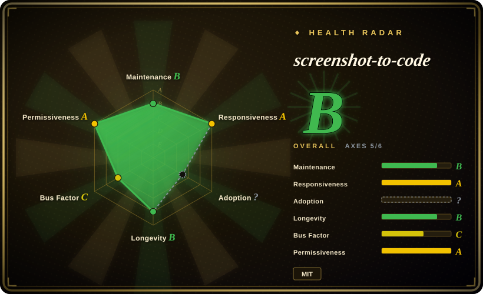
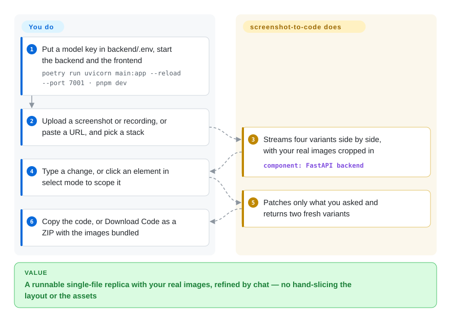
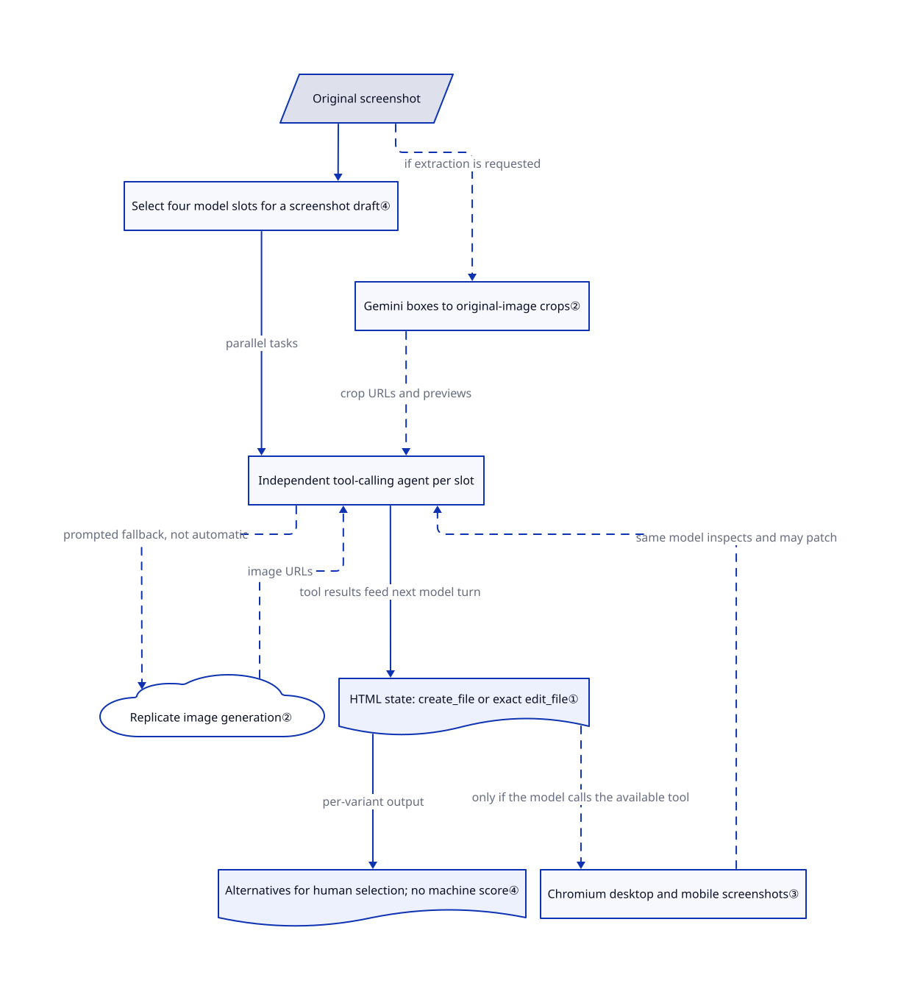

# screenshot-to-code

You have a screenshot or a Figma frame and need it as front-end code, and slicing out every image and guessing every margin by hand eats an afternoon. screenshot-to-code has a vision model rebuild the screen as one HTML file, crops your real images out of the screenshot, and renders its own page to check it against the original.

## When to use

You are a front-end developer or a founder prototyping alone. Someone hands you a PNG of a landing page — a competitor's pricing page, a designer's mockup, an old site with no source — and asks for "this, but working" by tomorrow. Doing it by hand means cropping the logo out in an image editor, eyeballing that the card gap is 24px not 20px, and retyping every line of copy. Asking a general chat model gives you a page with the right idea and placeholder `https://via.placeholder.com/150` boxes where the real images were.

Reach for screenshot-to-code when the input is pixels and the goal is a close visual replica, fast. Its difference from a plain "paste the image into a chat model" is three things a chat cannot do on its own: it crops the original images out of your screenshot instead of inventing them, it renders what it wrote in a real browser and looks at the result before handing it over, and it runs four model variants at once so you pick the best one instead of re-rolling. Pick it over [Open Design](open-design.md) when you are *copying an existing screen* rather than designing a new one from a brief, and over the hosted v0 when you want to self-host with your own model keys and keep the generated files.

## When NOT to use

- **The code has to drop into your existing codebase.** Output is one self-contained file that pulls Tailwind from `cdn.tailwindcss.com` and, for React, React UMD builds plus in-browser Babel — no components, no build step, no design tokens. Use [json-render](json-render.md) instead when a model must assemble UI from your own component catalog, or run a coding agent inside your repo with [Playwright MCP](../web-automation/playwright-family/playwright-mcp.md) for the screenshot check, because both write into your real structure rather than a throwaway prototype.
- **You need measurable, pixel-level fidelity.** There is no similarity metric and no "stop when close enough" rule (see Q&A). Build the loop yourself with [Playwright](../web-automation/playwright-family/playwright.md) screenshot comparison as the scorer instead of screenshot-to-code, because a numeric diff catches the spacing and font errors a model's eye passes.
- **You need the behaviour, not the look.** It sees pixels only: data, auth, routing and state behind the screen are not in the input. Video mode infers interactions from a recording and runs only two variants. Use a coding agent with [Playwright MCP](../web-automation/playwright-family/playwright-mcp.md) against the live site instead, because it can inspect the real DOM and network rather than guess from frames.
- **You are designing something new, not copying a screen.** The prompt is built around "looks exactly like the provided screenshot(s)". Use [Open Design](open-design.md) instead, because it drives your coding agent from a brief plus a `DESIGN.md` design system and also outputs decks, images and video.
- **You cannot pay for frontier-model APIs or want local models.** At least one OpenAI, Anthropic or Gemini key is required; Gemini and Replicate are "strongly recommended" for asset extraction and image editing; each variant may spend up to $3 before it is aborted, and four run per screenshot. The README calls the Ollama route "not recommended due to poor-quality results". Use [Open Design](open-design.md) with a BYOK OpenAI-compatible endpoint instead if the model must be yours, accepting it is not a replica tool.
- **You want zero ops.** The author's hosted product (screenshottocode.com, on a separate closed backend) or Vercel's v0 run it for you — both are not repos.

## Comparison

| Alternative | In index | Our verdict | Tradeoff |
|---|---|---|---|
| [Open Design](open-design.md) | ✅ | Pick Open Design when you are generating a new prototype, deck or video from a brief and a design system; pick screenshot-to-code when the job is to copy an existing screen from its pixels. | Open Design spans many artifact types and reuses your installed coding agent; screenshot-to-code is narrow but has the replica-specific pieces (asset cropping from the screenshot, four parallel variants, self-render check). |
| [Playwright MCP](../web-automation/playwright-family/playwright-mcp.md) + your coding agent | ✅ | Pick a coding agent with Playwright MCP when the result must live in your repo and you want to own the loop; pick screenshot-to-code when you want the replica pipeline ready-made in a web UI. | DIY gives you real components and the option of a numeric diff, but you assemble asset cropping and variants yourself; screenshot-to-code ships those but outputs a CDN single file. |
| [json-render](json-render.md) | ✅ | Pick json-render when a model must compose UI from your existing component catalog inside your app; pick screenshot-to-code when you need a standalone replica of a screen you were handed. | json-render keeps the model inside your design system and cannot invent markup; screenshot-to-code invents freely to match pixels and knows nothing about your components. |
| v0 (Vercel) | not a repo | Pick v0 when you want a hosted, React/shadcn-flavoured generator with deployment built in and do not need to self-host; pick screenshot-to-code to run it yourself with your own keys. | v0 is a closed hosted service tied to Vercel's stack and pricing; screenshot-to-code is MIT and self-hostable but you run two processes and pay the model bills. |
| Builder.io Visual Copilot | not a repo | Pick Visual Copilot when the source is a Figma file and you want framework-specific components mapped to your code; pick screenshot-to-code when all you have is a screenshot. | Closed commercial Figma plugin that reads design structure, not pixels; screenshot-to-code works from any image but loses layer and token information. |

## Q&A

**How does it guarantee a perfect replica?**
It does not. As of commit `a813977` (2026-10-09) there is no pixel diff, SSIM or other similarity score anywhere in the backend. Fidelity comes from four layers stacked: the prompt says to copy text verbatim; images are cropped from the original, not generated; the model renders its page and compares it to the screenshot by eye; and four variants run in parallel so a human picks the closest.

**So it is a vision-based closed loop?**
Yes, but a weak one. The judge is the same model that wrote the code, comparing two images by eye, so a 4px spacing error or a wrong font weight it cannot see stays. The loop stops when the model stops calling tools, at 30 steps, or past $3 spent on that variant — never "when similarity reaches X". The self-check is an instruction in the prompt, not enforced by code, and the tool is not offered at all if Chromium is not installed. A strong loop would add a machine scorer — align the two images, compute a perceptual diff, feed a heatmap of the worst regions back, stop at a threshold. This repo does not have one.

## Quick start

You run it as a local web app: put at least one model key in `backend/.env` (or in the settings dialog), start the FastAPI backend and the Vite frontend — or `docker-compose up -d --build` — and open `http://localhost:5173`. Input comes four ways: upload one or more screenshots or a screen recording; paste a URL, which is screenshotted through a ScreenshotOne key you supply (a paid screenshot API; Figma links are refused — export the frame as an image instead); describe the page in text; or import existing HTML to keep editing it. You pick an output stack, the app decides which models to run from the keys you have, and four variants — alternative versions of the page — stream in side by side. From there it works like a chat: type a change, or switch to select mode and click an element so the edit touches only that element; each round returns two fresh variants. When one is right, copy the code, open it in a new tab, or Download Code — a ZIP that bundles the cropped images, which otherwise live on your backend. What it does for you: the first draft, the image crops, the variants and the targeted patches. What stays yours: the keys and their bill, choosing the variant, and porting a single CDN-loaded file into your real project. How it gets close to the screenshot internally is in Key techniques.

<!-- flow-steps:begin (generated from flows/screenshot-to-code.json by tools/flow_card.py — do not edit) -->

Text version of the flow

1. **You**: Put a model key in backend/.env, start the backend and the frontend — `poetry run uvicorn main:app --reload --port 7001 · pnpm dev`
2. **You**: Upload a screenshot or recording, or paste a URL, and pick a stack
3. **screenshot-to-code**: Streams four variants side by side, with your real images cropped in — component: `FastAPI backend`
4. **You**: Type a change, or click an element in select mode to scope it
5. **screenshot-to-code**: Patches only what you asked and returns two fresh variants
6. **You**: Copy the code, or Download Code as a ZIP with the images bundled

**Value**: A runnable single-file replica with your real images, refined by chat — no hand-slicing the layout or the assets

<!-- flow-steps:end -->

## Key techniques

<!-- mechanism:begin (generated from mechanisms/screenshot-to-code.json by tools/mechanism_card.py; do not edit) -->

Text version of the mechanism

- Original screenshot
- Select four model slots for a screenshot draft④
- Independent tool-calling agent per slot
- Gemini boxes to original-image crops②
- Replicate image generation②
- HTML state: create_file or exact edit_file①
- Chromium desktop and mobile screenshots③
- Alternatives for human selection; no machine score④

- Original screenshot → Select four model slots for a screenshot draft④
- Select four model slots for a screenshot draft④ → Independent tool-calling agent per slot (parallel tasks)
- Original screenshot → Gemini boxes to original-image crops② (if extraction is requested) [optional/fallback]
- Gemini boxes to original-image crops② → Independent tool-calling agent per slot (crop URLs and previews) [optional/fallback]
- Independent tool-calling agent per slot → Replicate image generation② (prompted fallback, not automatic) [optional/fallback]
- Replicate image generation② → Independent tool-calling agent per slot (image URLs) [optional/fallback]
- Independent tool-calling agent per slot → HTML state: create_file or exact edit_file① (tool results feed next model turn)
- HTML state: create_file or exact edit_file① → Chromium desktop and mobile screenshots③ (only if the model calls the available tool) [optional/fallback]
- Chromium desktop and mobile screenshots③ → Independent tool-calling agent per slot (same model inspects and may patch) [optional/fallback]
- HTML state: create_file or exact edit_file① → Alternatives for human selection; no machine score④ (per-variant output)

<!-- mechanism:end -->

### 1. Patch the page through tools instead of regenerating it

- **Problem:** Rewriting an entire page to fix one gap can disturb parts that already match.
- **How:** The prompt asks for one `create_file` call with the full HTML, then `edit_file` calls that replace exact old text; an unmatched edit returns an error to the model. The agent executes tool calls and feeds their results into the next model turn.
- **Limits:** Exact matching constrains a patch, not its correctness or size; the runtime does not prevent another `create_file` call, so “write once” is an instruction, not a guarantee.
- **Source:** [Tool instructions:15–19](https://github.com/abi/screenshot-to-code/blob/a8139779f7c5ae231b7f2a86fa7f83ddc5f7badc/backend/prompts/system_prompt.py#L15-L19), [file creation and replacement:101–257](https://github.com/abi/screenshot-to-code/blob/a8139779f7c5ae231b7f2a86fa7f83ddc5f7badc/backend/agent/tools/runtime.py#L101-L257), [tool-result loop:278–325](https://github.com/abi/screenshot-to-code/blob/a8139779f7c5ae231b7f2a86fa7f83ddc5f7badc/backend/agent/engine.py#L278-L325).

### 2. Crop original assets before asking for substitutes

- **Problem:** Invented logos or photos make an otherwise close replica look wrong.
- **How:** Gemini locates a requested asset with four rectangle coordinates on a 0–1000 scale; the backend converts these to pixels and crops the original image. For obscured photos or backgrounds that cannot be isolated, the prompt asks the agent to generate a substitute through Replicate.
- **Limits:** This is a model-chosen tool path, not an automatic crop-failure fallback; extraction needs Gemini and a usable still image, while generation must be enabled and have a Replicate key.
- **Source:** [Asset instructions:21–25](https://github.com/abi/screenshot-to-code/blob/a8139779f7c5ae231b7f2a86fa7f83ddc5f7badc/backend/prompts/system_prompt.py#L21-L25), [box-to-pixel crop:293–343](https://github.com/abi/screenshot-to-code/blob/a8139779f7c5ae231b7f2a86fa7f83ddc5f7badc/backend/asset_extraction.py#L293-L343), [Replicate generation:259–294](https://github.com/abi/screenshot-to-code/blob/a8139779f7c5ae231b7f2a86fa7f83ddc5f7badc/backend/agent/tools/runtime.py#L259-L294), [extraction availability:336–351](https://github.com/abi/screenshot-to-code/blob/a8139779f7c5ae231b7f2a86fa7f83ddc5f7badc/backend/agent/engine.py#L336-L351).

### 3. Return browser renders to the same model for a visual check

- **Problem:** HTML that reads plausibly can still have broken layout or wrong spacing when rendered.
- **How:** If the model calls `screenshot_preview`, headless Chromium — a real browser without a window — renders the current HTML at desktop and mobile widths. Both full-page images return to the same model, which is instructed to inspect them and patch visible errors.
- **Limits:** The preview tool is omitted when Chromium is unavailable, and the loop does not enforce its use or compute a similarity score; stopping follows model completion, 30 turns or the priced-model budget, not a quality threshold.
- **Source:** [Preview result:10–99](https://github.com/abi/screenshot-to-code/blob/a8139779f7c5ae231b7f2a86fa7f83ddc5f7badc/backend/agent/tools/screenshot_preview.py#L10-L99), [Chromium rendering:30–88](https://github.com/abi/screenshot-to-code/blob/a8139779f7c5ae231b7f2a86fa7f83ddc5f7badc/backend/preview_screenshot/playwright_backend.py#L30-L88), [tool availability:25–39](https://github.com/abi/screenshot-to-code/blob/a8139779f7c5ae231b7f2a86fa7f83ddc5f7badc/backend/agent/providers/factory.py#L25-L39), [preview instruction:19](https://github.com/abi/screenshot-to-code/blob/a8139779f7c5ae231b7f2a86fa7f83ddc5f7badc/backend/prompts/system_prompt.py#L19-L19), [loop stopping:218–276](https://github.com/abi/screenshot-to-code/blob/a8139779f7c5ae231b7f2a86fa7f83ddc5f7badc/backend/agent/engine.py#L218-L276).

### 4. Run independent variants instead of trusting one draft

- **Problem:** One model's visual blind spots can survive its own self-check.
- **How:** Screenshot creation selects four model slots from providers for which keys are present, then starts a separate agent task per slot concurrently. The user chooses among the resulting alternatives rather than a machine score choosing a winner.
- **Limits:** Slots can repeat a model when fewer are configured; edits and video use two variants, not four. More alternatives do not establish pixel-level fidelity.
- **Source:** [Four-slot default:3–4](https://github.com/abi/screenshot-to-code/blob/a8139779f7c5ae231b7f2a86fa7f83ddc5f7badc/backend/config.py#L3-L4), [selection and mode limits:417–499](https://github.com/abi/screenshot-to-code/blob/a8139779f7c5ae231b7f2a86fa7f83ddc5f7badc/backend/routes/generate_code.py#L417-L499), [parallel tasks:589–611](https://github.com/abi/screenshot-to-code/blob/a8139779f7c5ae231b7f2a86fa7f83ddc5f7badc/backend/routes/generate_code.py#L589-L611).

## Tech stack

- **Backend:** Python ≥ 3.10, FastAPI + uvicorn, generation streamed over a WebSocket; Poetry. Provider SDKs `openai` 2.16.0, `anthropic` ^0.84, `google-genai`; `playwright` for the preview tool; Pillow + `pillow-heif` for cropping; `moviepy` for video input; BeautifulSoup for the ZIP export.
- **Agent loop:** a provider-neutral tool loop (`backend/agent/engine.py`) with tools `create_file`, `edit_file`, `extract_assets`, `generate_images`, `edit_images`, `remove_backgrounds`, `screenshot_preview`, `save_assets`, `retrieve_option`.
- **Frontend:** React + Vite + TypeScript, Tailwind, Radix UI, CodeMirror editor; pnpm.
- **Output stacks:** HTML + Tailwind, HTML + CSS, React + Tailwind, Vue + Tailwind, Bootstrap, Ionic + Tailwind — all as one CDN-loaded file.

## Dependencies

- **At least one model key:** `OPENAI_API_KEY`, `ANTHROPIC_API_KEY` or `GEMINI_API_KEY` (in `backend/.env` or the settings dialog). Gemini is needed for asset extraction and for video mode.
- **Optional `REPLICATE_API_KEY`** (only via `backend/.env`) for image generation, editing and background removal.
- **Chromium** via `poetry run playwright install chromium` for the self-check; without it the tool is silently left out.
- **Node + pnpm** for the frontend, or Docker Compose for both services.
- Cropped assets are stored in `backend/local_assets` and served from the backend at `/local-assets`; the in-app preview depends on the backend running, and the ZIP export bundles them.

## Ops difficulty

**Low to medium.** Two processes (FastAPI on 7001, Vite on 5173) or one `docker-compose up -d --build`, plus API keys and a Chromium install. The real ongoing cost is the model bill: up to four variants per screenshot, each capped at $3 (`GENERATION_MAX_COST_USD`), and unpriced models are not capped. Nothing in the setup adds authentication, so keep the backend on localhost.

## Health & viability

- **Maintenance:** Grade B — last commit 3 days before 2026-10-13, but only 3 of the last 13 weeks active on the default branch; no tagged releases ever, so you track `main`. Work arrives in bursts, partly through agent-authored branches.
- **Responsiveness:** Grade A — median time-to-first-response 4.4h on 3 qualifying issues (relaxed_solo band).
- **Adoption:** Cannot be scored (`?`, no package to count dependents of). Non-registry signals are large: ~80.3k stars and ~9.8k forks as of 2026-10-13.
- **Longevity:** Grade B — created 2023-11-14, 1063 days (about 2.9 years) old and still active. On this index's age × still-active prior that is a reasonable bet for a tool whose value moves with the models it calls.
- **Governance:** Grade C — effectively one maintainer: Abi Raja holds 99.8% of commits (`stats_contributors`), 2 active maintainers in 12 months. The roadmap follows the author's hosted product (`hosted` branch, separate closed SaaS backend, paywall experiment branches), so the open repo's direction is set by a commercial service it feeds.
- **Risk / License:** Grade A — MIT (copyright 2023 Abi Raja), no relicense in 36 months. The practical risk is not the license but model churn: default model lists and prompts are rewritten as providers ship, so pinned behaviour does not exist.

## Caveats (unverified)

- [未验证] Output quality: the README's "best models" ranking and the demo replicas are the author's; the repo's own evaluation is 16 screenshots rated 1–4 by a human, and the dataset download link in `Evaluation.md` still reads "TODO", so it cannot be reproduced.
- [推断] Whether the `screenshot_preview` self-check measurably improves fidelity is not published; the only evidence is the prompt instruction and the tool's existence.
- [未验证] That the backend has no authentication of its own was inferred from the setup docs and `docker-compose.yml` binding `0.0.0.0`; the routes were not audited.
- [未验证] Video mode quality and the "functional prototype" claim for screen recordings were not run.
- [未验证] The v0 and Builder.io Visual Copilot descriptions in Comparison come from their public product positioning, not from a hands-on run on 2026-10-13.
