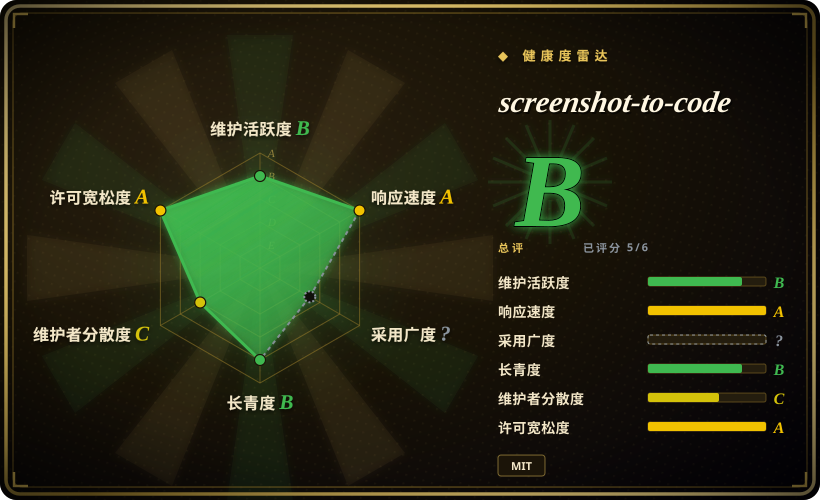
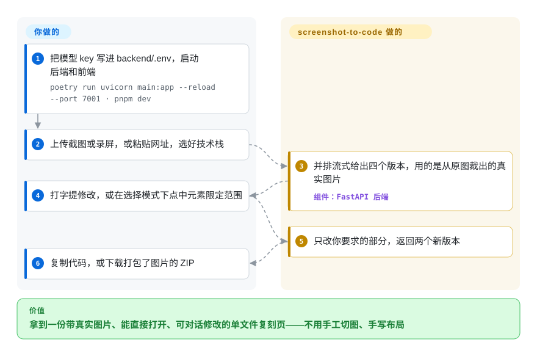

# screenshot-to-code

手里只有一张截图或一帧 Figma 设计稿，要把它变成前端代码，光是抠图、估间距就要耗掉一个下午。screenshot-to-code 让视觉模型把这一屏重写成一个 HTML 文件，从截图里把真实图片裁出来用，再自己渲染一遍和原图对照。

## 何时使用

你是前端开发，或者一个人做原型的创业者。有人丢给你一张落地页的 PNG——竞品的定价页、设计师的稿子、一个找不到源码的老网站——说明天要一个“能跑的这个”。手工做，就得在修图软件里把 logo 抠出来，用眼睛判断卡片间距是 24px 还是 20px，再把每行文案重新敲一遍。直接丢给通用聊天模型，你会拿到一个意思差不多的页面，原本放图的地方全是 `https://via.placeholder.com/150` 占位框。

输入是像素、目标是尽快做出一个视觉上接近的复刻时，就该想到 screenshot-to-code。它和“把图贴进聊天框”的区别，是三件聊天框自己做不到的事：图片从你的截图里裁，不靠模型编；写完先在真浏览器里渲染、看一眼结果再交给你；一次并行跑四个模型版本，你挑最好的，不用反复重抽。要“照抄一个现成页面”而不是“按简报设计新页面”，选它而不是 [Open Design](open-design.zh.md)；想用自己的模型 key 自建部署、产物文件留在手里，选它而不是托管的 v0。

## 何时不用

- **代码要直接放进现有代码库。** 产出是一个自包含文件，Tailwind 从 `cdn.tailwindcss.com` 加载；选 React 时用 React UMD 包加浏览器内 Babel 编译——没有组件、没有构建步骤、没有设计 token。要让模型用你自己的组件目录拼界面，选 [json-render](json-render.zh.md)；或者在你的仓库里跑编码 agent，配 [Playwright MCP](../web-automation/playwright-family/playwright-mcp.zh.md) 做截图检查。这两条路都写进你真实的工程结构，而不是一次性原型。
- **需要可度量的像素级还原。** 没有相似度指标，也没有“够像就停”的规则（见快问快答）。改用 [Playwright](../web-automation/playwright-family/playwright.zh.md) 的截图比对当打分器，自己搭这个循环，因为数值差异能抓到模型目测放过的间距和字体错误。
- **要的是行为，不是外观。** 它只看得到像素，页面背后的数据、登录、路由、状态都不在输入里。录屏模式靠视频帧推测交互，而且只跑两个版本。改用编码 agent 配 [Playwright MCP](../web-automation/playwright-family/playwright-mcp.zh.md) 直接访问线上站点，因为它能看真实 DOM 和网络请求，不用从画面里猜。
- **你在设计新东西，不是照抄一个页面。** 它的提示词围绕“和提供的截图看起来完全一样”写成。改用 [Open Design](open-design.zh.md)，它按简报加一份 `DESIGN.md` 设计系统驱动你的编码 agent，还能出 deck、图片和视频。
- **付不起前沿模型 API，或者必须用本地模型。** 至少要一个 OpenAI、Anthropic 或 Gemini 的 key；素材裁剪和图片编辑“强烈推荐”再配 Gemini 和 Replicate；每个版本最多花 3 美元才会被中止，一张截图跑四个。README 说走 Ollama 的路线“因效果差不推荐”。如果模型必须是你自己的，改用 [Open Design](open-design.zh.md) 接一个兼容 OpenAI 接口的自带端点，但要接受它不是复刻工具。
- **一点运维都不想做。** 作者的托管产品（screenshottocode.com，后端是另一个闭源仓库）或 Vercel 的 v0 会替你跑——两者都不是仓库。

## 横向对比

| 替代品 | 是否收录 | 我们的评价 | 取舍 |
|---|---|---|---|
| [Open Design](open-design.zh.md) | ✅ | 按简报和设计系统生成新原型、deck 或视频，选 Open Design；任务是照着像素复刻一个现成页面，选 screenshot-to-code。 | Open Design 覆盖多种产物、复用你已装的编码 agent；screenshot-to-code 面窄，但有复刻专用的部件：从截图裁素材、四版本并行、自渲染检查。 |
| [Playwright MCP](../web-automation/playwright-family/playwright-mcp.zh.md) + 你的编码 agent | ✅ | 结果必须进你的仓库、想自己掌控循环，选编码 agent 配 Playwright MCP；想要一个现成的网页版复刻流水线，选 screenshot-to-code。 | 自己搭能产出真实组件、还能加数值比对，但素材裁剪和多版本得自己拼；screenshot-to-code 这些都现成，代价是只产 CDN 单文件。 |
| [json-render](json-render.zh.md) | ✅ | 要模型在你的应用里用现有组件目录拼界面，选 json-render；要把别人给的一屏单独复刻出来，选 screenshot-to-code。 | json-render 把模型关在你的设计系统里，不能自造标记；screenshot-to-code 为贴合像素随意造标记，对你的组件一无所知。 |
| v0（Vercel） | 非仓库 | 想要托管的、偏 React/shadcn 的生成器且自带部署、不需要自建，选 v0；想用自己的 key 自己跑，选 screenshot-to-code。 | v0 是闭源托管服务，绑定 Vercel 的技术栈和定价；screenshot-to-code 是 MIT、可自建，但要自己跑两个进程、自己付模型账单。 |
| Builder.io Visual Copilot | 非仓库 | 源头是 Figma 文件、要映射到你代码里的框架组件，选 Visual Copilot；手里只有一张截图，选 screenshot-to-code。 | 闭源商业 Figma 插件，读的是设计结构而不是像素；screenshot-to-code 任何图片都能用，但拿不到图层和 token 信息。 |

## 快问快答

**它怎么保证完美复刻？**
保证不了。截至提交 `a813977`（2026-10-09），后端里没有任何像素差、SSIM 或其他相似度打分。还原度靠四层叠加：提示词要求文字逐字照抄；图片从原图裁，不生成；模型渲染自己的页面，用眼睛和截图对比；四个版本并行，由人挑最像的。

**那实际上就是基于视觉的闭环？**
是，但是个弱闭环。判官是写代码的同一个模型，靠目测比两张图，它看不出的 4px 间距误差、字重偏差就会留下来。循环在三种情况下停：模型不再调用工具、跑满 30 步、这个版本花费超过 3 美元——从来不是“相似度达到某个值”。自检只是提示词里的一句要求，代码不强制；没装 Chromium 时，这个工具根本不会提供给模型。强闭环还要加一个机器打分层：把两张图对齐、算感知差异、把差得最多的区域画成热力图回传、达到阈值才停。这个仓库没有。

## 快速上手

它作为一个本地网页应用来用：在 `backend/.env`（或设置对话框）里填至少一个模型 key，启动 FastAPI 后端和 Vite 前端——或者一条 `docker-compose up -d --build`——然后打开 `http://localhost:5173`。输入有四种：上传一张或多张截图，或一段录屏；粘贴网址，由你提供的 ScreenshotOne key（一个付费截图 API）去截图，Figma 链接会被拒绝，要先把画板导出成图片；用文字描述页面；或者导入现有 HTML 接着改。你选输出技术栈，应用按你手里有哪些 key 决定跑哪些模型，四个版本（同一页面的不同方案）并排流式出来。之后就像聊天：直接打字提修改，或者切到选择模式点中某个元素，让修改只作用于它；每轮修改返回两个新版本。满意了就复制代码、在新标签页打开，或者点 Download Code 下载 ZIP——裁出的图片平时存在你的后端上，ZIP 会把它们一起打包。它替你做的：初稿、裁图、多个版本和定点修补。留给你的：模型 key 和账单、挑版本，以及把这个靠 CDN 加载的单文件移植进你的真实项目。它内部怎么逼近截图，见技术要点。

<!-- flow-steps:begin (generated from flows/screenshot-to-code.json by tools/flow_card.py — do not edit) -->

流程文字版

1. **你**：把模型 key 写进 backend/.env，启动后端和前端 — `poetry run uvicorn main:app --reload --port 7001 · pnpm dev`
2. **你**：上传截图或录屏，或粘贴网址，选好技术栈
3. **screenshot-to-code**：并排流式给出四个版本，用的是从原图裁出的真实图片 — 组件：`FastAPI 后端`
4. **你**：打字提修改，或在选择模式下点中元素限定范围
5. **screenshot-to-code**：只改你要求的部分，返回两个新版本
6. **你**：复制代码，或下载打包了图片的 ZIP

**价值**：拿到一份带真实图片、能直接打开、可对话修改的单文件复刻页——不用手工切图、手写布局

<!-- flow-steps:end -->

## 技术要点

四层叠加。（1）它是带工具的 agent，不是一条提示词：模型用 `create_file` 一次写出整页，之后只能用精确字符串替换（`edit_file`）改，所以后面的修补不会顺手把已经对的部分重写掉。（2）真实图片从你的截图里来：Gemini 给每个 logo 或照片返回一个定位框——标出矩形位置的四个数，按 0–1000 缩放——后端按框从原图裁出；只有裁不出来的（被遮挡的照片、背景图）才通过 Replicate 生成。（3）自检：`screenshot_preview` 用无头 Chromium（没有窗口的真浏览器）按桌面和手机两种宽度渲染整页，把两张图回传给模型，看到哪里不对就修哪里。（4）不同厂商的四个版本并行生成，由你挑。好比一个仿写信件的人，邮票直接从原信上描下来，写完把两封信并排放在灯下比——但只用眼睛，不用尺子。

## 技术栈

- **后端：** Python ≥ 3.10，FastAPI + uvicorn，生成过程走 WebSocket 流式推送；Poetry 管依赖。模型 SDK 为 `openai` 2.16.0、`anthropic` ^0.84、`google-genai`；预览工具用 `playwright`；裁图用 Pillow + `pillow-heif`；视频输入用 `moviepy`；ZIP 导出用 BeautifulSoup。
- **agent 循环：** 一个与模型厂商无关的工具循环（`backend/agent/engine.py`），工具有 `create_file`、`edit_file`、`extract_assets`、`generate_images`、`edit_images`、`remove_backgrounds`、`screenshot_preview`、`save_assets`、`retrieve_option`。
- **前端：** React + Vite + TypeScript，Tailwind，Radix UI，CodeMirror 编辑器；pnpm。
- **产出技术栈：** HTML + Tailwind、HTML + CSS、React + Tailwind、Vue + Tailwind、Bootstrap、Ionic + Tailwind——都是靠 CDN 加载的单文件。

## 依赖

- **至少一个模型 key：** `OPENAI_API_KEY`、`ANTHROPIC_API_KEY` 或 `GEMINI_API_KEY`（写在 `backend/.env` 或设置对话框里）。素材裁剪和录屏模式需要 Gemini。
- **可选 `REPLICATE_API_KEY`**（只能写在 `backend/.env`），用于生成图片、编辑图片和去背景。
- **Chromium**：通过 `poetry run playwright install chromium` 安装，自检要用它；没装时这个工具会被悄悄去掉。
- **Node + pnpm** 跑前端，或者用 Docker Compose 一起跑两个服务。
- 裁出的素材存在 `backend/local_assets`，由后端在 `/local-assets` 下提供；应用内预览依赖后端在跑，ZIP 导出会把它们打包进去。

## 运维难度

**低到中。** 两个进程（FastAPI 在 7001，Vite 在 5173）或一条 `docker-compose up -d --build`，再加 API key 和一次 Chromium 安装。真正持续的成本是模型账单：每张截图最多四个版本，每个版本上限 3 美元（`GENERATION_MAX_COST_USD`），没有定价信息的模型不受这个上限约束。安装步骤里没有任何鉴权，后端只放在本机访问。

## 健康度与可持续性

- **维护：** B 级——2026-10-13 前 3 天还有提交，但最近 13 周里默认分支只有 3 周活跃；从未打过版本标签，只能跟 `main`。提交成批到来，部分来自 agent 写的分支。
- **响应：** A 级——3 个符合条件的 issue，首次响应中位数 4.4 小时（relaxed_solo 档）。
- **采用度：** 无法打分（`?`，没有可统计依赖方的包）。非注册表信号很大：截至 2026-10-13 约 8.03 万星、9.8 千 fork。
- **长寿度：** B 级——2023-11-14 建仓，1063 天（约 2.9 年）且仍活跃。按本索引“年龄 × 仍活跃”的先验，对一个价值随所调用模型变化的工具来说，算可以下注。
- **治理：** C 级——实际上只有一位维护者：Abi Raja 占 99.8% 的提交（`stats_contributors`），12 个月内活跃维护者 2 人。路线图跟着作者的托管产品走（`hosted` 分支、另一个闭源 SaaS 后端、付费墙实验分支），开源仓库的方向由它供给的商业服务决定。
- **风险 / 许可证：** A 级——MIT（版权 2023 Abi Raja），36 个月内没有改许可证。实际风险不在许可证，而在模型更替：默认模型列表和提示词随厂商发布不断重写，不存在可锁定的行为。

## 存疑（未验证）

- [未验证] 输出质量：README 里“最好的模型”排序和演示复刻图都出自作者；仓库自己的评估是 16 张截图由人按 1–4 分打分，`Evaluation.md` 里数据集下载链接仍写着 “TODO”，无法复现。
- [推断] `screenshot_preview` 自检能否可度量地提升还原度，没有公开数据；唯一依据是提示词里的要求和这个工具的存在。
- [未验证] “后端自身没有鉴权”是从安装文档和 `docker-compose.yml` 绑定 `0.0.0.0` 推出来的，没有逐个审查路由。
- [未验证] 录屏模式的效果、以及 README 说的录屏可生成“可用原型”，都没有实际跑过。
- [未验证] 横向对比里 v0 和 Builder.io Visual Copilot 的描述来自它们公开的产品定位，2026-10-13 没有实际试用。
