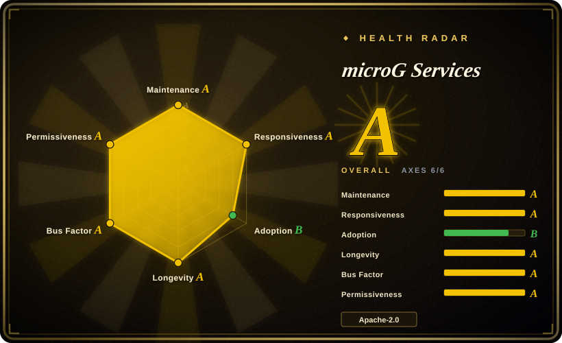
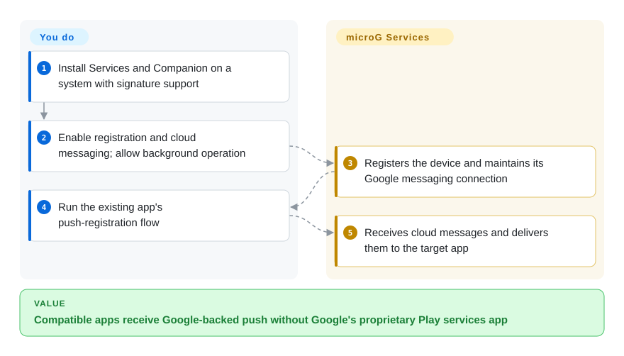
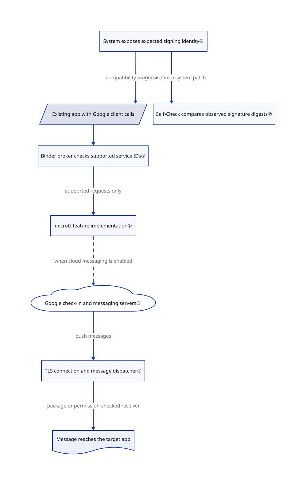

# microG Services

On an Android system without Google Play services, an existing app may lose push messages or refuse to sign in. microG supplies replacement service interfaces without installing Google's proprietary Play services app.

## When to use

You maintain a custom Android system or test device without Google's bundled services. An unmodified app expects `com.google.android.gms`: it cannot register for push, or its Google sign-in path fails. You can select a system that supports signature spoofing — letting microG present the identity expected by those apps — and accept testing each required app. Choose microG over repackaged Google apps when replacing the proprietary client matters more than reproducing every Google API.

You are preserving compatibility with existing binaries, not rewriting each app. Google-backed features remain opt-in network integrations, not self-hosted substitutes. The [installation guide](https://github.com/microg/GmsCore/wiki/Installation) and [prerequisites](https://github.com/microg/GmsCore/wiki/Prerequisites) define the system work you still own.

## When NOT to use

- **You cannot change the phone's system or its signature policy.** Keep official Google Play services on a supported stock device instead. The ordinary custom-system installation requires signature spoofing; the separate Huawei artifacts support particular Huawei systems, not arbitrary stock phones.
- **A banking or payment app must work without a compatibility investigation.** Prefer official Google Play services on a vendor-supported, certified device. Do not promise that microG will satisfy the app's integrity checks: [issue 2856](https://github.com/microg/GmsCore/issues/2856) remains open for Standard Integrity, and [issue 3738](https://github.com/microg/GmsCore/issues/3738) records a banking-app login hang. These reports are not proof of the same failure on every device.
- **Your requirement is no Google network contact for push in an app you control.** Integrate UnifiedPush's Android connector and a non-Google provider instead. microG's messaging implementation connects to `mtalk.google.com`; replacing the on-device program does not replace Google's push servers.
- **You actually want Google's apps installed into a compatible custom image.** Evaluate Open GApps' packaging scripts instead of microG, after checking the exact Android version and architecture. That installs proprietary Google components rather than reimplementing them; a bundle's existence does not certify the device.

## Comparison

| Alternative | In index | Our verdict | Tradeoff |
|---|---|---|---|
| [Google Play services](https://developers.google.com/android/guides/overview) | not a repo | Prefer the official service on a certified stock device when app compatibility outweighs removing Google's client; choose microG when replacing that client is the point. | Google's proprietary runtime, not its open sample repositories; you retain vendor-controlled services and their network dependencies. |
| [Open GApps](https://github.com/opengapps/opengapps) | not indexed | Choose Open GApps when building an image containing actual Google apps; choose microG when the image must use a free service reimplementation. | Packaging scripts download Google's APKs; scripts and APK licenses differ, and OS/architecture support needs checking; not added in this tab batch. |
| [UnifiedPush Android connector](https://github.com/UnifiedPush/android-connector) | not indexed | Choose the connector when you own the app and server and need provider-selectable push; choose microG for existing apps that already call Google's messaging interfaces. | Requires app and server integration plus a distributor; it is only a push-path substitute, not a replacement for sign-in, maps or Play service binaries; not added in this tab batch. |

## Quick start

Start with an already compatible custom Android system; changing a phone's operating system is a separate, potentially data-destructive project. For release `v0.3.17.252432`, install the normal `com.google.android.gms-250932034.apk` and `com.android.vending-84022634.apk` from the [release page](https://github.com/microg/GmsCore/releases/tag/v0.3.17.252432), not the `-hw` Huawei pair or the `org.microg.gms` development preview. The second package is microG Companion, a Play Store replacement component, not a promise of a full storefront. Open microG Settings and Self-Check, grant the needed permissions, enable device registration and cloud messaging for the push workflow, reboot, and exempt microG from battery optimization as the [guide](https://github.com/microg/GmsCore/wiki/Installation) directs. Then run the existing app's push-registration flow: microG handles the service side and message delivery, while you validate app behavior, network access and system updates; Google-backed messaging still uses Google's infrastructure.

<!-- flow-steps:begin (generated from flows/microg-gmscore.json by tools/flow_card.py — do not edit) -->

Text version of the flow

1. **You**: Install Services and Companion on a system with signature support
2. **You**: Enable registration and cloud messaging; allow background operation
3. **microG Services**: Registers the device and maintains its Google messaging connection
4. **You**: Run the existing app's push-registration flow
5. **microG Services**: Receives cloud messages and delivers them to the target app

**Value**: Compatible apps receive Google-backed push without Google's proprietary Play services app

<!-- flow-steps:end -->

## Key techniques

<!-- mechanism:begin (generated from mechanisms/microg-gmscore.json by tools/mechanism_card.py; do not edit) -->

Text version of the mechanism

- Existing app with Google client calls
- System exposes expected signing identity②
- Self-Check compares observed signature digests②
- Binder broker checks supported service IDs①
- microG feature implementation①
- Google check-in and messaging servers③
- TLS connection and message dispatcher③
- Message reaches the target app

- System exposes expected signing identity② → Existing app with Google client calls (compatibility prerequisite)
- System exposes expected signing identity② → Self-Check compares observed signature digests② (diagnosis, not a system patch)
- Existing app with Google client calls → Binder broker checks supported service IDs①
- Binder broker checks supported service IDs① → microG feature implementation① (supported requests only)
- microG feature implementation① → Google check-in and messaging servers③ (when cloud messaging is enabled) [optional/fallback]
- Google check-in and messaging servers③ → TLS connection and message dispatcher③ (push messages)
- TLS connection and message dispatcher③ → Message reaches the target app (package or permission-checked receiver)

<!-- mechanism:end -->

### 1. Implement the service boundary expected by existing apps

- **Problem:** Existing apps carry Google client libraries and expect a matching on-device service; replacing only the app store does not satisfy those calls.
- **How:** The core app uses the `com.google.android.gms` namespace. Its Android Binder broker — an inter-process call dispatcher — converts older request shapes into `GetServiceRequest`, checks the supported service set, and passes accepted requests to an implementation.
- **Limits:** Matching package and interface shapes does not implement every API. Unsupported broker requests raise an error; availability must be checked per feature and app.
- **Source:** [Core package and modules](https://github.com/microg/GmsCore/blob/32bc8954ff872d0e1a05ddfae81561b6dbecef69/play-services-core/build.gradle#L17-L79), [namespace](https://github.com/microg/GmsCore/blob/32bc8954ff872d0e1a05ddfae81561b6dbecef69/play-services-core/build.gradle#L116-L139), [request conversion and dispatch](https://github.com/microg/GmsCore/blob/32bc8954ff872d0e1a05ddfae81561b6dbecef69/play-services-base/core/src/main/java/org/microg/gms/AbstractGmsServiceBroker.java#L234-L263).

### 2. Diagnose the system identity requirement, not just installation

- **Problem:** An installed APK can still fail an app's check for the expected Google signing identity.
- **How:** Self-Check runs ROM signature checks for the normal Google package name. The check looks for the fake-signature permission, then compares both observed signature digests against Google's expected digest; its result reflects the actual exposed identity rather than permission presence alone.
- **Limits:** This diagnoses system support and can request an available permission; it does not patch an unsupported system. The `org.microg.gms` user flavor deliberately has a different package identity and is not the normal replacement path.
- **Source:** [Self-Check selection](https://github.com/microg/GmsCore/blob/32bc8954ff872d0e1a05ddfae81561b6dbecef69/play-services-core/src/main/java/org/microg/gms/ui/SelfCheckFragment.java#L60-L81), [signature comparison](https://github.com/microg/GmsCore/blob/32bc8954ff872d0e1a05ddfae81561b6dbecef69/play-services-core/src/main/java/org/microg/tools/selfcheck/RomSpoofSignatureChecks.java#L38-L78), [user flavor](https://github.com/microg/GmsCore/blob/32bc8954ff872d0e1a05ddfae81561b6dbecef69/play-services-core/build.gradle#L172-L188).

### 3. Bridge Google's push connection to the target app

- **Problem:** Apps expecting Google's push protocol need a live background receiver even without Google's proprietary service process.
- **How:** Device check-in posts a compressed protocol message to Google's check-in endpoint. The messaging service uses the returned Android ID and token, opens a TLS connection to Google's messaging host, maintains heartbeats, and dispatches incoming messages to the target package or permission-checked receiver.
- **Limits:** This is not Google-free or offline push. Network settings can disable the connection, and Android background restrictions still matter; the code cannot guarantee delivery latency or acceptance by a particular app.
- **Source:** [Check-in endpoint and request](https://github.com/microg/GmsCore/blob/32bc8954ff872d0e1a05ddfae81561b6dbecef69/play-services-core/src/main/java/org/microg/gms/checkin/CheckinClient.java#L45-L78), [connection and login](https://github.com/microg/GmsCore/blob/32bc8954ff872d0e1a05ddfae81561b6dbecef69/play-services-core/src/main/java/org/microg/gms/gcm/McsService.java#L444-L508), [credentials and delivery](https://github.com/microg/GmsCore/blob/32bc8954ff872d0e1a05ddfae81561b6dbecef69/play-services-core/src/main/java/org/microg/gms/gcm/McsService.java#L557-L643).

## Tech stack

- Java and Kotlin Android application modules; Binder interfaces defined with AIDL, Android's inter-process interface language.
- Gradle with Android Gradle Plugin; AndroidX, Material/Compose UI, Square Wire protocol messages, Guava and Tink. The reviewed root build sets minimum SDK 19 and compile SDK 35; individual features can require newer Android versions.
- Maps have separate VTM, Mapbox and Huawei build flavors. A build choice is not evidence that all map providers or features work identically.

## Dependencies

- **Device:** Android with signature spoofing for the standard replacement path; no simultaneous conflicting official service package. Privileged-system installation is not universally mandatory: the release notes explicitly allow unprivileged use with reduced functionality.
- **Components:** microG Services plus Companion unless the official Play Store is retained under a supported setup. The old framework proxy is optional for legacy C2DM messaging; do not install separate legacy location backends or DroidGuard Helper just because an old guide says so.
- **Network:** Google registration and messaging endpoints for the selected push path. Accounts, location providers and other online features add their own service dependencies; there is no database server for the maintainer to deploy.
- **Source builds:** JDK 17, Android SDK and Gradle; upstream CI assembles and lints debug/release targets. This intake read the build files but did not execute them.

## Ops difficulty

**High for system integration; medium on an already compatible system.** The APK installation is the small part. You own the operating-system compatibility, exposed package identity, permissions, battery settings, app-by-app regression checks and secure updates. Do not turn removal of existing Google system packages into a generic copy-paste instruction: back up the device and follow the system maintainer's procedure. Logs can contain account or device information, so sanitize them before reporting issues.

## Health & viability

- **Maintenance, 2026-10-21:** the repository is not archived. The latest release is `v0.3.17.252432`, published 2026-09-29; the preceding feature release was published 2026-07-14. The latest release fixes multiple security vulnerabilities, including high-severity issues, with a backport for the preceding release. Upgrade planning is a selection requirement, not optional polish.
- **Governance and backing:** this is a microG organization project, not a Google-maintained implementation. The top lifetime contributor has 1,197 contributions, followed by 284 and 175; several people ship fixes, but that distribution shows concentrated historical ownership rather than proof of a support organization. The wiki solicits donations and contributions; no service-level agreement was verified.
- **Age and durability:** GitHub creation is 2014-04-23, giving roughly 12 years of history plus a recent security release. [推断: based on creation and release dates] That old-and-active combination supports a durability prior, not a guarantee of continued API parity.
- **Adoption and integration risk:** 15,019 stars are an interest signal, not an installed-device count. Recent issues and open integrity reports show continuing app-specific compatibility work. Apache-2.0 covers the main project; retained third-party notices, such as the Chromium-derived CryptAuth license, still matter for redistribution.

## Caveats (unverified)

- [未验证: no compatible Android device or emulator; upstream code was not executed] Installation, sign-in, push latency, map behavior and banking-app compatibility were not reproduced. Source inspection and issue reports do not replace an acceptance test on the intended system and app versions.
- [推断: based on 2014 creation, the 2026 security release and lifetime contribution distribution] The project has useful durability evidence but concentrated ownership and an externally moving compatibility target; neither longevity nor stars promises future maintenance or Google API equivalence.
- [未验证: public metadata does not supply deployment counts or support guarantees] Installed-device adoption, guaranteed support capacity and a service-level agreement were not established; no such claim is used for selection.
