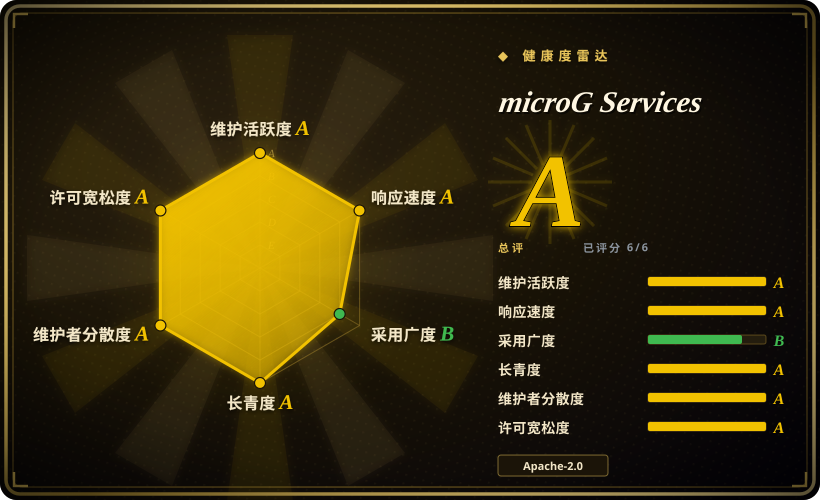
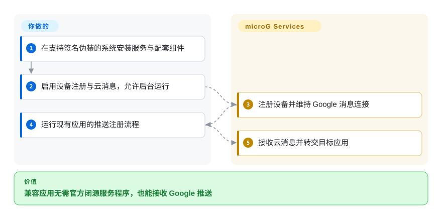
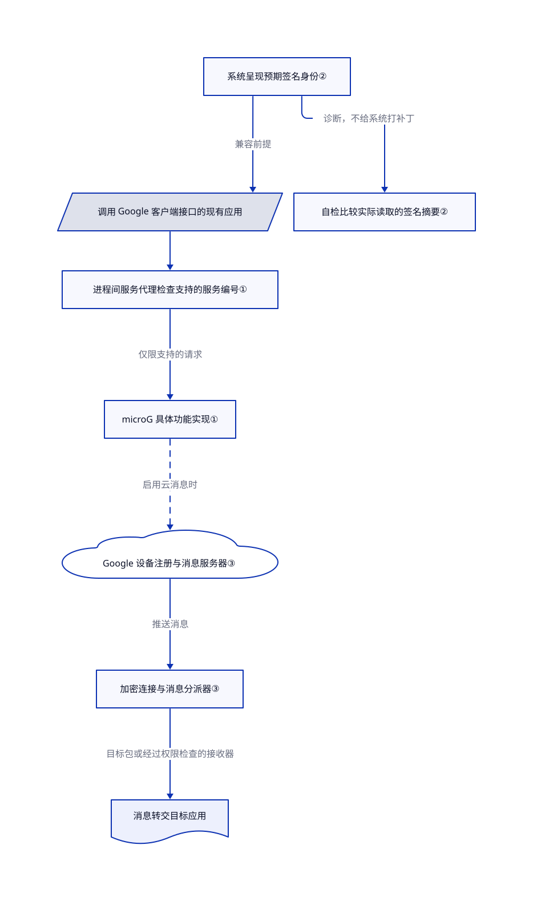

# microG Services

安卓系统没装 Google 服务，现有应用可能收不到推送，或卡在登录。microG 补上应用要调用的服务接口，不必安装 Google 的闭源服务程序。

## 何时使用

你维护不带 Google 套件的安卓系统或测试设备。一个现有应用要找 `com.google.android.gms`，结果无法注册推送，或 Google 登录失败。你可以选用支持签名伪装的系统，让 microG 对应用呈现预期身份，并愿意逐个验证必需应用。相比重新打包 Google 应用，选择 microG 的理由是替换闭源客户端，而不是完整复刻每个 Google 接口。

你要保留现有应用，不打算逐个重写。涉及 Google 的功能仍是可选的联网集成，不是自托管替代服务。[安装说明](https://github.com/microg/GmsCore/wiki/Installation)与[前置条件](https://github.com/microg/GmsCore/wiki/Prerequisites)列出了你仍须负责的系统工作。

## 何时不用

- **你不能更换手机系统，也不能改变其签名策略。** 应在受支持的原厂设备上保留官方 Google Play services。普通自定义系统安装路径需要签名伪装；单独的华为安装包只支持特定华为系统，不代表任意原厂手机都能用。
- **银行或支付应用必须直接可用。** 优先选用厂商支持、通过认证的设备及官方 Google Play services。不要承诺 microG 能满足应用的设备完整性检查：[问题 2856](https://github.com/microg/GmsCore/issues/2856)仍记录标准完整性接口问题，[问题 3738](https://github.com/microg/GmsCore/issues/3738)记录银行应用登录卡住。报告不代表所有设备都会复现。
- **你控制应用代码，且要求推送不联系 Google。** 应集成 UnifiedPush 安卓连接库，并选择非 Google 提供方。microG 的消息服务连接 `mtalk.google.com`，替换手机上的程序不等于替换 Google 推送服务器。
- **你实际想在兼容系统镜像里装 Google 应用。** 应评估 Open GApps 打包脚本，并核对安卓版本和处理器架构。它安装 Google 闭源组件，不是重实现；有安装包不等于设备获得认证。

## 横向对比

| 替代品 | 是否收录 | 我们的评价 | 取舍 |
|---|---|---|---|
| [Google Play services](https://developers.google.com/android/guides/overview) | 非仓库 | 原厂认证设备更看重应用兼容时，选官方服务；目标是移除 Google 客户端时，才选 microG。 | 对比的是闭源运行程序，不是开放的示例仓库；仍接受厂商控制的服务和联网依赖。 |
| [Open GApps](https://github.com/opengapps/opengapps) | 未收录 | 要在镜像里安装真正的 Google 应用，选 Open GApps；要用自由实现替代服务程序，选 microG。 | 脚本下载 Google 安装包，脚本与安装包的许可不同，还须核对系统和架构支持；not added in this tab batch。 |
| [UnifiedPush 安卓连接库](https://github.com/UnifiedPush/android-connector) | 未收录 | 你控制应用和服务端、要自主选择推送提供方时，选连接库；现有应用已调用 Google 消息接口时，选 microG。 | 需要改应用和服务端，并配置消息分发器；仅替代推送路径，不替代登录、地图或服务程序接口；not added in this tab batch。 |

## 快速上手

先准备已经兼容的自定义安卓系统；换系统是另一个可能清除数据的项目。针对 `v0.3.17.252432`，从[发布页](https://github.com/microg/GmsCore/releases/tag/v0.3.17.252432)安装普通版 `com.google.android.gms-250932034.apk` 和 `com.android.vending-84022634.apk`，不要混用华为 `-hw` 版或 `org.microg.gms` 开发预览版。第二个包是 microG Companion，即替代 Play Store 身份的组件，不代表完整商店。打开 microG 设置与自检，授予所需权限，为推送路径启用设备注册和云消息，再按[安装说明](https://github.com/microg/GmsCore/wiki/Installation)重启并取消电池优化。随后运行现有应用的推送注册流程：microG 负责服务端接口和消息转交，你负责验证应用行为、网络可达性和系统更新；消息仍经过 Google 基础设施。

<!-- flow-steps:begin (generated from flows/microg-gmscore.json by tools/flow_card.py — do not edit) -->

流程文字版

1. **你**：在支持签名伪装的系统安装服务与配套组件
2. **你**：启用设备注册与云消息，允许后台运行
3. **microG Services**：注册设备并维持 Google 消息连接
4. **你**：运行现有应用的推送注册流程
5. **microG Services**：接收云消息并转交目标应用

**价值**：兼容应用无需官方闭源服务程序，也能接收 Google 推送

<!-- flow-steps:end -->

## 技术要点

<!-- mechanism:begin (generated from mechanisms/microg-gmscore.json by tools/mechanism_card.py; do not edit) -->

机制文字版

- 调用 Google 客户端接口的现有应用
- 系统呈现预期签名身份②
- 自检比较实际读取的签名摘要②
- 进程间服务代理检查支持的服务编号①
- microG 具体功能实现①
- Google 设备注册与消息服务器③
- 加密连接与消息分派器③
- 消息转交目标应用

- 系统呈现预期签名身份② → 调用 Google 客户端接口的现有应用（兼容前提）
- 系统呈现预期签名身份② → 自检比较实际读取的签名摘要②（诊断，不给系统打补丁）
- 调用 Google 客户端接口的现有应用 → 进程间服务代理检查支持的服务编号①
- 进程间服务代理检查支持的服务编号① → microG 具体功能实现①（仅限支持的请求）
- microG 具体功能实现① → Google 设备注册与消息服务器③（启用云消息时）〔可选／兜底〕
- Google 设备注册与消息服务器③ → 加密连接与消息分派器③（推送消息）
- 加密连接与消息分派器③ → 消息转交目标应用（目标包或经过权限检查的接收器）

<!-- mechanism:end -->

### 1. 补上现有应用预期的服务边界

- **解决：** 现有应用带着 Google 客户端库，仍要调用手机上的配套服务；只换应用商店不能满足这些调用。
- **做法：** 核心应用使用 `com.google.android.gms` 命名空间。Binder 是安卓进程间调用机制，服务代理把旧请求整理成 `GetServiceRequest`，检查支持的服务集合，再交给具体实现。
- **边界：** 包名和接口一致，不代表所有功能都已实现。不支持的代理请求会报错，仍须逐功能、逐应用检查。
- **源码：** [核心模块](https://github.com/microg/GmsCore/blob/32bc8954ff872d0e1a05ddfae81561b6dbecef69/play-services-core/build.gradle#L17-L79)、[包命名空间](https://github.com/microg/GmsCore/blob/32bc8954ff872d0e1a05ddfae81561b6dbecef69/play-services-core/build.gradle#L116-L139)、[请求转换与分派](https://github.com/microg/GmsCore/blob/32bc8954ff872d0e1a05ddfae81561b6dbecef69/play-services-base/core/src/main/java/org/microg/gms/AbstractGmsServiceBroker.java#L234-L263)。

### 2. 自检系统呈现的签名，不只检查是否安装

- **解决：** 安装包已装好，应用仍可能认不出它预期的 Google 签名身份。
- **做法：** 普通 Google 包名会触发系统签名自检。代码先检查伪装签名权限，再把两种读取路径得到的签名摘要与预期 Google 摘要比较；结果依据实际暴露的身份，不只看权限是否存在。
- **边界：** 自检只能诊断系统支持、申请已有权限，不能给不支持的系统打补丁。`org.microg.gms` 用户变体故意使用不同包名，不是普通替换路径。
- **源码：** [自检项目选择](https://github.com/microg/GmsCore/blob/32bc8954ff872d0e1a05ddfae81561b6dbecef69/play-services-core/src/main/java/org/microg/gms/ui/SelfCheckFragment.java#L60-L81)、[签名比较](https://github.com/microg/GmsCore/blob/32bc8954ff872d0e1a05ddfae81561b6dbecef69/play-services-core/src/main/java/org/microg/tools/selfcheck/RomSpoofSignatureChecks.java#L38-L78)、[用户变体](https://github.com/microg/GmsCore/blob/32bc8954ff872d0e1a05ddfae81561b6dbecef69/play-services-core/build.gradle#L172-L188)。

### 3. 把 Google 推送连接转交给目标应用

- **解决：** 依赖 Google 推送协议的应用，在没有官方服务进程时，仍需要后台接收消息的程序。
- **做法：** 设备注册向 Google 地址提交压缩协议消息。消息服务使用返回的安卓标识和令牌，与 Google 消息主机建立加密连接，维持心跳，再把消息交给目标包或经过权限检查的接收器。
- **边界：** 这不是离线推送，也没有摆脱 Google。网络设置可以禁用连接，安卓后台限制仍会影响运行；代码不保证投递延迟或特定应用一定接收。
- **源码：** [设备注册地址与请求](https://github.com/microg/GmsCore/blob/32bc8954ff872d0e1a05ddfae81561b6dbecef69/play-services-core/src/main/java/org/microg/gms/checkin/CheckinClient.java#L45-L78)、[连接与登录](https://github.com/microg/GmsCore/blob/32bc8954ff872d0e1a05ddfae81561b6dbecef69/play-services-core/src/main/java/org/microg/gms/gcm/McsService.java#L444-L508)、[凭据与投递](https://github.com/microg/GmsCore/blob/32bc8954ff872d0e1a05ddfae81561b6dbecef69/play-services-core/src/main/java/org/microg/gms/gcm/McsService.java#L557-L643)。

## 技术栈

- Java 与 Kotlin 安卓应用模块；使用安卓进程间接口语言 AIDL 描述 Binder 接口。
- Gradle 与安卓构建插件；采用 AndroidX、Material/Compose 界面、Square Wire 协议消息、Guava 与 Tink。所读根构建文件设定最低 SDK 19、编译 SDK 35；具体功能可能要求更新的安卓版本。
- 地图分别有 VTM、Mapbox、华为构建变体。存在构建选项，不代表所有地图提供方和功能表现相同。

## 依赖

- **设备：** 标准替换路径需要支持签名伪装的安卓系统，且不能有冲突的官方服务包。并非必须作为特权系统应用安装：发布说明明确允许非特权使用，只是功能有所减少。
- **组件：** 通常需要 microG Services 与 Companion；受支持的配置若保留官方 Play Store，则按说明跳过 Companion。旧框架代理仅为旧式 C2DM 推送提供可选支持；不要因旧教程而另装旧定位后端或 DroidGuard Helper。
- **网络：** 本页推送路径需要 Google 设备注册和消息地址。账号、定位等联网功能还会增加各自依赖；维护者无需部署数据库服务。
- **源码构建：** JDK 17、安卓 SDK 与 Gradle。上游持续集成构建并检查调试版和发布版；本次只读构建配置，没有执行。

## 运维难度

**系统集成高，已有兼容系统时中等。** 装安装包只是小部分工作。你负责系统兼容、包身份、权限、电池设置、逐应用回归和安全更新。不要把删除现有 Google 系统包写成通用复制命令；先备份设备，再遵循系统维护者的流程。日志可能含账号或设备信息，上报前应脱敏。

## 健康度与可持续性

- **维护，截至 2026-10-21：** 仓库未归档，最新版本 `v0.3.17.252432` 发布于 2026-09-29，前一个功能版本发布于 2026-07-14。最新版本修复多项漏洞，含高严重性问题，并向前版提供安全补丁。选择它就要安排更新，不能只装一次。
- **治理与支持：** 这是 microG 组织项目，不由 Google 维护。长期贡献最多的三位分别有 1197、284、175 次贡献；多人提交修复，但历史贡献集中，不能当作有专门支持团队的证明。项目维基征求捐赠与贡献，本次未确认服务承诺。
- **年限与持续性：** GitHub 建库于 2014-04-23，已有约十二年历史，并仍发布安全更新。[推断：依据建库日期与发布记录] 年久且活跃提供持续性先验，不保证未来始终跟上 Google 接口。
- **采用与集成风险：** 15019 个星标反映关注，不是装机量。近期问题和未关闭的完整性报告显示，逐应用兼容工作仍在继续。主体使用 Apache-2.0，分发时仍须保留第三方声明，例如 Chromium 来源的 CryptAuth 许可。

## 存疑（未验证）

- [未验证：本次没有兼容安卓真机或模拟器，也未执行上游代码] 未复现安装、登录、推送延迟、地图行为或银行应用兼容性。源码阅读和问题报告不能替代目标系统及应用版本上的验收。
- [推断：依据是 2014 年建库、2026 年安全发布及长期贡献分布] 项目有持续性证据，但历史维护集中，兼容目标也受外部变化影响；年限和星标都不承诺未来维护或 Google 接口等价性。
- [未验证：公开元数据不提供部署统计或服务承诺] 未确认装机量、保证的支持能力或服务等级协议，选型结论不依赖这些主张。
