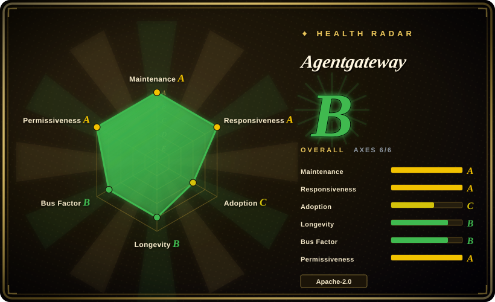
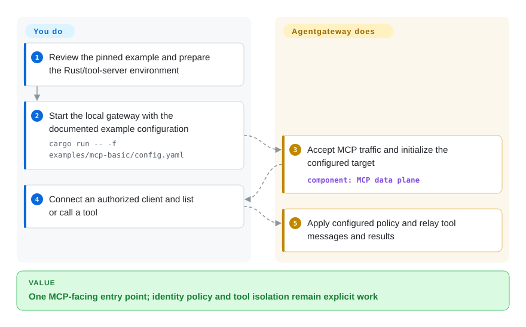
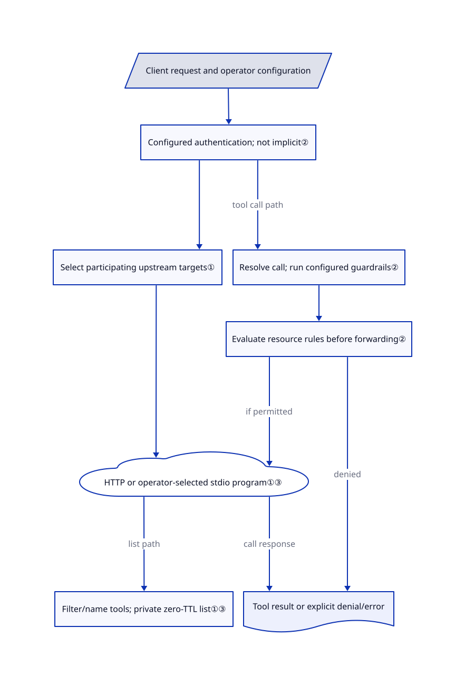

# Agentgateway

Every assistant has its own MCP server list, and removing a tool from one client does not remove it from the others. Agentgateway puts a configurable proxy in the connection path, federating tool servers and evaluating explicit request/resource policies.

## When to use

You operate several assistants or applications that need shared MCP tools, model endpoints or agent communication. The problem is not writing another agent loop: you need one place to configure upstreams, authenticate clients, decide which tools they may list or call, and observe traffic. Choose Agentgateway when MCP-aware federation and resource authorization are the decisive part of that boundary, rather than only generic HTTP plugins or a provider-neutral completion endpoint.

It supplies a Rust data plane with MCP, LLM and A2A surfaces; standalone YAML and Kubernetes/controller integration are documented entry points. You still own identities, TLS, correct policy, upstream trust and service operations. This page pins main at `cfa8d1b8`; latest stable v1.6.0 and preview v1.7.0-alpha.1 are different artifacts, so do not assume every main feature is in a downloaded stable binary.

## When NOT to use

- **You only need multi-provider model keys, budgets and spend governance.** Start with [LiteLLM](litellm.md), checking its commercial-feature boundary, instead of adding an agent-protocol gateway without an MCP/A2A requirement.
- **Your platform already depends on HTTP API-management plugins or an Envoy control plane.** Keep [Kong](kong.md) for that packaged policy/plugin workflow, or [Envoy](envoy.md) for an existing xDS/filter ecosystem. Agentgateway is not a promise of drop-in filter/configuration compatibility.
- **You need OS isolation for untrusted tool programs.** Use a separately configured runtime such as [OpenSandbox](../sandboxing/opensandbox.md). A `stdio` target starts an operator-selected command; network authorization is not a process sandbox, an environment guarantee, or rollback of that tool's effects.
- **Installing a gateway must automatically make an endpoint private.** Keep the endpoint unexposed while implementing authentication, or reuse your existing Kong policy boundary. Empty MCP authorization sets allow access. In deny-only policies, an expression that fails to evaluate may fail to deny; prefer deliberately tested allow/require policies rather than assuming every error closes access.
- **You need a long-proven transport or a verified failure/recovery matrix today.** Prefer your established Envoy deployment for generic traffic. Federation can fail the whole session when one target fails; opting into partial failure changes coverage, not availability guarantees. This page ran no proxy, identity-provider, load, failover or multi-replica test.

## Comparison

| Alternative | In index | Our verdict | Tradeoff |
|---|---|---|---|
| [LiteLLM](litellm.md) | ✅ | Choose LiteLLM when model-provider governance and spending are the main product; choose Agentgateway when MCP server federation and tool/resource policy decide the architecture. | A provider-focused gateway and commercial carve-out versus an agent-protocol-oriented Rust data plane; you operate policy and credentials in either case. |
| [Kong Gateway](kong.md) | ✅ | Keep Kong when existing API consumers, plugins and administration are the investment; choose Agentgateway for a focused agent-protocol connection boundary after checking exact capabilities. | Reuse mature HTTP/API-management workflows, but verify the availability/license of advanced plugins; Agentgateway adds a different configuration and operations surface. |
| [Envoy](envoy.md) | ✅ | Choose Envoy when the platform is already built around its xDS/filter APIs; choose Agentgateway when an explicit MCP-aware resource layer is the primary requirement. | General-purpose programmable transport versus an agent-facing gateway product; do not infer configuration/filter interchangeability from both supporting dynamic infrastructure. |

## Quick start

After separately approving a local test, use the pinned source's [basic example](https://github.com/agentgateway/agentgateway/blob/cfa8d1b84996b0c4e3ce204a81a86bd64f257921/examples/mcp-basic/README.md#L5-L59): `cargo run -- -f examples/mcp-basic/config.yaml`. Its YAML selects port 3000 and a `stdio` target running `npx` with `@modelcontextprotocol/server-everything`; client traffic can therefore launch an external program and resolve its package, not just read a static config. Connect an authorized MCP client to `/mcp` or the documented SSE endpoint and list/call tools. The gateway handles forwarding; you supply the tool runtime, permissions, client identity and actual result checks. The [demo configuration](https://github.com/agentgateway/agentgateway/blob/cfa8d1b84996b0c4e3ce204a81a86bd64f257921/examples/mcp-basic/config.yaml#L1-L19) has permissive CORS and no authentication policy: production needs its own TLS/auth/policy, not the demonstration JWT keys. This review did not compile, start the gateway, run `npx`, connect a client or send real traffic.

<!-- flow-steps:begin (generated from flows/agentgateway.json by tools/flow_card.py — do not edit) -->

Text version of the flow

1. **You**: Review the pinned example and prepare the Rust/tool-server environment
2. **You**: Start the local gateway with the documented example configuration — `cargo run -- -f examples/mcp-basic/config.yaml`
3. **Agentgateway**: Accept MCP traffic and initialize the configured target — component: `MCP data plane`
4. **You**: Connect an authorized client and list or call a tool
5. **Agentgateway**: Apply configured policy and relay tool messages and results

**Value**: One MCP-facing entry point; identity policy and tool isolation remain explicit work

<!-- flow-steps:end -->

## Key techniques

<!-- mechanism:begin (generated from mechanisms/agentgateway.json by tools/mechanism_card.py; do not edit) -->

Text version of the mechanism

- Client request and operator configuration
- Configured authentication; not implicit②
- Select participating upstream targets①
- HTTP or operator-selected stdio program①③
- Filter/name tools; private zero-TTL list①③
- Resolve call; run configured guardrails②
- Evaluate resource rules before forwarding②
- Tool result or explicit denial/error

- Client request and operator configuration → Configured authentication; not implicit②
- Configured authentication; not implicit② → Select participating upstream targets①
- Select participating upstream targets① → HTTP or operator-selected stdio program①③
- HTTP or operator-selected stdio program①③ → Filter/name tools; private zero-TTL list①③ (list path)
- Configured authentication; not implicit② → Resolve call; run configured guardrails② (tool call path)
- Resolve call; run configured guardrails② → Evaluate resource rules before forwarding②
- Evaluate resource rules before forwarding② → HTTP or operator-selected stdio program①③ (if permitted)
- Evaluate resource rules before forwarding② → Tool result or explicit denial/error (denied)
- HTTP or operator-selected stdio program①③ → Tool result or explicit denial/error (call response)

<!-- mechanism:end -->

### 1. Select upstream targets before connection setup, then federate resources

- **Problem:** One virtual MCP endpoint needs several backends without exposing every backend to every request or colliding on tool names.
- **How:** Request-context target conditions filter the configured multi-target set before upstream setup. Federation can namespace names; list merging applies resource policy before returning the combined tools.
- **Limits:** Target participation and individual resource authorization are different stages. Missing target conditions allow participation; filtering a returned tool does not mean its server was never initialized. Default `FailClosed` and optional `FailOpen` have materially different partial-coverage behavior.
- **Source:** [Condition filtering and setup:459–579](https://github.com/agentgateway/agentgateway/blob/cfa8d1b84996b0c4e3ce204a81a86bd64f257921/crates/agentgateway/src/mcp/upstream/mod.rs#L459-L579), [tool filtering/naming:802–848](https://github.com/agentgateway/agentgateway/blob/cfa8d1b84996b0c4e3ce204a81a86bd64f257921/crates/agentgateway/src/mcp/handler.rs#L802-L848), [failure modes:42–56](https://github.com/agentgateway/agentgateway/blob/cfa8d1b84996b0c4e3ce204a81a86bd64f257921/crates/agentgateway/src/mcp/mod.rs#L42-L56).

### 2. Apply explicit policy to calls, not just tool visibility

- **Problem:** A client can cache an old tool list or directly send a tool call that should no longer be permitted.
- **How:** The session resolves the target/resource and authorizes `tools/call` before forwarding. CEL rules combine deny precedence, all required conditions and matching allows across the composed rule sets.
- **Limits:** No rules means allow, not implicit authentication. Deny-expression failures may fail to deny; allow/require composition must be tested. The call guardrail stage precedes resource authorization, so a denied tool call is not proof of zero earlier logging or contact with a separately configured checker.
- **Source:** [Call enforcement before send:620–661](https://github.com/agentgateway/agentgateway/blob/cfa8d1b84996b0c4e3ce204a81a86bd64f257921/crates/agentgateway/src/mcp/session.rs#L620-L661), [guardrails then authorization:284–317](https://github.com/agentgateway/agentgateway/blob/cfa8d1b84996b0c4e3ce204a81a86bd64f257921/crates/agentgateway/src/mcp/session.rs#L284-L317), [policy modes and composition:130–140,251–274](https://github.com/agentgateway/agentgateway/blob/cfa8d1b84996b0c4e3ce204a81a86bd64f257921/crates/agentgateway/src/http/authorization.rs#L130-L274), [empty MCP rules:53–63](https://github.com/agentgateway/agentgateway/blob/cfa8d1b84996b0c4e3ce204a81a86bd64f257921/crates/agentgateway/src/mcp/rbac.rs#L53-L63).

### 3. Keep protocol/list state separate from transport and operator trust

- **Problem:** Mixed MCP generations, stale discovery data and locally spawned servers have different failure and security boundaries.
- **How:** The protocol path distinguishes modern discovery from legacy initialization; the tools merge marks its result private with zero TTL. `stdio` setup uses a real child process, can clear its environment when configured, and delegates shutdown through the transport's close path.
- **Limits:** Compatibility still relies on client/server fallback behavior; subscription setup has no independent timeout beyond a configured route timeout. Client-side caches can still require refresh. Child-process transport does not establish OS isolation, child-tree cleanup or removal of files/remote effects.
- **Source:** [Protocol and listen limits:22–78](https://github.com/agentgateway/agentgateway/blob/cfa8d1b84996b0c4e3ce204a81a86bd64f257921/crates/agentgateway/src/mcp/README.md#L22-L78), [private zero-TTL list:802–848](https://github.com/agentgateway/agentgateway/blob/cfa8d1b84996b0c4e3ce204a81a86bd64f257921/crates/agentgateway/src/mcp/handler.rs#L802-L848), [child command/environment:690–715](https://github.com/agentgateway/agentgateway/blob/cfa8d1b84996b0c4e3ce204a81a86bd64f257921/crates/agentgateway/src/mcp/upstream/mod.rs#L690-L715), [shutdown:200–212,249–264](https://github.com/agentgateway/agentgateway/blob/cfa8d1b84996b0c4e3ce204a81a86bd64f257921/crates/agentgateway/src/mcp/upstream/stdio.rs#L200-L264).

## Tech stack

- Rust 2024 data plane, Tokio/Hyper networking, rustls/AWS-LC crypto and a CEL policy layer, plus the MCP transport SDK. Workspace Cargo version `0.0.0` is explicitly unused, not the product release version.
- A separately built pnpm UI and Go controller/development integration; standalone file configuration does not require running Kubernetes.
- Source build pins [Rust 1.99.0](https://github.com/agentgateway/agentgateway/blob/cfa8d1b84996b0c4e3ce204a81a86bd64f257921/rust-toolchain.toml#L1-L3). The development guide's older “Rust 1.86+” wording is not that pinned toolchain; UI development additionally documents Node 24.22.1 and pnpm.

## Dependencies

- A binary/image or the source build toolchain, network access to upstream services, and configuration/identity material you control. The basic file-config path has no separate database prerequisite; configured hybrid storage explicitly requires a database URL.
- Each `stdio` target's executable/package environment, or reachable HTTP/SSE/Streamable HTTP servers. Those programs and services have their own permissions, supply chain and licensing.
- TLS/JWT/OAuth or other chosen policy dependencies, provider API credentials for model routes, and any configured external checks/telemetry. These are not supplied by Apache-2.0 or by installing the proxy.

## Ops difficulty

**Medium for a bounded local route; high for a shared security boundary.** Own TLS, credentials, policy review, request timeouts, upstream behavior, logs and replica/session failure testing. The reviewed defaults put admin on loopback port 15000 but stats/readiness on wildcard addresses at 15020/15021; expose none without an explicit network decision ([defaults](https://github.com/agentgateway/agentgateway/blob/cfa8d1b84996b0c4e3ce204a81a86bd64f257921/crates/agentgateway/src/config.rs#L349-L369)). The [security policy](https://github.com/agentgateway/agentgateway/blob/cfa8d1b84996b0c4e3ce204a81a86bd64f257921/SECURITY.md#L28-L35) treats admin interfaces and configured external policy services as trusted, not hostile boundaries.

Stopping transport is not transaction rollback. Review retention of tool arguments, credentials, gateway logs and external telemetry; a tool or checker may already have produced effects before a later failure. Transport close paths exist, but no uninstall, process-tree termination or whole-system cleanup was tested here.

## Health & viability

- **Maintenance, 2026-10-25:** unarchived and active; sampled releases include stable v1.6.0 on October 2 and v1.7.0-alpha.1 on October 21. The reviewed main SHA is a separate pinned snapshot; release/API compatibility should be checked at adoption.
- **Governance/backing:** the repository contains an LF Projects, LLC [technical charter](https://github.com/agentgateway/agentgateway/blob/cfa8d1b84996b0c4e3ce204a81a86bd64f257921/CHARTER.md#L1-L48) with a TSC and [Apache-2.0/DCO contribution policy](https://github.com/agentgateway/agentgateway/blob/cfa8d1b84996b0c4e3ce204a81a86bd64f257921/CHARTER.md#L161-L196). The root license retains Solo.io's notice. This is concrete governance evidence, not an SLA or proof that contributors are evenly distributed.
- **Age and adoption:** created 2025-03-18, about nineteen months old, with 5,567 stars and 990 forks at observation. [推断：based on age, active releases and the charter, not long-term deployment measurement] Institutional structure helps, but this is a younger durability bet than established general-purpose proxies.
- **Risk signals:** policy semantics, protocol evolution, external components and privileged administration matter more than a feature list. The root Apache-2.0 license is not the only license in the tree: the CEL fork declares MIT, and `crates/pool/LICENSE` is MIT. Complete retention of the CEL upstream notices remains unverified. Source tests and example JWTs exist; none were executed or used as production credentials in this review.

## Caveats (unverified)

- [未验证：the host denied the directed CEL notice retrieval; it was not retried through another command] The root Apache-2.0 license, pool MIT text and CEL manifest's MIT declaration were read. This is not a complete third-party notice-retention or redistribution audit; the gap does not establish infringement or a false root license.
- [未验证：no upstream build, deployment or real traffic was authorized] Throughput, latency, scaling, identity-provider interoperability, provider-field fidelity, guardrail effectiveness, budget guarantees and failover were not reproduced.
- [未验证：only directed source paths were read, not a complete security audit] The MCP target/list/call and configuration boundaries above are source-backed; this is not proof of all protocol, tenancy, parser or administrative surfaces.
- [未验证：no shutdown, upgrade or uninstall experiment] Child-tree termination, state durability, credential/log deletion and absence of residual/remote effects are not established by a transport close method.
- [推断：age and documented governance are selection priors, not future-support guarantees] Pin a version and validate the exact policy, client, upstream and replica topology you need.
