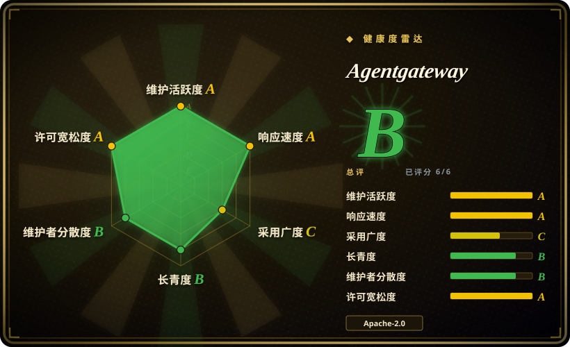
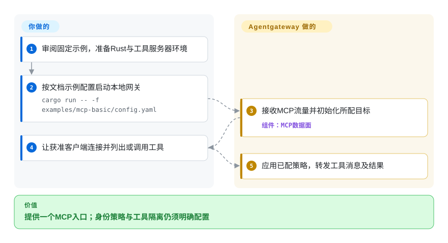
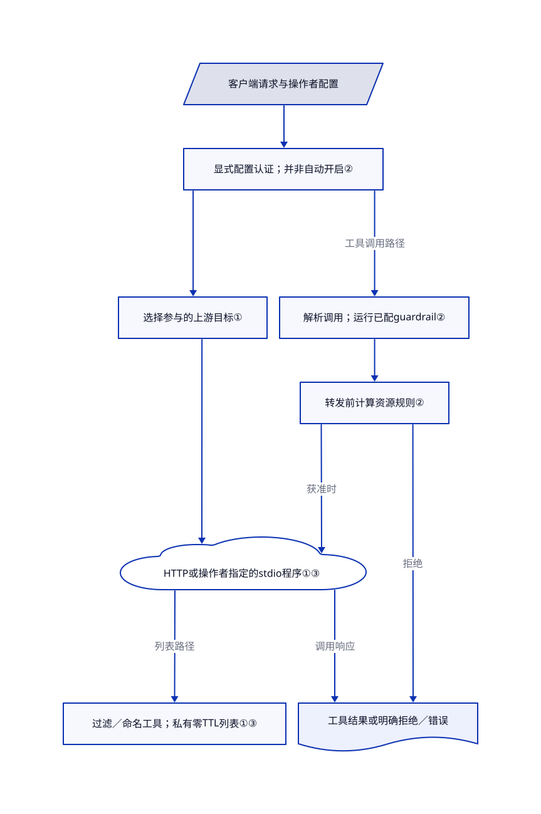

# Agentgateway

每个助手都配一份MCP服务器清单，删掉一个客户端的工具，其它客户端仍能调用。Agentgateway把可配置代理放进连接路径，聚合工具服务器，并按明确策略判断请求和资源权限。

## 何时使用

你运维多个助手或应用，需要共享MCP工具、模型接口或agent通信。问题不是再写一个代理执行循环，而是统一配置上游、认证客户端、决定谁能列出和调用哪些工具，并观察流量。当MCP协议聚合与资源授权是决定性边界，而不只是通用HTTP插件或跨模型文本接口时，考虑Agentgateway。

它提供Rust数据面及MCP、LLM、A2A接口，文档同时给出独立YAML和Kubernetes／控制器入口。身份、TLS、正确策略、上游信任与服务运维仍归你。本页固定`cfa8d1b8`主分支；最新稳定版v1.6.0和v1.7.0-alpha.1预览是不同产物，不能认为主分支全部能力都在下载的稳定二进制里。

## 何时不用

- **只需要多模型密钥、预算和费用治理。** 先看[LiteLLM](litellm.zh.md)，另核企业功能边界；没有MCP／A2A需求时，不必因此再引入agent协议网关。
- **平台已有HTTP API管理插件或Envoy控制面。** 通用管理工作流继续用[Kong](kong.zh.md)，已有xDS／过滤器生态用[Envoy](envoy.zh.md)。Agentgateway不承诺这些配置或插件可直接替换。
- **需要隔离不可信工具程序。** 用另行配置的执行层，例如[OpenSandbox](../sandboxing/opensandbox.zh.md)。`stdio`目标会启动操作者指定的命令；网络授权不是进程沙箱、环境保证，也不回滚工具副作用。
- **希望安装网关就自动保护私有接口。** 先不暴露接口并配置认证，或复用已有Kong策略边界。空MCP授权集合会放行；只写deny规则时，表达式求值失败可能不触发拒绝，不能认为所有错误都会关门，应测试明确的allow／require策略。
- **现在就需要长期验证过的传输或完整故障恢复矩阵。** 通用流量优先复用已运维的Envoy。联邦中一个目标失败可能使整段会话失败；选择部分失败模式只改变覆盖，不保证可用性。本条目未运行代理、身份服务、压测、故障切换或多副本实验。

## 横向对比

| 替代品 | 是否收录 | 我们的评价 | 取舍 |
|---|---|---|---|
| [LiteLLM](litellm.zh.md) | 已收录 | 模型提供方治理与费用是主产品时选LiteLLM；MCP服务器聚合和工具／资源策略决定架构时看Agentgateway。 | 模型治理网关及商业功能分界，对比更面向agent协议的Rust数据面；两者都要自己管策略和凭据。 |
| [Kong Gateway](kong.zh.md) | 已收录 | 已有API消费者、插件与管理投入时继续用Kong；以agent协议连接边界为切口时，核具体能力后评估Agentgateway。 | 复用成熟HTTP管理流程，但要核高级插件许可；Agentgateway带来另一套配置与运维表面。 |
| [Envoy](envoy.zh.md) | 已收录 | 平台已围绕Envoy的xDS／过滤器API建设时选Envoy；明确MCP资源层是首要要求时评估Agentgateway。 | 通用可编程传输对比面向agent的网关产品；都能参与动态基础设施，不等于配置或过滤器互换。 |

## 快速上手

单独批准本地测试后，按固定源码的[基础示例](https://github.com/agentgateway/agentgateway/blob/cfa8d1b84996b0c4e3ce204a81a86bd64f257921/examples/mcp-basic/README.md#L5-L59)使用`cargo run -- -f examples/mcp-basic/config.yaml`。YAML选择3000端口和一个通过`npx`运行`@modelcontextprotocol/server-everything`的`stdio`目标，因此客户端连接可能启动外部程序并解析软件包，不只是读取静态配置。让获准的MCP客户端连`/mcp`或文档的SSE入口，再列出／调用工具。网关负责转发；你负责工具运行环境、权限、客户端身份及真实结果验收。[演示配置](https://github.com/agentgateway/agentgateway/blob/cfa8d1b84996b0c4e3ce204a81a86bd64f257921/examples/mcp-basic/config.yaml#L1-L19)是宽松CORS且无认证策略，生产应另配TLS／认证／授权，不用示例JWT密钥。本次没有编译、启动网关、运行`npx`、连接客户端或接入真实流量。

<!-- flow-steps:begin (generated from flows/agentgateway.json by tools/flow_card.py — do not edit) -->

流程文字版

1. **你**：审阅固定示例，准备Rust与工具服务器环境
2. **你**：按文档示例配置启动本地网关 — `cargo run -- -f examples/mcp-basic/config.yaml`
3. **Agentgateway**：接收MCP流量并初始化所配目标 — 组件：`MCP数据面`
4. **你**：让获准客户端连接并列出或调用工具
5. **Agentgateway**：应用已配策略，转发工具消息及结果

**价值**：提供一个MCP入口；身份策略与工具隔离仍须明确配置

<!-- flow-steps:end -->

## 技术要点

<!-- mechanism:begin (generated from mechanisms/agentgateway.json by tools/mechanism_card.py; do not edit) -->

机制文字版

- 客户端请求与操作者配置
- 显式配置认证；并非自动开启②
- 选择参与的上游目标①
- HTTP或操作者指定的stdio程序①③
- 过滤／命名工具；私有零TTL列表①③
- 解析调用；运行已配guardrail②
- 转发前计算资源规则②
- 工具结果或明确拒绝／错误

- 客户端请求与操作者配置 → 显式配置认证；并非自动开启②
- 显式配置认证；并非自动开启② → 选择参与的上游目标①
- 选择参与的上游目标① → HTTP或操作者指定的stdio程序①③
- HTTP或操作者指定的stdio程序①③ → 过滤／命名工具；私有零TTL列表①③（列表路径）
- 显式配置认证；并非自动开启② → 解析调用；运行已配guardrail②（工具调用路径）
- 解析调用；运行已配guardrail② → 转发前计算资源规则②
- 转发前计算资源规则② → HTTP或操作者指定的stdio程序①③（获准时）
- 转发前计算资源规则② → 工具结果或明确拒绝／错误（拒绝）
- HTTP或操作者指定的stdio程序①③ → 工具结果或明确拒绝／错误（调用响应）

<!-- mechanism:end -->

### 1. 连接前选目标，再聚合资源

- **解决：** 一个虚拟MCP入口要接多个后端，又不能把所有后端交给每个请求，或让工具重名。
- **做法：** 多目标集合按请求上下文中的条件先筛选，再建立上游。聚合可给名称加目标前缀；列表合并在返回工具前应用资源策略。
- **边界：** 目标参与和单项资源授权不是同一阶段。不写目标条件就允许参与；从返回列表滤掉工具，不表示服务器从未初始化。默认`FailClosed`与可选`FailOpen`对部分覆盖有实质差别。
- **源码：** [条件过滤与建连第459–579行](https://github.com/agentgateway/agentgateway/blob/cfa8d1b84996b0c4e3ce204a81a86bd64f257921/crates/agentgateway/src/mcp/upstream/mod.rs#L459-L579)、[工具过滤／命名第802–848行](https://github.com/agentgateway/agentgateway/blob/cfa8d1b84996b0c4e3ce204a81a86bd64f257921/crates/agentgateway/src/mcp/handler.rs#L802-L848)、[故障模式第42–56行](https://github.com/agentgateway/agentgateway/blob/cfa8d1b84996b0c4e3ce204a81a86bd64f257921/crates/agentgateway/src/mcp/mod.rs#L42-L56)。

### 2. 对实际调用授权，而不只隐藏工具

- **解决：** 客户端可能缓存旧工具清单，也能直接发送已不该获准的调用。
- **做法：** 会话先解析目标／资源，对`tools/call`授权后才转发。CEL策略组合中，deny优先，require必须全部满足，allow在组合规则集合中匹配放行。
- **边界：** 没有规则就是放行，不等于自动认证。deny表达式失败可能未拒绝，allow／require组合仍须测试。调用的guardrail阶段先于资源授权，所以拒绝工具调用，也不证明此前没有日志或联系另配的检查服务。
- **源码：** [授权后发送第620–661行](https://github.com/agentgateway/agentgateway/blob/cfa8d1b84996b0c4e3ce204a81a86bd64f257921/crates/agentgateway/src/mcp/session.rs#L620-L661)、[先guardrail后授权第284–317行](https://github.com/agentgateway/agentgateway/blob/cfa8d1b84996b0c4e3ce204a81a86bd64f257921/crates/agentgateway/src/mcp/session.rs#L284-L317)、[策略模式与组合第130–274行](https://github.com/agentgateway/agentgateway/blob/cfa8d1b84996b0c4e3ce204a81a86bd64f257921/crates/agentgateway/src/http/authorization.rs#L130-L274)、[空MCP规则第53–63行](https://github.com/agentgateway/agentgateway/blob/cfa8d1b84996b0c4e3ce204a81a86bd64f257921/crates/agentgateway/src/mcp/rbac.rs#L53-L63)。

### 3. 分开协议／列表状态、传输与操作者信任

- **解决：** 混合MCP版本、过期发现结果及本机子进程，各有不同故障和安全边界。
- **做法：** 协议路径区分新发现与旧初始化；合并工具列表设置私有范围及零TTL。`stdio`用真实子进程，可按配置清空环境，并把关闭委托给传输层。
- **边界：** 兼容仍依赖客户端／服务器回退；订阅建连没有独立超时，要靠已配置的路由请求超时约束。客户端缓存仍可能要主动刷新。子进程传输不证明操作系统隔离、进程树收尾或文件／远端效果被删除。
- **源码：** [协议与监听限制第22–78行](https://github.com/agentgateway/agentgateway/blob/cfa8d1b84996b0c4e3ce204a81a86bd64f257921/crates/agentgateway/src/mcp/README.md#L22-L78)、[零TTL列表第802–848行](https://github.com/agentgateway/agentgateway/blob/cfa8d1b84996b0c4e3ce204a81a86bd64f257921/crates/agentgateway/src/mcp/handler.rs#L802-L848)、[命令／环境第690–715行](https://github.com/agentgateway/agentgateway/blob/cfa8d1b84996b0c4e3ce204a81a86bd64f257921/crates/agentgateway/src/mcp/upstream/mod.rs#L690-L715)、[关闭第200–264行](https://github.com/agentgateway/agentgateway/blob/cfa8d1b84996b0c4e3ce204a81a86bd64f257921/crates/agentgateway/src/mcp/upstream/stdio.rs#L200-L264)。

## 技术栈

- Rust 2024数据面，Tokio／Hyper网络、rustls／AWS-LC密码层及CEL策略，另接MCP传输SDK。工作区Cargo的`0.0.0`明确不作产品版本，不能用它替发行版本。
- 单独构建的pnpm界面，以及Go控制器／开发集成；独立文件配置不要求运行Kubernetes。
- 源码构建锁定[Rust 1.99.0](https://github.com/agentgateway/agentgateway/blob/cfa8d1b84996b0c4e3ce204a81a86bd64f257921/rust-toolchain.toml#L1-L3)。开发指南较旧的“Rust 1.86+”文字不等于当前锁定工具链；UI开发另说明Node 24.22.1和pnpm。

## 依赖

- 二进制／镜像或源码工具链、可达的上游服务、自管配置和身份材料。基本文件配置路线不要求独立数据库；启用hybrid存储则明确需要数据库URL。
- 各`stdio`目标的可执行程序／软件包环境，或可达HTTP／SSE／Streamable HTTP服务器；这些程序与服务另有权限、供应链和许可。
- 所选TLS／JWT／OAuth等策略依赖、模型路由的API凭据，以及配置的外部检查和遥测。Apache-2.0或装好代理不会替你提供这些条件。

## 运维难度

**有界本地路由为中等，共享安全边界为高。** 你须管TLS、凭据、策略审查、请求超时、上游行为、日志及副本／会话故障测试。已读默认值将管理入口放在15000回环端口，但统计／就绪入口在15020／15021通配地址上，任何暴露都要明确网络决策（[默认值](https://github.com/agentgateway/agentgateway/blob/cfa8d1b84996b0c4e3ce204a81a86bd64f257921/crates/agentgateway/src/config.rs#L349-L369)）。[安全政策](https://github.com/agentgateway/agentgateway/blob/cfa8d1b84996b0c4e3ce204a81a86bd64f257921/SECURITY.md#L28-L35)把管理界面与配置的外部策略服务视为可信组件，不是敌对输入边界。

停传输不是事务回滚。工具参数、凭据、网关日志与外部遥测的留存要单独管理；后续失败前，工具或检查器可能已经产生效果。源码有关闭路径，但本次没有验证卸载、子进程树终止或全系统清理。

## 健康度与可持续性

- **维护，2026-10-25：** 未归档且活跃；发行采样有10月2日稳定v1.6.0及10月21日v1.7.0-alpha.1。已读主分支是另一固定快照，采用时要核对具体发行／API兼容。
- **治理与背书：** 仓库附LF Projects, LLC的[技术章程](https://github.com/agentgateway/agentgateway/blob/cfa8d1b84996b0c4e3ce204a81a86bd64f257921/CHARTER.md#L1-L48)，设TSC，并给出[Apache-2.0／DCO贡献政策](https://github.com/agentgateway/agentgateway/blob/cfa8d1b84996b0c4e3ce204a81a86bd64f257921/CHARTER.md#L161-L196)。根许可保留Solo.io通知。这是具体治理证据，不是SLA，也不证明贡献均匀分散。
- **年龄与采用：** 2025-03-18创建，约十九个月；观察时5567星、990个fork。[推断：依据仓龄、活跃发行及章程，未做长期部署观察] 机构结构有帮助，但相对成熟通用代理仍是更年轻的持续性押注。
- **风险信号：** 策略语义、协议变化、外部组件和高权限管理，比功能清单更重要。根Apache-2.0不是仓内唯一许可：CEL分支声明MIT，`crates/pool/LICENSE`也是MIT；CEL上游通知的完整保留尚未核清。源码含测试及示例JWT，本次都未执行，也没有把演示密钥当生产凭据。

## 存疑（未验证）

- [未验证：宿主拒绝定向读取CEL通知，未换命令重试] 已读根Apache-2.0、pool的MIT文本及CEL清单的MIT声明，未完成第三方通知保留或再分发审计；缺口不等于已确认侵权或根许可虚假。
- [未验证：未获准编译、部署上游或接真实流量] 未复现吞吐、时延、扩展、身份服务互通、提供方字段保真、guardrail效果、预算保证或故障切换。
- [未验证：只读定向源码路径，不是完整安全审计] 上述MCP目标／列表／调用及配置边界有源码依据，不代表全部协议、租户、解析器或管理表面都经过证明。
- [未验证：未进行关闭、升级或卸载实验] 传输层close不证明进程树退出、状态持久、凭据／日志删除或没有远端副作用。
- [推断：仓龄与治理文档是选型先验，不保证未来支持] 固定版本，验证你实际需要的策略、客户端、上游和副本拓扑。
