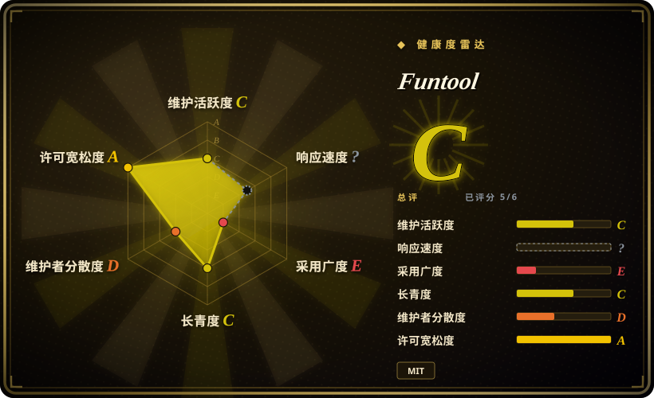
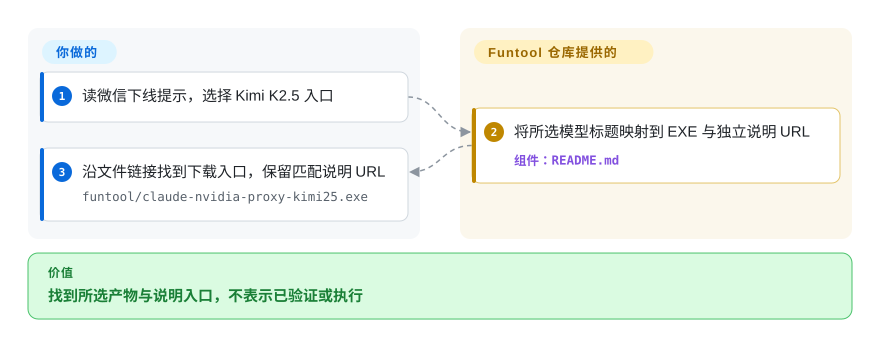
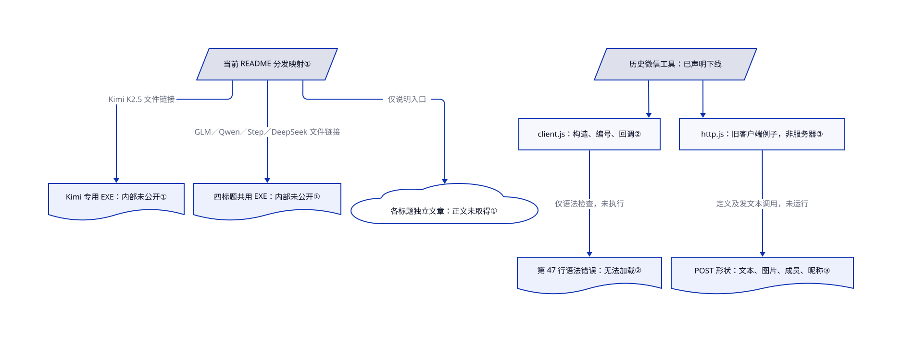

# Funtool

你沿微信机器人仓库找代码，旧工具却已下线；Funtool 现在列出 NVIDIA 模型代理 EXE 和独立说明链接，没有当前代理源码。

## 何时使用

你在评估仓库点名的 NVIDIA 模型与 Claude Code CLI 路线，想先找到打包好的 Windows 程序，而不是自建代理。README 将 Kimi K2.5、GLM 4.7、Qwen3 Coder、Step-3.5-Flash 和 DeepSeek V3.2 分成下载与外部说明入口。这里只把 Funtool 当分发线索；独立取得匹配说明、接受二进制信任后，才考虑它而非可检查源码的路由器。

微信工具明确已下线。本次读到仓库 README 与历史 JS，没有取得公众号文章正文；不能确认当前代理配置可用、凭据安全或免费服务资格。这些是硬要求时，从下方可检查源码的替代品起步。

## 何时不用

- **必须检查凭据处理、依赖或自行重建。** 用 [LiteLLM](../litellm.zh.md) 或 [Claude Code Router](claude-code-router.zh.md)；当前 NVIDIA 代理 EXE 在此树中是闭源分发，不是可评审实现。历史微信 JS 不能补上这个缺口。
- **现在就要已核实的安装与配置路径。** 用 Claude Code Router 公开的配置流程；Funtool 仓库只有下载链接，没有当前端口、参数或 Claude 配置，本次也未取得外部文章正文。
- **要共享网关、预算与访问控制。** 用 LiteLLM；Funtool 的 README 没有证明这些控制或团队服务已经可用。
- **只要桌面供应商与配置切换。** 用 [CC Switch](../../agent-frameworks/coding-agents/orchestration-and-review/cc-switch.zh.md)；不需要代理时选其直连模式。Funtool 分发的则是请求链路中的不透明程序。
- **要求更广的维护与支持队伍。** 评估 LiteLLM 的厂商支持及商业功能边界；本仓库测得活跃作者集中于一人，当前二进制也无法用公开源码维护。
- **要旧微信机器人。** 不把留存 JS 当受支持产品，README 已注明工具下线。若要做本页现在覆盖的模型路由，用 Claude Code Router，不挪用旧消息客户端例子。

## 横向对比

| 替代品 | 是否收录 | 我们的评价 | 取舍 |
|---|---|---|---|
| [LiteLLM](../litellm.zh.md) | 已收录 | 要有源码可审、带预算的团队网关时选 LiteLLM；解决说明与二进制信任后，仅为找到那份特定 NVIDIA 程序才考虑 Funtool。 | LiteLLM 增加 Python 与服务器运维，还有企业功能边界；Funtool 给文件入口，没有当前实现或可比的治理证据。 |
| [Claude Code Router](claude-code-router.zh.md) | 已收录 | 要可检查、配置驱动的编程 agent 路由时选 Router；列出的预构建 NVIDIA 路线是决定约束时才考虑 Funtool。 | Router 增加 Node/Electron 与配置面；Funtool 提供的 EXE 无法仅凭源码树重建或确认运行方式。 |
| [CC Switch](../../agent-frameworks/coding-agents/orchestration-and-review/cc-switch.zh.md) | 已收录 | 要可视化切换供应商，尤其无需代理的直连配置时选 CC Switch；要评估列出的代理产物本身才考虑 Funtool。 | CC Switch 有可检查的桌面源码和可选路由模式；Funtool 分发清单更窄，本次未取得配套文章正文。 |

## 快速上手

打开固定版本 [README.md:12–31](https://github.com/cixingguangming55555/wechat-bot/blob/2afcb9d8d527a49cf684f9ba33853f23aa722e7b/README.md#L12-L31)，先看清微信工具已下线。选一条模型路线：Kimi K2.5 指向 `funtool/claude-nvidia-proxy-kimi25.exe`，其余四个标题都指向同一 `funtool/claude-nvidia-proxy.exe`。沿对应文件链接找到 GitHub 下载入口，保留配套外部说明 URL；这是获取与选择路径，不是已核实的启动教程。仓库提供这些入口，你负责取得可读说明，并在运行前核产物来源、授权和凭据处理。本次未取得公众号正文，因此不提供当前端口、命令参数、配置或承诺输出。README 称上游模型免费，但账号资格、额度与持续费用未核；本次没有执行 EXE、登录或调用模型。

<!-- flow-steps:begin (generated from flows/funtool.json by tools/flow_card.py — do not edit) -->

流程文字版

1. **你**：读微信下线提示，选择 Kimi K2.5 入口
2. **Funtool**：将所选模型标题映射到 EXE 与独立说明 URL — 组件：`README.md`
3. **你**：沿文件链接找到下载入口，保留匹配说明 URL — `funtool/claude-nvidia-proxy-kimi25.exe`

**价值**：找到所选产物与说明入口，不表示已验证或执行

<!-- flow-steps:end -->

## 技术要点

<!-- mechanism:begin (generated from mechanisms/funtool.json by tools/mechanism_card.py; do not edit) -->

机制文字版

- 当前 README 分发映射①
- Kimi 专用 EXE：内部未公开①
- 四标题共用 EXE：内部未公开①
- 各标题独立文章：正文未取得①
- 历史微信工具：已声明下线
- client.js：构造、编号、回调②
- 第 47 行语法错误：无法加载②
- http.js：旧客户端例子，非服务器③
- POST 形状：文本、图片、成员、昵称③

- 当前 README 分发映射① → Kimi 专用 EXE：内部未公开①（Kimi K2.5 文件链接）
- 当前 README 分发映射① → 四标题共用 EXE：内部未公开①（GLM／Qwen／Step／DeepSeek 文件链接）
- 当前 README 分发映射① → 各标题独立文章：正文未取得①（仅说明入口）
- 历史微信工具：已声明下线 → client.js：构造、编号、回调②
- client.js：构造、编号、回调② → 第 47 行语法错误：无法加载②（仅语法检查，未执行）
- 历史微信工具：已声明下线 → http.js：旧客户端例子，非服务器③
- http.js：旧客户端例子，非服务器③ → POST 形状：文本、图片、成员、昵称③（定义及发文本调用，未运行）

<!-- mechanism:end -->

### 1. 模型名映射到分发文件，不冒充可检查的代理实现

- **解决：** 只看模型标题，不知道该找哪份程序、配哪篇说明。
- **做法：** README 给 Kimi K2.5 单独的 EXE，GLM、Qwen3 Coder、Step、DeepSeek 四个标题则共用另一个 EXE 路径，每个标题各有文章链接。这是分发映射，不是可见的请求路由逻辑。
- **边界：** 当前代理在此树中无公开源码，共用 EXE 如何选模型、如何转换协议、鉴权和保存凭据，都不能从文件名核实。本次没有检查文章正文、执行程序或逆向二进制内部。
- **源码：** 当前代理无公开源码；[分发条目第 14–31 行](https://github.com/cixingguangming55555/wechat-bot/blob/2afcb9d8d527a49cf684f9ba33853f23aa722e7b/README.md#L14-L31)。

### 2. 旧事件接口草图与可运行客户端分开看

- **解决：** 追查旧微信消息接口时，需要知道事件词汇，但不能把残留文件当成当前适配器。
- **做法：** 历史 `client.js` 写有本地 WebSocket 构造调用（与同一台机器维持消息连接）、消息编号常量，以及连接、断开、收到消息时的回调与打印。这些展示旧事件接口的形状。
- **边界：** 结尾括号不配对，`node --check` 在第 47 行失败，所以这份提交文件无法加载，不证明连接或收消息成功。README 已标微信工具下线，旧端口也不是当前 NVIDIA/Claude 代理配置。
- **源码：** [构造与编号第 4–24 行](https://github.com/cixingguangming55555/wechat-bot/blob/2afcb9d8d527a49cf684f9ba33853f23aa722e7b/funtool/client.js#L4-L24)、[回调与错误结尾第 32–49 行](https://github.com/cixingguangming55555/wechat-bot/blob/2afcb9d8d527a49cf684f9ba33853f23aa722e7b/funtool/client.js#L32-L49)、[下线声明第 12 行](https://github.com/cixingguangming55555/wechat-bot/blob/2afcb9d8d527a49cf684f9ba33853f23aa722e7b/README.md#L12-L12)。

### 3. 展示历史消息请求形状，不当作当前网关 API

- **解决：** 留存请求例子容易被误认成服务器实现，或替代代理的当前 API。
- **做法：** 历史 `http.js` 把微信用户 ID 放进 JSON，组装发送文本、图片的 POST 请求，还定义成员和昵称请求，并从 `main` 调用发送文本例子。它演示旧客户端会提交什么，不解释服务器怎样处理。
- **边界：** 这些是已下线微信工具的客户端例子，不证明当前 EXE 的模型路由、访问控制或兼容性；本次未执行任何示例请求。
- **源码：** [文本与图片请求第 35–67 行](https://github.com/cixingguangming55555/wechat-bot/blob/2afcb9d8d527a49cf684f9ba33853f23aa722e7b/funtool/http.js#L35-L67)、[成员、昵称及调用第 74–115 行](https://github.com/cixingguangming55555/wechat-bot/blob/2afcb9d8d527a49cf684f9ba33853f23aa722e7b/funtool/http.js#L74-L115)、[下线声明第 12 行](https://github.com/cixingguangming55555/wechat-bot/blob/2afcb9d8d527a49cf684f9ba33853f23aa722e7b/README.md#L12-L12)。

## 技术栈

- **当前产物：** 已提交的 Windows EXE，对应 README 点名的 NVIDIA/Claude Code CLI 路线；已查源码树没有公开它们的实现语言、库或构建过程。
- **README 链接以外的留存产物：** 树中共有 6 份二进制，不止列出的两份代理 EXE。`funtool/` 还保留 `nvidia-llm-proxy.exe`、`funtool-4.0.0.26-receive-message.exe`、`funtool.4.0.0.26.disable.auto.update.exe` 和 `funtool_4.0.0.26_only_printlog.exe.zip`，后三份带旧 Funtool 名称。工具下线不等于文件移除；它们的内容、用途与兼容性没有核验，不用未列明文件替换有说明入口的产物。
- **历史源码：** Node.js 风格的 JavaScript，导入 `ws` 与 `request-promise`，用于已下线微信客户端示例。GitHub 的 JavaScript 主语言字段描述可见旧文件，不描述当前 EXE。
- **交付：** Markdown 下载与文章链接、Git 跟踪的二进制；没有包清单或当前代理构建教程。GitHub 的 954186 KiB 仓库大小是历史与存储信号，不是实测浅克隆下载量。

## 依赖

- 浏览与获取需要访问 GitHub，并取得与产物匹配的可读说明；本次没有这些外部文章正文。
- README 面向 Claude Code CLI 与 NVIDIA 模型服务，但没写当前凭据、运行库、支持的 Windows 版本、端点配置或启动参数。不按相似代理填补缺口。
- 若独立继续使用，须提供获准执行环境与私密凭据策略。安装旧 JS 的包不是当前 EXE 安装路径。

## 运维难度

**查找低，可信运维高；启动成本未知。** README 方便找文件，不证明能安全或正常启动。你要解决说明、来源、私密凭据处理、更新版本匹配和无代理源码时的故障定位。历史 JS 不减轻这个负担；这些要求未独立满足前，不向评估中的程序提供可信生产凭据。

## 健康度与可持续性

- **判断日期 2026-10-14：** 源码不透明的产物目录，不是可审计网关。Master 最后更新于 2026-02-09，未归档，GitHub Releases 为空；文件通过分支提交分发。
- **治理与采用：** 上游是个人账号，测得活跃维护者 1 人，连续性集中；2520 stars 表示关注，不证明安装安全或当前模型请求成功。
- **年龄与 Lindy：** 创建于 2020-02-17，约 6.7 年，但原微信产品已下线，当前代理代码缺失。仓库年龄不能直接变成替换 EXE 的耐久证据。
- **许可边界：** 根 MIT 文本写 Binaryify 和 2013–2016；评分器的宽松许可等级只针对识别到的文本，不是二进制审计，也不确认当前 EXE 的授权与来源。

## 存疑（未验证）

- [未验证：公众号正文未取得] 当前用法、文章与产物版本匹配、端口、参数及 Claude 配置仍未知；本轮未打开外部文章。
- [未验证：当前代理没有对应源码，且未执行或逆向EXE] 协议转换、鉴权、凭据存储、内置依赖、遥测、更新行为和运行结果均未确认。
- [未验证：根MIT没有单独说明当前二进制授权范围] Binaryify 声明不能解决当前 EXE 权利与来源问题；再分发或商业依赖前须取得说明。
- [未验证：未核NVIDIA服务账号条款和额度] README 的免费模型说法不证明你的账号持续可用、资格、限流或费用。
- [未验证：README未说明额外四份二进制，且未执行或逆向] 未列明的代理命名 EXE 与三份旧 Funtool 命名 EXE/ZIP 仍可从源码树下载，但内容与当前用途未知。
