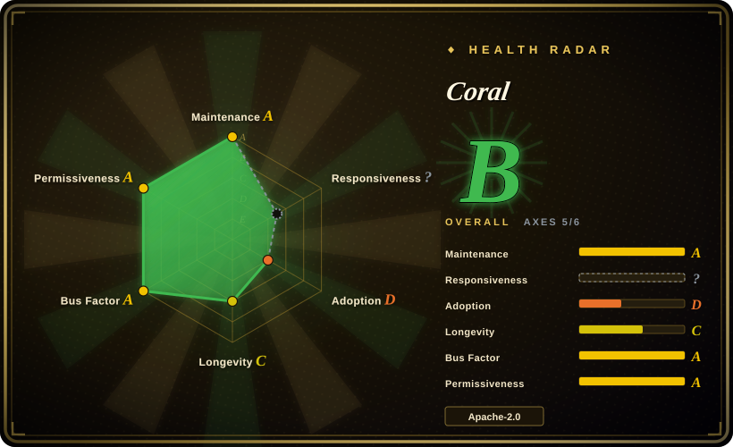
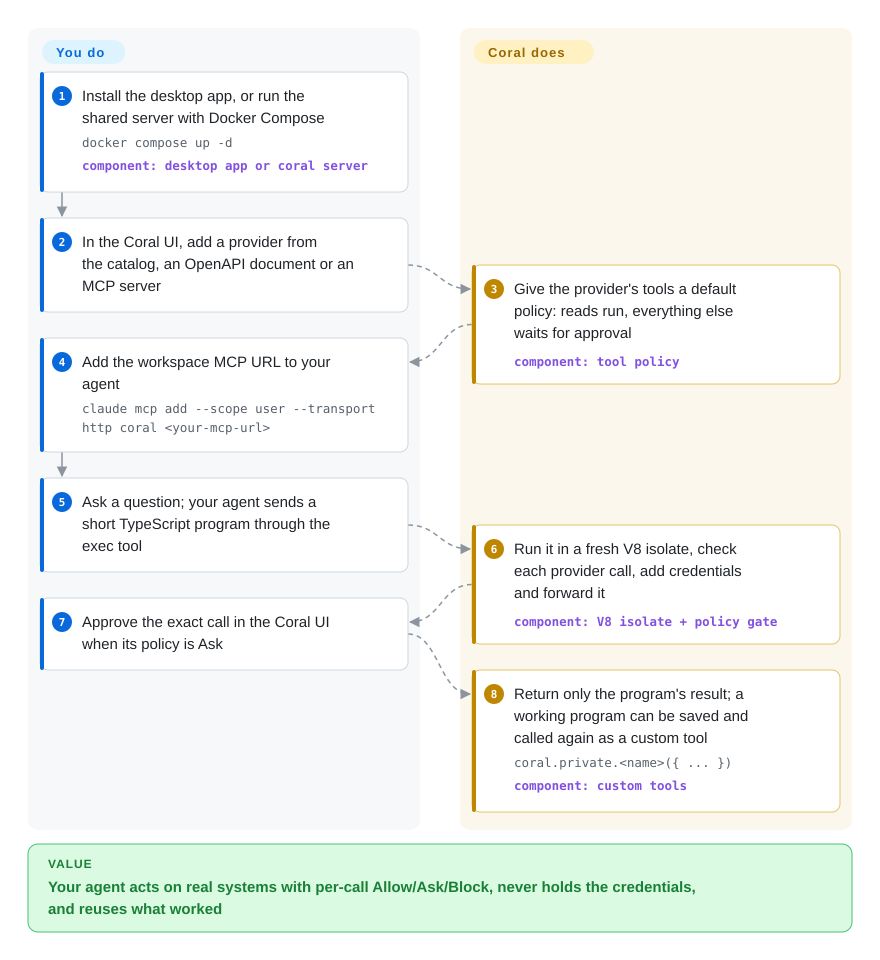
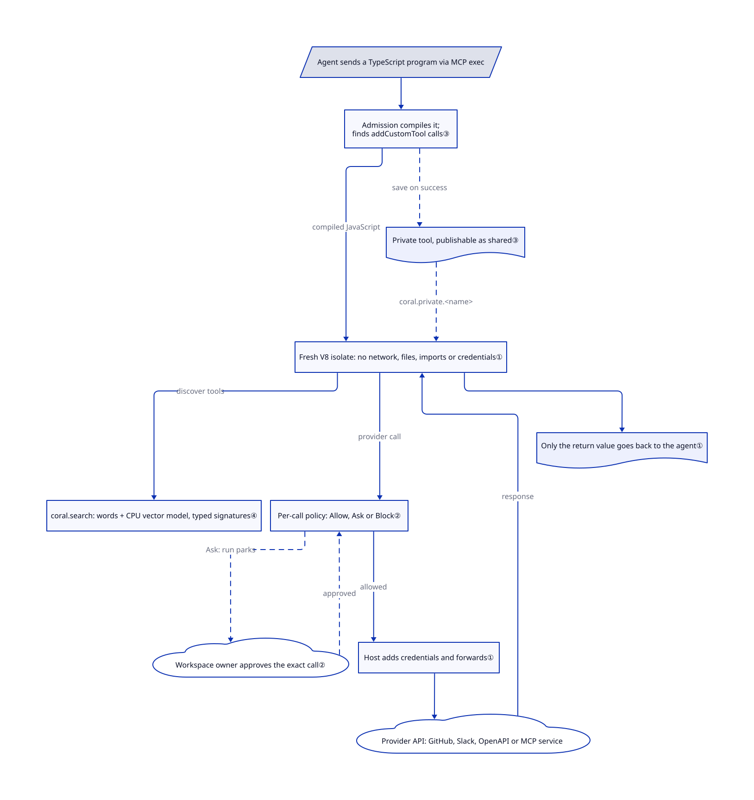

# Coral

Your agent can reach GitHub, Slack or a refunds API, but a gateway can only show or hide a whole tool: if the agent may call `update_record`, it may update any record, and the next day it re-reads the same schemas and re-writes the same calls. Coral makes the agent send a short TypeScript program instead; the program runs in a sandbox that holds no credentials, every provider call inside it is checked as Allow, Ask or Block, and a program that worked can be saved as a narrower, reusable tool.

## When to use

You run agents (Claude Code, Codex, a support bot) against company systems: GitHub, Linear, Slack, a warehouse, an internal OpenAPI service. Security will not hand the agent a token that can, say, `POST /refunds` for any amount, and an ordinary MCP gateway only lets you allow or deny whole tools. Meanwhile each task burns turns re-reading tool schemas and pulling a 40 KB `pulls.list` response through the model's context to find three pull request numbers. Reach for Coral when the deciding requirement is **per-call control over writes plus credentials that never enter the agent**: the agent writes a program that filters data before returning it, a person approves the exact refund call in the Coral UI, and a program that should only ever touch one field (`closeStaleTicket`) becomes a saved tool with its own policy.

Pick it over [Agentgateway](agentgateway.md) when you want code mode (the agent writes code that calls many tools in one step) and saved custom tools, not MCP federation and list/call rules over unchanged tools. Pick it over an in-process library such as [Monty](../sandboxing/monty.md) when you want a ready gateway with a UI, provider catalog, credential storage and approvals rather than building those yourself. The tradeoff is a young, company-run, fast-moving product (v1 is five weeks old) with an `ee/` source-available boundary.

## When NOT to use

- **You only need several assistants to share MCP servers with list/call rules.** Use [Agentgateway](agentgateway.md): it federates and filters existing MCP tools without asking agents to change how they call them. Coral's value depends on the agent writing TypeScript programs; a client that cannot run code mode well gets little from it.
- **Your agent is your own code and you want policy at each function boundary, not a separate server.** Use [Agent Governance Toolkit](../agent-governance/agent-governance-toolkit.md) to wrap actions in-process, or embed [Monty](../sandboxing/monty.md) to run model-written code inside your own runtime. Coral is a separate service with its own users, workspaces and database.
- **You need rules on argument values from configuration alone.** Coral's policy is one of Allow/Ask/Block per exact tool; it has no argument patterns or conditions. Value rules (only refunds under 50 USD) must be written as code in a custom tool, so someone has to write, review and own that code. If declarative attribute rules are the requirement, put a policy engine in front of your own tools with [Agent Governance Toolkit](../agent-governance/agent-governance-toolkit.md).
- **You need a strict no-egress or air-gapped install out of the box.** Despite the README's "zero data egress", official release builds (desktop app and `ghcr.io/withcoral/coral`) send one anonymous usage report per day to `telemetry.withcoral.com` by default, and on first start the server downloads a 133 MB search model from GitHub. Set `CORAL_DISABLE_USAGE_DATA=1` or `DO_NOT_TRACK=1` and pre-place the model under `/opt/coral/models`, or build from source (source builds never send).
- **You need SSO with SAML, SCIM, advanced RBAC or an immutable audit log now.** Those are announced for Coral Enterprise, which the README says is "coming soon" under the `ee/LICENSE` that forbids production use without a subscription. Use your identity provider in front of [Agentgateway](agentgateway.md) or wait for a priced, shipped Enterprise edition.
- **You need a stable API to build on for a year.** v1 (2026-10-12) was a ground-up rewrite that dropped the 0.x SQL interface with no migration, and nine minor releases followed in five weeks. Pin a version and re-test custom tools on every upgrade, or choose an older gateway such as [Kong](kong.md) if you only need HTTP-level control.
- **You want a shared paid catalog of third-party APIs behind one token.** Use [Treg](treg.md); Coral connects your own provider accounts and does not resell API access.

## Comparison

| Alternative | In index | Our verdict | Tradeoff |
|---|---|---|---|
| [Agentgateway](agentgateway.md) | ✅ | Choose Agentgateway when several clients must share existing MCP servers under configured list/call policy; choose Coral when agents should write programs, keep raw data out of context, and save narrow custom tools. | Linux Foundation charter and Apache-2.0 policy layer, but tools stay all-or-nothing; Coral adds code mode, approvals and credential storage, run by a single company with an `ee/` carve-out. |
| [Agent Governance Toolkit](../agent-governance/agent-governance-toolkit.md) | ✅ | Choose AGT when you control the agent's code and can wrap each action with in-process policy and audit; choose Coral when the agent is an off-the-shelf MCP client you cannot modify. | AGT gives declarative policy at your own call sites but you build the enforcement points; Coral enforces at the network boundary with less policy expressiveness (Allow/Ask/Block per tool). |
| [Monty](../sandboxing/monty.md) | ✅ | Choose Monty to add code mode inside your own Python agent with no extra service; choose Coral when you also need provider catalog, credentials, approvals and a team UI. | Monty is a library-level Python subset interpreter you wire up; Coral is a full TypeScript/V8 gateway with database, identity provider and UI to operate. |
| [Treg](treg.md) | ✅ | Choose Treg when the problem is sharing many paid third-party APIs through one token and catalog; choose Coral when the problem is governing what agents do with your own systems. | Treg meters and injects credentials for catalog operations under a custom license; Coral governs per-call writes and saved programs but supplies no third-party accounts. |
| IBM ContextForge (`IBM/mcp-context-forge`) | not indexed | Consider ContextForge when you want an Apache-2.0 registry and proxy over MCP, A2A and REST without an enterprise carve-out; choose Coral for code mode and saved custom tools. Not added in this tab batch. | Broader protocol federation from a large vendor, but no evidence read here of in-sandbox programs or per-call human approval; not evaluated in this review. |

## Quick start

For yourself, download the desktop app (macOS Apple silicon, Windows x64, Linux x86_64 AppImage) from the `withcoral/coral-releases` page; for a team, run the `coral` and `coral-web` images with Docker Compose or Kubernetes behind your own OIDC identity provider (the service that signs users in, such as Okta) and a TLS reverse proxy. In the Coral UI you add a provider (one service such as GitHub, chosen from the catalog or described by your own OpenAPI document or MCP server), connect an account, and adjust each tool's policy: Allow, Ask (a person confirms each call) or Block. Then you register the workspace's MCP URL in your agent once. From there the agent writes TypeScript programs that Coral runs, checks and forwards, and you approve calls whose policy is Ask. You remain responsible for the policy itself, for reviewing custom tools before a workspace owner shares them, and for running the server (identity, database, backups of the credentials key).

<!-- flow-steps:begin (generated from flows/coral.json by tools/flow_card.py — do not edit) -->

Text version of the flow

1. **You**: Install the desktop app, or run the shared server with Docker Compose — `docker compose up -d` — component: `desktop app or coral server`
2. **You**: In the Coral UI, add a provider from the catalog, an OpenAPI document or an MCP server
3. **Coral**: Give the provider's tools a default policy: reads run, everything else waits for approval — component: `tool policy`
4. **You**: Add the workspace MCP URL to your agent — `claude mcp add --scope user --transport http coral <your-mcp-url>`
5. **You**: Ask a question; your agent sends a short TypeScript program through the exec tool
6. **Coral**: Run it in a fresh V8 isolate, check each provider call, add credentials and forward it — component: `V8 isolate + policy gate`
7. **You**: Approve the exact call in the Coral UI when its policy is Ask
8. **Coral**: Return only the program's result; a working program can be saved and called again as a custom tool — `coral.private.<name>({ ... })` — component: `custom tools`

**Value**: Your agent acts on real systems with per-call Allow/Ask/Block, never holds the credentials, and reuses what worked

<!-- flow-steps:end -->

## Key techniques

<!-- mechanism:begin (generated from mechanisms/coral.json by tools/mechanism_card.py; do not edit) -->

Text version of the mechanism

- Agent sends a TypeScript program via MCP exec
- Admission compiles it; finds addCustomTool calls③
- Fresh V8 isolate: no network, files, imports or credentials①
- coral.search: words + CPU vector model, typed signatures④
- Per-call policy: Allow, Ask or Block②
- Workspace owner approves the exact call②
- Host adds credentials and forwards①
- Provider API: GitHub, Slack, OpenAPI or MCP service
- Only the return value goes back to the agent①
- Private tool, publishable as shared③

- Agent sends a TypeScript program via MCP exec → Admission compiles it; finds addCustomTool calls③
- Admission compiles it; finds addCustomTool calls③ → Fresh V8 isolate: no network, files, imports or credentials① (compiled JavaScript)
- Fresh V8 isolate: no network, files, imports or credentials① → coral.search: words + CPU vector model, typed signatures④ (discover tools)
- Fresh V8 isolate: no network, files, imports or credentials① → Per-call policy: Allow, Ask or Block② (provider call)
- Per-call policy: Allow, Ask or Block② → Workspace owner approves the exact call② (Ask: run parks) [optional/fallback]
- Workspace owner approves the exact call② → Per-call policy: Allow, Ask or Block② (approved) [optional/fallback]
- Per-call policy: Allow, Ask or Block② → Host adds credentials and forwards① (allowed)
- Host adds credentials and forwards① → Provider API: GitHub, Slack, OpenAPI or MCP service
- Provider API: GitHub, Slack, OpenAPI or MCP service → Fresh V8 isolate: no network, files, imports or credentials① (response)
- Fresh V8 isolate: no network, files, imports or credentials① → Only the return value goes back to the agent①
- Admission compiles it; finds addCustomTool calls③ → Private tool, publishable as shared③ (save on success) [optional/fallback]
- Private tool, publishable as shared③ → Fresh V8 isolate: no network, files, imports or credentials① (coral.private.&lt;name&gt;) [optional/fallback]

<!-- mechanism:end -->

### 1. Run agent code in a fresh V8 isolate that holds no credentials

- **Problem:** Calling tools one by one sends every raw response through the model and needs many turns; letting the agent run arbitrary code with real tokens would be worse.
- **How:** The program is compiled from TypeScript and executed in a fresh V8 isolate (a separate JavaScript heap inside the V8 engine) with no Node, browser, package, filesystem, environment, timer, network, WebAssembly or dynamic-code access. Provider calls go through a narrow host interface; the host checks policy, adds credentials and forwards, and only the program's return value goes back to the agent.
- **Limits:** The per-run CPU budget is unset by default and cannot be enabled on Windows; default heap is 128 MiB. Programs cannot import npm packages. Isolation rests on V8 and on Run Executor child processes whose OS-level confinement this review did not audit.
- **Source:** [isolate authority:1–16](https://github.com/withcoral/coral/blob/88c62f1dd5cdf75fe630ccfe7ecf15dd3fc55b08/crates/coral-v8/src/lib.rs#L1-L16), [CPU budget:1–26](https://github.com/withcoral/coral/blob/88c62f1dd5cdf75fe630ccfe7ecf15dd3fc55b08/crates/coral-v8/src/cpu.rs#L1-L26), [heap and CPU settings:100–102](https://github.com/withcoral/coral/blob/88c62f1dd5cdf75fe630ccfe7ecf15dd3fc55b08/apps/docs/reference/configuration.mdx#L100-L102), [Run Executors:1–18](https://github.com/withcoral/coral/blob/88c62f1dd5cdf75fe630ccfe7ecf15dd3fc55b08/crates/coral-run-executor/src/lib.rs#L1-L18).

### 2. Check every provider call, defaulting writes to human approval

- **Problem:** A gateway that only hides or shows tools cannot stop a permitted tool from being called with damaging arguments.
- **How:** Each call inside a program is checked against an exact per-workspace, per-provider, per-tool state: enabled, approval_required or disabled. Without an explicit rule, a tool that declares itself read-only or uses a safe HTTP method is enabled and everything else needs approval. An Ask call parks the run on the server until a workspace owner approves the exact call and arguments, so the run survives the agent disconnecting.
- **Limits:** The rule has no argument conditions, so value limits require custom-tool code. The read-only default trusts the provider's `readOnlyHint` or HTTP method; a mislabeled tool would run unapproved. Only workspace owners can approve.
- **Source:** [policy interface:1–30](https://github.com/withcoral/coral/blob/88c62f1dd5cdf75fe630ccfe7ecf15dd3fc55b08/crates/coral-policy/src/lib.rs#L1-L30), [default state:1130–1149](https://github.com/withcoral/coral/blob/88c62f1dd5cdf75fe630ccfe7ecf15dd3fc55b08/crates/coral-policy/src/lib.rs#L1130-L1149), [enforcement point:1–13](https://github.com/withcoral/coral/blob/88c62f1dd5cdf75fe630ccfe7ecf15dd3fc55b08/crates/coral-run/src/enforcement.rs#L1-L13), [approvals:78–85](https://github.com/withcoral/coral/blob/88c62f1dd5cdf75fe630ccfe7ecf15dd3fc55b08/apps/docs/guides/permissions.mdx#L78-L85).

### 3. Save a working program as a private or shared tool

- **Problem:** Agents redo the same discovery and code every task, and broad provider tools cannot express "change one field on stale tickets only".
- **How:** A program passes a top-level function to `coral.addCustomTool`; at admission Coral saves that function plus every top-level declaration it reaches as a module under `coral.private.<name>`. A workspace owner can publish an immutable revision under `coral.shared`. The custom tool gets its own Allow/Ask/Block, and provider calls inside it are still checked.
- **Limits:** The project's own ablation found the mechanism did not change whether agents save or reuse, and Claude Code never saved unprompted. Saved code is not type-checked or effect-analyzed; top-level initialization reruns in every run that links it.
- **Source:** [ADR 0031 save by reference:5–30](https://github.com/withcoral/coral/blob/88c62f1dd5cdf75fe630ccfe7ecf15dd3fc55b08/docs/adr/0031-agents-save-functions-inside-programs.md#L5-L30), [ADR 0031 measurement:50–54](https://github.com/withcoral/coral/blob/88c62f1dd5cdf75fe630ccfe7ecf15dd3fc55b08/docs/adr/0031-agents-save-functions-inside-programs.md#L50-L54), [private and shared tools:1–22](https://github.com/withcoral/coral/blob/88c62f1dd5cdf75fe630ccfe7ecf15dd3fc55b08/crates/coral-tools/src/lib.rs#L1-L22).

### 4. Discover tools from inside the program with word and vector search

- **Problem:** Thousands of provider operations cannot all sit in the model's context, and word search misses a tool described in different words than the query.
- **How:** Programs call the built-in `coral.search`, which ranks provider, private and shared tools the caller may see and returns abridged TypeScript declarations. Each kind runs a lexical query beside a vector query from `BAAI/bge-small-en-v1.5` on the CPU, fused by position; the team's labelled bench moved hit@10 from 0.668 to 0.753 on its largest set.
- **Limits:** The bench is the vendor's own. The model is downloaded from GitHub on first start unless pre-placed, and is skipped on x86-64 CPUs without v3 features, which then rank by words only. Postgres deployments need pgvector for the vector side.
- **Source:** [ADR 0026 discovery in programs:5–20](https://github.com/withcoral/coral/blob/88c62f1dd5cdf75fe630ccfe7ecf15dd3fc55b08/docs/adr/0026-agents-discover-tools-inside-programs.md#L5-L20), [ADR 0035 vector list:5–20](https://github.com/withcoral/coral/blob/88c62f1dd5cdf75fe630ccfe7ecf15dd3fc55b08/docs/adr/0035-universal-search-adds-a-vector-list-from-a-bundled-cpu-model.md#L5-L20), [search module:1–55](https://github.com/withcoral/coral/blob/88c62f1dd5cdf75fe630ccfe7ecf15dd3fc55b08/crates/coral-search/src/lib.rs#L1-L55), [model download:120](https://github.com/withcoral/coral/blob/88c62f1dd5cdf75fe630ccfe7ecf15dd3fc55b08/apps/docs/reference/configuration.mdx#L120).

## Tech stack

- Rust 2024 workspace (rust-version 1.100) of about 30 `coral-*` crates: the `v8` crate (=152.2.0) for compile and execution isolates, oxc for TypeScript parsing, axum for HTTP, rusqlite/sqlx for SQLite and Postgres, sqlite-vec or pgvector for vectors, ONNX Runtime (via `ort`) for the embedding model, OpenTelemetry for traces and metrics.
- Coral UI (`apps/reef`): React 19, React Router and Vite. Desktop app (`apps/desktop`): Electron 45 with electron-updater.
- Enterprise crates live in `ee/crates`; a plain `cargo build` builds only the Apache-2.0 crates, while the released binary is built from `ee/crates/coral-ee` and runs as Community Edition until a license enables Enterprise features.

## Dependencies

- **Desktop:** nothing beyond the app; it keeps serving MCP in the background after the window closes.
- **Shared server:** an OIDC identity provider, a TLS-terminating reverse proxy, DNS and certificates for three hostnames (`<coral-host>`, `auth.<coral-host>`, `mcp.<coral-host>`), and SQLite (default) or Postgres (pgvector when vector search is on). Keep `CORAL_CREDENTIALS_KEY` or the key file with every backup; losing it fails closed.
- **Outbound:** HTTPS to every provider you add, GitHub for the 133 MB search model unless pre-placed, and `telemetry.withcoral.com` for usage reports unless disabled.
- **Clients:** an MCP client that speaks Streamable HTTP; v1 dropped the 0.x stdio transport.

## Ops difficulty

**Low for the desktop app; medium to high for a shared server.** The desktop path is download-and-run with self-updates. A team server means operating OIDC, TLS, three public endpoints, the database and the credentials key, and upgrading `coral` and `coral-web` together; the guide says to back up before each upgrade because Coral migrates its own database on start. The policy work is ongoing: someone must review each provider's defaults, decide which writes are Ask, and review custom tools before a workspace owner shares them. Turn off usage reporting explicitly if your environment forbids outbound telemetry.

## Health & viability

- **Maintenance (2026-11-18):** very active. Daily merged pull requests, 46 releases since v0.1.0 on 2026-04-08, and v1.0.0 through v1.8.0 between 2026-10-12 and 2026-11-13. Engineering is unusually documented (37 ADRs with measured ablations).
- **Governance and backing:** owned by Phoebe Technology Limited (the `withcoral` organization), which also sells the forthcoming Enterprise edition. The roadmap and merge rights sit with that company; the top contributors are a handful of people with hundreds of commits each. [推断：employment inferred from commit volume and the CLA flow, not confirmed] Corporate contributors must sign a CLA.
- **Age and Lindy:** about seven and a half months old, and the current v1 is a five-week-old rewrite. There is no Lindy support yet; 5,017 stars and 226 forks this early are an attention signal, not proof of durable adoption.
- **Adoption:** the README claims thousands of developers at more than 450 companies and benchmark wins over other MCP gateways; neither was independently checkable here.
- **Risk flags:** open core (`ee/` under a license that forbids production use without a subscription, plus Enterprise features not yet shipped); default-on usage telemetry in release builds that contradicts the "zero data egress" line; a 0.x→1.0 rewrite with no data migration, which shows willingness to break users early.

## Caveats (unverified)

- [未验证：no build, install or traffic was run in this review] Performance claims (37% fewer tokens, 31% lower cost, 29% faster, "Opus-level accuracy at Haiku cost") are vendor benchmarks and were not reproduced.
- [未验证：marketing claim with no public customer list] "Thousands of developers at more than 450 companies" and the ISO/IEC 27001:2022 certification were not verified.
- [未验证：the benchmark page is on withcoral.com, not in the repo] Blind-benchmark wins over other MCP gateways were not checked; the compared gateways are not named in the README.
- [推断：based on the coral-v8 module docs and Run Executor process layout, not a security audit] The isolate has no network or credential authority; V8 escape resistance and OS confinement of Run Executor child processes were not tested.
- [推断：from the default-policy code path] A provider tool that wrongly declares `readOnlyHint` or uses GET for a mutation would run without approval under the default policy.
- [未验证：Enterprise edition not yet released] Enterprise pricing, feature set and whether any currently open feature moves into `ee/` are unknown.
- [未验证：ContextForge was not read beyond its repository metadata] Its feature comparison row is limited to what its description states.
- [推断：from commit counts and the CLA requirement] The core team appears to be company employees; actual bus factor was not confirmed.
