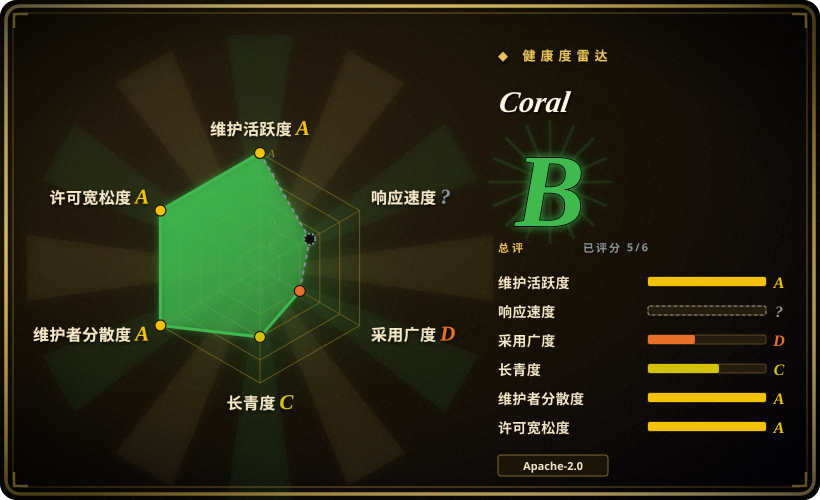
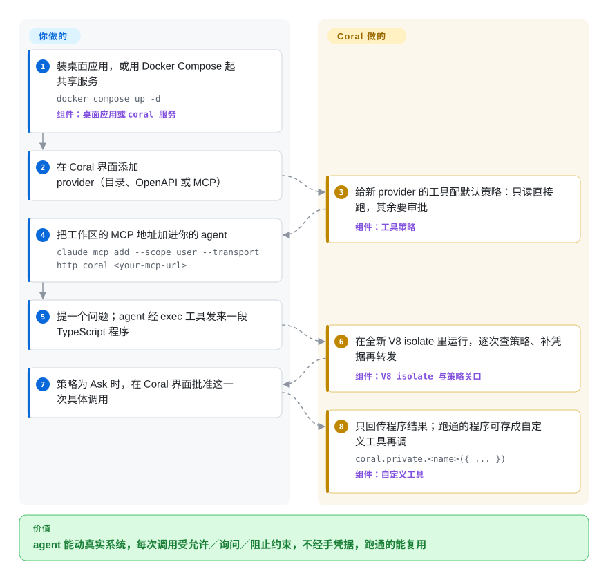
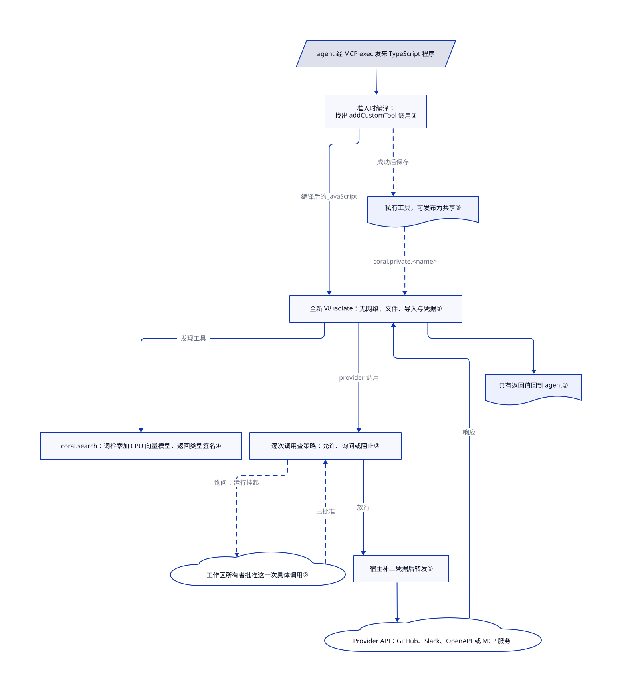

# Coral

你的 agent 连得上 GitHub、Slack 甚至退款接口，可网关只能整个放行或整个屏蔽一个工具：允许它调 `update_record`，它就能随便改任何一条记录；第二天它还得重新读一遍同样的 schema、重写一遍同样的调用。Coral 改让 agent 发一小段 TypeScript 程序：程序在不持有任何凭据的沙箱里跑，里面每一次对外部服务的调用都要过允许、询问或阻止这一关，跑通的程序还能存成范围更窄、可复用的工具。

## 何时使用

你让 agent（Claude Code、Codex、客服机器人）去动公司里的系统：GitHub、Linear、Slack、数仓、内部 OpenAPI 服务。安全团队不会把一个能对任意金额发 `POST /refunds` 的令牌交给 agent，而普通的 MCP 网关只能按整个工具允许或拒绝。与此同时，每个任务都在反复读工具 schema，为了找出三个 PR 编号，把 40 KB 的 `pulls.list` 原始响应整个塞进模型上下文。当决定性需求是**能逐次管住写操作、凭据又永远不进 agent** 时，就该想到 Coral：agent 写程序，先在程序里过滤数据再返回；退款那一次具体调用由人在 Coral 界面里批准；本该只改一个字段的操作（比如 `closeStaleTicket`）存成一个有自己策略的工具。

和 [Agentgateway](agentgateway.zh.md) 比，你要的是 code mode（agent 写代码，一步里调多个工具）和可保存的自定义工具，而不是对原样工具做 MCP 聚合和列出／调用规则时，选 Coral。和 [Monty](../sandboxing/monty.zh.md) 这类进程内库比，你要的是现成网关，自带界面、provider 目录、凭据存储和审批，而不是自己搭这些时，选 Coral。代价是：这是一个很年轻、由公司主导、变化很快的产品（v1 才五周），并且有一块 `ee/` 源码可见但非开源的边界。

## 何时不用

- **你只是想让几个助手共享 MCP 服务，并配上列出／调用规则。** 用 [Agentgateway](agentgateway.zh.md)：它聚合并过滤现有 MCP 工具，不要求 agent 改变调用方式。Coral 的价值建立在 agent 会写 TypeScript 程序上，code mode 跑不好的客户端从它这里得不到多少好处。
- **agent 是你自己写的代码，你想在每个函数边界上做策略，而不是另起一个服务。** 用 [Agent Governance Toolkit](../agent-governance/agent-governance-toolkit.zh.md) 在进程内包住每个动作，或者嵌入 [Monty](../sandboxing/monty.zh.md) 在自己的运行时里执行模型写的代码。Coral 是一个独立服务，有自己的用户、工作区和数据库。
- **你要只靠配置就对参数值设规则。** Coral 的策略是按具体工具三选一：允许、询问或阻止，没有参数模式或条件。“只允许 50 美元以下的退款”这类值规则只能写成自定义工具里的代码，于是得有人写、审、长期维护这段代码。如果声明式的属性规则才是硬需求，在你自己的工具前面放 [Agent Governance Toolkit](../agent-governance/agent-governance-toolkit.zh.md) 这样的策略引擎。
- **你要开箱即用的零外联或气隙环境。** 尽管 README 写着“zero data egress”，官方发行版（桌面应用和 `ghcr.io/withcoral/coral` 镜像）默认每天向 `telemetry.withcoral.com` 发一份匿名使用报告，服务端首次启动还会从 GitHub 下载 133 MB 的搜索模型。设置 `CORAL_DISABLE_USAGE_DATA=1` 或 `DO_NOT_TRACK=1`，把模型预先放到 `/opt/coral/models`，或者干脆从源码构建（源码构建从不发送）。
- **你现在就要 SAML 单点登录、SCIM、高级 RBAC 或不可篡改审计日志。** 这些被划给 Coral Enterprise，README 写的是“即将推出”，许可证是 `ee/LICENSE`，没有订阅不得用于生产。可以在 [Agentgateway](agentgateway.zh.md) 前面接你自己的身份提供方，或者等企业版真正发布并定价。
- **你要一个一年内稳定、可以放心在上面开发的 API。** v1（2026-10-12）是推倒重写，砍掉了 0.x 的 SQL 接口且不做迁移，之后五周里又出了九个小版本。要用就锁版本，每次升级重测自定义工具；如果你只需要 HTTP 层的控制，选更老牌的网关，比如 [Kong](kong.zh.md)。
- **你要的是一个用一个令牌访问的第三方付费 API 共享目录。** 用 [Treg](treg.zh.md)；Coral 连接的是你自己的 provider 账号，不转售 API 访问。

## 横向对比

| 替代品 | 是否收录 | 我们的评价 | 取舍 |
|---|---|---|---|
| [Agentgateway](agentgateway.zh.md) | 已收录 | 多个客户端要在配置好的列出／调用策略下共享现有 MCP 服务时选 Agentgateway；要让 agent 写程序、把原始数据挡在上下文之外、并保存窄范围自定义工具时选 Coral。 | Agentgateway 有 Linux 基金会章程和 Apache-2.0 的策略层，但工具仍是全有或全无；Coral 多了 code mode、审批和凭据存储，代价是单一公司主导，并有 `ee/` 划出的部分。 |
| [Agent Governance Toolkit](../agent-governance/agent-governance-toolkit.zh.md) | 已收录 | 你掌控 agent 代码、能在每个动作外面包一层进程内策略和审计时选 AGT；agent 是你改不了的现成 MCP 客户端时选 Coral。 | AGT 能在你自己的调用点上写声明式策略，但执行点要你自己搭；Coral 在网络边界上强制执行，策略表达力较弱（每个工具只有允许／询问／阻止）。 |
| [Monty](../sandboxing/monty.zh.md) | 已收录 | 想在自己的 Python agent 里加 code mode、又不想多一个服务时选 Monty；还需要 provider 目录、凭据、审批和团队界面时选 Coral。 | Monty 是要你自己接线的库级 Python 子集解释器；Coral 是完整的 TypeScript／V8 网关，要运维数据库、身份提供方和界面。 |
| [Treg](treg.zh.md) | 已收录 | 要解决的是通过一个令牌和目录共享很多付费第三方 API 时选 Treg；要解决的是管住 agent 对你自己系统做什么时选 Coral。 | Treg 在自定义许可证下为目录操作计量并注入凭据；Coral 管逐次写操作和保存的程序，但不提供任何第三方账号。 |
| IBM ContextForge（`IBM/mcp-context-forge`） | 未收录 | 想要一个覆盖 MCP、A2A 和 REST、没有企业版划分的 Apache-2.0 注册中心加代理时考虑 ContextForge；要 code mode 和保存自定义工具时选 Coral。本批标签处理中未收录。 | 大厂出品、协议聚合面更广，但本次没有读到它支持沙箱内程序或逐次人工审批的证据；本次未评估。 |

## 快速上手

自己用的话，从 `withcoral/coral-releases` 页面下载桌面应用（macOS Apple 芯片、Windows x64、Linux x86_64 AppImage）；团队用的话，用 Docker Compose 或 Kubernetes 运行 `coral` 和 `coral-web` 两个镜像，前面接你自己的 OIDC 身份提供方（负责让用户登录的服务，比如 Okta）和一个做 TLS 的反向代理。在 Coral 界面里添加 provider（一个具体服务，比如 GitHub，可以从目录里选，也可以用你自己的 OpenAPI 文档或 MCP 服务描述），连上账号，再逐个调整工具策略：允许、询问（每次调用都由人确认）或阻止。然后把工作区的 MCP 地址在你的 agent 里登记一次。之后 agent 写 TypeScript 程序，Coral 负责运行、检查和转发；策略为询问的调用由你来批准。你仍然要负责：策略本身怎么定、工作区所有者共享自定义工具前先审代码、以及运维服务端（身份、数据库、凭据密钥的备份）。

<!-- flow-steps:begin (generated from flows/coral.json by tools/flow_card.py — do not edit) -->

流程文字版

1. **你**：装桌面应用，或用 Docker Compose 起共享服务 — `docker compose up -d` — 组件：`桌面应用或 coral 服务`
2. **你**：在 Coral 界面添加 provider（目录、OpenAPI 或 MCP）
3. **Coral**：给新 provider 的工具配默认策略：只读直接跑，其余要审批 — 组件：`工具策略`
4. **你**：把工作区的 MCP 地址加进你的 agent — `claude mcp add --scope user --transport http coral <your-mcp-url>`
5. **你**：提一个问题；agent 经 exec 工具发来一段 TypeScript 程序
6. **Coral**：在全新 V8 isolate 里运行，逐次查策略、补凭据再转发 — 组件：`V8 isolate 与策略关口`
7. **你**：策略为 Ask 时，在 Coral 界面批准这一次具体调用
8. **Coral**：只回传程序结果；跑通的程序可存成自定义工具再调 — `coral.private.<name>({ ... })` — 组件：`自定义工具`

**价值**：agent 能动真实系统，每次调用受允许／询问／阻止约束，不经手凭据，跑通的能复用

<!-- flow-steps:end -->

## 技术要点

<!-- mechanism:begin (generated from mechanisms/coral.json by tools/mechanism_card.py; do not edit) -->

机制文字版

- agent 经 MCP exec 发来 TypeScript 程序
- 准入时编译； 找出 addCustomTool 调用③
- 全新 V8 isolate：无网络、文件、导入与凭据①
- coral.search：词检索加 CPU 向量模型，返回类型签名④
- 逐次调用查策略：允许、询问或阻止②
- 工作区所有者批准这一次具体调用②
- 宿主补上凭据后转发①
- Provider API：GitHub、Slack、OpenAPI 或 MCP 服务
- 只有返回值回到 agent①
- 私有工具，可发布为共享③

- agent 经 MCP exec 发来 TypeScript 程序 → 准入时编译； 找出 addCustomTool 调用③
- 准入时编译； 找出 addCustomTool 调用③ → 全新 V8 isolate：无网络、文件、导入与凭据①（编译后的 JavaScript）
- 全新 V8 isolate：无网络、文件、导入与凭据① → coral.search：词检索加 CPU 向量模型，返回类型签名④（发现工具）
- 全新 V8 isolate：无网络、文件、导入与凭据① → 逐次调用查策略：允许、询问或阻止②（provider 调用）
- 逐次调用查策略：允许、询问或阻止② → 工作区所有者批准这一次具体调用②（询问：运行挂起）〔可选／兜底〕
- 工作区所有者批准这一次具体调用② → 逐次调用查策略：允许、询问或阻止②（已批准）〔可选／兜底〕
- 逐次调用查策略：允许、询问或阻止② → 宿主补上凭据后转发①（放行）
- 宿主补上凭据后转发① → Provider API：GitHub、Slack、OpenAPI 或 MCP 服务
- Provider API：GitHub、Slack、OpenAPI 或 MCP 服务 → 全新 V8 isolate：无网络、文件、导入与凭据①（响应）
- 全新 V8 isolate：无网络、文件、导入与凭据① → 只有返回值回到 agent①
- 准入时编译； 找出 addCustomTool 调用③ → 私有工具，可发布为共享③（成功后保存）〔可选／兜底〕
- 私有工具，可发布为共享③ → 全新 V8 isolate：无网络、文件、导入与凭据①（coral.private.&lt;name&gt;）〔可选／兜底〕

<!-- mechanism:end -->

### 1. 在不持有凭据的全新 V8 isolate 里运行 agent 代码

- **解决：** 一个个调用工具，每份原始响应都要过一遍模型，轮次也多；可要是让 agent 拿着真实令牌随意跑代码，风险更大。
- **做法：** 程序从 TypeScript 编译后，在全新的 V8 isolate（V8 引擎里一块独立的 JavaScript 堆）中执行，没有 Node、浏览器、包、文件系统、环境变量、定时器、网络、WebAssembly 或动态代码能力。对 provider 的调用走一个很窄的宿主接口：宿主查策略、补凭据再转发，只有程序的返回值回到 agent。
- **边界：** 单次运行的 CPU 预算默认不设，Windows 上也开不了；默认堆上限 128 MiB。程序不能导入 npm 包。隔离依赖 V8 本身和 Run Executor 子进程，这些子进程在操作系统层面的约束本次没有审计。
- **源码：** [isolate 能力边界第 1–16 行](https://github.com/withcoral/coral/blob/88c62f1dd5cdf75fe630ccfe7ecf15dd3fc55b08/crates/coral-v8/src/lib.rs#L1-L16)、[CPU 预算第 1–26 行](https://github.com/withcoral/coral/blob/88c62f1dd5cdf75fe630ccfe7ecf15dd3fc55b08/crates/coral-v8/src/cpu.rs#L1-L26)、[堆与 CPU 配置第 100–102 行](https://github.com/withcoral/coral/blob/88c62f1dd5cdf75fe630ccfe7ecf15dd3fc55b08/apps/docs/reference/configuration.mdx#L100-L102)、[Run Executor 第 1–18 行](https://github.com/withcoral/coral/blob/88c62f1dd5cdf75fe630ccfe7ecf15dd3fc55b08/crates/coral-run-executor/src/lib.rs#L1-L18)。

### 2. 每次 provider 调用都过策略，写操作默认要人审批

- **解决：** 只会显示或隐藏工具的网关，挡不住一个被允许的工具带着破坏性参数被调用。
- **做法：** 程序里的每次调用都按“工作区＋provider＋具体工具”查一个确切状态：放行、需审批或禁用。没有显式规则时，声明自己只读、或用安全 HTTP 方法的工具直接放行，其余都要审批。询问类调用会把这次运行挂在服务端，直到工作区所有者批准这一次具体调用和参数，所以 agent 断线了运行也不会丢。
- **边界：** 规则没有参数条件，金额之类的限制只能写进自定义工具的代码。只读默认值信任 provider 给的 `readOnlyHint` 或 HTTP 方法，标错的工具会不经审批直接执行。只有工作区所有者能批准。
- **源码：** [策略接口第 1–30 行](https://github.com/withcoral/coral/blob/88c62f1dd5cdf75fe630ccfe7ecf15dd3fc55b08/crates/coral-policy/src/lib.rs#L1-L30)、[默认状态第 1130–1149 行](https://github.com/withcoral/coral/blob/88c62f1dd5cdf75fe630ccfe7ecf15dd3fc55b08/crates/coral-policy/src/lib.rs#L1130-L1149)、[执行点第 1–13 行](https://github.com/withcoral/coral/blob/88c62f1dd5cdf75fe630ccfe7ecf15dd3fc55b08/crates/coral-run/src/enforcement.rs#L1-L13)、[审批说明第 78–85 行](https://github.com/withcoral/coral/blob/88c62f1dd5cdf75fe630ccfe7ecf15dd3fc55b08/apps/docs/guides/permissions.mdx#L78-L85)。

### 3. 把跑通的程序存成私有或共享工具

- **解决：** agent 每个任务都重做同样的发现和代码；宽泛的 provider 工具也表达不了“只改长期无动静工单的一个字段”。
- **做法：** 程序把一个顶层函数传给 `coral.addCustomTool`；准入阶段 Coral 把这个函数连同它引用到的所有顶层声明一起存成模块，挂在 `coral.private.<name>` 下。工作区所有者可以把它发布成 `coral.shared` 下不可变的版本。自定义工具有自己的允许／询问／阻止，里面的 provider 调用照样逐次检查。
- **边界：** 项目自己的消融实验发现，这套机制并没有改变 agent 会不会保存或复用；Claude Code 在没人提示时从来不主动保存。保存的代码不做类型检查和副作用分析，顶层初始化在每次链接它的运行里都会重跑。
- **源码：** [ADR 0031 按引用保存第 5–30 行](https://github.com/withcoral/coral/blob/88c62f1dd5cdf75fe630ccfe7ecf15dd3fc55b08/docs/adr/0031-agents-save-functions-inside-programs.md#L5-L30)、[ADR 0031 测量结论第 50–54 行](https://github.com/withcoral/coral/blob/88c62f1dd5cdf75fe630ccfe7ecf15dd3fc55b08/docs/adr/0031-agents-save-functions-inside-programs.md#L50-L54)、[私有与共享工具第 1–22 行](https://github.com/withcoral/coral/blob/88c62f1dd5cdf75fe630ccfe7ecf15dd3fc55b08/crates/coral-tools/src/lib.rs#L1-L22)。

### 4. 在程序里用词检索加向量检索发现工具

- **解决：** 成千上万个 provider 操作不可能全塞进模型上下文；只按词检索，又会漏掉描述用词和查询不同的工具。
- **做法：** 程序调用内置的 `coral.search`，它对调用者可见的 provider 工具、私有工具和共享工具排序，返回删节过的 TypeScript 声明。每类工具都同时跑一条词检索和一条向量检索（`BAAI/bge-small-en-v1.5`，在 CPU 上运行），按名次融合；团队自建的标注基准上，最大一组的 hit@10 从 0.668 升到 0.753。
- **边界：** 基准是厂商自己的。模型首次启动时从 GitHub 下载，除非预先放好；x86-64 CPU 不支持 v3 指令集时直接跳过模型，只按词排序。用 Postgres 时向量检索需要 pgvector。
- **源码：** [ADR 0026 在程序内发现第 5–20 行](https://github.com/withcoral/coral/blob/88c62f1dd5cdf75fe630ccfe7ecf15dd3fc55b08/docs/adr/0026-agents-discover-tools-inside-programs.md#L5-L20)、[ADR 0035 向量检索第 5–20 行](https://github.com/withcoral/coral/blob/88c62f1dd5cdf75fe630ccfe7ecf15dd3fc55b08/docs/adr/0035-universal-search-adds-a-vector-list-from-a-bundled-cpu-model.md#L5-L20)、[搜索模块第 1–55 行](https://github.com/withcoral/coral/blob/88c62f1dd5cdf75fe630ccfe7ecf15dd3fc55b08/crates/coral-search/src/lib.rs#L1-L55)、[模型下载第 120 行](https://github.com/withcoral/coral/blob/88c62f1dd5cdf75fe630ccfe7ecf15dd3fc55b08/apps/docs/reference/configuration.mdx#L120)。

## 技术栈

- Rust 2024 工作区（rust-version 1.100），约 30 个 `coral-*` crate：`v8` crate（=152.2.0）负责编译和执行 isolate，oxc 解析 TypeScript，axum 做 HTTP，rusqlite／sqlx 访问 SQLite 和 Postgres，sqlite-vec 或 pgvector 存向量，ONNX Runtime（经 `ort`）跑嵌入模型，OpenTelemetry 出追踪和指标。
- Coral 界面（`apps/reef`）：React 19、React Router 和 Vite。桌面应用（`apps/desktop`）：Electron 45 加 electron-updater。
- 企业版 crate 放在 `ee/crates`；在仓库根目录直接 `cargo build` 只构建 Apache-2.0 的 crate，而官方发行的二进制是从 `ee/crates/coral-ee` 构建的，在许可证启用企业功能之前以社区版运行。

## 依赖

- **桌面版：** 除应用本身外不需要别的；关掉窗口后它仍在后台提供 MCP 服务。
- **共享服务端：** 一个 OIDC 身份提供方、一个做 TLS 终止的反向代理、三个主机名（`<coral-host>`、`auth.<coral-host>`、`mcp.<coral-host>`）的 DNS 和证书，以及 SQLite（默认）或 Postgres（开启向量检索时需要 pgvector）。每次备份都要带上 `CORAL_CREDENTIALS_KEY` 或密钥文件；密钥丢了会直接拒绝工作。
- **出站：** 到你添加的每个 provider 的 HTTPS；除非预先放好模型，还要能访问 GitHub 下载 133 MB 的搜索模型；除非关闭，还会访问 `telemetry.withcoral.com` 发使用报告。
- **客户端：** 支持 Streamable HTTP 的 MCP 客户端；v1 已经去掉 0.x 的 stdio 传输。

## 运维难度

**桌面版低；共享服务端中到高。** 桌面版下载即用，自动更新。团队服务端意味着要运维 OIDC、TLS、三个公开端点、数据库和凭据密钥，并且 `coral` 与 `coral-web` 要同版本一起升级；因为 Coral 启动时会自己迁移数据库，文档要求每次升级前先备份。策略工作是持续性的：得有人审每个 provider 的默认值、决定哪些写操作设为询问，并在工作区所有者共享自定义工具前审代码。如果环境禁止出站遥测，要显式关掉使用报告。

## 健康度与可持续性

- **维护（2026-11-18）：** 非常活跃。每天都有 PR 合并，自 2026-04-08 的 v0.1.0 起共 46 个版本，2026-10-12 到 2026-11-13 之间从 v1.0.0 发到 v1.8.0。工程决策记录得异常完整（37 篇 ADR，附带实测的消融实验）。
- **治理与背书：** 归 Phoebe Technology Limited（`withcoral` 组织）所有，这家公司同时在卖即将推出的企业版。路线图和合并权都在这家公司手里；头部贡献者是少数几个人，每人数百次提交。[推断：雇佣关系是从提交量和 CLA 流程推出来的，未确认] 企业贡献者须签 CLA。
- **年龄与 Lindy：** 项目约七个半月，当前的 v1 是五周前的重写。还谈不上 Lindy 支撑；这么早就有 5,017 星、226 个 fork，说明受关注，不能证明会被长期采用。
- **采用：** README 声称有超过 450 家公司的数千名开发者在用，并在基准上胜过其他 MCP 网关；两者本次都无法独立核实。
- **风险信号：** open core（`ee/` 的许可证禁止无订阅用于生产，企业功能尚未发布）；发行版默认开启使用遥测，和“zero data egress”的说法矛盾；0.x 到 1.0 的重写不做数据迁移，说明早期愿意让用户承受破坏性变更。

## 存疑（未验证）

- [未验证：本次没有构建、安装或发送流量] 性能数字（token 少 37%、成本低 31%、快 29%、“Haiku 的价格拿到 Opus 的准确率”）都是厂商基准，未复现。
- [未验证：营销说法，没有公开客户名单] “超过 450 家公司的数千名开发者”以及 ISO/IEC 27001:2022 认证未核实。
- [未验证：基准页面在 withcoral.com 上，不在仓库里] 对其他 MCP 网关的盲测胜出没有核对；README 没写比的是哪些网关。
- [推断：依据 coral-v8 模块文档和 Run Executor 的进程布局，不是安全审计] isolate 没有网络和凭据能力；V8 逃逸抵抗力以及 Run Executor 子进程的操作系统级约束未测试。
- [推断：依据默认策略的代码路径] 错误声明 `readOnlyHint`、或用 GET 做修改的 provider 工具，在默认策略下会不经审批直接执行。
- [未验证：企业版尚未发布] 企业版定价、功能集合，以及现有开源功能是否会挪进 `ee/`，都未知。
- [未验证：ContextForge 只读了仓库元数据] 对比表里它那一行只限于其仓库描述所写的内容。
- [推断：依据提交数和 CLA 要求] 核心团队看起来是公司员工；真实的巴士因子未确认。
