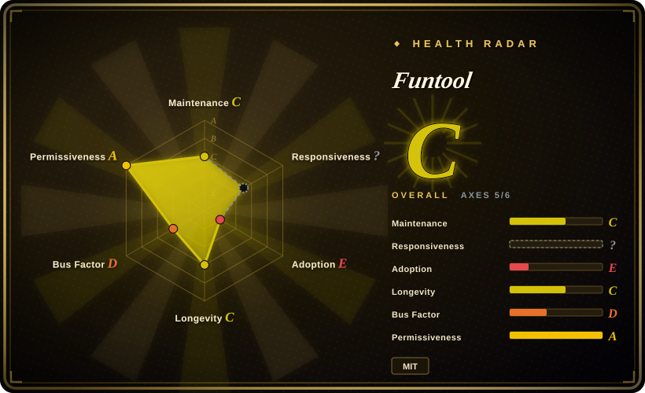
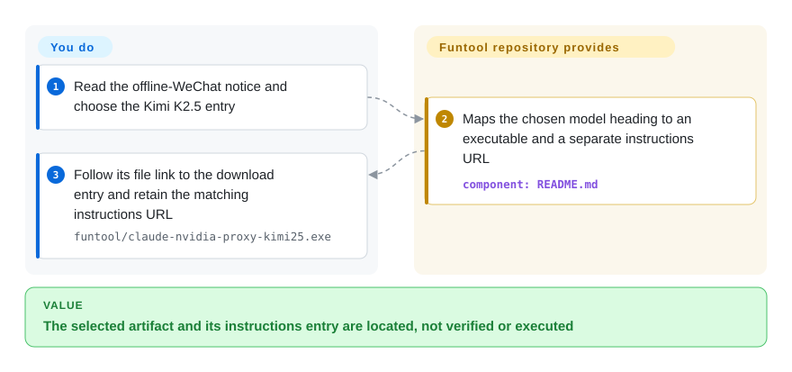

# Funtool

You followed a WeChat-bot repository looking for code, but that tool is offline; Funtool now lists NVIDIA model-proxy EXEs and separate setup articles, without the current proxy source.

## When to use

You are evaluating the specific NVIDIA-backed Claude Code CLI routes named in this repository and want to locate their packaged Windows executable rather than build a proxy. The README groups Kimi K2.5, GLM 4.7, Qwen3 Coder, Step-3.5-Flash and DeepSeek V3.2 under download and external-documentation links. Treat Funtool as a distribution lead only, and consider it over an inspectable router only after you independently obtain matching instructions and accept binary trust.

The WeChat tool is explicitly offline. This review obtained the repository README and historical JS, not the linked WeChat article bodies; it does not establish a working current proxy configuration, credential safety or a free-service entitlement. If those are hard requirements, start from the inspectable alternatives below.

## When NOT to use

- **You must inspect credential handling, dependencies or rebuilds.** Use [LiteLLM](litellm.md) or [Claude Code Router](claude-code-router.md); the current NVIDIA proxy EXEs are closed-source distributions in this tree, not reviewable implementations. Historical WeChat JS does not close that gap.
- **You need a verified install/configuration path now.** Choose Claude Code Router's published configuration workflow; Funtool's repository supplies download links, not current ports, arguments or Claude configuration, and its external article bodies were not obtained here.
- **You need a shared gateway with budgets and access control.** Use LiteLLM; Funtool's README does not establish those controls or an operated team service.
- **You only need a desktop provider/configuration switcher.** Use [CC Switch](../agent-frameworks/coding-agents/orchestration-and-review/cc-switch.md); choose its direct mode when you do not need an extra proxy. Funtool distributes an opaque request-path program instead.
- **You need a broader maintainer/support bench.** Evaluate LiteLLM's vendor-backed gateway, including its commercial boundaries; this repository's measured active-author concentration is one person, and you cannot maintain the current binary from the published source.
- **You want the old WeChat bot.** Do not adopt the retained JS as a supported product: README marks that tool offline. For the model-routing task this page now covers, use Claude Code Router rather than repurposing old message-client examples.

## Comparison

| Alternative | In index | Our verdict | Tradeoff |
|---|---|---|---|
| [LiteLLM](litellm.md) | ✅ | Choose LiteLLM for a source-reviewable team gateway with budgets; consider Funtool only for locating its exact NVIDIA executable after resolving instructions and binary trust. | LiteLLM adds Python/server operations and an enterprise feature boundary; Funtool gives file links without current implementation or comparable governance evidence. |
| [Claude Code Router](claude-code-router.md) | ✅ | Choose Router for inspectable, configuration-driven coding-agent routing; consider Funtool only if the listed prebuilt NVIDIA route is the deciding constraint. | Router adds a Node/Electron and configuration surface; Funtool offers EXEs whose operation cannot be rebuilt or confirmed from this tree alone. |
| [CC Switch](../agent-frameworks/coding-agents/orchestration-and-review/cc-switch.md) | ✅ | Choose CC Switch for visual provider switching, especially direct configuration without a proxy; consider Funtool only when evaluating the listed proxy artifacts themselves. | CC Switch has inspectable desktop code and optional routing mode; Funtool has a narrower distribution list with unavailable setup article bodies in this review. |

## Quick start

Open the pinned [README.md:12–31](https://github.com/cixingguangming55555/wechat-bot/blob/2afcb9d8d527a49cf684f9ba33853f23aa722e7b/README.md#L12-L31) and first note that the WeChat tool is offline. Select one listed model route: Kimi K2.5 points to `funtool/claude-nvidia-proxy-kimi25.exe`, while the other four headings point to the same `funtool/claude-nvidia-proxy.exe` path. Follow the corresponding file link to its GitHub download entry and retain the matching external-documentation URL; this is an acquisition/selection path, not a verified launch recipe. The repository supplies those entries, while you must obtain readable instructions and verify artifact provenance, authorization and credential handling before running anything. The linked WeChat article bodies were not obtained, so this page supplies no current port, command-line arguments, configuration or promised output. README calls the upstream models free, but quotas, account eligibility and continuing cost were not verified; no EXE, login or model call was executed in this review.

<!-- flow-steps:begin (generated from flows/funtool.json by tools/flow_card.py — do not edit) -->

Text version of the flow

1. **You**: Read the offline-WeChat notice and choose the Kimi K2.5 entry
2. **Funtool**: Maps the chosen model heading to an executable and a separate instructions URL — component: `README.md`
3. **You**: Follow its file link to the download entry and retain the matching instructions URL — `funtool/claude-nvidia-proxy-kimi25.exe`

**Value**: The selected artifact and its instructions entry are located, not verified or executed

<!-- flow-steps:end -->

## Key techniques

- **Current distribution is a model-to-file/document map, not visible proxy code.** [README.md:14–31](https://github.com/cixingguangming55555/wechat-bot/blob/2afcb9d8d527a49cf684f9ba33853f23aa722e7b/README.md#L14-L31) gives one distinct Kimi executable and four model headings sharing another executable, each with a separate article link. This organizes selection and acquisition, but does not prove how that shared EXE selects models. **The current proxy program's internal mechanisms have no source to inspect in this tree**; protocol conversion, authentication and credential storage remain unknown, not inferred from the filenames.
- **Historical WebSocket client prints WeChat messages; it is offline, not the current proxy.** [funtool/client.js:4–24](https://github.com/cixingguangming55555/wechat-bot/blob/2afcb9d8d527a49cf684f9ba33853f23aa722e7b/funtool/client.js#L4-L24) opens a loopback WebSocket and declares message codes; [funtool/client.js:32–49](https://github.com/cixingguangming55555/wechat-bot/blob/2afcb9d8d527a49cf684f9ba33853f23aa722e7b/funtool/client.js#L32-L49) registers callbacks and logs incoming data. It demonstrates the old client event surface, not a WebSocket server or any NVIDIA/Claude adapter; [README.md:12](https://github.com/cixingguangming55555/wechat-bot/blob/2afcb9d8d527a49cf684f9ba33853f23aa722e7b/README.md#L12) marks the WeChat tool offline. Its historical port is not a current proxy setup value.
- **Historical HTTP examples assemble message requests; they are offline, not current product APIs.** [funtool/http.js:35–67](https://github.com/cixingguangming55555/wechat-bot/blob/2afcb9d8d527a49cf684f9ba33853f23aa722e7b/funtool/http.js#L35-L67) posts text/picture JSON with a WeChat user ID; [funtool/http.js:74–115](https://github.com/cixingguangming55555/wechat-bot/blob/2afcb9d8d527a49cf684f9ba33853f23aa722e7b/funtool/http.js#L74-L115) defines member/nickname requests and invokes a text-send example. These are client-side examples, not the server implementation or evidence of the current EXEs' model-routing, access control or compatibility.

## Tech stack

- **Current artifacts:** committed Windows EXEs for README-named NVIDIA/Claude Code CLI routes; their implementation language, libraries and build process are not published in the inspected tree.
- **Historical source:** Node.js-style JavaScript importing `ws` and `request-promise`, for the offline WeChat client examples. GitHub's JavaScript primary-language field describes visible historical files, not the current EXEs.
- **Delivery:** Markdown download/article links and Git-tracked binaries; no package manifest or current proxy build recipe. GitHub's 954186 KiB repository-size metadata is a history/storage signal, not a measured shallow-download size.

## Dependencies

- Browsing/acquisition needs GitHub access and readable instructions matching the chosen artifact; those external article bodies are absent from this review.
- README targets Claude Code CLI and NVIDIA model service access, but does not specify current credentials, runtime libraries, supported Windows versions, endpoint configuration or launch arguments. Do not fill those gaps from a similar proxy.
- If you proceed independently, provide an approved execution environment and private credential policy. Installing the historical JS packages is not an installation path for the current EXEs.

## Ops difficulty

**Low to locate, high to assure; launch effort is unknown.** README makes files easy to find, but it does not establish a safe or working setup. You must resolve instructions, provenance, private credential handling, update/version matching and incident diagnosis without the proxy source. Historical JS does not reduce that burden; keep executable evaluation outside trusted production credentials until those requirements are independently met.

## Health & viability

- **Verdict, 2026-10-14:** a source-opaque artifact catalog, not an auditable gateway. Master last changed on 2026-02-09, the repository is not archived, and GitHub Releases is empty; files are distributed through branch commits.
- **Governance and adoption:** a personal-account upstream and 1 measured active maintainer concentrate continuity; 2520 stars are attention, not evidence of a safe installation or successful current model requests.
- **Age/Lindy:** created 2020-02-17, about 6.7 years old, but the former WeChat product is offline and current proxy code is absent. Repository age does not transfer into demonstrated durability of the replacement EXEs.
- **License boundary:** root MIT text names Binaryify and 2013–2016; the scorer's permissive-license grade is about that recognized text, not a binary audit or confirmation of the current EXEs' licensing/provenance.

## Caveats (unverified)

- [未验证：公众号正文未取得] Current setup instructions, article/artifact version alignment, ports, arguments and Claude configuration remain unknown; no external article was opened in this re-verification.
- [未验证：当前代理没有对应源码，且未执行或逆向EXE] Protocol conversion, authentication, credential storage, embedded dependencies, telemetry, update behavior and runtime results were not established.
- [未验证：根MIT没有单独说明当前二进制授权范围] The Binaryify notice does not settle current EXE rights or provenance; obtain clarification before redistribution or commercial reliance.
- [未验证：未核NVIDIA服务账号条款和额度] README's free-model wording does not establish ongoing availability, eligibility, rate limits or cost for your account.
