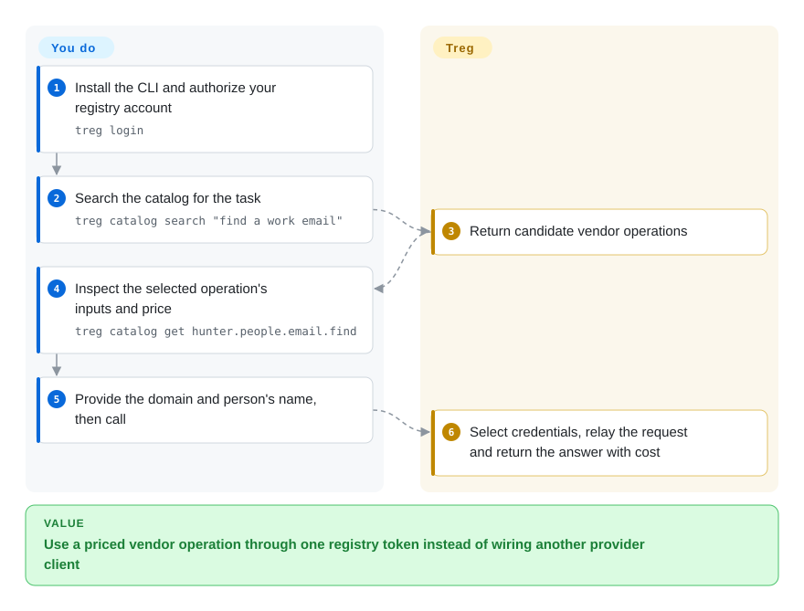
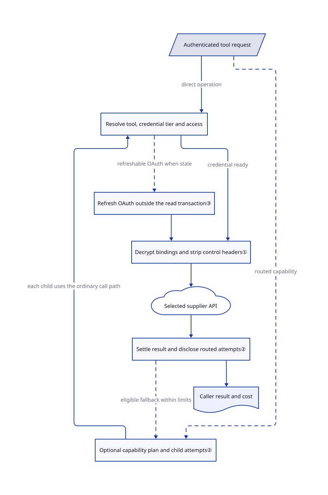

# Treg

Your agent needs a search result, a work email and a video, but each supplier demands another account and key. Treg puts a searchable tool catalog and server-side credential injection behind one token, with paid shared-provider calls and an internally self-hostable registry.

## When to use

You maintain agents for a team that already pays for several APIs. A teammate pastes a provider key into a skill, another duplicates it in a laptop's `.env`, and rotating it breaks both. Choose Treg when the shared unit is an actual API operation: register the team's tools and credentials once, then let agents call them through an authenticated registry. The server injects the provider credential rather than handing it to the HTTP caller. Its CLI, MCP interfaces and shared skills make that boundary usable from different agents.

You can instead use the hosted catalog when an occasional enrichment or media call does not justify a separate vendor subscription. Read the operation's input and price first; calls using Treg's accounts spend the team's prepaid balance. Unlike Monid's open connector engine, this repository includes registry and routing implementation. Internal self-hosting is allowed, but it neither supplies the hosted operator's provider accounts nor removes the custom license's service restrictions.

## When NOT to use

- **You will sell an embedded or managed registry to third parties.** The [license's additional terms](https://github.com/superdesigndev/treg/blob/ece225100e8d479fdcd8ac1eb44480c9283c458d/LICENSE#L1-L30) require prior written permission, and cover more than competing SaaS. Evaluate [Agentgateway](agentgateway.md) for an Apache-2.0 MCP gateway instead; it does not supply a paid data catalog.
- **You only need to federate existing MCP servers.** Choose [Agentgateway](agentgateway.md) for explicit list/call policy without adding Treg's marketplace, balances and vendor catalog. Treg's `/mcp/` and catalog-only `/mcp/v2/` deliberately expose different surfaces.
- **You need leased database credentials, PKI or an infrastructure secrets authority.** Choose [OpenBao](../secrets-management/openbao.md). Fernet-encrypted provider tokens and request injection are not a replacement for a secrets engine's lease/revocation model.
- **You want an embeddable, permissively licensed connector contract rather than a registry service.** Consider [Monid](monid.md), accepting that its hosted routing/credential platform is not in that open engine. Treg exposes more registry implementation but carries a custom redistribution/service boundary.
- **You require keys never to reach a local process or all calls to be free.** Prefer the HTTP proxy path, or OpenBao with your own narrowly scoped consumer. Treg's local-run mode deliberately releases a credential to a runner; protected mode requires a separate system user and administrator setup. Team-owned keys avoid Treg balance charges, not the supplier's bill. Routed calls may make several chargeable attempts.
- **Your workload must leave no sensitive payload at the gateway.** Use a separately approved direct vendor integration, or a configured Agentgateway boundary whose logging you have reviewed. Treg documents response archives and redacted failure evidence; neither credential injection nor an audit trail means zero data retention.

## Comparison

| Alternative | In index | Our verdict | Tradeoff |
|---|---|---|---|
| [Monid](monid.md) | Yes | Choose Monid to build and replay declarative vendor connectors under MIT; choose Treg when a runnable team registry and credential-injecting service are the required artifact. | Monid's open engine is narrower than its hosted platform; Treg publishes registry/routing code but restricts third-party managed and embedded services. |
| [Agentgateway](agentgateway.md) | Yes | Choose Agentgateway when federating existing MCP servers and enforcing tool policy is the job; choose Treg when discovering priced vendor operations and sharing team credentials is the job. | Protocol-aware Rust data plane versus a Python registry with catalog, balance and credential lifecycle; neither provides automatic OS isolation for tools. |
| [OpenBao](../secrets-management/openbao.md) | Yes | Choose OpenBao when machine identities need leased secrets and revocation; choose Treg when callers should receive an API result without first receiving that API's key. | A general secrets authority has unseal/storage operations; Treg couples custody to a call proxy and does not replace dynamic-secret engines. |

## Quick start

The [documented CLI-only package](https://github.com/superdesigndev/treg/blob/ece225100e8d479fdcd8ac1eb44480c9283c458d/README.md#L356-L359) is `pip install tools-registry`; it talks to an existing registry rather than starting a server. Use `treg login`, search the catalog, inspect an endpoint's parameters and price, then call it as shown below. You authorize the account, provide the input and approve spending; Treg selects the credential, forwards the request and reports the result/cost. The hosted service needs network access and paid calls need balance; your own provider key still incurs that provider's charges. The convenience installer also bootstraps agent skills, so do not treat it as a binary-only install. These commands were checked against pinned documentation, not executed in this review.

<!-- flow-steps:begin (generated from flows/treg.json by tools/flow_card.py — do not edit) -->

Text version of the flow

1. **You**: Install the CLI and authorize your registry account — `treg login`
2. **You**: Search the catalog for the task — `treg catalog search "find a work email"`
3. **Treg**: Return candidate vendor operations
4. **You**: Inspect the selected operation's inputs and price — `treg catalog get hunter.people.email.find`
5. **You**: Provide the domain and person's name, then call
6. **Treg**: Select credentials, relay the request and return the answer with cost

**Value**: Use a priced vendor operation through one registry token instead of wiring another provider client

<!-- flow-steps:end -->

## Key techniques

<!-- mechanism:begin (generated from mechanisms/treg.json by tools/mechanism_card.py; do not edit) -->

Text version of the mechanism

- Authenticated tool request
- Optional capability plan and child attempts②
- Resolve tool, credential tier and access
- Refresh OAuth outside the read transaction③
- Decrypt bindings and strip control headers①
- Selected supplier API
- Settle result and disclose routed attempts②
- Caller result and cost

- Authenticated tool request → Resolve tool, credential tier and access (direct operation)
- Authenticated tool request → Optional capability plan and child attempts② (routed capability) [optional/fallback]
- Optional capability plan and child attempts② → Resolve tool, credential tier and access (each child uses the ordinary call path)
- Resolve tool, credential tier and access → Refresh OAuth outside the read transaction③ (refreshable OAuth when stale) [optional/fallback]
- Refresh OAuth outside the read transaction③ → Decrypt bindings and strip control headers①
- Resolve tool, credential tier and access → Decrypt bindings and strip control headers① (credential ready)
- Decrypt bindings and strip control headers① → Selected supplier API
- Selected supplier API → Settle result and disclose routed attempts②
- Settle result and disclose routed attempts② → Optional capability plan and child attempts② (eligible fallback within limits) [optional/fallback]
- Settle result and disclose routed attempts② → Caller result and cost

<!-- mechanism:end -->

### 1. Inject credentials at the forwarding boundary

- **Problem:** A shared skill should not need to contain every teammate's provider key.
- **How:** The relay decrypts the resolved tool's secrets and applies each declared binding to a header, query parameter or JSON field. It strips Treg control headers and session cookies before forwarding; multiple bindings support APIs needing several credentials.
- **Limits:** JSON-field injection reserializes the body, so it is unsuitable for raw-body signatures. This is server custody, not protection from the server operator; shared-key calls also rewrite selected transport/account metadata.
- **Source:** [Binding application and forwarding:138–257](https://github.com/superdesigndev/treg/blob/ece225100e8d479fdcd8ac1eb44480c9283c458d/src/treg/infra/upstream/relay.py#L138-L257), [injection formats:54–139](https://github.com/superdesigndev/treg/blob/ece225100e8d479fdcd8ac1eb44480c9283c458d/src/treg/infra/upstream/injectors.py#L54-L139), [at-rest key:16–31](https://github.com/superdesigndev/treg/blob/ece225100e8d479fdcd8ac1eb44480c9283c458d/src/treg/crypto.py#L16-L31).

### 2. Route a capability through accountable child calls

- **Problem:** One vendor can return no useful match while another can answer, but trying all vendors can silently multiply cost.
- **How:** A `treg.<capability>` call builds candidates, prioritizes team credentials and runs each attempt through the ordinary call path. The response names the serving endpoint, attempts, ignored filters and total charged amount; child settlements defer to the parent outcome.
- **Limits:** This is an opt-in routed surface, not universal failover for vendor-specific calls. Misses can advance the waterfall and accumulate charges on a completed routed answer; failed routed calls release deferred charges. Filter support varies, so strict filtering and explicit cost limits matter.
- **Source:** [Candidate credentials and eligibility:256–373](https://github.com/superdesigndev/treg/blob/ece225100e8d479fdcd8ac1eb44480c9283c458d/src/treg/application/call/route.py#L256-L373), [settlement and attempts:432–557](https://github.com/superdesigndev/treg/blob/ece225100e8d479fdcd8ac1eb44480c9283c458d/src/treg/application/call/route.py#L432-L557), [output disclosure:803–851](https://github.com/superdesigndev/treg/blob/ece225100e8d479fdcd8ac1eb44480c9283c458d/src/treg/application/call/route.py#L803-L851).

### 3. Refresh OAuth without holding a database connection over the network

- **Problem:** Many agents can hit the same expired token at once, while an OAuth request can stall a database pool.
- **How:** A per-secret process lock rechecks the stored token, commits the read transaction, exchanges it outside that transaction, then conditionally updates the ciphertext it originally read. Reloading adopts whichever refresh won.
- **Limits:** The lock is process-local, not a distributed single-flight guarantee. Conditional persistence prevents overwriting a newer stored value, but does not prove simultaneous upstream refreshes are harmless. Tokens without refresh credentials remain manually maintained.
- **Source:** [Refreshability:45–55](https://github.com/superdesigndev/treg/blob/ece225100e8d479fdcd8ac1eb44480c9283c458d/src/treg/domain/connections/refresh.py#L45-L55), [refresh transaction boundary:145–195](https://github.com/superdesigndev/treg/blob/ece225100e8d479fdcd8ac1eb44480c9283c458d/src/treg/domain/connections/refresh.py#L145-L195).

## Tech stack

- Python `>=3.12,<3.14`; CLI entry point `treg.cli:main`. Base dependencies are HTTPX, PostHog and Questionary.
- The server extra adds FastAPI/Uvicorn, SQLModel/SQLAlchemy, Alembic, SQLite/PostgreSQL drivers, cryptography, MCP, Redis, QuickJS and storage/media helpers. The dashboard build uses Node/npm; the source README requires Node 22.12+.
- The pinned tree contains 341 Python files under `src/treg/`, plus a pytest suite. File presence is not a test-pass claim.

## Dependencies

- Hosted use needs the CLI or a compatible MCP client, a Treg account/token and network access. Third-party accounts and prepaid credit depend on which credential tier serves the call.
- Self-hosting needs `tools-registry[server]`, a persistent database and a durable `TREG_SECRET_KEY`. The empty-key fallback generates a process-local Fernet key; losing it makes stored ciphertext unusable after restart. Back up the database and key separately.
- You supply provider credentials, OAuth applications and chosen sign-in/email settings. The source does not grant the official service's supplier accounts or private operator policy extension. Redis provides configured shared counters; optional integrations introduce their own services.
- Protected local CLI runs add vendor binaries, a dedicated system user, sudoers and egress rules. Those administrator changes are not prerequisites for plain HTTP calls.

## Ops difficulty

**Medium for a private registry; high when it holds shared production credentials or prepaid money.** Maintain TLS, account scopes, encryption-key backups, schema upgrades, supplier quotas and audit/archive retention. Review the [local-run trust boundary](https://github.com/superdesigndev/treg/blob/ece225100e8d479fdcd8ac1eb44480c9283c458d/docs/context/architecture/local-run.md#L17-L62) before granting administrator setup; server-side CLI execution is disabled, and unconfigured local execution is only best-effort isolation. CLI command telemetry on treg.to can be disabled with `TREG_TELEMETRY=0` or `DO_NOT_TRACK=1`.

Stopping the service does not revoke supplier keys or undo API writes and charges. Remove installed skills/MCP entries separately and review any local-run system user, firewall rules and runner files before uninstalling. This review did not perform an installation or cleanup experiment.

## Health & viability

- **Maintenance, 2026-10-28:** the repository is unarchived, created 2026-07-15 and pushed on the observation date. The manifest says 0.27.0; the GitHub releases API returned an empty list, so that is not a claimed GitHub release.
- **Governance/backing:** Superdesign owns the organization repository and license. The sampled contributor list has several substantial contributors, led by JayZeeDesign, stonexer, shehjad-dev and unclecode; commit counts do not establish independent governance or a support SLA.
- **Age/adoption:** 6,423 stars and 551 forks were observed, but the project is only about three and a half months old. [推断：based on repository age and current activity, not longitudinal deployment evidence] Active work is encouraging; there is not yet a long-lived maintenance record to rely on.
- **License risk:** the actual license permits internal use but requires authorization for third-party hosted, managed or embedded service distribution. It is source-available with additional restrictions, not unmodified Apache-2.0. The manifest itself uses the Other/Proprietary classifier. The Vue runtime copy script preserves Vue's license in built distributions; this was not a whole-tree rights audit.
- **Radar coverage:** the automated aggregate is B with 4/6 axes scored. `no_package_structural` and `license_unparsed` leave adoption and license unknown to the scorer; they do not mean the documented Python package or the license file is absent.

## Caveats (unverified)

- [未验证：upstream execution, installation and paid calls were prohibited] Authentication, real supplier responses, price correctness, latency, security effectiveness, concurrency, recovery and uninstall behavior were not reproduced.
- [未验证：only directed source paths and public APIs were examined] The review does not certify every catalog entry's availability, all third-party rights, or the hosted service's private policy, account agreements and retention settings. A self-hosted registry is not a free replica of the hosted vendor accounts.
- [推断：current activity and age are selection priors, not future-support evidence] Treat the young vendor-controlled service as a version-pinned trial, not a proven long-term infrastructure standard.
