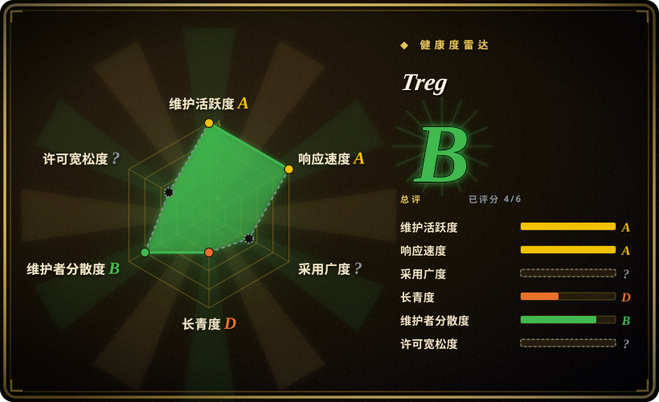
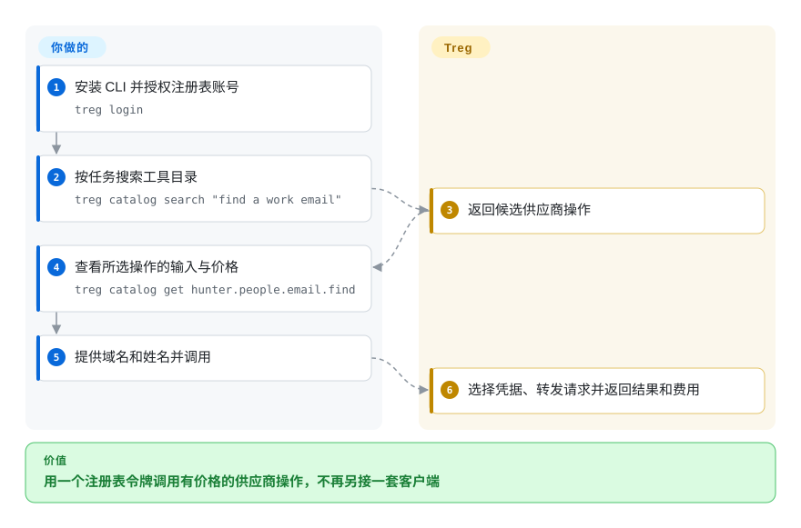
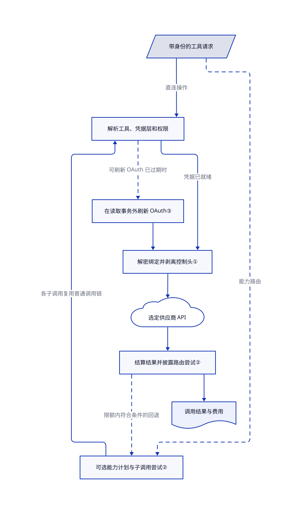

# Treg

agent 查网页、找邮箱、生成视频，每换一家都要再开账号、再塞一个 key。Treg 把工具目录和服务端凭据注入放到同一个令牌后面，既能按次调用共享供应商账号，也能自建团队内部注册表。

## 何时使用

你维护团队里的多个 agent，团队已经付费购买几家 API。同事把供应商 key 写进技能，另一个人复制到本机 `.env`，一轮换就两边报错。当共享单位是实际的 API 操作时，选 Treg：集中登记工具和凭据，让 agent 通过带身份认证的注册表调用。服务端注入供应商凭据，HTTP 调用者只拿结果。CLI、MCP 接口和共享技能让不同 agent 都能接入这条边界。

偶尔查一次联系人、生成一段媒体，不值得单独订阅供应商时，也可使用托管目录。先读参数和价格，使用 Treg 账号的调用会扣团队预付余额。相比 Monid 的开源连接器引擎，本仓库包含注册表和路由实现。许可允许内部自托管，但不会附送官方供应商账号，也不解除第三方服务限制。

## 何时不用

- **你要向第三方销售嵌入式或托管注册表。** [许可证附加条款](https://github.com/superdesigndev/treg/blob/ece225100e8d479fdcd8ac1eb44480c9283c458d/LICENSE#L1-L30)要求事先取得书面许可，范围不只限于竞品 SaaS。可评估 Apache-2.0 的 [Agentgateway](agentgateway.zh.md) 做 MCP 网关，但它不提供付费数据目录。
- **你只需聚合现有 MCP 服务器。** 选 [Agentgateway](agentgateway.zh.md) 做显式列出／调用策略，不必引入 Treg 的市场、余额和供应商目录。Treg 的 `/mcp/` 与仅面向目录的 `/mcp/v2/` 暴露不同能力。
- **你需要租约式数据库凭据、证书签发或基础设施密钥中心。** 选 [OpenBao](../secrets-management/openbao.zh.md)。Fernet 加密的供应商令牌和请求注入，不等于密钥引擎的租约与撤销模型。
- **你要宽松许可、可嵌入的连接器契约，而不是注册表服务。** 可考虑 [Monid](monid.zh.md)，但要接受其托管路由和凭据平台不在开源引擎里。Treg 公开更多注册表实现，却对第三方托管和嵌入服务设限。
- **你要求凭据绝不进入本机进程，或所有调用免费。** 优先用 HTTP 代理路径，或以 OpenBao 配合自己审过的窄权限调用端。Treg 本地运行模式会主动向 runner 释放凭据；保护模式要管理员配置独立系统用户。自带 key 不扣 Treg 余额，不代表供应商不收费；能力路由也可能产生多次计费尝试。
- **敏感请求不得在网关留存。** 选择另行批准的供应商直连接口，或审过日志配置的 Agentgateway 边界。Treg 文档描述结果归档和脱敏失败证据；凭据注入与审计不等于零留存。

## 横向对比

| 替代品 | 是否收录 | 我们的评价 | 取舍 |
|---|---|---|---|
| [Monid](monid.zh.md) | 已收录 | 要在 MIT 下编写、回放声明式供应商连接器，选 Monid；要直接运行团队注册表和凭据注入服务，选 Treg。 | Monid 的开源引擎小于其托管平台；Treg 公开注册表和路由源码，但限制第三方托管、嵌入服务。 |
| [Agentgateway](agentgateway.zh.md) | 已收录 | 聚合现有 MCP 服务、控制工具权限，选 Agentgateway；发现有价格的供应商操作、共享团队凭据，选 Treg。 | 面向协议的 Rust 数据面，对比带目录、余额和凭据生命周期的 Python 注册表；两者都不自动给工具提供操作系统隔离。 |
| [OpenBao](../secrets-management/openbao.zh.md) | 已收录 | 机器身份需要租约式密钥和撤销，选 OpenBao；调用者只需 API 结果、不应先拿供应商 key，选 Treg。 | 通用密钥中心需要解封和存储运维；Treg 把凭据托管绑定到调用代理，不替代动态密钥引擎。 |

## 快速上手

[文档给出的纯 CLI 包](https://github.com/superdesigndev/treg/blob/ece225100e8d479fdcd8ac1eb44480c9283c458d/README.md#L356-L359)是 `pip install tools-registry`，它连接已有注册表，不会启动服务器。运行 `treg login`，搜索目录，查看操作参数与价格，再按下图调用。你负责授权账号、提供输入和批准花费；Treg 选择凭据、转发请求、返回结果和费用。托管服务需要网络，付费调用需要余额；自带 key 仍承担供应商账单。便捷安装脚本还会安装 agent 技能，不是只放一个二进制。本轮只核对固定源码中的命令，未实际执行。

<!-- flow-steps:begin (generated from flows/treg.json by tools/flow_card.py — do not edit) -->

流程文字版

1. **你**：安装 CLI 并授权注册表账号 — `treg login`
2. **你**：按任务搜索工具目录 — `treg catalog search "find a work email"`
3. **Treg**：返回候选供应商操作
4. **你**：查看所选操作的输入与价格 — `treg catalog get hunter.people.email.find`
5. **你**：提供域名和姓名并调用
6. **Treg**：选择凭据、转发请求并返回结果和费用

**价值**：用一个注册表令牌调用有价格的供应商操作，不再另接一套客户端

<!-- flow-steps:end -->

## 技术要点

<!-- mechanism:begin (generated from mechanisms/treg.json by tools/mechanism_card.py; do not edit) -->

机制文字版

- 带身份的工具请求
- 可选能力计划与子调用尝试②
- 解析工具、凭据层和权限
- 在读取事务外刷新 OAuth③
- 解密绑定并剥离控制头①
- 选定供应商 API
- 结算结果并披露路由尝试②
- 调用结果与费用

- 带身份的工具请求 → 解析工具、凭据层和权限（直连操作）
- 带身份的工具请求 → 可选能力计划与子调用尝试②（能力路由）〔可选／兜底〕
- 可选能力计划与子调用尝试② → 解析工具、凭据层和权限（各子调用复用普通调用链）
- 解析工具、凭据层和权限 → 在读取事务外刷新 OAuth③（可刷新 OAuth 已过期时）〔可选／兜底〕
- 在读取事务外刷新 OAuth③ → 解密绑定并剥离控制头①
- 解析工具、凭据层和权限 → 解密绑定并剥离控制头①（凭据已就绪）
- 解密绑定并剥离控制头① → 选定供应商 API
- 选定供应商 API → 结算结果并披露路由尝试②
- 结算结果并披露路由尝试② → 可选能力计划与子调用尝试②（限额内符合条件的回退）〔可选／兜底〕
- 结算结果并披露路由尝试② → 调用结果与费用

<!-- mechanism:end -->

### 1. 在转发边界注入凭据

- **解决：** 共享技能不应内嵌每位同事的供应商 key。
- **做法：** 转发器解密已解析工具的密钥，逐条将绑定写入请求头、查询参数或 JSON 字段；转发前剥离 Treg 控制头与会话 cookie。多绑定支持一次请求携带多份凭据。
- **边界：** JSON 字段注入会重新序列化正文，不适合原始正文签名。这是服务端托管，不防服务端运营者；共享 key 调用还会改写特定传输和账号元数据。
- **源码：** [绑定注入与转发第 138–257 行](https://github.com/superdesigndev/treg/blob/ece225100e8d479fdcd8ac1eb44480c9283c458d/src/treg/infra/upstream/relay.py#L138-L257)、[注入格式第 54–139 行](https://github.com/superdesigndev/treg/blob/ece225100e8d479fdcd8ac1eb44480c9283c458d/src/treg/infra/upstream/injectors.py#L54-L139)、[静态加密密钥第 16–31 行](https://github.com/superdesigndev/treg/blob/ece225100e8d479fdcd8ac1eb44480c9283c458d/src/treg/crypto.py#L16-L31)。

### 2. 用可追踪子调用执行能力路由

- **解决：** 一家找不到结果，另一家可能找到；但逐家尝试会叠加费用。
- **做法：** `treg.<capability>` 调用生成候选，优先团队凭据，再让每次尝试进入普通调用链。结果列出实际端点、尝试记录、忽略的筛选条件和总费用；子调用结算延迟到父调用结果确定。
- **边界：** 这是主动选择的路由入口，不是供应商专属调用的通用故障转移。无匹配结果可继续瀑布尝试，最终完成的路由结果可能累计计费；路由整体失败则释放延迟费用。供应商筛选能力不同，需明确严格筛选与费用上限。
- **源码：** [候选凭据和资格第 256–373 行](https://github.com/superdesigndev/treg/blob/ece225100e8d479fdcd8ac1eb44480c9283c458d/src/treg/application/call/route.py#L256-L373)、[结算和尝试第 432–557 行](https://github.com/superdesigndev/treg/blob/ece225100e8d479fdcd8ac1eb44480c9283c458d/src/treg/application/call/route.py#L432-L557)、[结果披露第 803–851 行](https://github.com/superdesigndev/treg/blob/ece225100e8d479fdcd8ac1eb44480c9283c458d/src/treg/application/call/route.py#L803-L851)。

### 3. 刷新 OAuth 时释放数据库连接

- **解决：** 多个 agent 同时遇到令牌过期，慢速授权请求会占满数据库连接池。
- **做法：** 进程内按密钥加锁并重读令牌，提交读取事务后才发刷新请求，再按原始密文条件更新。最后重新加载，采用成功写入的令牌。
- **边界：** 锁只在单进程内，不是分布式单飞保证。条件更新防止旧值覆盖新存储值，但不证明上游并发刷新无害。缺少刷新凭据的令牌仍由用户手工维护。
- **源码：** [可刷新条件第 45–55 行](https://github.com/superdesigndev/treg/blob/ece225100e8d479fdcd8ac1eb44480c9283c458d/src/treg/domain/connections/refresh.py#L45-L55)、[刷新事务边界第 145–195 行](https://github.com/superdesigndev/treg/blob/ece225100e8d479fdcd8ac1eb44480c9283c458d/src/treg/domain/connections/refresh.py#L145-L195)。

## 技术栈

- Python `>=3.12,<3.14`，CLI 入口为 `treg.cli:main`。基础依赖是 HTTPX、PostHog 和 Questionary。
- 服务端额外依赖包括 FastAPI／Uvicorn、SQLModel／SQLAlchemy、Alembic、SQLite／PostgreSQL 驱动、cryptography、MCP、Redis、QuickJS 和存储／媒体组件。控制台构建用 Node／npm；源码 README 要求 Node 22.12+。
- 固定源码树的 `src/treg/` 下有 341 个 Python 文件，并包含 pytest 测试集。文件存在不代表本轮测试通过。

## 依赖

- 使用托管服务需要 CLI 或兼容 MCP 客户端、Treg 账号／令牌和网络。供应商账号与预付余额要求取决于实际凭据层。
- 自托管需要 `tools-registry[server]`、持久数据库和稳定的 `TREG_SECRET_KEY`。未配置时会生成进程内 Fernet 密钥；重启丢失后，已存密文无法解密。数据库和密钥应分别备份。
- 供应商凭据、OAuth 应用、登录与邮件设置由你提供。源码不附带官方供应商账号或私有运营策略扩展。配置共享计数器时需要 Redis，可选集成也有各自服务依赖。
- 受保护的本地 CLI 运行还需要供应商二进制、独立系统用户、sudoers 和出口规则。普通 HTTP 调用不要求这些管理员改动。

## 运维难度

**私有注册表中等；托管生产共享凭据与预付费用时较高。** 你维护 TLS、账号权限、加密密钥备份、数据库升级、供应商配额和审计／归档留存。批准管理员设置前先读[本地运行信任边界](https://github.com/superdesigndev/treg/blob/ece225100e8d479fdcd8ac1eb44480c9283c458d/docs/context/architecture/local-run.md#L17-L62)：服务端 CLI 执行已禁用，未配置的本地执行只有尽力隔离。连接 treg.to 时的 CLI 命令遥测可用 `TREG_TELEMETRY=0` 或 `DO_NOT_TRACK=1` 关闭。

停止服务不会撤销供应商 key，也不撤销 API 写入和费用。卸载时另清安装的技能与 MCP 条目，并先检查本地运行创建的系统用户、防火墙规则与 runner 文件。本轮未执行安装或清理实验。

## 健康度与可持续性

- **维护，2026-10-28：** 仓库未归档，创建于 2026-07-15，观测当天仍有推送。清单版本为 0.27.0；GitHub releases API 返回空列表，因此不把它称为 GitHub 发布版。
- **治理与支持：** Superdesign 持有组织仓库和版权。抽样贡献者列表有多名高贡献者，主要包括 JayZeeDesign、stonexer、shehjad-dev 和 unclecode；提交数不证明独立治理或支持 SLA。
- **年龄与采用：** 观测到 6,423 星、551 个 fork，但项目只有约三个半月历史。[推断：依据仓库年龄和当前活动，未做长期部署观测] 活跃开发是正信号，尚无长期维护记录可依赖。
- **许可风险：** 实际许可允许内部使用，却要求第三方托管、管理式或嵌入服务事先获批。它是带附加限制的源码可用许可，不是原版 Apache-2.0；清单自身标为 Other／Proprietary。Vue 运行时复制脚本会将 Vue 许可带入构建分发包，但本轮不是全树权属审计。
- **雷达覆盖：** 自动聚合为 B，评分覆盖 4／6 轴。`no_package_structural` 与 `license_unparsed` 表示评分器未识别采用数据与许可，不代表文档里的 Python 包或许可证文件不存在。

## 存疑（未验证）

- [未验证：任务禁止执行上游、安装和付费调用] 未复现身份认证、真实供应商响应、价格准确性、延迟、安全有效性、并发、恢复与卸载行为。
- [未验证：只审定向源码和公开 API] 本轮不认证全部目录条目的可用性、全部第三方权利，以及托管服务的私有策略、账号协议和留存设置。自托管注册表不等于免费复制官方供应商账号。
- [推断：当前活动和年龄只作选型先验，不是未来支持证据] 应固定版本、小范围试用，不把年轻厂商服务当作已证实的长期基础设施标准。
