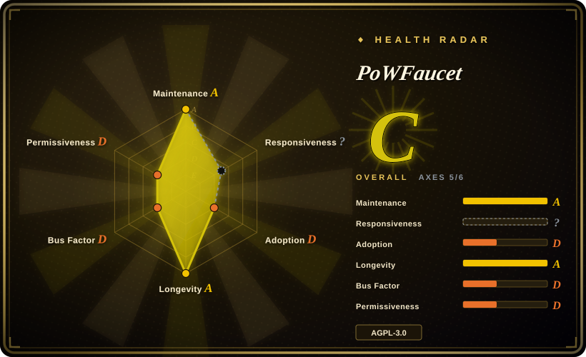
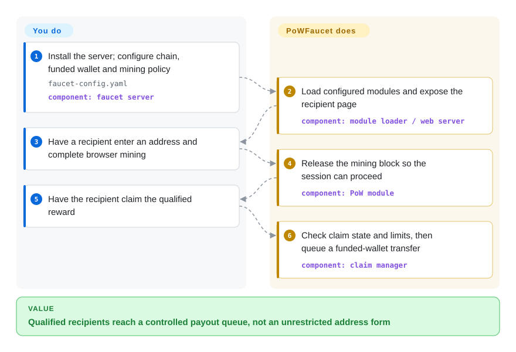
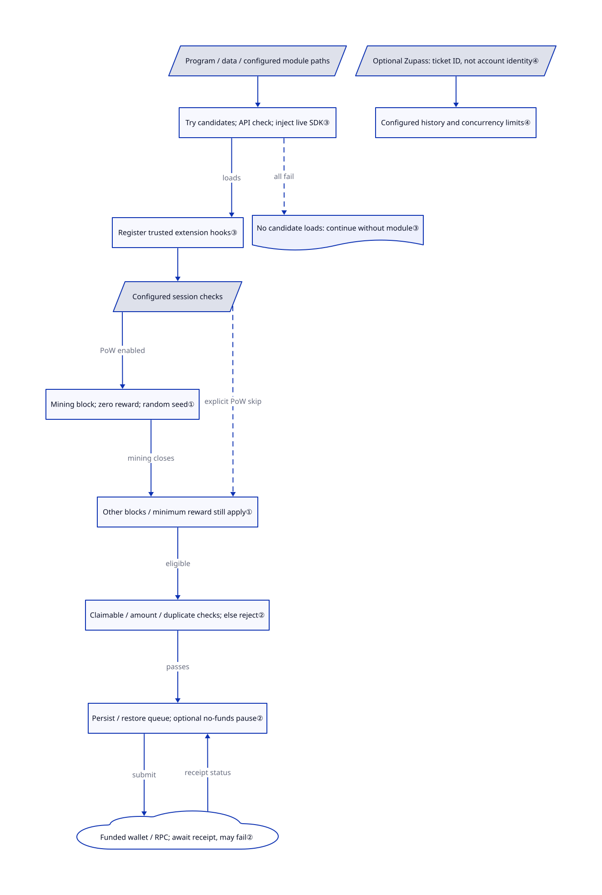

# PoWFaucet

Bots drain your testnet giveaway wallet through a simple address form; PoWFaucet makes recipients pass configurable checks before it queues transfers from your funded wallet.

## When to use

You're operating a public or community EVM testnet whose users need small amounts of native currency or an ERC-20 token, but a simple address form is drained by bots. You are prepared to fund and secure a faucet hot wallet, connect reliable RPC endpoints, and run a persistent web service. PoWFaucet gives you a complete distribution service with transaction queues, wallet and outflow controls, SQLite or MySQL persistence, and optional protection modules for browser proof-of-work, CAPTCHA, IP reputation, recurring limits, GitHub identity, mainnet-wallet checks, Gitcoin Passport, Zupass, ENS, vouchers, and whitelists.

You choose it over a small faucet script when abuse resistance and configurable reward policy justify the larger operational surface. Browser proof-of-work spends computation to qualify for a payout; it does not create coins. You supply native currency and gas, and arrange the token supply for ERC-20 distribution. The demo token's separately granted minting role is not a way to mint arbitrary assets ([README.md:16–18](https://github.com/pk910/PoWFaucet/blob/e93b953836db7e8c62cdc59f325830b5f4ed7b7d/README.md#L16-L18), [docs/demo/README.md:3–4](https://github.com/pk910/PoWFaucet/blob/e93b953836db7e8c62cdc59f325830b5f4ed7b7d/docs/demo/README.md#L3-L4)).

## When NOT to use

- **You only need a local development chain.** Use Foundry Anvil rather than exposing a public giveaway service and its signing key.
- **You do not want to custody keys or replenish funds.** Use the target network's established public faucet or a trusted managed faucet; PoWFaucet requires an operator-funded wallet and incident ownership.
- **The chain is not EVM-compatible.** Use that chain's native faucet implementation and SDK; PoWFaucet's transaction, RPC, address, and token assumptions are Ethereum-oriented.
- **You are distributing valuable mainnet assets, an airdrop, or user entitlements.** Use an audited Merkle-claim or allowlist contract backed by a multisig treasury; a testnet faucet is not a high-value distribution control plane.
- **You only need to rate-limit a web form.** Keep protection inside your application; PoWFaucet adds unnecessary wallet, session and payout infrastructure.
- **You cannot meet AGPL obligations.** Do not adopt it without license review. Its AGPL v3 license includes source-offer obligations for modified versions used through a network; the health scorer's D bucket is not a legal analysis.
- **You require protection to fail closed at startup.** Audit enabled modules and startup logs: the loader skips modules that fail to load, and the application initialization catch exits with code 0, not a reliable readiness signal ([ModuleLoader.ts:249–280](https://github.com/pk910/PoWFaucet/blob/e93b953836db7e8c62cdc59f325830b5f4ed7b7d/src/loader/ModuleLoader.ts#L249-L280), [app.ts:74–76](https://github.com/pk910/PoWFaucet/blob/e93b953836db7e8c62cdc59f325830b5f4ed7b7d/src/app.ts#L74-L76)).

## Comparison

| Alternative | In index | Our verdict | Tradeoff |
|---|---|---|---|
| [FaucETH](https://github.com/komputing/FaucETH) | not indexed | Choose FaucETH for an hCaptcha-protected multi-chain address form; choose PoWFaucet when configurable mining sessions and reward policies decide the choice. | FaucETH's documented setup is narrower; both require operator funding and both declare AGPLv3. |
| [Nethereum.Faucet](https://github.com/Nethereum/Nethereum.Faucet) | not indexed | Choose its C# template when you need Blazor and REST inside a .NET stack; choose PoWFaucet for its browser proof-of-work and module hooks. | The template supplies a conventional funding API, not PoWFaucet's mining-session platform. |
| [Foundry Anvil](https://github.com/foundry-rs/foundry) | not indexed | Choose Anvil for a local Ethereum development node; choose PoWFaucet when independent users need payouts on an existing shared chain. | A local test chain avoids public wallet operations but does not fund users on that shared chain. |

## Quick start

Use the operator instructions linked from [README.md:63–69](https://github.com/pk910/PoWFaucet/blob/e93b953836db7e8c62cdc59f325830b5f4ed7b7d/README.md#L63-L69) to obtain a server distribution or Docker image; do not substitute the unstable `snapshot` release for a pinned stable artifact. Configure `faucet-config.yaml` with your chain, RPC address—the service that reads and broadcasts chain transactions—funded wallet and protection policy; secrets can be supplied through `FAUCET_ETH_WALLET_KEY` and `FAUCET_SECRET` instead of copied demo keys. For the browser-mining path, enable `modules.pow`, start the configured server and publish its web page behind TLS. A recipient enters a destination address, completes the configured mining session and claims the reward; the service checks the session and queues a wallet transfer. You pay for funding and transaction fees, maintain storage and RPC availability, and verify confirmations; this page did not run a faucet or transact. The ticket-limit behavior described below is from reviewed master after v2.5.2; do not assume that selecting the stable archive includes it.

<!-- flow-steps:begin (generated from flows/powfaucet.json by tools/flow_card.py — do not edit) -->

Text version of the flow

1. **You**: Install the server; configure chain, funded wallet and mining policy — `faucet-config.yaml` — component: `faucet server`
2. **PoWFaucet**: Load configured modules and expose the recipient page — component: `module loader / web server`
3. **You**: Have a recipient enter an address and complete browser mining
4. **PoWFaucet**: Release the mining block so the session can proceed — component: `PoW module`
5. **You**: Have the recipient claim the qualified reward
6. **PoWFaucet**: Check claim state and limits, then queue a funded-wallet transfer — component: `claim manager`

**Value**: Qualified recipients reach a controlled payout queue, not an unrestricted address form

<!-- flow-steps:end -->

## Key techniques

<!-- mechanism:begin (generated from mechanisms/powfaucet.json by tools/mechanism_card.py; do not edit) -->

Text version of the mechanism

- Program / data / configured module paths
- Try candidates; API check; inject live SDK③
- Register trusted extension hooks③
- No candidate loads: continue without module③
- Configured session checks
- Mining block; zero reward; random seed①
- Other blocks / minimum reward still apply①
- Claimable / amount / duplicate checks; else reject②
- Persist / restore queue; optional no-funds pause②
- Funded wallet / RPC; await receipt, may fail②
- Optional Zupass: ticket ID, not account identity④
- Configured history and concurrency limits④

- Program / data / configured module paths → Try candidates; API check; inject live SDK③
- Try candidates; API check; inject live SDK③ → Register trusted extension hooks③ (loads)
- Try candidates; API check; inject live SDK③ → No candidate loads: continue without module③ (all fail) [optional/fallback]
- Register trusted extension hooks③ → Configured session checks
- Configured session checks → Mining block; zero reward; random seed① (PoW enabled)
- Configured session checks → Other blocks / minimum reward still apply① (explicit PoW skip) [optional/fallback]
- Mining block; zero reward; random seed① → Other blocks / minimum reward still apply① (mining closes)
- Other blocks / minimum reward still apply① → Claimable / amount / duplicate checks; else reject② (eligible)
- Claimable / amount / duplicate checks; else reject② → Persist / restore queue; optional no-funds pause② (passes)
- Persist / restore queue; optional no-funds pause② → Funded wallet / RPC; await receipt, may fail② (submit)
- Funded wallet / RPC; await receipt, may fail② → Persist / restore queue; optional no-funds pause② (receipt status)
- Optional Zupass: ticket ID, not account identity④ → Configured history and concurrency limits④

<!-- mechanism:end -->

### 1. Block reward eligibility until the mining stage ends

- **Problem:** A recipient should not reach payout simply by submitting an address when browser work is part of the policy.
- **How:** The PoW hook adds a blocking task, resets the reward to zero and creates a random session seed—the preimage used by the mining challenge—if none exists. Closing mining resolves that task and asks the session to proceed.
- **Limits:** Configuration can explicitly skip PoW; other blocking tasks and the minimum reward still govern eligibility, and expired tasks can be removed by the session timer. This is payout qualification, not coin creation or proof of chain payment.
- **Source:** [PoWModule.ts:142–187](https://github.com/pk910/PoWFaucet/blob/e93b953836db7e8c62cdc59f325830b5f4ed7b7d/src/modules/pow/PoWModule.ts#L142-L187), [FaucetSession.ts:275–315](https://github.com/pk910/PoWFaucet/blob/e93b953836db7e8c62cdc59f325830b5f4ed7b7d/src/session/FaucetSession.ts#L275-L315).

### 2. Restore payout work without confusing it with confirmation

- **Problem:** A restart can lose pending work, while duplicate claims or an unfunded wallet can break distribution.
- **How:** The claim manager restores queued/processing claims and watches saved pending transactions; new claims require claimable state, amount limits and duplicate protection. It persists claim state and processes a queue, pausing for wallet/RPC or gas shortages when `ethQueueNoFunds` is enabled.
- **Limits:** Without that pause option, the send path can mark such claims failed instead. A saved queue or submitted transaction is not finality: receipt success or failure updates its status later, and RPC availability remains external.
- **Source:** [EthClaimManager.ts:78–116](https://github.com/pk910/PoWFaucet/blob/e93b953836db7e8c62cdc59f325830b5f4ed7b7d/src/eth/EthClaimManager.ts#L78-L116), [claim and pause:187–253](https://github.com/pk910/PoWFaucet/blob/e93b953836db7e8c62cdc59f325830b5f4ed7b7d/src/eth/EthClaimManager.ts#L187-L253), [send and receipt:283–348](https://github.com/pk910/PoWFaucet/blob/e93b953836db7e8c62cdc59f325830b5f4ed7b7d/src/eth/EthClaimManager.ts#L283-L348).

### 3. Inject the live registry into trusted extensions

- **Problem:** An extension bundling its own faucet registry could register hooks that the running service never calls.
- **How:** The loader searches program modules, data-directory modules and configured paths, preferring later copies and trying an older candidate if loading fails. It checks the module API version and injects the faucet's shared SDK—the extension interface—before initialization and registration.
- **Limits:** Modules execute trusted code, not inside a sandbox; if no candidate loads, the service can continue without it. The separate application initialization catch exits 0 even on failure, so neither API compatibility nor a clean process exit proves protection readiness.
- **Source:** [ModuleLoader.ts:169–198](https://github.com/pk910/PoWFaucet/blob/e93b953836db7e8c62cdc59f325830b5f4ed7b7d/src/loader/ModuleLoader.ts#L169-L198), [candidate loading:219–340](https://github.com/pk910/PoWFaucet/blob/e93b953836db7e8c62cdc59f325830b5f4ed7b7d/src/loader/ModuleLoader.ts#L219-L340), [SDK injection:476–522](https://github.com/pk910/PoWFaucet/blob/e93b953836db7e8c62cdc59f325830b5f4ed7b7d/src/loader/ModuleLoader.ts#L476-L522), [app.ts:74–76](https://github.com/pk910/PoWFaucet/blob/e93b953836db7e8c62cdc59f325830b5f4ed7b7d/src/app.ts#L74-L76).

### 4. Follow the ticket rather than a replaceable Zupass account identity

- **Problem:** Reissuing one event ticket to a fresh account identity could reset identity-keyed usage limits.
- **How:** Current master keys the optional Zupass module's grant history and concurrent-session check on `ticketId`, not the attendee identity. Its version-2 module schema adds a ticket lookup index; the history query counts claimable, claiming and finished sessions within the configured window.
- **Limits:** This post-v2.5.2 change does not mean the stable release contains the fix. Limits still depend on configuration: zero concurrency limit disables that check, and an optional grant can decline its benefit rather than reject the session.
- **Source:** [ZupassModule.ts:255–325](https://github.com/pk910/PoWFaucet/blob/e93b953836db7e8c62cdc59f325830b5f4ed7b7d/src/modules/zupass/ZupassModule.ts#L255-L325), [ZupassDB.ts:7–45](https://github.com/pk910/PoWFaucet/blob/e93b953836db7e8c62cdc59f325830b5f4ed7b7d/src/modules/zupass/ZupassDB.ts#L7-L45), [ticket history:69–82](https://github.com/pk910/PoWFaucet/blob/e93b953836db7e8c62cdc59f325830b5f4ed7b7d/src/modules/zupass/ZupassDB.ts#L69-L82).

## Tech stack

- **Server:** TypeScript on Node.js, HTTP and WebSocket APIs, `web3` and Ethereum transaction libraries.
- **Client:** React 19, React Router, Bootstrap, Webpack, and Web Workers for proof-of-work algorithms.
- **Persistence:** SQLite by default or MySQL for higher-traffic and separated database deployments.
- **Proof-of-work:** bundled WASM implementations for Argon2, scrypt, CryptoNight, and the optional `nickminer` mode.
- **Packaging:** release archives and standalone binaries, plus a multi-stage Docker image combining Node.js with unprivileged Nginx.

## Dependencies

- An EVM execution-layer RPC endpoint, chain ID, funded hot-wallet private key, and enough native coins or ERC-20 tokens to distribute.
- Persistent SQLite storage or MySQL, plus disk for configuration, logs, session state, and optional passport caches.
- A version-compatible Node.js runtime or the published Docker image. The checked Dockerfile uses Node 22, while all-in-one release descriptions embed Node 18; this is not proof that every fresh dependency supports Node 18.
- A reverse proxy and TLS for public production deployment; the Docker image includes Nginx for static files and API/WebSocket proxying.
- Optional external credentials for hCaptcha, reCAPTCHA, Turnstile, GitHub OAuth, Gitcoin Passport, identity providers, and third-party IP information.

## Ops difficulty

**High.** The service holds a transaction-signing key, sends real on-chain transfers, persists user and session state, depends on RPC health, and exposes public HTTP and WebSocket surfaces. Operators must manage wallet funding, gas limits, pending transaction queues, database backups and migrations, rate and outflow policy, secrets, TLS, monitoring, abuse response, and upgrades. The optional vault contract can limit hot-wallet exposure, but adds contract configuration and on-chain failure modes rather than removing custody risk.

## Health & viability

- **Measured signals (2026-10-17):** A/?/D/A/D/D, overall C with 5/6 axes scored. The existing responsiveness gap remains `no_window_signal`: the scorer found traffic but no qualifying response in its sampled window, not proof of slow responses.
- **Maintenance:** v2.5.2 was published on 2026-10-13; reviewed master additionally contains the unreleased Zupass ticket-limit fix and dependency-lock updates. The external module loader and runtime secret overrides remain present; the repository is not archived, and only the latest 2.x release is supported in `SECURITY.md`.
- **Governance:** 5 measured active maintainers, with top-1 share 0.825, retain D. The security policy explicitly names the primary maintainer; community contributors do not eliminate concentration risk.
- **Age and Lindy:** created in 2022 and still active after roughly four years, with public Sepolia, Hoodi, and Ephemery instances named in the README. This is a useful but not long-established infrastructure track record.
- **Adoption:** 5639 stars and the README's named instances show interest, not security or load capacity. The measured install signals give D; the SDK's dependent count is not the number of faucet deployments.
- **Risk flags:** AGPL network obligations, hot-wallet custody, many optional secrets and identity integrations, privacy-sensitive IP and wallet data, external RPC dependencies, and public abuse economics.

## Caveats (unverified)

- [未验证：未执行上游] Installation, runtime compatibility, wallet/RPC failure recovery and chain transfers were not tested here; source and release descriptions are the evidence.
- [未验证：未取得独立审计或压测] Security and capacity under concurrent mining, RPC failures and malicious verifiers remain unproven.
- [未验证：未进行防滥用效果实验] The effectiveness and fairness of CAPTCHA, IP, GitHub, Passport, Zupass, and proof-of-work modules depend on operator configuration and external services.
- [未验证：未审计公共实例的部署版本] The public instances listed in the README may run configurations or patches that differ from the default branch.
- [推断：按分发服务的主要目的归类] The primary category is blockchain development infrastructure because token distribution is the service's purpose; CAPTCHA and proof-of-work are optional anti-abuse modules.
- [推断：依据是贡献集中与维护者政策，未来维护无法实测] The low bus factor raises long-term maintenance risk despite active releases and a substantial test suite.
