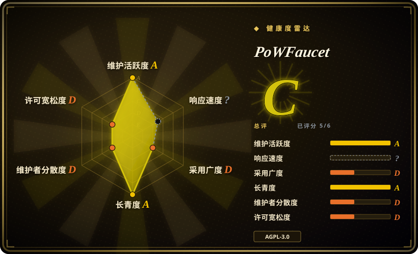
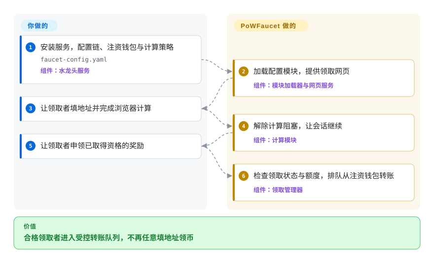
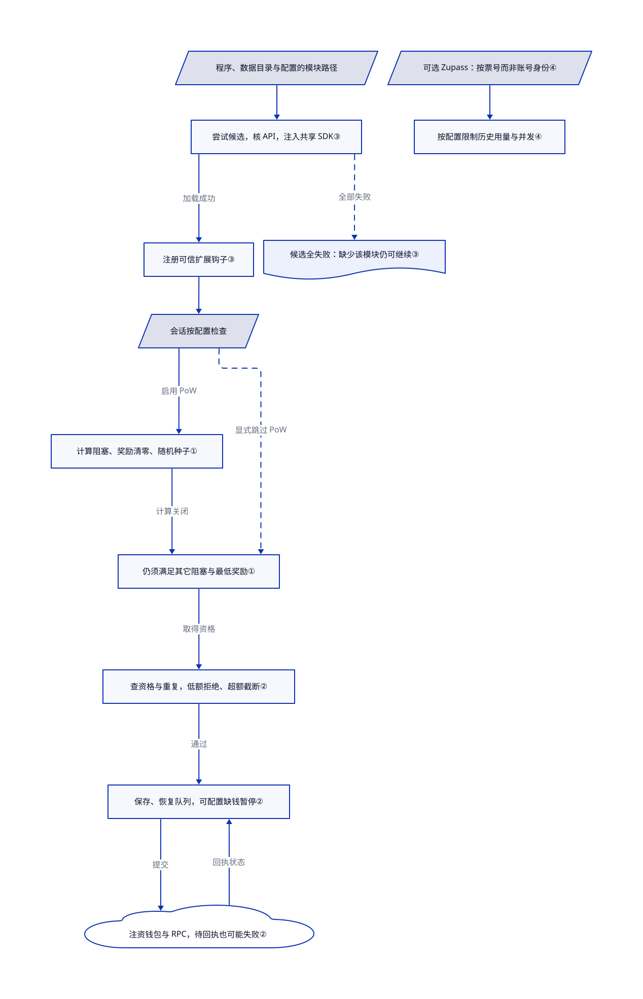

# PoWFaucet

测试币领取页只让人填地址，机器人很快抽干钱包；PoWFaucet 先检查领取资格，再从你注资的钱包排队转账。

## 何时使用

你正在运营一个公共或社区 EVM 测试网。用户需要少量原生币或 ERC-20 token，但简单的地址输入框会被 bot 迅速抽干。你愿意为 faucet 热钱包注资并保护密钥，接入可靠的 RPC endpoint，并持续运行一个 Web 服务。PoWFaucet 提供完整的分发服务，包括交易队列、钱包与出流控制、SQLite 或 MySQL 持久化，以及可选的浏览器工作量证明、验证码、IP 信誉、周期限制、GitHub 身份、主网钱包条件、Gitcoin Passport、Zupass、ENS、voucher 和 whitelist 模块。

防滥用和可配置奖励值得承担更多运维时，选它而不是小型脚本。浏览器工作量证明消耗计算来取得领取资格，不会造币。你提供原生币和手续费，并安排 ERC-20 代币供应；演示代币另授的铸币权限不代表它能铸造任意资产（[README.md:16–18](https://github.com/pk910/PoWFaucet/blob/e93b953836db7e8c62cdc59f325830b5f4ed7b7d/README.md#L16-L18)、[docs/demo/README.md:3–4](https://github.com/pk910/PoWFaucet/blob/e93b953836db7e8c62cdc59f325830b5f4ed7b7d/docs/demo/README.md#L3-L4)）。

## 何时不用

- **你只需要本地开发链。** 用 Foundry Anvil，不必公开领取服务及其签名私钥。
- **你不想托管私钥或持续补充资金。** 使用目标网络已有的公共 faucet，或可信托管 faucet；PoWFaucet 要求运营方为钱包注资并承担事故责任。
- **目标链不兼容 EVM。** 使用该链原生的 faucet 实现和 SDK；PoWFaucet 的交易、RPC、地址与 token 假设都围绕 Ethereum。
- **你要分发高价值主网资产、空投或用户权益。** 使用经过审计的 Merkle claim 或 allowlist 合约，并由 multisig treasury 管理；测试网 faucet 不是高价值分发控制面。
- **你只需要给网页表单限流。** 在自己的应用里做；PoWFaucet 会额外引入钱包、会话和转账设施。
- **你不能满足 AGPL 义务。** 先做许可审查；AGPL v3 对通过网络使用的修改版本包含源码提供义务，健康评分的 D 桶不是法律意见。
- **你要求保护模块加载失败就停止服务。** 必须核对启用模块与日志：加载器会跳过失败模块，应用初始化异常甚至以退出码 0 结束，不能把它当就绪信号（[ModuleLoader.ts:249–280](https://github.com/pk910/PoWFaucet/blob/e93b953836db7e8c62cdc59f325830b5f4ed7b7d/src/loader/ModuleLoader.ts#L249-L280)、[app.ts:74–76](https://github.com/pk910/PoWFaucet/blob/e93b953836db7e8c62cdc59f325830b5f4ed7b7d/src/app.ts#L74-L76)）。

## 横向对比

| 替代品 | 是否收录 | 我们的评价 | 取舍 |
|---|---|---|---|
| [FaucETH](https://github.com/komputing/FaucETH) | 未收录 | 带 hCaptcha 的多链地址表单够用时选它；需要计算会话和奖励策略时选 PoWFaucet。 | 文档设置更窄；两者都要运营方注资，都声明 AGPLv3。 |
| [Nethereum.Faucet](https://github.com/Nethereum/Nethereum.Faucet) | 未收录 | 需要 .NET 内的 Blazor 与 REST 接口时选其 C# 模板；需要浏览器工作量证明和模块钩子时选 PoWFaucet。 | 模板提供传统注资接口，不是计算会话平台。 |
| [Foundry Anvil](https://github.com/foundry-rs/foundry) | 未收录 | 本地 Ethereum 开发节点选 Anvil；独立用户需要在既有共享链领取资产时选 PoWFaucet。 | 本地链避免公网钱包运维，但不能为共享链用户注资。 |

## 快速上手

按 [README.md:63–69](https://github.com/pk910/PoWFaucet/blob/e93b953836db7e8c62cdc59f325830b5f4ed7b7d/README.md#L63-L69) 链接的运营文档取得服务端包或 Docker 镜像，固定稳定版，不把 `snapshot` 当稳定发布。在 `faucet-config.yaml` 配置链、RPC 地址——读取和广播链上交易的服务——已注资钱包和保护策略；用 `FAUCET_ETH_WALLET_KEY`、`FAUCET_SECRET` 注入秘密，不复制演示私钥。这里选择浏览器计算主线：启用 `modules.pow`，启动配置好的服务，用 TLS 发布网页。领取者填目标地址、完成计算会话并申领奖励，服务检查资格后排队转账。你承担注资、手续费、存储、RPC 可用性和确认核对；本页没有部署水龙头或发起交易。下文票号限额行为来自 v2.5.2 之后的 master，不能假定稳定版压缩包已包含。

<!-- flow-steps:begin (generated from flows/powfaucet.json by tools/flow_card.py — do not edit) -->

流程文字版

1. **你**：安装服务，配置链、注资钱包与计算策略 — `faucet-config.yaml` — 组件：`水龙头服务`
2. **PoWFaucet**：加载配置模块，提供领取网页 — 组件：`模块加载器与网页服务`
3. **你**：让领取者填地址并完成浏览器计算
4. **PoWFaucet**：解除计算阻塞，让会话继续 — 组件：`计算模块`
5. **你**：让领取者申领已取得资格的奖励
6. **PoWFaucet**：检查领取状态与额度，排队从注资钱包转账 — 组件：`领取管理器`

**价值**：合格领取者进入受控转账队列，不再任意填地址领币

<!-- flow-steps:end -->

## 技术要点

<!-- mechanism:begin (generated from mechanisms/powfaucet.json by tools/mechanism_card.py; do not edit) -->

机制文字版

- 程序、数据目录与配置的模块路径
- 尝试候选，核 API，注入共享 SDK③
- 注册可信扩展钩子③
- 候选全失败：缺少该模块仍可继续③
- 会话按配置检查
- 计算阻塞、奖励清零、随机种子①
- 仍须满足其它阻塞与最低奖励①
- 查可领取、金额、重复，否则拒绝②
- 保存、恢复队列，可配置缺钱暂停②
- 注资钱包与 RPC，待回执也可能失败②
- 可选 Zupass：按票号而非账号身份④
- 按配置限制历史用量与并发④

- 程序、数据目录与配置的模块路径 → 尝试候选，核 API，注入共享 SDK③
- 尝试候选，核 API，注入共享 SDK③ → 注册可信扩展钩子③（加载成功）
- 尝试候选，核 API，注入共享 SDK③ → 候选全失败：缺少该模块仍可继续③（全部失败）〔可选／兜底〕
- 注册可信扩展钩子③ → 会话按配置检查
- 会话按配置检查 → 计算阻塞、奖励清零、随机种子①（启用 PoW）
- 会话按配置检查 → 仍须满足其它阻塞与最低奖励①（显式跳过 PoW）〔可选／兜底〕
- 计算阻塞、奖励清零、随机种子① → 仍须满足其它阻塞与最低奖励①（计算关闭）
- 仍须满足其它阻塞与最低奖励① → 查可领取、金额、重复，否则拒绝②（取得资格）
- 查可领取、金额、重复，否则拒绝② → 保存、恢复队列，可配置缺钱暂停②（通过）
- 保存、恢复队列，可配置缺钱暂停② → 注资钱包与 RPC，待回执也可能失败②（提交）
- 注资钱包与 RPC，待回执也可能失败② → 保存、恢复队列，可配置缺钱暂停②（回执状态）
- 可选 Zupass：按票号而非账号身份④ → 按配置限制历史用量与并发④

<!-- mechanism:end -->

### 1. 计算阶段结束前，先阻塞领取资格

- **解决：** 策略要求浏览器计算时，领取者不能只填地址就进入转账阶段。
- **做法：** PoW 钩子加入阻塞任务，清零奖励；没有会话随机种子时，就生成计算挑战使用的种子，也就是前像。计算关闭时解除该任务，并请求会话继续推进。
- **边界：** 配置可以显式跳过 PoW；其它阻塞任务和最低奖励仍约束资格，会话定时器也能移除到期任务。这是领取资格检查，不是造币或链上付款证明。
- **源码：** [PoWModule.ts:142–187](https://github.com/pk910/PoWFaucet/blob/e93b953836db7e8c62cdc59f325830b5f4ed7b7d/src/modules/pow/PoWModule.ts#L142-L187)、[FaucetSession.ts:275–315](https://github.com/pk910/PoWFaucet/blob/e93b953836db7e8c62cdc59f325830b5f4ed7b7d/src/session/FaucetSession.ts#L275-L315)。

### 2. 恢复待转账工作，不把入队当成到账

- **解决：** 重启可能丢失待办，重复申领或钱包没钱也会破坏分发。
- **做法：** 领取管理器恢复排队与处理中的申领，并继续监视已存的待确认交易；新申领要检查可领取状态、金额限制和重复请求。它持久化领取状态，再处理队列；启用 `ethQueueNoFunds` 时，钱包、RPC 或手续费不足会暂停队列。
- **边界：** 没启用暂停选项时，发送路径会将这类申领记为失败。保存队列或提交交易不等于最终确认；之后还要按回执更新成功或失败状态，RPC 可用性仍依赖外部。
- **源码：** [EthClaimManager.ts:78–116](https://github.com/pk910/PoWFaucet/blob/e93b953836db7e8c62cdc59f325830b5f4ed7b7d/src/eth/EthClaimManager.ts#L78-L116)、[申领与暂停：187–253](https://github.com/pk910/PoWFaucet/blob/e93b953836db7e8c62cdc59f325830b5f4ed7b7d/src/eth/EthClaimManager.ts#L187-L253)、[发送与回执：283–348](https://github.com/pk910/PoWFaucet/blob/e93b953836db7e8c62cdc59f325830b5f4ed7b7d/src/eth/EthClaimManager.ts#L283-L348)。

### 3. 给可信扩展注入正在使用的注册表

- **解决：** 扩展若自带另一份水龙头注册表，可能把钩子注册到运行服务根本不调用的副本。
- **做法：** 加载器搜索程序目录、数据目录和配置路径，优先后面的副本，加载失败再尝试较早候选。它核对模块 API 版本，在初始化和注册前注入水龙头共享 SDK，也就是扩展接口。
- **边界：** 模块是受信任的可执行代码，不在沙箱里；所有候选都失败时，服务仍可能缺着该模块继续。另一个应用初始化异常分支甚至退出 0，因此 API 兼容或正常退出都不证明保护已就绪。
- **源码：** [ModuleLoader.ts:169–198](https://github.com/pk910/PoWFaucet/blob/e93b953836db7e8c62cdc59f325830b5f4ed7b7d/src/loader/ModuleLoader.ts#L169-L198)、[候选加载：219–340](https://github.com/pk910/PoWFaucet/blob/e93b953836db7e8c62cdc59f325830b5f4ed7b7d/src/loader/ModuleLoader.ts#L219-L340)、[SDK 注入：476–522](https://github.com/pk910/PoWFaucet/blob/e93b953836db7e8c62cdc59f325830b5f4ed7b7d/src/loader/ModuleLoader.ts#L476-L522)、[app.ts:74–76](https://github.com/pk910/PoWFaucet/blob/e93b953836db7e8c62cdc59f325830b5f4ed7b7d/src/app.ts#L74-L76)。

### 4. Zupass 限额跟票走，不跟可更换的账号身份走

- **解决：** 同一活动票重签给新账号身份后，按身份统计的用量限制可能被重置。
- **做法：** 当前 master 的可选 Zupass 模块按 `ticketId` 查询奖励授权历史与并发会话，不再按参加者身份。模块第 2 版数据结构增加票号索引；历史查询统计配置窗口内可领取、领取中、已完成的会话。
- **边界：** 这是 v2.5.2 之后的变化，不表示稳定发布已包含修复。限制仍取决于配置：并发上限为零会关闭该检查，可选奖励授权超限时也可能只是不提供优惠，而非拒绝会话。
- **源码：** [ZupassModule.ts:255–325](https://github.com/pk910/PoWFaucet/blob/e93b953836db7e8c62cdc59f325830b5f4ed7b7d/src/modules/zupass/ZupassModule.ts#L255-L325)、[ZupassDB.ts:7–45](https://github.com/pk910/PoWFaucet/blob/e93b953836db7e8c62cdc59f325830b5f4ed7b7d/src/modules/zupass/ZupassDB.ts#L7-L45)、[票号历史：69–82](https://github.com/pk910/PoWFaucet/blob/e93b953836db7e8c62cdc59f325830b5f4ed7b7d/src/modules/zupass/ZupassDB.ts#L69-L82)。

## 技术栈

- **服务端：** Node.js 上的 TypeScript，提供 HTTP 与 WebSocket API，并使用 `web3` 和 Ethereum 交易库。
- **客户端：** React 19、React Router、Bootstrap、Webpack，以及执行工作量证明算法的 Web Workers。
- **持久化：** 默认 SQLite；高流量或数据库独立部署可用 MySQL。
- **工作量证明：** 随附 Argon2、scrypt、CryptoNight 和可选 `nickminer` 模式的 WASM 实现。
- **打包：** release archive、独立二进制，以及把 Node.js 和非 root Nginx 合在一起的多阶段 Docker image。

## 依赖

- EVM execution-layer RPC endpoint、chain ID、已注资的热钱包私钥，以及足够分发的原生币或 ERC-20 token。
- 持久化 SQLite 或 MySQL，并为配置、日志、session 状态和可选 passport cache 提供磁盘。
- 与版本兼容的 Node.js 或发布镜像。核对的 Dockerfile 使用 Node 22，独立可执行包的发布说明内嵌 Node 18；这不能证明新依赖都兼容 Node 18。
- 公网生产部署需要 reverse proxy 和 TLS；Docker image 已包含用于静态文件与 API、WebSocket 代理的 Nginx。
- hCaptcha、reCAPTCHA、Turnstile、GitHub OAuth、Gitcoin Passport、身份提供方和第三方 IP 信息等可选外部凭据。

## 运维难度

**高。** 服务持有交易签名私钥，发起真实链上转账，持久化用户和 session 状态，依赖 RPC 健康，并暴露公共 HTTP 与 WebSocket 接口。运营方需要管理钱包注资、gas 限制、pending transaction queue、数据库备份和迁移、频率与出流策略、secret、TLS、监控、滥用响应和升级。可选 vault contract 能限制热钱包暴露面，但它增加的是合约配置和链上失败模式，并不会消除托管风险。

## 健康度与可持续性

- **实测信号（2026-10-17）：** A/?/D/A/D/D，整体 C，覆盖 5/6 轴。原响应缺口仍是 `no_window_signal`：有流量，但抽样窗口没有合格首响，不等于响应慢。
- **维护情况：** 2026-10-13 发布 v2.5.2；本次审读的 master 另含尚未发布的 Zupass 票号限额修复与依赖锁更新。外部模块加载器和运行时秘密覆盖仍在；仓库未归档，`SECURITY.md` 只支持最新 2.x 发布。
- **治理：** 实测活跃维护者 5、第一贡献者占比 0.825，仍为 D。安全政策明确主要维护者，社区贡献不能消除集中风险。
- **年龄与 Lindy：** 项目创建于 2022 年，约四年后仍活跃；README 列出了 Sepolia、Hoodi 和 Ephemery 公共实例。这是有用但还不算长期的基础设施记录。
- **采用信号：** 5639 star 与 README 列出的实例说明关注度，不证明安全或容量。安装信号实测为 D；SDK 依赖数不是实际水龙头部署数。
- **风险标记：** AGPL 网络义务、热钱包托管、多组可选 secret 与身份集成、涉及隐私的 IP 和钱包数据、外部 RPC 依赖，以及公开服务的滥用经济问题。

## 存疑（未验证）

- [未验证：未执行上游] 未测试安装、运行时兼容性、钱包或 RPC 故障恢复及链上转账；证据来自源码和发布说明。
- [未验证：未取得独立审计或压测] 并发计算、RPC 故障和恶意验证者下的安全与容量仍未证明。
- [未验证：未进行防滥用效果实验] 验证码、IP、GitHub、Passport、Zupass 和工作量证明模块的效果与公平性取决于运营方配置和外部服务。
- [未验证：未审计公共实例的部署版本] README 列出的公共实例可能运行与默认分支不同的配置或 patch。
- [推断：按分发服务的主要目的归类] 主分类应是区块链开发基础设施，因为 token 分发才是服务目的；验证码和工作量证明只是可选防滥用模块。
- [推断：依据是贡献集中与维护者政策，未来维护无法实测] 尽管发布活跃且测试较多，低 bus factor 仍提高了长期维护风险。
