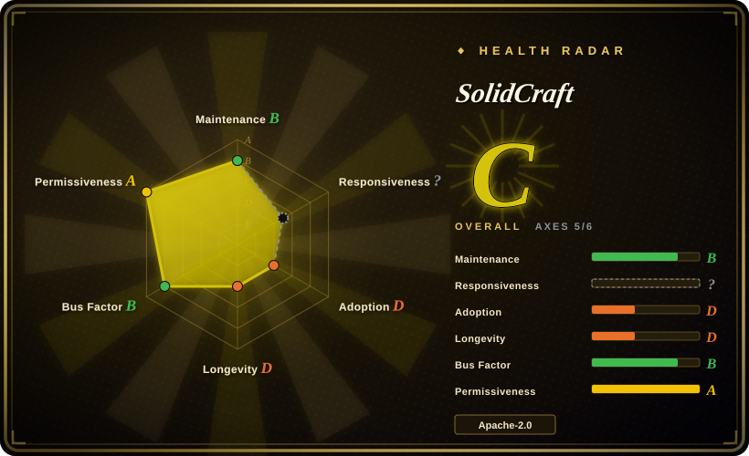
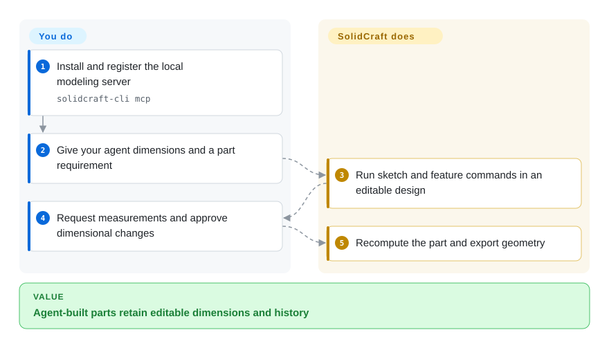
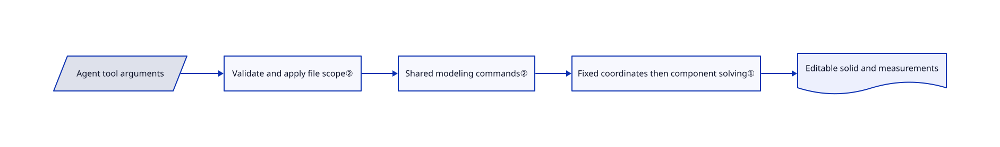

# SolidCraft

Change an enclosure's width and its holes should follow, including when an agent built it. SolidCraft keeps editable sketches and a feature history behind the commands shared by its desktop interface and MCP server.

## When to use

You prototype printable brackets or enclosures and want interactive sketching plus an agent that builds, measures and revises the same model. Choose SolidCraft when built-in MCP access and readable command recipes matter more than FreeCAD's workbench breadth and longer history. You inspect a parametric design rather than accepting an opaque mesh. The project explicitly labels itself early and suitable for simple parts, not equivalent to an established engineering suite.

## When NOT to use

- **Production-critical engineering or mature workbenches.** Prefer [FreeCAD](freecad.md), with geometry validation; SolidCraft's reference-part checks do not establish complete equivalence.
- **Small text-first CSG programs.** Choose OpenSCAD; SolidCraft brings a larger interactive document and feature-history model.
- **Supported manufacturing workflows or commercial native formats.** Keep Autodesk Fusion or your supported CAD suite. The reviewed build enables open cadmpeg import codecs, not its commercial-format codecs.
- **Polished product rendering.** Use Blender or a dedicated renderer; the documented viewport lacks HDRI, refraction and texture maps.
- **An agent may not have broad file access.** Use restricted MCP paths plus process isolation where needed. Avoid `--allow-any-path`; allowed folders permit write/delete operations and hard links are a documented scope limitation.

## Comparison

| Alternative | In index | Our verdict | Tradeoff |
|---|---|---|---|
| [FreeCAD](freecad.md) | ✅ | Choose FreeCAD for mature workbenches and the OCCT ecosystem; choose SolidCraft for a built-in agent command surface over editable sketches. | Longer engineering history versus a younger Rust stack with integrated MCP. |
| OpenSCAD | not indexed | Choose OpenSCAD when CSG code is the design; choose SolidCraft when a person must also sketch and edit a feature history. | Text-first geometry versus interactive constraints; real repository, not added in this tab batch. |
| Autodesk Fusion | not a repo | Choose Fusion for supported manufacturing integration; choose SolidCraft for local editable parts and inspectable implementation. | Commercial CAD product, not an open repository; vendor dependence versus early-tool risk. |

## Quick start

Install a desktop release, or build the Rust workspace and run `cargo run --release -p solidcraft-cli -- run examples/bracket.json --out bracket.step`. The recipe declares dimensions, sketches, extrusion and holes; SolidCraft evaluates them and writes the STEP exchange file. For agent modeling, configure an MCP client to launch `solidcraft-cli mcp`, then ask it to inspect commands, model and measure. MCP is the agent's tool interface, not a cloud CAD service. You own dimensions, file permissions and manufacturing validation; the model provider remains separate.

<!-- flow-steps:begin (generated from flows/solidcraft.json by tools/flow_card.py — do not edit) -->

Text version of the flow

1. **You**: Install and register the local modeling server — `solidcraft-cli mcp`
2. **You**: Give your agent dimensions and a part requirement
3. **SolidCraft**: Run sketch and feature commands in an editable design
4. **You**: Request measurements and approve dimensional changes
5. **SolidCraft**: Recompute the part and export geometry

**Value**: Agent-built parts retain editable dimensions and history

<!-- flow-steps:end -->

## Key techniques

<!-- mechanism:begin (generated from mechanisms/solidcraft.json by tools/mechanism_card.py; do not edit) -->

Text version of the mechanism

- Agent tool arguments
- Validate and apply file scope②
- Shared modeling commands②
- Fixed coordinates then component solving①
- Editable solid and measurements

- Agent tool arguments → Validate and apply file scope②
- Validate and apply file scope② → Shared modeling commands②
- Shared modeling commands② → Fixed coordinates then component solving①
- Fixed coordinates then component solving① → Editable solid and measurements

<!-- mechanism:end -->

### 1. Eliminate fixed coordinates before numerical solving

- **Problem:** Sketch edits must preserve constraints without solving an unnecessarily large system.
- **How:** The solver fixes constructively determined coordinates, splits remaining variables into connected components and applies damped Gauss–Newton iteration. Jacobian rank reports remaining freedom, meaning movements the constraints still allow.
- **Limits:** The dense solver rejects components above 4,000 variables. Failure may mean conflict or inability to converge, not proof that no solution exists.
- **Source:** [Constraint solver](https://github.com/tangency-labs/solidcraft/blob/a8e8d82f902fa1f9f5c4b6c2306f70df5cf7391c/crates/sketch/src/solver.rs#L1-L77).

### 2. Apply a file scope before dispatching agent tools

- **Problem:** Agent tools can diverge from application behavior or accidentally open unrestricted filesystem access.
- **How:** The stdio JSON-RPC server validates arguments, applies a path scope and dispatches to the modeling backend. Tools expose the design's measurements, parameter changes and screenshots.
- **Limits:** This is application-level scoping, not a sandbox. Explicit allowed paths include hidden files; hard links and the unrestricted-path option require care.
- **Source:** [Dispatcher](https://github.com/tangency-labs/solidcraft/blob/a8e8d82f902fa1f9f5c4b6c2306f70df5cf7391c/crates/mcp/src/server.rs#L137-L179), [scope documentation](https://github.com/tangency-labs/solidcraft/blob/a8e8d82f902fa1f9f5c4b6c2306f70df5cf7391c/docs/mcp.md#L50-L155).

## Tech stack

Rust 2024, egui/eframe, wgpu, Truck geometry components and custom sketch/document/engine crates. The manifest requires Rust 1.95 and includes patched vendored dependencies. The workspace declares MIT OR Apache-2.0, with separately attributed dependencies and assets.

## Dependencies

Desktop packages or a modern Rust toolchain. The GUI needs a working graphics environment; headless screenshots prefer GPU rendering and document a CPU fallback. Core modeling needs no database or model account. Agent use adds an MCP client and its model. Selected cadmpeg codecs support native-build FreeCAD and Rhino imports.

## Ops difficulty

**Low for a trial, medium for repeatable engineering.** Version designs, recipes and the tool. Downloads are not signed yet; assess provenance rather than automatically bypassing OS warnings. Versions 0.11–0.14 need a manual download once after the release-address move. Test exchange and recomputation before adopting it for valuable designs.

## Health & viability

- **2026-10-18 — early, rapid releases.** v0.15.0 shipped October 17, after v0.14.0 the previous day. The API records repository creation on October 7; short public history is a weak Lindy signal, not a measure of all prior work.
- **Governance.** The repository moved from bherbruck to tangency-labs. Several contributors are visible, with the leading author dominating the top-contributor snapshot.
- **Provenance.** LICENSE-MIT names SolidCraft contributors. ATTRIBUTION and vendor notices distinguish original assets from patched third-party code.
- **Adoption judgment.** Recipes, oracle comparisons and an MCP-built rover are inspectable artifacts, not independent proof of general production reliability.

## Caveats (unverified)

- [未验证：未构建或运行上游] Geometry correctness, performance, desktop artifacts and reference-part success counts were not reproduced.
- [推断：依据是早期声明与短公开历史] Prefer reversible prototype trials over making this your only production CAD workflow.
