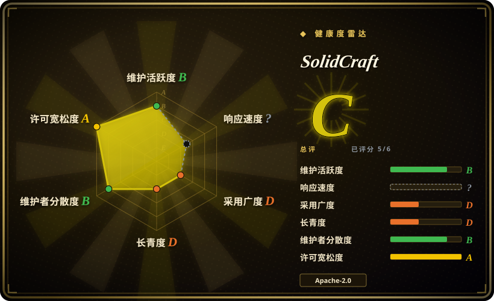
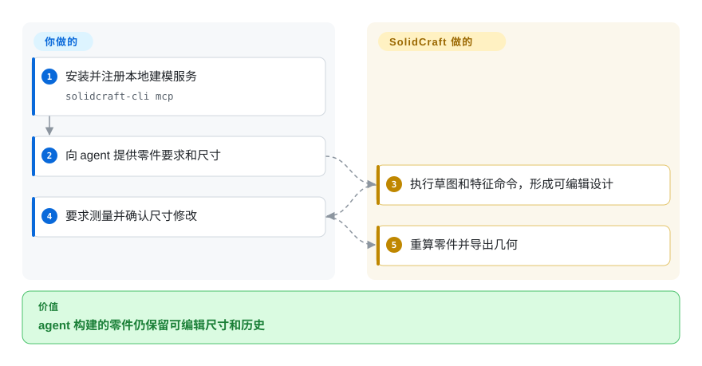

# SolidCraft

外壳宽度改了，孔位也该跟着变，即使模型由 agent 画出。SolidCraft 保留可编辑草图和特征历史，桌面界面与 MCP 服务使用同一套命令。

## 何时使用

你试做可打印支架或外壳，希望既能手动画草图，也能让 agent 构建、测量和修改同一模型。当内置 MCP 接口和可读命令配方比 FreeCAD 的工作台广度及长期历史更重要时，选 SolidCraft。你能检查参数化设计，不必只接收难改的网格。项目明确自称早期、适合简单零件，不代表等同成熟工程套件。

## 何时不用

- **生产关键工程或成熟工作台。** 优先用 [FreeCAD](freecad.zh.md) 并验证几何；SolidCraft 的参考零件检查不证明完整等价性。
- **设计就是精简的文本 CSG 程序。** 选 OpenSCAD；SolidCraft 带有更大的交互文档和特征历史模型。
- **依赖有支持承诺的制造流程或商业原生格式。** 保留 Autodesk Fusion 等现有 CAD。所读构建只启用 cadmpeg 的开放格式编解码器。
- **需要成熟产品渲染。** 用 Blender 或专用渲染器；当前视口缺少 HDRI、折射和贴图。
- **不能让 agent 广泛访问文件。** 使用受限 MCP 路径，必要时另加进程隔离。避免 `--allow-any-path`；授权目录包含写入和删除，硬链接也有已知范围限制。

## 横向对比

| 替代品 | 是否收录 | 我们的评价 | 取舍 |
|---|---|---|---|
| [FreeCAD](freecad.zh.md) | ✅ | 成熟工作台和 OCCT 生态优先时选 FreeCAD；内置 agent 命令操作可编辑草图优先时选 SolidCraft。 | 更长工程历史与年轻 Rust 栈及内置 MCP 之间取舍。 |
| OpenSCAD | 未收录 | 设计本身是 CSG 程序时选 OpenSCAD；人还要画草图和修改特征历史时选 SolidCraft。 | 文本几何与交互式约束之间取舍；真实仓库，本次标签批次未收录。 |
| Autodesk Fusion | 非仓库 | 有支持承诺的制造集成决定选型时选 Fusion；本地可编辑零件和开放实现优先时选 SolidCraft。 | 商业 CAD 产品，不是开放仓库；厂商依赖与早期工具风险之间取舍。 |

## 快速上手

安装桌面发布版，或构建 Rust 工作区后运行 `cargo run --release -p solidcraft-cli -- run examples/bracket.json --out bracket.step`。配方声明尺寸、草图、拉伸和孔，SolidCraft 求值并写出 STEP 交换文件。让 agent 建模时，配置 MCP 客户端启动 `solidcraft-cli mcp`，再要求查命令、建模和测量。MCP 是 agent 调工具的接口，不是云 CAD。尺寸、文件权限和制造验证由你负责，模型商也在项目外。

<!-- flow-steps:begin (generated from flows/solidcraft.json by tools/flow_card.py — do not edit) -->

流程文字版

1. **你**：安装并注册本地建模服务 — `solidcraft-cli mcp`
2. **你**：向 agent 提供零件要求和尺寸
3. **SolidCraft**：执行草图和特征命令，形成可编辑设计
4. **你**：要求测量并确认尺寸修改
5. **SolidCraft**：重算零件并导出几何

**价值**：agent 构建的零件仍保留可编辑尺寸和历史

<!-- flow-steps:end -->

## 技术要点

<!-- mechanism:begin (generated from mechanisms/solidcraft.json by tools/mechanism_card.py; do not edit) -->

机制文字版

- agent 工具参数
- 校验并套用文件范围②
- 共享建模命令②
- 固定坐标后按分量求解①
- 可编辑实体和测量结果

- agent 工具参数 → 校验并套用文件范围②
- 校验并套用文件范围② → 共享建模命令②
- 共享建模命令② → 固定坐标后按分量求解①
- 固定坐标后按分量求解① → 可编辑实体和测量结果

<!-- mechanism:end -->

### 1. 先消去固定坐标，再做数值求解

- **解决：** 草图编辑要保持约束，但不该每次都求解不必要的大系统。
- **做法：** 求解器先固定能通过几何构造确定的坐标，把剩余变量拆成连通分量，再做阻尼高斯牛顿迭代。雅可比矩阵的秩报告约束仍允许哪些运动，也就是剩余自由度。
- **边界：** 稠密求解器拒绝超过 4000 个变量的分量。失败可能是约束冲突，也可能只是未收敛，不证明数学上无解。
- **源码：** [约束求解器](https://github.com/tangency-labs/solidcraft/blob/a8e8d82f902fa1f9f5c4b6c2306f70df5cf7391c/crates/sketch/src/solver.rs#L1-L77)。

### 2. 分发 agent 工具前先套用文件范围

- **解决：** agent 工具可能偏离应用行为，或意外开放整个文件系统。
- **做法：** 标准输入输出上的 JSON-RPC 服务校验参数，套用路径范围，再分发到建模后端。工具提供设计的测量、参数修改和截图。
- **边界：** 这是应用级范围，不是沙箱。显式授权目录包含隐藏文件；硬链接和无限制路径选项需谨慎处理。
- **源码：** [分发器](https://github.com/tangency-labs/solidcraft/blob/a8e8d82f902fa1f9f5c4b6c2306f70df5cf7391c/crates/mcp/src/server.rs#L137-L179)、[范围文档](https://github.com/tangency-labs/solidcraft/blob/a8e8d82f902fa1f9f5c4b6c2306f70df5cf7391c/docs/mcp.md#L50-L155)。

## 技术栈

Rust 2024、egui/eframe、wgpu、Truck 几何组件及自有草图、文档和引擎模块。清单要求 Rust 1.95，并带有内置修补依赖。工作区声明 MIT OR Apache-2.0，依赖及素材单独署名。

## 依赖

桌面安装包或现代 Rust 工具链。图形界面需可用图形环境；无窗口截图优先 GPU，文档也有 CPU 回退。核心建模不需要数据库或模型账号。agent 使用另需 MCP 客户端和模型。原生构建通过选定 cadmpeg 编解码器导入 FreeCAD 与 Rhino 文件。

## 运维难度

**试用低，可重复工程中。** 版本化设计、配方和工具。下载产物尚未签名，应核对来源，不要自动绕过系统警告。0.11–0.14 用户在发布地址迁移后需要手动下载一次新版。重要设计接入前先测试格式交换和重算。

## 健康度与可持续性

- **2026-10-18，早期快速发布。** v0.15.0 发布于 10 月 17 日，前一天发布 v0.14.0。API 建库时间为 10 月 7 日；短公开历史不能提供强 Lindy 依据，也不代表此前全部工作的时长。
- **治理。** 仓库从 bherbruck 迁到 tangency-labs。可见多人贡献，但头部贡献者快照中首位作者占主要份额。
- **来源。** LICENSE-MIT 署名 SolidCraft contributors。ATTRIBUTION 及 vendor 声明区分原创素材与修补后的第三方代码。
- **采用判断。** 配方、参考几何对照和 MCP 月球车是可检查产物，不是普遍生产可靠的独立证明。

## 存疑（未验证）

- [未验证：未构建或运行上游] 没有复现几何正确性、性能、桌面产物和参考零件成功数量。
- [推断：依据是早期声明与短公开历史] 宜先做可回退的原型试用，不宜作为生产 CAD 的唯一工具。
