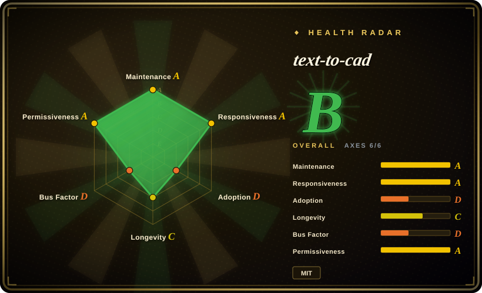
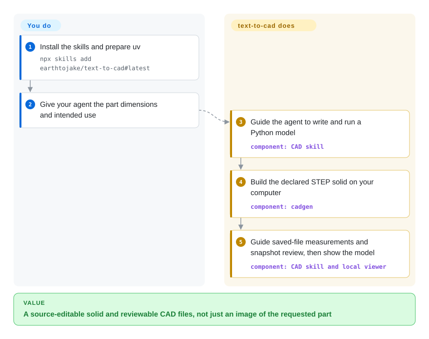
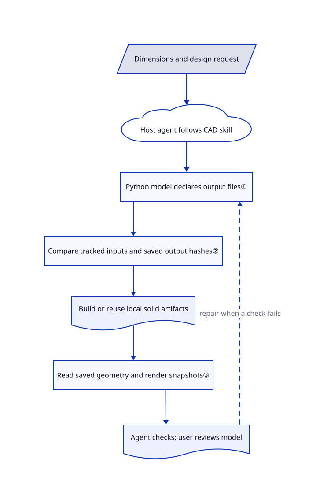

# text-to-cad

Your agent can describe a bracket but leaves you to turn it into an editable solid. text-to-cad supplies modeling instructions and a local Python runtime that builds CAD files and renders them for review.

## When to use

You prototype an enclosure with a coding agent, then ask it to move a mounting hole without losing the dimensions that already fit. Instead of accepting a picture or an opaque mesh, you want a Python model, a STEP file — an exchange format for solid geometry — and a saved-file measurement and image review loop. Choose text-to-cad over bare build123d when you want the agent's modeling workflow, export runtime and viewer packaged together rather than assembling those pieces yourself.

Your existing agent supplies the language model. This repository supplies skills, the version-pinned cadgen runtime and optional MCP integration — the interface that lets an agent show and inspect local CAD views. It is not a separately trained text-to-CAD model or a replacement for engineering judgment.

## When NOT to use

- **You need a designer to edit sketches and a feature history directly.** Choose [FreeCAD](freecad.md); text-to-cad's maintained design is Python source, not an interactive sketch document. [SolidCraft](solidcraft.md) is another early option when shared desktop and agent commands matter.
- **You already own a Python CAD pipeline.** Use [build123d](https://github.com/gumyr/build123d) directly if you only need geometry and exports. text-to-cad adds agent instructions, a daemon, cached artifacts and a browser renderer that your existing pipeline may not need.
- **You need guaranteed manufacturability or unrestricted assembly scale.** Keep a validated FreeCAD engineering workflow and independent checks. The skill requires dimensional and visual review, not certification; [issue 626](https://github.com/earthtojake/text-to-cad/issues/626) reports a viewer memory-envelope refusal in 0.7.21, without establishing a universal part-count limit.
- **You need an unauthenticated shared CAD service.** Do not expose its viewer to a network. Use isolated local FreeCAD sessions instead, or add and validate your own authentication boundary: the upstream security policy defines loopback as the trust boundary.
- **You cannot permit default outbound statistics or runtime downloads.** Prefer an approved, pre-provisioned build123d environment, or explicitly configure text-to-cad first. Its telemetry starts after a CLI notice by default; persistently disable it with `uvx cadgen telemetry off` and separately disable update checks with `CADGEN_UPDATE_CHECK=0`. The agent provider has its own data policy.

## Comparison

| Alternative | In index | Our verdict | Tradeoff |
|---|---|---|---|
| [FreeCAD](freecad.md) | ✅ | Choose FreeCAD when a human must constrain sketches and edit a feature history; choose text-to-cad when the agent should maintain reviewable Python and regenerate exchange files. | A broader desktop engineering environment versus a source-first agent workflow; neither removes the need to validate manufactured parts. |
| [SolidCraft](solidcraft.md) | ✅ | Choose SolidCraft for agent commands over the same editable design as its desktop UI; choose text-to-cad for build123d-based Python models and bundled fabrication skills. | Interactive sketches and a young Rust geometry stack versus Python on OpenCASCADE plus a separate host agent. |
| [build123d](https://github.com/gumyr/build123d) | not indexed | Choose build123d for an embedded geometry library you control; choose text-to-cad when ready-made agent instructions, saved-file review and a local viewer outweigh the extra runtime. | Direct modeling APIs and fewer workflow layers, but you implement orchestration and review; not added in this tab batch. |

## Quick start

Install uv, then use the documented skills-only path `npx skills add earthtojake/text-to-cad#latest` for an agent without plugin support; do not also install a duplicate plugin in that host. The CAD skill pins `cadgen==0.7.26` through uv and managed Python 3.13; first use downloads the runtime, and the first snapshot downloads a headless browser. Give your agent dimensions and ask for a Python model such as the documented `src/bracket.py`, whose `@step(out="../STEP/bracket.step")` function returns a build123d shape. The agent runs that model to generate STEP, checks the saved geometry and renders a review image; cadgen handles artifact generation and the local viewer. You supply the host agent and its model budget, approve dimensional assumptions and independently validate the part before fabrication; plugin-supported hosts can instead follow the README's host-specific installation.

<!-- flow-steps:begin (generated from flows/text-to-cad.json by tools/flow_card.py — do not edit) -->

Text version of the flow

1. **You**: Install the skills and prepare uv — `npx skills add earthtojake/text-to-cad#latest`
2. **You**: Give your agent the part dimensions and intended use
3. **text-to-cad**: Guide the agent to write and run a Python model — component: `CAD skill`
4. **text-to-cad**: Build the declared STEP solid on your computer — component: `cadgen`
5. **text-to-cad**: Guide saved-file measurements and snapshot review, then show the model — component: `CAD skill and local viewer`

**Value**: A source-editable solid and reviewable CAD files, not just an image of the requested part

<!-- flow-steps:end -->

## Key techniques

<!-- mechanism:begin (generated from mechanisms/text-to-cad.json by tools/mechanism_card.py; do not edit) -->

Text version of the mechanism

- Dimensions and design request
- Host agent follows CAD skill
- Python model declares output files①
- Compare tracked inputs and saved output hashes②
- Build or reuse local solid artifacts
- Read saved geometry and render snapshots③
- Agent checks; user reviews model

- Dimensions and design request → Host agent follows CAD skill
- Host agent follows CAD skill → Python model declares output files①
- Python model declares output files① → Compare tracked inputs and saved output hashes②
- Compare tracked inputs and saved output hashes② → Build or reuse local solid artifacts
- Build or reuse local solid artifacts → Read saved geometry and render snapshots③
- Read saved geometry and render snapshots③ → Agent checks; user reviews model
- Agent checks; user reviews model → Python model declares output files① (repair when a check fails) [optional/fallback]

<!-- mechanism:end -->

### 1. Declare outputs on executable Python models

- **Problem:** An agent's geometry script needs an explicit, repeatable route from editable source to the requested files.
- **How:** `@step` registers a parameterless model and its output declaration. A top-level call builds its output; a call inside another model composes a child result. Mesh decorators extend that declaration for STL, 3MF or GLB.
- **Limits:** The script is an ordinary program, not sandboxed model data. Document export and viewing do not execute source; after editing Python, the agent must run the model explicitly.
- **Source:** [Declaration and invocation](https://github.com/earthtojake/text-to-cad/blob/2f793659fb7bab537e2f00836e06448fc4087cb2/packages/cadgen/src/cadgen/authoring.py#L484-L615), [mesh declarations](https://github.com/earthtojake/text-to-cad/blob/2f793659fb7bab537e2f00836e06448fc4087cb2/packages/cadgen/src/cadgen/authoring.py#L690-L776), [source/document separation](https://github.com/earthtojake/text-to-cad/blob/2f793659fb7bab537e2f00836e06448fc4087cb2/packages/cadgen/src/cadgen/step.py#L1-L26).

### 2. Rebuild from tracked inputs, not just timestamps

- **Problem:** Rebuilding an entire assembly after every small edit wastes geometry work; reusing the wrong result silently preserves stale parts.
- **How:** The freshness gate compares a recorded source-dependency hash, imported constant values, child-result hashes, stored objects and declared output hashes. Python source uses syntax-tree hashes and reachable-definition slices, so comment-only changes need not invalidate geometry. The gate runs before the heavy CAD kernel is imported.
- **Limits:** The model must not depend on untracked time, randomness, environment variables or working directory. Dynamic analysis escapes fall back to whole-file hashes; cache freshness does not establish dimensional correctness.
- **Source:** [Gate and output checks](https://github.com/earthtojake/text-to-cad/blob/2f793659fb7bab537e2f00836e06448fc4087cb2/packages/cadgen/src/cadgen/store/gate.py#L1-L23), [gate implementation](https://github.com/earthtojake/text-to-cad/blob/2f793659fb7bab537e2f00836e06448fc4087cb2/packages/cadgen/src/cadgen/store/gate.py#L164-L269), [dependency slicing](https://github.com/earthtojake/text-to-cad/blob/2f793659fb7bab537e2f00836e06448fc4087cb2/packages/cadgen/src/cadgen/store/closure.py#L1-L56), [model restrictions](https://github.com/earthtojake/text-to-cad/blob/2f793659fb7bab537e2f00836e06448fc4087cb2/skills/cad/SKILL.md#L81-L99).

### 3. Review the saved artifact, not the source's intention

- **Problem:** A script can run successfully while its exported part has the wrong hole, scale or placement.
- **How:** The CAD skill instructs the agent to measure the saved STEP with `read_scene` or `read_step`, then generate and inspect a snapshot after visible geometry changes. The snapshot runtime drives local headless Chromium and writes the requested images; the user-facing viewer is a separate handoff.
- **Limits:** These are workflow instructions, not an enforced manufacturing approval gate or an automatic visual correctness score. Mesh measurements are approximate; precise topology selection requires STEP.
- **Source:** [Verification and handoff](https://github.com/earthtojake/text-to-cad/blob/2f793659fb7bab537e2f00836e06448fc4087cb2/skills/cad/SKILL.md#L174-L227), [browser rendering](https://github.com/earthtojake/text-to-cad/blob/2f793659fb7bab537e2f00836e06448fc4087cb2/packages/cadgen/src/cadgen/snapshot_core.py#L1730-L1768), [output writing](https://github.com/earthtojake/text-to-cad/blob/2f793659fb7bab537e2f00836e06448fc4087cb2/packages/cadgen/src/cadgen/snapshot_core.py#L2322-L2349).

## Tech stack

Python cadgen engine, build123d 0.11 and OpenCASCADE through `cadquery-ocp-novtk` 7.9. The package also declares ezdxf, Shapely, Matplotlib, Pillow and Playwright 1.64.0. JavaScript builders, React viewer clients and a native file tracer ship in the Python wheel; Markdown skills guide the external agent.

## Dependencies

- **Host:** an existing coding agent with skills or plugin support, plus its own model access. No model weights or inference server ship here.
- **Runtime:** uv for the supported skill launch path; cadgen supports Python 3.11+, while shipped skills request managed 3.13. Native CAD wheels must load on the target OS.
- **Rendering and mesh exports:** Playwright's browser downloads on first snapshot. JavaScript builders use `CADGEN_NODE`, then Node on PATH, then Playwright's bundled Node; a separate Node installation is not always required in 0.7.26.
- **Network:** installation and optional parts/fabrication integrations need their services. Geometry runs locally; telemetry and version-check requests have independent controls. No database is required.

## Ops difficulty

**Medium.** This is a local engineering toolchain, not just a prompt file. Keep skills and cadgen pins aligned, account for browser downloads, native CAD compatibility, build workers and the derived-artifact cache. Keep the unauthenticated viewer on loopback and treat model scripts as executable code. Persist the telemetry choice rather than relying only on a temporary environment variable: detached viewers and the shared daemon use stored settings. On Windows 11, the README documents unsigned OCP modules being blocked by Smart App Control; prefer WSL over weakening machine-wide protection without an explicit security decision.

## Health & viability

- **2026-10-22 — active beta.** The default-branch commit is dated October 20; v0.7.26 was released that day after v0.7.25 and v0.7.24. Frequent patches indicate active work, not an established compatibility promise. The manifest labels the package Beta.
- **Governance and backing.** GitHub ownership is a personal account. The leading contributor has 1,136 recorded contributions versus 44 for the next listed non-bot, non-agent contributor. The MIT license and privacy policy name Thompson Labs LLC; no foundation governance or funding commitment was found in the inspected tree.
- **Age and durability judgment.** Created April 22, 2026: six months old and currently active. Its public history is too short for a strong Lindy durability prior; pin a working release and retain portable STEP files and Python sources.
- **Adoption and evidence.** The API reports about 22.4k stars and 2.2k forks. Multiple host integrations, 281 test-tree files and detailed package contracts are inspectable ecosystem signals, not proof of production geometry quality.
- **Risk flags.** Default telemetry, an unauthenticated local viewer, native binary compatibility and a fast-changing runtime are the consequential adoption costs. The [security policy](https://github.com/earthtojake/text-to-cad/blob/2f793659fb7bab537e2f00836e06448fc4087cb2/SECURITY.md) supports only the latest release.

## Caveats (unverified)

- [未验证：本批次仅静态研究，未安装或执行上游] Installation, agent-host compatibility, CAD accuracy, snapshot rendering and manufacturing-check results were not reproduced.
- [未验证：未做网络抓包或服务端审计] The README, privacy policy and client code document telemetry fields and deletion behavior; actual outbound payloads, server retention and deletion were not independently audited. A host model provider may separately receive prompts and tool results.
- [推断：依据是六个月公开历史、维护者贡献集中和快速补丁发布] Treat this as a reversible prototyping workflow rather than the sole authority for production engineering; stars do not establish reliability.
