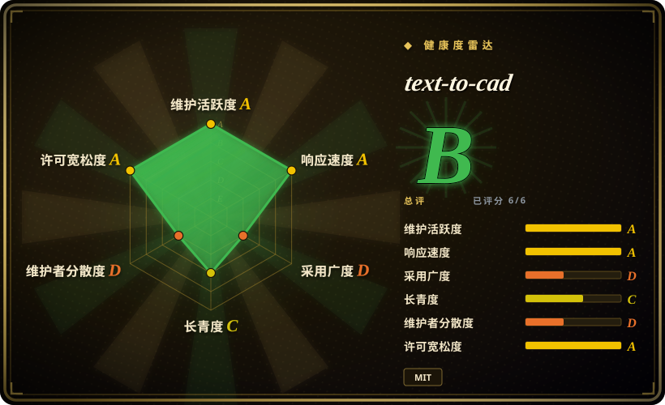
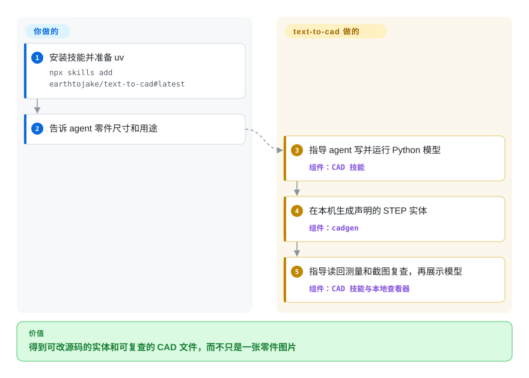
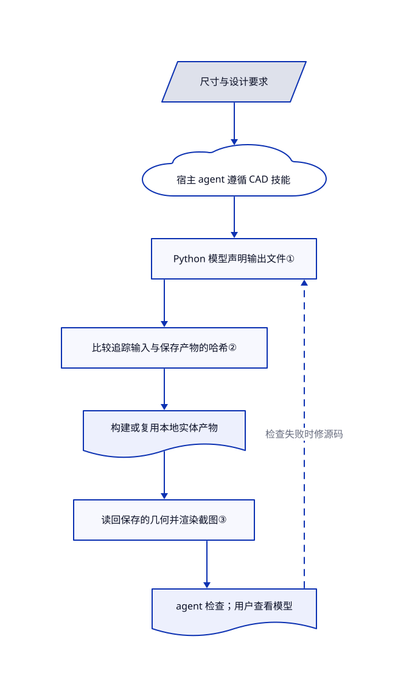

# text-to-cad

agent 能描述支架，却还要你亲手画成可修改的实体。text-to-cad 提供建模指令和本地 Python 工具链，生成 CAD 文件并渲染成图，供你核对。

## 何时使用

你用编程 agent 试做外壳，随后要求它挪动安装孔，同时保住已经对齐的尺寸。你要的不是一张图片或难改的网格，而是 Python 模型、STEP 文件（用于交换实体几何的格式），以及读回文件、测量和看图的检查流程。相比直接用 build123d，当你不想自己拼接 agent 建模规则、导出工具和查看器时，选 text-to-cad。

语言模型由你已有的 agent 提供。本仓库提供技能、固定版本的 cadgen 工具链，以及可选的 MCP 集成，即让 agent 展示和检查本地 CAD 视图的工具接口。它不是独立训练的文字生成 CAD 模型，也不能替代工程判断。

## 何时不用

- **设计师需要直接编辑草图和特征历史。** 选 [FreeCAD](freecad.zh.md)；text-to-cad 持续维护的是 Python 源码，不是交互式草图文档。[SolidCraft](solidcraft.zh.md) 也是早期候选，适合看重桌面与 agent 共用命令的情况。
- **你已有 Python CAD 管线。** 只缺几何和导出时，直接用 [build123d](https://github.com/gumyr/build123d)。text-to-cad 增加了 agent 指令、后台构建进程、产物缓存和浏览器渲染器，未必值得重复引入。
- **你需要可制造性保证，或假定装配规模没有上限。** 保留经过验证的 FreeCAD 工程流程并独立检查。技能要求尺寸与视觉检查，不提供认证；[问题 626](https://github.com/earthtojake/text-to-cad/issues/626) 记录了 0.7.21 查看器因内存包络拒绝加载，不能据此编造统一零件数上限。
- **你要把它当成无认证的多人 CAD 服务。** 不要把查看器暴露到网络。改用隔离的本地 FreeCAD 会话，或自行增加并验证认证边界；上游安全政策把本机回环地址作为信任边界。
- **你不能接受默认统计外发或运行时下载。** 优先用预先批准并部署的 build123d 环境，或先明确配置本项目。遥测默认在命令行告知后启用；用 `uvx cadgen telemetry off` 持久关闭，再用 `CADGEN_UPDATE_CHECK=0` 单独关闭版本检查。agent 模型服务另有自己的数据政策。

## 横向对比

| 替代品 | 是否收录 | 我们的评价 | 取舍 |
|---|---|---|---|
| [FreeCAD](freecad.zh.md) | ✅ | 人需要约束草图和修改特征历史时选 FreeCAD；要让 agent 维护可审查的 Python，再生成交换文件时选 text-to-cad。 | 更广的桌面工程环境，对比源码优先的 agent 流程；两者都不能省掉制造前验证。 |
| [SolidCraft](solidcraft.zh.md) | ✅ | 要让 agent 操作桌面界面中的同一份可编辑设计时选 SolidCraft；需要基于 build123d 的 Python 模型和配套制造技能时选 text-to-cad。 | 交互草图与年轻的 Rust 几何栈，对比 OpenCASCADE 上的 Python 与另备的宿主 agent。 |
| [build123d](https://github.com/gumyr/build123d) | 未收录 | 嵌入自己的几何程序时选 build123d；现成 agent 指令、保存文件后的复查与本地查看器更重要时选 text-to-cad。 | 直接建模接口和更少流程层，代价是自建编排与复查；未在本次标签批次添加。 |

## 快速上手

先安装 uv；不支持插件的 agent 可走官方技能安装命令 `npx skills add earthtojake/text-to-cad#latest`，同一宿主不要再重复装插件。CAD 技能通过 uv 和托管 Python 3.13 固定使用 `cadgen==0.7.26`；首次使用下载运行时，首次截图下载无界面浏览器。把尺寸交给 agent，让它参考官方 `src/bracket.py` 示例编写模型，使用 `@step(out="../STEP/bracket.step")` 声明输出，并返回 build123d 几何。agent 运行模型生成 STEP，读回几何检查并渲染复查图；cadgen 负责产物生成和本地查看器。你负责宿主 agent、模型费用、尺寸假设批准和制造前独立验收；支持插件的宿主也可改走 README 对应的安装入口。

<!-- flow-steps:begin (generated from flows/text-to-cad.json by tools/flow_card.py — do not edit) -->

流程文字版

1. **你**：安装技能并准备 uv — `npx skills add earthtojake/text-to-cad#latest`
2. **你**：告诉 agent 零件尺寸和用途
3. **text-to-cad**：指导 agent 写并运行 Python 模型 — 组件：`CAD 技能`
4. **text-to-cad**：在本机生成声明的 STEP 实体 — 组件：`cadgen`
5. **text-to-cad**：指导读回测量和截图复查，再展示模型 — 组件：`CAD 技能与本地查看器`

**价值**：得到可改源码的实体和可复查的 CAD 文件，而不只是一张零件图片

<!-- flow-steps:end -->

## 技术要点

<!-- mechanism:begin (generated from mechanisms/text-to-cad.json by tools/mechanism_card.py; do not edit) -->

机制文字版

- 尺寸与设计要求
- 宿主 agent 遵循 CAD 技能
- Python 模型声明输出文件①
- 比较追踪输入与保存产物的哈希②
- 构建或复用本地实体产物
- 读回保存的几何并渲染截图③
- agent 检查；用户查看模型

- 尺寸与设计要求 → 宿主 agent 遵循 CAD 技能
- 宿主 agent 遵循 CAD 技能 → Python 模型声明输出文件①
- Python 模型声明输出文件① → 比较追踪输入与保存产物的哈希②
- 比较追踪输入与保存产物的哈希② → 构建或复用本地实体产物
- 构建或复用本地实体产物 → 读回保存的几何并渲染截图③
- 读回保存的几何并渲染截图③ → agent 检查；用户查看模型
- agent 检查；用户查看模型 → Python 模型声明输出文件①（检查失败时修源码）〔可选／兜底〕

<!-- mechanism:end -->

### 1. 在可执行 Python 模型上声明产物

- **解决：** agent 写出的几何脚本，需要明确且可重复的文件生成路径。
- **做法：** `@step` 注册无参数模型及输出声明。顶层调用会构建产物；在另一个模型内调用则组合子模型结果。网格装饰器把 STL、3MF 或 GLB 加入同一声明。
- **边界：** 脚本是普通程序，不是沙箱内的模型数据。文档导出和查看不会执行源码；改完 Python 后，agent 必须显式运行模型。
- **源码：** [声明与调用](https://github.com/earthtojake/text-to-cad/blob/2f793659fb7bab537e2f00836e06448fc4087cb2/packages/cadgen/src/cadgen/authoring.py#L484-L615)、[网格声明](https://github.com/earthtojake/text-to-cad/blob/2f793659fb7bab537e2f00836e06448fc4087cb2/packages/cadgen/src/cadgen/authoring.py#L690-L776)、[源码与文档分离](https://github.com/earthtojake/text-to-cad/blob/2f793659fb7bab537e2f00836e06448fc4087cb2/packages/cadgen/src/cadgen/step.py#L1-L26)。

### 2. 按追踪到的输入决定重建

- **解决：** 每改一处就重建整套装配会浪费几何计算；错用缓存又会悄悄保留旧零件。
- **做法：** 新鲜度门禁比较源码依赖哈希、导入常量值、子模型结果哈希、缓存对象和声明输出哈希。Python 源码使用语法树哈希与可达定义切片，因此只改注释不必使几何失效。门禁在导入重型 CAD 内核前执行。
- **边界：** 模型不能依赖未追踪的时间、随机值、环境变量或工作目录。无法静态分析的动态行为退回整文件哈希；缓存未过期不代表尺寸正确。
- **源码：** [门禁与输出检查](https://github.com/earthtojake/text-to-cad/blob/2f793659fb7bab537e2f00836e06448fc4087cb2/packages/cadgen/src/cadgen/store/gate.py#L1-L23)、[门禁实现](https://github.com/earthtojake/text-to-cad/blob/2f793659fb7bab537e2f00836e06448fc4087cb2/packages/cadgen/src/cadgen/store/gate.py#L164-L269)、[依赖切片](https://github.com/earthtojake/text-to-cad/blob/2f793659fb7bab537e2f00836e06448fc4087cb2/packages/cadgen/src/cadgen/store/closure.py#L1-L56)、[模型约束](https://github.com/earthtojake/text-to-cad/blob/2f793659fb7bab537e2f00836e06448fc4087cb2/skills/cad/SKILL.md#L81-L99)。

### 3. 检查保存的产物，而不是源码意图

- **解决：** 脚本执行成功，导出零件仍可能孔位、比例或装配位置错误。
- **做法：** CAD 技能要求 agent 用 `read_scene` 或 `read_step` 测量已保存的 STEP，并在几何外观变化后生成截图、亲自看图。截图工具驱动本机无界面 Chromium 并写出图片；面向用户的查看器是另一项交接。
- **边界：** 这些是流程指令，不是强制制造审批门，也没有自动视觉正确性评分。网格测量是近似值；精确拓扑选择需要 STEP。
- **源码：** [验证与交接](https://github.com/earthtojake/text-to-cad/blob/2f793659fb7bab537e2f00836e06448fc4087cb2/skills/cad/SKILL.md#L174-L227)、[浏览器渲染](https://github.com/earthtojake/text-to-cad/blob/2f793659fb7bab537e2f00836e06448fc4087cb2/packages/cadgen/src/cadgen/snapshot_core.py#L1730-L1768)、[输出写入](https://github.com/earthtojake/text-to-cad/blob/2f793659fb7bab537e2f00836e06448fc4087cb2/packages/cadgen/src/cadgen/snapshot_core.py#L2322-L2349)。

## 技术栈

Python cadgen 引擎、build123d 0.11，以及通过 `cadquery-ocp-novtk` 接入的 OpenCASCADE 7.9。包还声明 ezdxf、Shapely、Matplotlib、Pillow 和 Playwright 1.64.0。JavaScript 构建器、React 查看器客户端和本地文件追踪库随 Python wheel 分发；Markdown 技能指导外部 agent。

## 依赖

- **宿主：** 支持技能或插件的现有编程 agent，以及它的模型访问。仓库不提供模型权重或推理服务。
- **运行时：** 官方技能启动路径需要 uv；cadgen 支持 Python 3.11 及以上，随包技能选择托管 3.13。目标系统必须能加载原生 CAD wheel。
- **渲染和网格导出：** 首次截图下载 Playwright 浏览器。JavaScript 构建器依次使用 `CADGEN_NODE`、PATH 上的 Node、Playwright 自带的 Node；0.7.26 不一定需要另装 Node。
- **网络：** 安装、可选零件搜索和制造服务集成需要相应网络。几何计算在本地；遥测与版本检查各有开关。不需要数据库。

## 运维难度

**中。** 这是本地工程工具链，不只是一份提示词。技能和 cadgen 的固定版本要一致，还要管理浏览器下载、原生 CAD 兼容性、构建进程与派生产物缓存。无认证查看器应保持本机回环监听，模型脚本应按可执行代码对待。遥测应持久关闭，不要只设临时环境变量：脱离终端运行的查看器和共享后台进程会读取保存的设置。README 记录了 Windows 11 Smart App Control 拦截未签名 OCP 模块的情况；优先考虑 WSL，不要未经明确安全决策就削弱整机防护。

## 健康度与可持续性

- **2026-10-22——活跃测试版。** 默认分支提交日期是 10 月 20 日；当天发布 v0.7.26，前面紧邻 v0.7.25 和 v0.7.24。频繁补丁说明正在维护，不代表兼容性承诺成熟。包清单把项目标为测试版。
- **治理与托底。** GitHub 所有者是个人账户。贡献榜首记录为 1136 次，下一位排除机器人与 agent 账号的贡献者为 44 次。MIT 许可证和隐私政策均署名 Thompson Labs LLC；所查目录未发现基金会治理或资金承诺。
- **年龄与持久性判断。** 仓库创建于 2026 年 4 月 22 日，已有六个月公开历史，当前仍活跃。公开历史不足以形成强的长期存续先验；应固定可用版本，保留可移植的 STEP 和 Python 源码。
- **采用与证据。** API 记录约 2.24 万星、2200 个复刻。多宿主集成、测试目录中的 281 个文件和详细包契约是可检查的生态信号，不是生产几何质量的证明。
- **风险。** 默认遥测、无认证本地查看器、原生二进制兼容性和快速变化的运行时，是实际采用成本。[安全政策](https://github.com/earthtojake/text-to-cad/blob/2f793659fb7bab537e2f00836e06448fc4087cb2/SECURITY.md) 只支持最新版本。

## 存疑（未验证）

- [未验证：本批次仅静态研究，未安装或执行上游] 未复现安装、agent 宿主兼容性、几何精度、截图渲染或制造检查结果。
- [未验证：未做网络抓包或服务端审计] README、隐私政策和客户端代码描述了遥测字段及删除行为；未独立审计实际外发数据、服务端保留和删除效果。宿主模型服务可能另外收到提示词与工具结果。
- [推断：依据是六个月公开历史、维护者贡献集中和快速补丁发布] 更适合可回退的原型流程，不应作为生产工程的唯一裁决者；星数不能证明可靠性。
