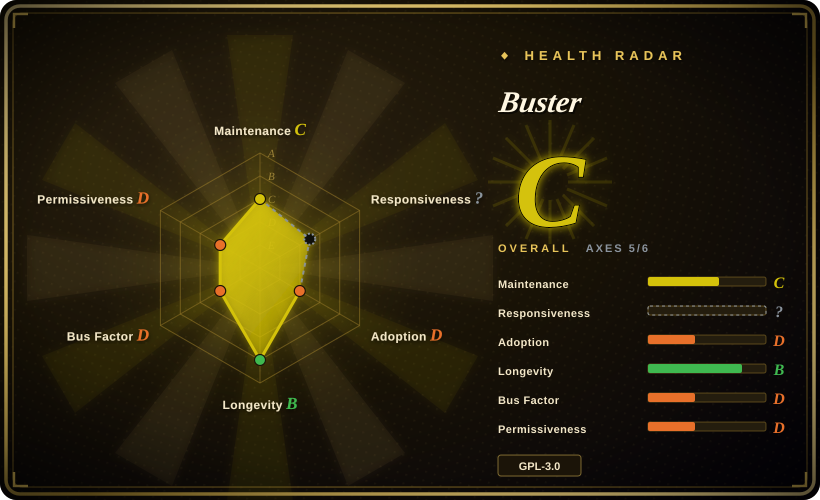
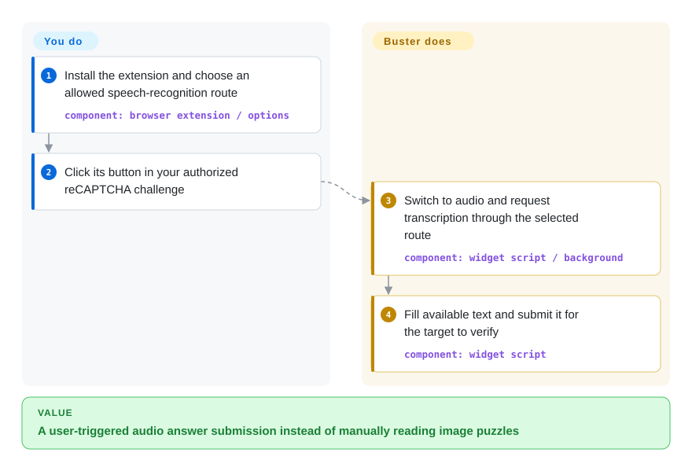
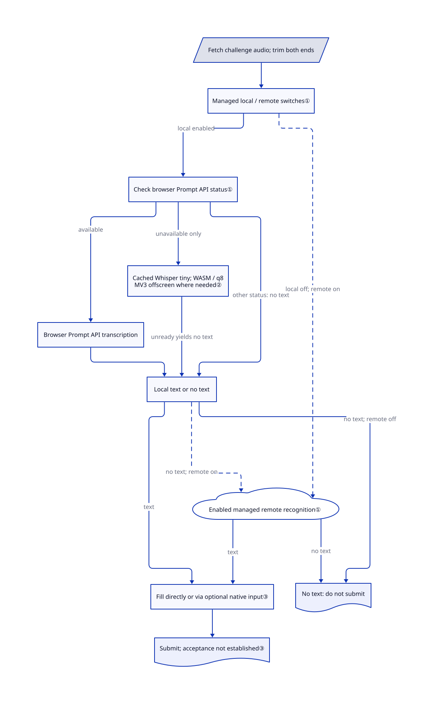

# Buster

You cannot reliably read reCAPTCHA's image puzzles; Buster adds a user-clicked button that transcribes the audio alternative and fills its answer, without guaranteeing acceptance.

## When to use

You're a user who is repeatedly blocked by difficult visual reCAPTCHA challenges, or a tester validating an accessibility journey on a system you own or have permission to test. You want a button inside the reCAPTCHA widget that switches to the audio challenge, transcribes it, and fills the response, while keeping the extension source available for review. Buster can use browser-local speech models or configured remote speech services, and an optional native client can simulate operating-system mouse and keyboard input.

You choose Buster over NopeCHA when a human-triggered, reCAPTCHA-specific accessibility workflow and source auditability matter more than unattended automation or broad CAPTCHA-family coverage. It assists with one challenge path; it does not confer authorization, and no recognition success level should be assumed.

## When NOT to use

- **You lack authorization for automated access to a third-party system.** Do not turn Buster, NopeCHA, or another solver into a bulk-access bypass; use the site's official API, provider test keys, or an owner-approved test environment.
- **You need unattended multi-family CAPTCHA solving.** In an explicitly authorized environment, evaluate NopeCHA; Buster centers on a person clicking its button for reCAPTCHA audio.
- **You need deterministic end-to-end tests.** Use Playwright with reCAPTCHA test keys or mocked verification responses; live audio challenges and speech models make Buster unsuitable as a stable CI oracle.
- **Audio must never reach a remote service.** Configure and verify Buster's local model path, or use manual accessibility testing; do not leave managed remote recognition enabled without reviewing the data boundary.
- **You cannot install a browser extension or optional native input client.** Use a dedicated test browser with Playwright fixtures, or test the server-side verification contract directly.
- **GPL-3.0-only is incompatible with your redistribution model.** Use provider test configurations plus Apache-2.0 Playwright rather than embedding or redistributing Buster in a proprietary bundle.

## Comparison

| Alternative | In index | Our verdict | Tradeoff |
|---|---|---|---|
| [NopeCHA](nopecha-extension.md) | ✅ | Choose Buster for human-triggered, auditable reCAPTCHA audio assistance; choose NopeCHA only for authorized unattended coverage across several CAPTCHA families. | Buster is narrower and open source; NopeCHA is broader but its maintained implementation is closed and service-dependent. |
| 2captcha-python | not indexed | Choose 2captcha-python when a backend script needs a solving-service API; choose Buster when the user should explicitly trigger assistance in the browser. | The API client suits automation but adds external service and billing dependencies; Buster stays in the browser and can use local recognition. |
| [Text_select_captcha](text-select-captcha.md) | ✅ | Choose Text_select_captcha for authorized Chinese click-to-select recognition; choose Buster for reCAPTCHA audio accessibility. | They solve different challenge modalities; Text_select_captcha also lacks a license grant. |

## Quick start

Install Buster from one of the browser-store links in [README.md:6–21](https://github.com/dessant/buster/blob/4f6fa9f26321fd645401e2f96e00cea4f8532e1a/README.md#L6-L21), in a profile used for your own or explicitly authorized accessibility test. Open the extension's options and choose a speech-recognition route; managed mode enables both local and remote services in the checked migration, so disable remote processing if audio must stay local. If the local model is not ready, prepare it before testing; local recognition still needs model downloads and challenge audio from the network. Open your authorized reCAPTCHA challenge and click the Buster button: it switches to audio, requests transcription, fills the answer and submits it. You retain authorization, browser permissions and data-boundary decisions; the separate native client is optional, and the target can still reject the response.

<!-- flow-steps:begin (generated from flows/buster.json by tools/flow_card.py — do not edit) -->

Text version of the flow

1. **You**: Install the extension and choose an allowed speech-recognition route — component: `browser extension / options`
2. **You**: Click its button in your authorized reCAPTCHA challenge
3. **Buster**: Switch to audio and request transcription through the selected route — component: `widget script / background`
4. **Buster**: Fill available text and submit it for the target to verify — component: `widget script`

**Value**: A user-triggered audio answer submission instead of manually reading image puzzles

<!-- flow-steps:end -->

## Key techniques

<!-- mechanism:begin (generated from mechanisms/buster.json by tools/mechanism_card.py; do not edit) -->

Text version of the mechanism

- Fetch challenge audio; trim both ends
- Managed local / remote switches①
- Check browser Prompt API status①
- Browser Prompt API transcription
- Cached Whisper tiny; WASM / q8; MV3 offscreen where needed②
- Local text or no text
- Enabled managed remote recognition①
- Fill directly or via optional native input③
- Submit; acceptance not established③
- No text: do not submit

- Fetch challenge audio; trim both ends → Managed local / remote switches①
- Managed local / remote switches① → Check browser Prompt API status① (local enabled)
- Check browser Prompt API status① → Browser Prompt API transcription (available)
- Check browser Prompt API status① → Cached Whisper tiny; WASM / q8; MV3 offscreen where needed② (unavailable only)
- Check browser Prompt API status① → Local text or no text (other status: no text)
- Browser Prompt API transcription → Local text or no text
- Cached Whisper tiny; WASM / q8; MV3 offscreen where needed② → Local text or no text (unready yields no text)
- Managed local / remote switches① → Enabled managed remote recognition① (local off; remote on) [optional/fallback]
- Local text or no text → Enabled managed remote recognition① (no text; remote on) [optional/fallback]
- Local text or no text → Fill directly or via optional native input③ (text)
- Local text or no text → No text: do not submit (no text; remote off)
- Enabled managed remote recognition① → Fill directly or via optional native input③ (text)
- Enabled managed remote recognition① → No text: do not submit (no text)
- Fill directly or via optional native input③ → Submit; acceptance not established③

<!-- mechanism:end -->

### 1. Route audio by availability and explicit service switches

- **Problem:** A browser-local recognizer may be absent or return no answer; local support alone says nothing about whether audio can leave the browser.
- **How:** The background fetches audio and trims 1.5 seconds from each end; managed local mode tries the browser Prompt API when available, and only an unavailable API selects Transformers. Managed remote recognition can run without a local answer, and the checked migration enables both local and remote switches.
- **Limits:** A Prompt API call returning no text does not trigger the Transformers branch; downloading or other intermediate API states do not either. Enabled remote fallback is an outbound-data path, not a local-only guarantee.
- **Source:** [background/main.js:663–756](https://github.com/dessant/buster/blob/4f6fa9f26321fd645401e2f96e00cea4f8532e1a/src/background/main.js#L663-L756), [managed-service migration:8–14](https://github.com/dessant/buster/blob/4f6fa9f26321fd645401e2f96e00cea4f8532e1a/src/storage/revisions/local/20260617113244_add_managed_services.js#L8-L14).

### 2. Check model readiness before browser transcription

- **Problem:** Selecting a local model is not enough when its weights have not been downloaded and cached.
- **How:** Transformers selects Whisper tiny with WASM, a browser execution format, and q8, eight-bit model weights; availability is checked through the pipeline cache. On the relevant Manifest V3 browsers, a separate offscreen document processes audio outside the extension's background service worker and transcribes only an available pipeline.
- **Limits:** An unready model returns no text; this readiness check neither guarantees recognition nor removes network downloads for models and challenge audio.
- **Source:** [models.js:101–151](https://github.com/dessant/buster/blob/4f6fa9f26321fd645401e2f96e00cea4f8532e1a/src/utils/models.js#L101-L151), [offscreen/main.js:21–37](https://github.com/dessant/buster/blob/4f6fa9f26321fd645401e2f96e00cea4f8532e1a/src/offscreen/main.js#L21-L37), [background/main.js:694–723](https://github.com/dessant/buster/blob/4f6fa9f26321fd645401e2f96e00cea4f8532e1a/src/background/main.js#L694-L723).

### 3. Fill and submit only after receiving text

- **Problem:** Recognizing audio and operating the challenge widget require different browser interactions.
- **How:** The widget asks the background for a transcription and stops if it receives none. Otherwise it fills the answer directly or uses optional native mouse/keyboard commands, then activates the verification button.
- **Limits:** The auditable interaction still depends on reCAPTCHA's DOM selectors, the page-element addresses used by the script. Submission and its internal solved notification do not prove server acceptance.
- **Source:** [base/main.js:368–407](https://github.com/dessant/buster/blob/4f6fa9f26321fd645401e2f96e00cea4f8532e1a/src/base/main.js#L368-L407).

## Tech stack

- **Extension:** modern JavaScript ES modules using WebExtension APIs for Chrome, Edge, Firefox, and Opera.
- **Interface:** Vue 3 and Vuetify for setup, contribution, and options surfaces.
- **Recognition:** `@huggingface/transformers` and `onnxruntime-web` for browser-local models, with optional Wit.ai, Google, IBM, and Microsoft speech APIs.
- **Build:** Node.js, npm, Gulp, Webpack, Babel, PostCSS, and per-browser manifests.
- **Optional native integration:** Buster Client receives native-messaging commands to simulate mouse and keyboard input.

## Dependencies

- A supported desktop browser and the extension from its browser store or a built release archive.
- A speech-recognition route: the managed local model, a configured remote service, or user-supplied speech API credentials.
- The optional Buster Client on Windows, Linux, or macOS when operating-system-level input simulation is enabled.
- Building from source currently uses the Node version pinned in `.nvmrc` (`24.16.0`) and `npm ci`.

## Ops difficulty

**Low for personal use, medium for managed deployment.** Installing from a browser store is straightforward. A managed rollout must decide whether recognition is local or remote, review extension permissions and native messaging, control updates, and validate accessibility behavior after reCAPTCHA changes. Keep it in a dedicated browser profile for testing, and do not make a passing Buster solve the acceptance criterion for CI.

## Health & viability

- **Measured signals (2026-10-14):** C/?/D/B/D/D, overall C with 5/6 axes scored. Responsiveness changed from A to `?`/`no_window_signal`: traffic exists, but the deterministic 90-day window ending 1 day before scoring yielded no qualifying response, not an API failure or a measured slow response.
- **Maintenance:** the checked branch has not changed since 2026-06; v3.4.0 was released on 2026-06-20. The repository is not archived, but 109 days without a commit is not evidence of current rapid iteration.
- **Governance:** the repository is User-owned and contributor history is dominated by `dessant`, so maintenance and security response depend heavily on one person.
- **Age and Lindy:** created in 2018, measured age 2887 days, with releases in 2026; recent silence lowers longevity from A to B. Age is a positive prior, not proof of future compatibility.
- **Adoption:** 9336 stars and several store links show interest, not solve rate. The measured release-install signal is D; GitHub's previous mistaken Go-registry match is not a usage claim for this JavaScript extension.
- **Risk flags:** low bus factor, live dependence on reCAPTCHA behavior, optional remote audio processing, optional native input control, and GPL-3.0-only redistribution obligations.

## Caveats (unverified)

- [未验证：抽样窗口无合格首响] Responsiveness has natural `no_window_signal` in the trailing 90-day window ending 1 day before 2026-10-14 scoring. Actual support speed remains unknown; the original A is not retained as current evidence.
- [未验证：未安装或运行扩展] This entry verifies source routes, not browser-model readiness, release-package behavior or actual audio network destinations. Managed remote fallback is visible in source; validate installed options before sensitive use.
- [未验证] Recognition success varies with reCAPTCHA, language, browser, IP reputation, and the selected local or remote speech model; no independently verified success rate was found.
- [未验证] The separate Buster Client repository, binary update path, and native-messaging security model were not fully audited in this entry.
- [未验证] Managed-service defaults and audio data destinations can change; verify the installed version's options and network behavior before handling sensitive sessions.
- [未验证] The GitHub Actions workflow builds browser artifacts but does not show automated behavioral tests against real or simulated reCAPTCHA flows.
- [推断] The dominant-maintainer contribution pattern creates a bus-factor risk even though the project is old and actively released.
- [推断] Authorization and accessibility legitimacy depend on the target, terms, and jurisdiction; this page does not provide legal approval for automated access.
