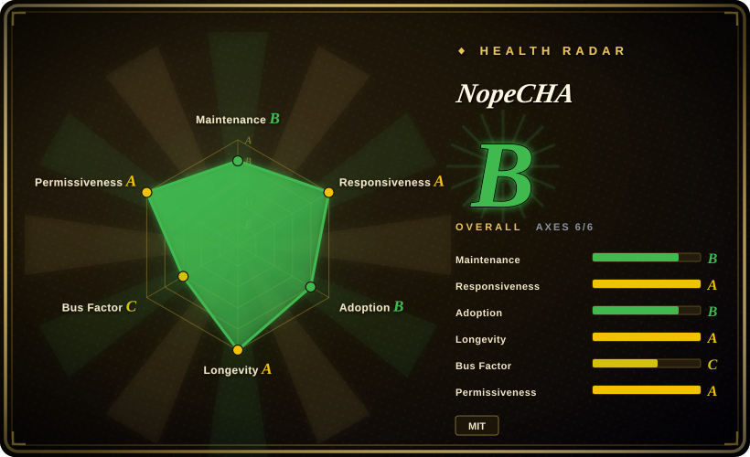
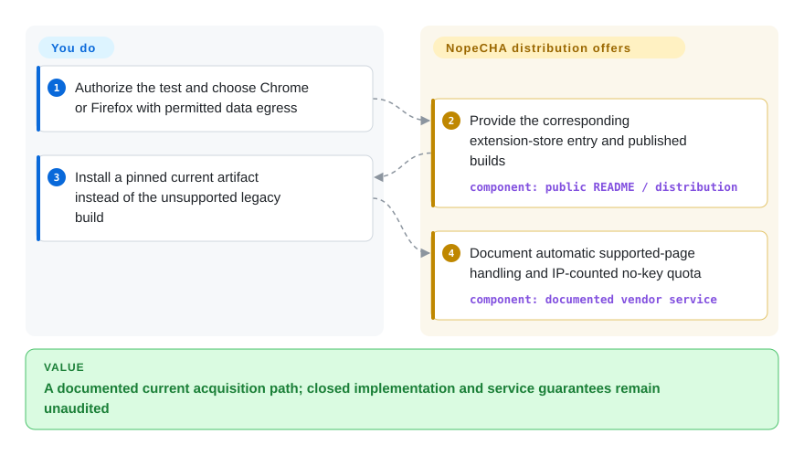
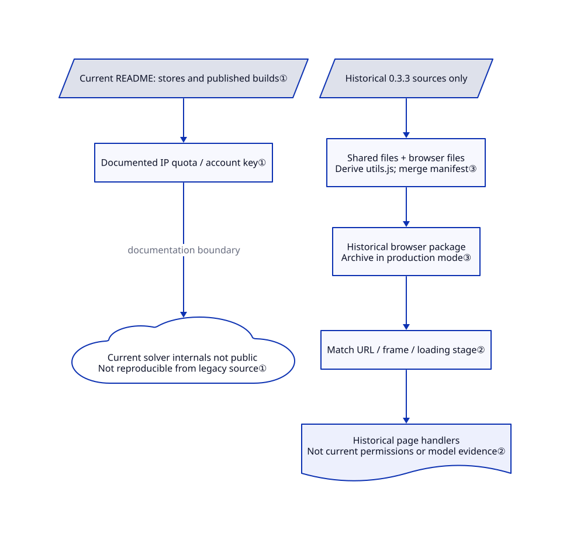

# NopeCHA

Your authorized browser test encounters several CAPTCHA families that need separate integrations; NopeCHA offers one hosted-service extension, but its current implementation is closed and cannot be rebuilt from this repository.

The current product is not an auditable open-source extension. The retained MIT repository and historical 0.3.3 source do not establish the license or implementation of current binaries.

## When to use

You're an automation engineer testing your own application or an explicitly authorized staging environment, and the test journey includes several CAPTCHA families that cannot be represented adequately by a static fixture. You want one extension that can be loaded into Chrome, Firefox, Selenium, Puppeteer, or another Chromium automation setup, rather than integrating a different solver for every challenge type. NopeCHA detects supported challenges in the browser and sends solving work to the hosted NopeCHA API.

You choose it over Buster when unattended multi-family automation matters more than local auditability or human-triggered accessibility. That choice is valid only when the system owner has authorized the test, external API processing is acceptable, and your test plan tolerates changing success rates, quotas, and service availability.

## When NOT to use

- **You do not own the target and lack explicit authorization.** Do not use NopeCHA or another solver to evade a third party's access control; use the site's official API, provider test keys, or an owner-provided test environment instead.
- **You need the current implementation to be open source and auditable.** Use Buster for human-triggered reCAPTCHA audio assistance, or build an authorized test fixture with Playwright; NopeCHA's maintained 0.6.x extension source is not present on the default branch.
- **Challenge data cannot leave your environment.** Use provider test keys or local mocks; the README describes a hosted API dependency, not an offline solver.
- **You need deterministic CI rather than live challenge solving.** Use Playwright with mocked verification responses or official CAPTCHA test keys; no solver can promise stable recognition against changing challenges.
- **You only need human accessibility assistance for reCAPTCHA audio.** Use Buster, whose interaction model is a user-triggered audio challenge flow rather than a broad unattended solving service.
- **You need a source-level library integration instead of a browser-wide extension.** Use a provider SDK such as 2captcha-python only within the same authorization boundary, and accept its separate service, privacy, and billing tradeoffs.

## Comparison

| Alternative | In index | Our verdict | Tradeoff |
|---|---|---|---|
| [Buster](buster.md) | ✅ | Choose Buster for a human-triggered, source-auditable reCAPTCHA audio aid; choose NopeCHA only for authorized unattended coverage across several CAPTCHA families. | Buster is narrower and may use local or remote speech recognition, while NopeCHA offers broader automation through a closed hosted service. |
| 2captcha-python | not indexed | Choose 2captcha-python when a Python program needs an explicit API client rather than a browser extension; choose NopeCHA when browser-side detection and interaction are the deciding needs. | Both depend on external solving services; the integration surface, pricing, data handling, and supported challenges differ. |
| [Text_select_captcha](text-select-captcha.md) | ✅ | Choose Text_select_captcha for an authorized, local Chinese click-to-select pipeline; choose NopeCHA when several browser CAPTCHA families must be handled by one service. | Text_select_captcha is local and specialized but has no license grant; NopeCHA is broader but its current implementation is closed. |

## Quick start

For an environment you own or have explicit permission to test, use the Chrome or Firefox store link in [README.md:100–118](https://github.com/NopeCHALLC/nopecha-extension/blob/5b198e1c256afddfc6ae4b01544d357e79ee4544/README.md#L100-L118), or select a pinned release artifact. Keep stable 0.6.1 separate from the newer 0.6.2-rc.2 prerelease; the historical 0.3.3 build is not the maintained installation path. The README says installing the extension enables automatic handling on supported pages, with up to 100 no-key requests per day counted by IP; these are vendor terms, not independently verified service guarantees. For an automated-browser integration, follow its linked documentation rather than inventing current flags from the legacy source. You supply authorization, browser isolation, allowed data egress and any paid account quota; the vendor supplies the current binary and hosted recognition, whose internals have no source available here.

<!-- flow-steps:begin (generated from flows/nopecha-extension.json by tools/flow_card.py — do not edit) -->

Text version of the flow

1. **You**: Authorize the test and choose Chrome or Firefox with permitted data egress
2. **NopeCHA**: Provide the corresponding extension-store entry and published builds — component: `public README / distribution`
3. **You**: Install a pinned current artifact instead of the unsupported legacy build
4. **NopeCHA**: Document automatic supported-page handling and IP-counted no-key quota — component: `documented vendor service`

**Value**: A documented current acquisition path; closed implementation and service guarantees remain unaudited

<!-- flow-steps:end -->

## Key techniques

<!-- mechanism:begin (generated from mechanisms/nopecha-extension.json by tools/mechanism_card.py; do not edit) -->

Text version of the mechanism

- Current README: stores and published builds①
- Documented IP quota / account key①
- Current solver internals not public Not reproducible from legacy source①
- Historical 0.3.3 sources only
- Shared files + browser files Derive utils.js; merge manifest③
- Historical browser package Archive in production mode③
- Match URL / frame / loading stage②
- Historical page handlers Not current permissions or model evidence②

- Current README: stores and published builds① → Documented IP quota / account key①
- Documented IP quota / account key① → Current solver internals not public Not reproducible from legacy source① (documentation boundary)
- Historical 0.3.3 sources only → Shared files + browser files Derive utils.js; merge manifest③
- Shared files + browser files Derive utils.js; merge manifest③ → Historical browser package Archive in production mode③
- Historical browser package Archive in production mode③ → Match URL / frame / loading stage②
- Match URL / frame / loading stage② → Historical page handlers Not current permissions or model evidence②

<!-- mechanism:end -->

### 1. Current product: distribute builds instead of exposing the solver

- **Problem:** The public repository is an acquisition route, not the current extension's implementation.
- **How:** The README links Chrome/Firefox stores and published builds, describing up to 100 no-key requests daily counted by IP, with account keys for higher quotas. Its closed-source notice explicitly separates current distribution from the unsupported 0.3.x archive.
- **Limits:** No public current source is available for detection, models or online reinforcement learning, the claimed learning from service interactions; no such internals are inferred here. These documented vendor terms are not a verified quota or service guarantee, and the retained MIT repository does not establish current-binary licensing.
- **Source:** No public current implementation; [README.md:84–118](https://github.com/NopeCHALLC/nopecha-extension/blob/5b198e1c256afddfc6ae4b01544d357e79ee4544/README.md#L84-L118), [closed-source notice:160–173](https://github.com/NopeCHALLC/nopecha-extension/blob/5b198e1c256afddfc6ae4b01544d357e79ee4544/README.md#L160-L173).

### 2. Historical 0.3.3 only: inject handlers by page family and timing

- **Problem:** Different challenge providers place their widgets in different embedded page frames and need handlers at different loading stages.
- **How:** The old manifest matches provider URL patterns, declares all-frame injection where configured, and starts selected scripts at document start or document end. The extension is thus a set of browser-page handlers rather than one in-process API.
- **Limits:** Some patterns cover all URLs, creating broad page access; individual entries still differ in frame scope. These are historical manifest facts, not evidence of current 0.6.x permissions or recognition internals.
- **Source:** Historical 0.3.3 [manifest.base.json:3–100](https://github.com/NopeCHALLC/nopecha-extension/blob/6d97479a82a9792b3b6741e751964867523d66a5/manifest.base.json#L3-L100).

### 3. Historical 0.3.3 only: derive browser packages from shared files

- **Problem:** Separate Chrome and Firefox packages can drift when their utility code is maintained twice.
- **How:** The old build reads a base manifest and copies shared plus browser-specific files; it derives `utils.js` from `utils.mjs` by removing module exports. It then merges browser permissions, writes the manifest and, in production mode, creates an archive.
- **Limits:** This synchronizes the historical utility variants only; it cannot reproducibly build the current closed extension. The diagram's historical packaging and injection branch is not connected to the current-product branch.
- **Source:** Historical 0.3.3 [build.py:153–250](https://github.com/NopeCHALLC/nopecha-extension/blob/6d97479a82a9792b3b6741e751964867523d66a5/build.py#L153-L250).

## Tech stack

- **Current distribution:** prebuilt Chromium and Firefox extension archives published as GitHub release assets and through browser stores.
- **Hosted backend:** the browser extension calls the NopeCHA API for multimodal CAPTCHA solving; the current server and model implementation are not in this repository.
- **Legacy open-source branch:** `legacy-oss` contains JavaScript WebExtension content scripts for reCAPTCHA, hCaptcha, FunCaptcha, AWS WAF, and text challenges, plus a Python build script.
- **Browser permissions:** the legacy Manifest V3 build requests broad host access and injects content scripts into challenge frames; current 0.6.x permissions must be checked from the distributed package.

## Dependencies

- Chrome, Chromium, or Firefox, with the extension installed from a store or release archive.
- Network access to the hosted NopeCHA API; higher quotas and some features require a NopeCHA account and API key.
- Selenium, Puppeteer, or Playwright is optional and supplied by the surrounding automation workflow, not by this repository.
- The target's owner authorization, test credentials, and provider-approved test configuration remain operational prerequisites.

## Ops difficulty

**Low to install, medium to depend on.** Loading the extension is simple, but production test reliability depends on a third-party API, changing CAPTCHA implementations, quotas, extension-store or release updates, and browser permissions. Pin the extension artifact, isolate it in a test browser profile, restrict target hosts where possible, and keep a deterministic mock path for CI. Treat solve failures as an expected branch rather than proof that the target is unavailable.

## Health & viability

- **Measured signals (2026-10-14):** B/A/B/A/C/A, overall B with 6/6 axes scored; no unknown axes. The A license signal comes from this repository's MIT file, not a legal finding about the closed binary.
- **Maintenance:** the main branch was updated in 2026-10; stable 0.6.1 was published on 2026-06-11 and prerelease 0.6.2-rc.2 on 2026-08-20. This measures public distribution activity, not visibility into private development.
- **Governance:** the repository is User-owned and the service roadmap is controlled by NopeCHA; users cannot independently maintain the current extension implementation from the default branch.
- **Age and Lindy:** the repository is about three years old and still releasing, which is a modest positive signal, but the 2023 closed-source transition weakens the open-source durability case.
- **Adoption:** 11033 stars and measured release downloads indicate attention and acquisition, not accuracy, authorization or service continuity.
- **Risk flags:** closed current source, hosted-service dependency, broad browser access, uncertain current-binary license boundary, and an adversarial domain where challenge support can regress without notice.

## Caveats (unverified)

- [未验证：当前实现无源码可查] Current 0.6.x detection, models, network processing and RL cannot be audited or reproduced here. Public README claims and historical 0.3.3 packaging are not current implementation evidence.
- [未验证] The repository's MIT LICENSE was read, but its applicability to current closed-source 0.6.x binaries and hosted service components is unclear; obtain maintainer clarification before redistribution or embedding.
- [未验证] Supported challenge lists, free quotas, pricing, retention, and data-processing behavior can change outside this repository.
- [未验证] Recognition, solving success, and resistance to challenge changes have no independently verified service level; the README's performance claims were not independently benchmarked.
- [未验证：未下载或运行闭源产物] Store/release permissions, actual data destinations, quota enforcement and browser behavior were not tested. The vendor's 100-request allowance is dated documentation, not a benchmark or SLA.
- [推断：默认分支无实现，历史源码为JavaScript] `language: JavaScript` records the historical extension language, not a confirmed current binary language; GitHub reports null for main.
- [推断] Legal use depends on target ownership, explicit authorization, provider terms, and local law; this page is selection guidance, not legal advice.
