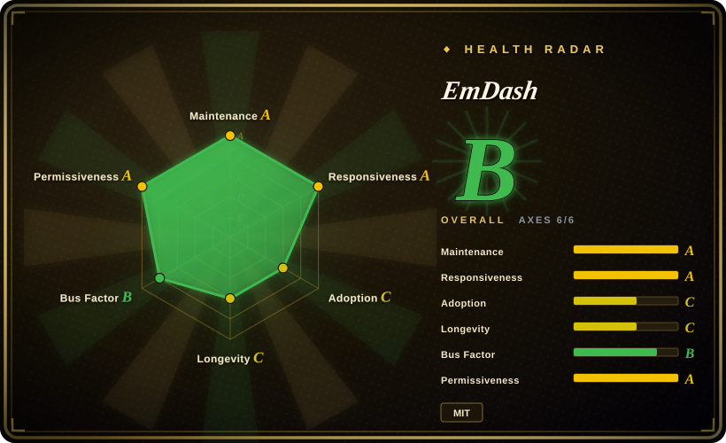
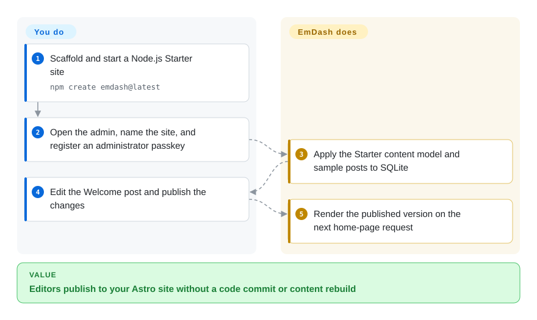
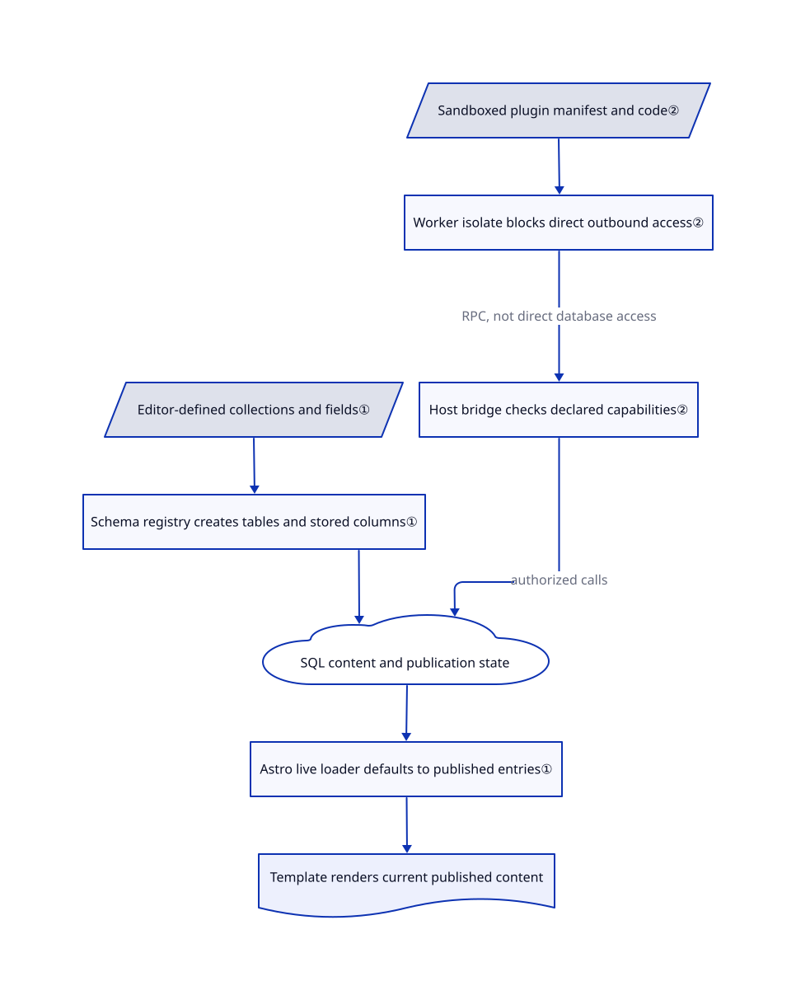

# EmDash

Your Astro site's editors need to publish without committing Markdown, but moving to WordPress would replace your templates and add PHP. EmDash adds an editing dashboard and live database-backed content inside the Astro site.

## When to use

You maintain a publication or marketing site in Astro. Every title correction currently becomes a Git pull request and a rebuild, while editors need drafts, media uploads, and a Publish button. Choose EmDash when you want those editorial tools in the same application as your Astro routes, rather than operating a separate headless backend or rewriting the site around WordPress. Editors can define collections in the dashboard; your templates query published content at request time.

It also fits a deliberate WordPress content migration when you can rebuild the theme and audit imported blocks. Its importer converts Gutenberg content into Portable Text, a JSON representation of rich text that templates render separately. The deciding tradeoff is retaining TypeScript and Astro while taking on a younger CMS and a migration project, not gaining compatibility with existing PHP plugins.

## When NOT to use

- **An existing WordPress theme, shortcode, or business-critical plugin must keep working unchanged.** Stay with [WordPress](https://github.com/WordPress/WordPress). EmDash imports content, not executable PHP; its migration guide warns that dynamic Gutenberg blocks can import as comments that render nothing. WXR imports do not reconstruct scheduled dates or every custom-meta value.
- **The CMS must live inside an existing Next.js application.** Choose [Payload](https://github.com/payloadcms/payload), whose integration runs in that application's `/app` directory. EmDash is an Astro integration, so adopting it introduces another application framework rather than extending Next.js.
- **Developers already own all content in Git and only need a static blog.** Use [Astro alone](../web-ui/frameworks/site-frameworks/astro.md). Adding EmDash introduces a writable database, admin authentication, backups, and a server-rendered deployment that a static build does not require.
- **The requirement is “every extension has hard CPU and memory quotas at no extra infrastructure cost.”** Do not treat EmDash as that guarantee; choose Astro without runtime extensions if you can compile the needed features. Cloudflare sandboxed plugins require Workers Paid and a Worker Loader binding; Node's workerd runner enforces wall time, not CPU, memory, or subrequest quotas. Native plugins and Node's debugging option `sandbox: false` run without that isolation.

## Comparison

| Alternative | In index | Our verdict | Tradeoff |
|---|---|---|---|
| [WordPress](https://github.com/WordPress/WordPress) | not indexed | Keep WordPress when PHP plugins and the installed theme are part of the product; choose EmDash when rebuilding the presentation in Astro is acceptable. | WordPress preserves the existing runtime ecosystem; EmDash replaces it with TypeScript and structured content. WordPress is not added in this tab batch. |
| [Payload](https://github.com/payloadcms/payload) | not indexed | Choose Payload when the editorial backend must share an existing Next.js application; choose EmDash when Astro is the framework you intend to retain. | Payload provides a Next.js-native CMS; switching an Astro site to that integration changes its framework rather than adding an Astro dashboard. Payload is not added in this tab batch. |
| [Astro](../web-ui/frameworks/site-frameworks/astro.md) | ✅ | Choose Astro alone for Git-authored content and static hosting; add EmDash when editors need database-backed publishing without a rebuild. | Astro alone removes the CMS database and admin service; EmDash supplies editorial workflows but requires operating persistent state. |

## Quick start

Follow the [first-site tutorial](https://github.com/emdash-cms/emdash/blob/333abdeae27093db6ef9df9ecb8ae26eeea8dde6/docs/src/content/docs/getting-started.mdx) with Node.js 22.22 or later. Run `npm create emdash@latest`, choose Node.js and the Starter template, install dependencies, then enter the generated directory and run `npm run dev`. Open `http://localhost:4321/_emdash/admin/`, set the site title and administrator email, and register a passkey — a browser-managed sign-in credential. EmDash applies the starter content model to SQLite; you edit the Welcome post and select Publish changes, and the template reads the published version on the next page load. You own custom templates, deployment, database and upload backups, and a separate recovery copy of `EMDASH_ENCRYPTION_KEY`; the CMS supplies the editor, content APIs, and publication state.

<!-- flow-steps:begin (generated from flows/emdash.json by tools/flow_card.py — do not edit) -->

Text version of the flow

1. **You**: Scaffold and start a Node.js Starter site — `npm create emdash@latest`
2. **You**: Open the admin, name the site, and register an administrator passkey
3. **EmDash**: Apply the Starter content model and sample posts to SQLite
4. **You**: Edit the Welcome post and publish the changes
5. **EmDash**: Render the published version on the next home-page request

**Value**: Editors publish to your Astro site without a code commit or content rebuild

<!-- flow-steps:end -->

## Key techniques

<!-- mechanism:begin (generated from mechanisms/emdash.json by tools/mechanism_card.py; do not edit) -->

Text version of the mechanism

- Editor-defined collections and fields①
- Schema registry creates tables and stored columns①
- SQL content and publication state
- Astro live loader defaults to published entries①
- Template renders current published content
- Sandboxed plugin manifest and code②
- Worker isolate blocks direct outbound access②
- Host bridge checks declared capabilities②

- Editor-defined collections and fields① → Schema registry creates tables and stored columns①
- Schema registry creates tables and stored columns① → SQL content and publication state
- SQL content and publication state → Astro live loader defaults to published entries①
- Astro live loader defaults to published entries① → Template renders current published content
- Sandboxed plugin manifest and code② → Worker isolate blocks direct outbound access②
- Worker isolate blocks direct outbound access② → Host bridge checks declared capabilities② (RPC, not direct database access)
- Host bridge checks declared capabilities② → SQL content and publication state (authorized calls)

<!-- mechanism:end -->

### 1. Materialize editable collections as SQL tables, then read them live

- **Problem:** A file-only content model makes every new editor-defined field a developer change and a site rebuild.
- **How:** The schema registry records collection definitions and creates per-collection SQL tables. Adding a stored field adds a typed column and refreshes generated types; the Astro live loader queries that table with published status as its default.
- **Limits:** Not every field has a column: relation-backed fields can use side tables. D1 cannot roll back the whole schema operation, so failed column creation needs explicit metadata cleanup; live queries still need an available database and correctly managed page caches.
- **Source:** [Collection creation](https://github.com/emdash-cms/emdash/blob/333abdeae27093db6ef9df9ecb8ae26eeea8dde6/packages/core/src/schema/registry.ts#L517-L629), [field creation and compensation](https://github.com/emdash-cms/emdash/blob/333abdeae27093db6ef9df9ecb8ae26eeea8dde6/packages/core/src/schema/registry.ts#L1284-L1428), [live loader](https://github.com/emdash-cms/emdash/blob/333abdeae27093db6ef9df9ecb8ae26eeea8dde6/packages/core/src/loader.ts#L1764-L1799).

### 2. Put plugin authority behind an isolate and a capability bridge

- **Problem:** Loading an extension in the CMS process gives it the process's authority over site data and secrets.
- **How:** The Cloudflare runner creates a Worker isolate with direct outbound access disabled and only a bridge binding. That bridge receives the plugin's declared capabilities and permitted hosts; its APIs reject missing capabilities before accessing host resources. Node deployments can instead run plugins in a workerd child process.
- **Limits:** This boundary applies to sandboxed plugins, not native plugins. Grants are coarse: content-write access is not limited to entries the plugin created. Cloudflare CPU/subrequest limits differ from Node's wall-time-only enforcement, and per-plugin memory limits are not enforced by either runner.
- **Source:** [Worker creation and bindings](https://github.com/emdash-cms/emdash/blob/333abdeae27093db6ef9df9ecb8ae26eeea8dde6/packages/cloudflare/src/sandbox/runner.ts#L349-L405), [bridge checks](https://github.com/emdash-cms/emdash/blob/333abdeae27093db6ef9df9ecb8ae26eeea8dde6/packages/cloudflare/src/sandbox/bridge.ts#L424-L435), [capability boundaries](https://github.com/emdash-cms/emdash/blob/333abdeae27093db6ef9df9ecb8ae26eeea8dde6/docs/src/content/docs/plugins/creating-plugins/capabilities.mdx#L234-L279), [runner setup](https://github.com/emdash-cms/emdash/blob/333abdeae27093db6ef9df9ecb8ae26eeea8dde6/docs/src/content/docs/deployment/plugin-sandbox.mdx).

## Tech stack

- TypeScript pnpm monorepo; Astro integration and server-rendered routes, React admin UI, TipTap editor, and Portable Text storage.
- Kysely SQL abstraction; SQLite, Cloudflare D1, libSQL/Turso, and PostgreSQL adapters. Local filesystem, R2, and S3-compatible media storage.
- WebAuthn passkeys, OAuth integrations, REST APIs, CLI, and a built-in Model Context Protocol server for AI tool access. The core manifest includes the MCP SDK; no model provider is required for ordinary publishing.

## Dependencies

- **Node deployment:** follow the current guide's Node.js 22.22+ requirement, an Astro server adapter, React integration, and a persistent database. The package manifest's broader Node floor is 22.16; do not use it to override the newer tutorial requirement.
- **Durable state:** the single-server path uses SQLite plus a writable upload directory. Several instances should share a remote database and suitable shared media storage, rather than independent local files.
- **Cloudflare deployment:** Workers, D1 and R2 for the documented default. Sandboxed plugins additionally require Workers Paid, `LOADER`, and an exported `PluginBridge`; the documented Cloudflare bridge uses D1 directly and is unavailable with Hyperdrive.
- **Optional sandbox on Node:** `@emdash-cms/sandbox-workerd` and the platform-specific `workerd` binary. Preserve `EMDASH_ENCRYPTION_KEY` separately from the database to recover encrypted plugin settings.

## Ops difficulty

**Medium.** A local Node/SQLite starter needs no cloud account, but production includes identity, mutable content, media, encryption keys, migrations, and optional plugin subprocesses. The [Node deployment guide](https://github.com/emdash-cms/emdash/blob/333abdeae27093db6ef9df9ecb8ae26eeea8dde6/docs/src/content/docs/deployment/nodejs.mdx) requires checks of public pages, migration state, editor publishing, uploads, and plugin execution; an Astro-only `/health` response proves none of those dependencies. Version 1.3.1's release notes specifically require CLI application of large pending content migrations on Workers rather than assuming the first request can finish them. Keep a rollback copy during WordPress cutover and inspect dynamic blocks, drafts, URLs, and media before switching traffic.

## Health & viability

- **Maintenance, checked 2026-10-21:** the repository is not archived and received pushes on the verification date. Core releases 1.3.0 on October 15 and 1.3.1 on October 18 show current delivery; the README commits the core packages to semantic versioning while first-party plugins and plugin tooling remain on 0.x.
- **Governance and backing:** [GOVERNANCE.md](https://github.com/emdash-cms/emdash/blob/333abdeae27093db6ef9df9ecb8ae26eeea8dde6/GOVERNANCE.md) names Matt Kane as Project Lead and five human Maintainers. Cloudflare appoints the lead, who holds final authority after consultation. This is vendor-led governance, not an independent foundation; the MIT license credits Cloudflare Inc.
- **Durability verdict:** [推断：based on repository creation, recent releases, and the published governance] suitable for an Astro-led pilot with explicit backups and upgrade acceptance tests, not yet a long-history durability bet. The repository was created on 2026-04-01, about seven months before verification; active development and multiple maintainers do not create years of operational history.
- **Adoption and risk:** 13,857 stars are attention, not an audited deployment count. The tree includes unit and browser/end-to-end tests, but this intake did not run them. The 1.3.1 [release](https://github.com/emdash-cms/emdash/releases/tag/emdash%401.3.1) fixes unpublished-content visibility and migration-related empty pages, so security and upgrade testing remain material selection costs. [SECURITY.md](https://github.com/emdash-cms/emdash/blob/333abdeae27093db6ef9df9ecb8ae26eeea8dde6/SECURITY.md) asks for private reports against current main and latest packages.

## Caveats (unverified)

- [未验证：upstream installation and execution were outside this read-only intake] The documented setup, publish path, WordPress conversion fidelity, and sandbox behavior were checked against source and docs, not exercised on a deployed site. No performance, isolation audit, or workload capacity is claimed.
- [推断：the viability verdict uses dated release, age, and governance evidence, not a longitudinal deployment study] A backed and active seven-month-old CMS can support a pilot; long-term maintenance and site-specific upgrade effort remain unproven.
